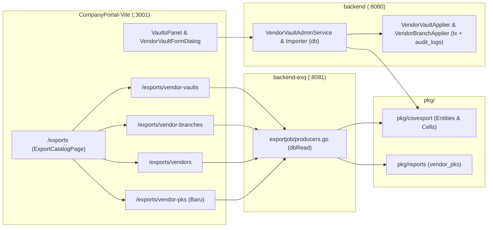

# Design: Penyesuaian Export & Skema Vendor Vaults, Vendor Branches, Vendors, dan Menu Export PKS (`vendor-vaults-export-revamp`)

> Status: accepted 2026-11-11 (user)

## 1. Ringkasan Arsitektur & Area Kritis

> [!IMPORTANT]
> **Area Kritis (Gate Manusia Wajib)**:
> 1. **Migrasi Skema Database (`040_vendor_vaults_revamp.sql`)**:
>    - Pada `vendor_vaults`: rename `min_capacity_amount` → `min_balance` dan `max_capacity_amount` → `max_balance`; tambah `vault_name`, `alamat`, `cis_limit_amount`, `cis_limit_currency`, `escrow_cash`, `escrow_atm`; hapus `escrow_account`.
>    - Pada `vendor_branches`: pindahkan nilai `cis_limit_amount` & `cis_limit_currency` ke `vendor_vaults`, lalu hapus kedua kolom tersebut dari `vendor_branches`.
> 2. **Tipe Data Uang (`numeric(20,2)`)**: Seluruh field nominal (`min_balance`, `max_balance`, `cis_limit_amount`) menggunakan `numeric(20,2)` di PostgreSQL dan string desimal di Go/TypeScript (tanpa `float`).
> 3. **Maker-Checker & Audit**: Seluruh mutasi melalui Form Admin UI (`VendorVaultFormDialog`, `VendorBranchFormDialog`) maupun CSV Import wajib melewati `MasterDataChangeService.Submit` (`202 Accepted`) → `Applier` dengan pencatatan `audit_logs` dalam transaksi database yang sama.



---

## 2. Desain Model Data & Migrasi (`backend/migrations/040_vendor_vaults_revamp.sql`)

### 2.1 Perubahan Tabel `public.vendor_vaults` & `public.vendor_branches`
Migrasi forward-only dalam satu transaksi (`BEGIN ... COMMIT`):

1. **Rename Kolom Kapasitas di `vendor_vaults`**:
   ```sql
   ALTER TABLE public.vendor_vaults
     RENAME COLUMN min_capacity_amount TO min_balance;
   ALTER TABLE public.vendor_vaults
     RENAME COLUMN max_capacity_amount TO max_balance;
   ```
2. **Tambah Kolom `vault_name` & `alamat` di `vendor_vaults`**:
   - `vault_name text NULL` (di-backfill lalu di-set `NOT NULL`).
   - `alamat text NULL`.
   - **Aturan Backfill `vault_name`** untuk baris eksisting yang belum memiliki `vault_name`:
     Format: `<vendorPrefix>_<area>_V<3-digit-seq>` (contoh: `ABA_Bali_V001`), di mana:
     - `<vendorPrefix>`: `vendors.request_prefix` (mis. `ABA`, `ADV`, `TAG`, `SSI`, `BJK`, `ROH`, `BRK`, `KJR`, `PSG`).
     - `<area>`: Nama area cabang tanpa prefix nama vendor (`regexp_replace(b.branch_name, '^' || v.name || '\s+', '', 'i')`, spasi diganti `_`).
     - `<3-digit-seq>`: Nomor urut 3 digit per cabang mulai dari `001` (`lpad(row_number() OVER (PARTITION BY vl.vendor_branch_id ORDER BY vl.id)::text, 3, '0')`).
3. **Pindahkan `cis_limit_amount` & `cis_limit_currency` dari `vendor_branches` ke `vendor_vaults`**:
   ```sql
   ALTER TABLE public.vendor_vaults
     ADD COLUMN cis_limit_amount numeric(20,2) NULL,
     ADD COLUMN cis_limit_currency character(3) NOT NULL DEFAULT 'IDR',
     ADD CONSTRAINT vendor_vaults_cis_limit_amount_chk CHECK (cis_limit_amount > 0);

   UPDATE public.vendor_vaults vl
   SET cis_limit_amount = b.cis_limit_amount,
       cis_limit_currency = b.cis_limit_currency
   FROM public.vendor_branches b
   WHERE b.id = vl.vendor_branch_id
     AND b.cis_limit_amount IS NOT NULL;

   ALTER TABLE public.vendor_branches
     DROP CONSTRAINT IF EXISTS vendor_branches_cis_limit_amount_chk,
     DROP COLUMN IF EXISTS cis_limit_currency,
     DROP COLUMN IF EXISTS cis_limit_amount;
   ```
4. **Ganti `escrow_account` menjadi `escrow_cash` & `escrow_atm` di `vendor_vaults`**:
   ```sql
   ALTER TABLE public.vendor_vaults
     ADD COLUMN escrow_cash text NULL CONSTRAINT vendor_vaults_escrow_cash_chk CHECK (escrow_cash ~ '^[0-9]{12}$'),
     ADD COLUMN escrow_atm  text NULL CONSTRAINT vendor_vaults_escrow_atm_chk  CHECK (escrow_atm ~ '^[0-9]{12}$');

   UPDATE public.vendor_vaults
   SET escrow_cash = CASE WHEN category IN ('CASH', 'ATM_CASH') THEN escrow_account ELSE NULL END,
       escrow_atm  = CASE WHEN category IN ('ATM', 'ATM_CASH')  THEN escrow_account ELSE NULL END
   WHERE escrow_account IS NOT NULL;

   ALTER TABLE public.vendor_vaults
     DROP CONSTRAINT IF EXISTS vendor_vaults_escrow_account_chk,
     DROP COLUMN IF EXISTS escrow_account;
   ```

---

## 3. Kontrak CSV & Tabel Pratinjau (`pkg/csvexport`, `pkg/reports`, & `datasets.ts`)

### 3.1 `/exports/vendor-vaults` (14 Kolom — Urutan Sesuai A1)
| # | Header Kolom | Sumber Data (`ExportVendorVaultsBatch`) | Tipe / Penjajaran UI |
| :--- | :--- | :--- | :--- |
| 1 | `no` | Nomor urut baris (`row_number` / urutan emisi 1..N) | `numericColumns` (rata kanan) |
| 2 | `branch_name` | `vendor_branches.branch_name` | Text |
| 3 | `vault_name` | `vendor_vaults.vault_name` (format `ABA_Bali_V001`) | Text |
| 4 | `category` | `vendor_vaults.category` (`ATM` \| `CASH` \| `ATM_CASH`) | Text |
| 5 | `operating_hours` | `COALESCE(vl.operating_hours, '')` | Text |
| 6 | `currency_code` | `COALESCE(vl.currency_code, '')` | Text |
| 7 | `region` | `COALESCE(b.region, '')` (JOIN `vendor_branches`) | Text (read-only dari cabang) |
| 8 | `alamat` | `COALESCE(vl.alamat, '')` | Text |
| 9 | `min_balance` | `COALESCE(vl.min_balance::text, '')` | `numericColumns` + `moneyColumns` |
| 10 | `max_balance` | `COALESCE(vl.max_balance::text, '')` | `numericColumns` + `moneyColumns` |
| 11 | `cis_limit_amount` | `COALESCE(vl.cis_limit_amount::text, '')` | `numericColumns` + `moneyColumns` |
| 12 | `escrow_cash` | `COALESCE(vl.escrow_cash, '')` | Text (12 digit) |
| 13 | `escrow_atm` | `COALESCE(vl.escrow_atm, '')` | Text (12 digit) |
| 14 | `is_active` | `vl.is_active` | Boolean badge (`Aktif` / `Nonaktif`) |

*(Kolom `id`, `vendor_code`, `branch_code`, `location_id`, `latitude`, `longitude` tidak disertakan).*

### 3.2 `/exports/vendor-branches` (9 Kolom — Tanpa `cis_limit_amount`)
- Header: `id`, `vendor_code`, `branch_code`, `branch_name`, `region`, `region_code`, `category`, `location_id`, `is_active`.
- `LegacyHeaders` tetap mendukung file CSV lama yang masih memiliki `cis_limit_amount` (diabaikan saat import cabang).

### 3.3 `/exports/vendors` (7 Kolom — Tanpa `id`, `code`, Direktur, & PKS)
- Header: `name`, `legal_name`, `npwp`, `contact_email`, `contact_phone`, `hq_address`, `is_active`.
- `ReadOnlyColumns` pada `Vendors` dikosongkan (`nil`).
- `LegacyHeaders` tetap mendukung file CSV lama yang masih memiliki `id` dan `code`.

### 3.4 Menu Dataset Baru: `/exports/vendor-pks` (11 Kolom)
- Ditambahkan ke katalog `EXPORT_DATASETS` di `frontend/CompanyPortal-Vite/src/features/exports/datasets.ts`:
  - `id: "vendor-pks"`
  - `group: "master"`
  - `label: "PKS vendor"`
  - `description: "Data Direktur Utama dan Perjanjian Kerja Sama (PKS) aktif per vendor."`
  - `filters: { vendor: "optional", branch: false, priceLevel: false }`
  - `numericColumns: ["pks_validity_months", "pks_remaining_days"]`
- Header & Kolom (`/exports/vendor-pks`):
  `vendor_code`, `vendor_name`, `director_name`, `director_phone`, `director_email`, `pks_name`, `pks_effective_date`, `pks_expiry_date`, `pks_validity_months`, `pks_remaining_days`, `pks_status`.
- Di `backend-exq/internal/exportjob/producers.go`, `vendor-pks` didaftarkan sebagai `PreviewProducer` pada `KindMasterDataGlobal` dan `KindVendor` (sehingga mendukung tabel pratinjau `/exports/vendor-pks` sekaligus unduhan CSV).

---

## 4. Desain Layer Backend (`backend/` & `backend-exq/`)

### 4.1 SQL Queries (`backend/queries/`)
1. `backend/queries/master_data_export.sql`:
   - `ExportVendorVaultsBatch`: mengambil `vl.id`, `b.branch_name`, `vl.vault_name`, `vl.category`, `vl.operating_hours`, `vl.currency_code`, `b.region`, `vl.alamat`, `vl.min_balance`, `vl.max_balance`, `vl.cis_limit_amount`, `vl.escrow_cash`, `vl.escrow_atm`, `vl.is_active`.
   - `ExportVendorBranchesBatch`: menghapus proyeksi `b.cis_limit_amount`.
   - `ExportVendorsBatch`: dipakai untuk `/exports/vendors` (tanpa join PKS), sedangkan query PKS dipakai oleh producer `vendor-pks`.
2. `backend/queries/vendor_vaults_admin.sql`:
   - Memperbarui `ListVendorVaultsAdmin`, `GetVendorVaultAdminByID`, `CreateVendorVaultAdmin`, `UpdateVendorVaultAdmin` untuk menyertakan `vault_name`, `alamat`, `min_balance`, `max_balance`, `cis_limit_amount`, `cis_limit_currency`, `escrow_cash`, `escrow_atm`, serta `b.region` pada query baca.
3. `backend/queries/vendor_branches_admin.sql`:
   - Menghapus `cis_limit_amount` & `cis_limit_currency` dari query baca, create, dan update cabang.
4. Regenerasi `sqlc generate` di `backend/` dan `backend-exq/` (serta pastikan anomali `UserLeafe` → `UserLeave` diperbaiki).

### 4.2 Service, Maker-Checker Applier, & Handler (`backend/internal/`)
1. **`VendorVaultAdminService` & `VendorVaultApplier`**:
   - Payload `VendorVaultUpdatePayload` & DTO `VendorVault`:
     - `VaultName *string` (jika kosong saat create, digenerate otomatis dengan format `<vendorPrefix>_<area>_V<3-digit>`)
     - `Alamat *string`
     - `MinBalance *string` (`numeric(20,2)`)
     - `MaxBalance *string` (`numeric(20,2)`)
     - `CisLimitAmount *string` (`numeric(20,2) > 0`)
     - `EscrowCash *string` (`^[0-9]{12}$`)
     - `EscrowAtm *string` (`^[0-9]{12}$`)
   - Validasi dilakukan saat `Submit` **dan** saat `Apply` di dalam transaksi maker-checker.
2. **`VendorBranchAdminService` & `VendorBranchApplier`**:
   - Menghapus `CisLimitAmount` dan `CisLimitCurrency` dari payload/DTO cabang.
3. **CSV Importer (`masterdata_import*.go`)**:
   - `vendor-vaults`: membaca 14 kolom baru (`no` & `region` diabaikan sebagai kolom tampilan/derivasi, resolusi cabang melalui `branch_name` dan identifikasi vault melalui `vault_name`), serta mendukung `LegacyHeaders` untuk backward compatibility.
   - `vendors`: membaca 7 kolom baru (resolusi vendor melalui `name`) serta tetap menerima `LegacyHeaders` yang menyertakan `id` dan `code`.

---

## 5. Desain Layer Frontend (`frontend/CompanyPortal-Vite/`)

1. **`src/features/exports/datasets.ts`**:
   - Update `vendor-vaults`: `numericColumns: ["no", "min_balance", "max_balance", "cis_limit_amount"]`, `moneyColumns: ["min_balance", "max_balance", "cis_limit_amount"]`.
   - Update `vendors`: `numericColumns: []`.
   - Tambah dataset `vendor-pks`: `numericColumns: ["pks_validity_months", "pks_remaining_days"]`.
2. **`src/features/admin-vendors/`**:
   - `types.ts` & `vendorVaultFormSchema.ts`: ganti `min_capacity_amount`/`max_capacity_amount` → `min_balance`/`max_balance`, tambah `vault_name`, `alamat`, `cis_limit_amount`, `escrow_cash`, `escrow_atm`, dan hapus input `latitude`/`longitude`/`location_id` pada `VendorVaultFormDialog.tsx`.
   - `VaultsPanel.tsx`: tampilkan `vault_name`, `category`, `region`, `max_balance`, `cis_limit_amount`, `escrow_cash`, `escrow_atm`, `operating_hours`, `status`.
   - Hapus field `cis_limit_amount` dari form/tipe cabang jika ada.

---

## 6. Correctness Properties (Invarian Pengujian)

1. **Property 1 — Keselarasan Kolom Preview & CSV**: Untuk setiap dataset (`vendor-vaults`, `vendor-branches`, `vendors`, `vendor-pks`), `len(row) == len(Header())` dan urutan kolom pada `PreviewProducer.Page()` identik dengan `Producer.Produce()`.
2. **Property 2 — Presisi Uang Tanpa Float**: `min_balance`, `max_balance`, dan `cis_limit_amount` dipertahankan sebagai string desimal eksak dari PostgreSQL `numeric(20,2)` hingga sel CSV dan JSON response.
3. **Property 3 — Validasi Escrow & Limit CIS**: `escrow_cash` dan `escrow_atm` menolak string selain 12 digit angka; `cis_limit_amount` menolak nilai `<= 0` atau skala `> 2` desimal.
4. **Property 4 — Format `vault_name` Otomatis**: Pembuatan vault tanpa `vault_name` menghasilkan `<vendorPrefix>_<area>_V<3-digit>` yang berurutan (`V001`, `V002`, dst.).

---

## 7. Out of Scope
- Perubahan pada `atms.escrow_account`.
- Rekonsiliasi saldo escrow harian SIBS / Corebanking.
