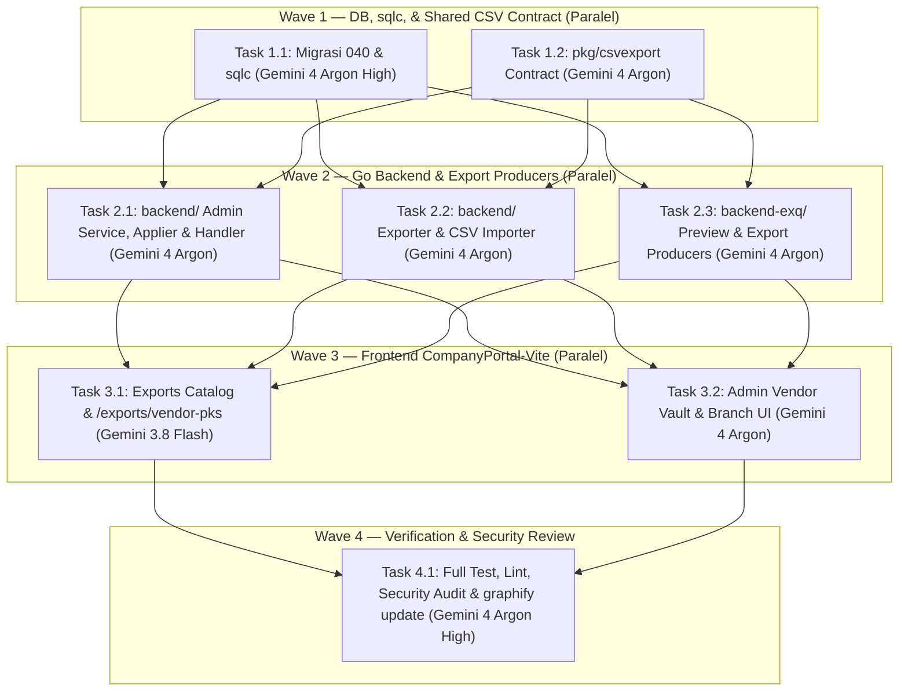

# Tasks: Penyesuaian Export & Skema Vendor Vaults, Vendor Branches, Vendors, dan Menu Export PKS (`vendor-vaults-export-revamp`)

> Status: draft

## Overview

Rencana implementasi terstruktur untuk merestrukturisasi skema dan kolom ekspor/impor **Vendor Vaults** (`/exports/vendor-vaults`), **Vendor Branches** (`/exports/vendor-branches`), **Vendors** (`/exports/vendors`), serta menambahkan menu dataset baru **PKS Vendor** (`/exports/vendor-pks`). Setiap task dirancang dengan cakupan file eksklusif per *Wave* sehingga siap dieksekusi oleh [`cms-orchestrator.md`](../../agents/cms-orchestrator.md) / skill `cms-run-wave`.

## Model Split

Mengacu pada standar pemilihan LLM di [`.agents/specs/gemini-sdlc.md`](../gemini-sdlc.md):

| Model | Keunggulan Utama & Alasan Pemilihan | Daftar Task |
| :--- | :--- | :--- |
| **`Gemini 4 Argon (High)`** | **Deep Reasoning** — Penalaran mendalam & minim halusinasi untuk bedah arsitektur skema DB lintas tabel dan security/financial audit akhir. | `1.1`, `4.1` |
| **`Gemini 4 Argon`** | **Andalan Utama** — Keseimbangan terbaik untuk pembuatan fitur end-to-end dan refactoring lintas banyak file (`pkg/csvexport`, `backend/`, `backend-exq/`, dan form/panel React `admin-vendors`). | `1.2`, `2.1`, `2.2`, `2.3`, `3.2` |
| **`Gemini 3.8 Flash`** | **Tercepat** — Respons instan & ringan untuk edit konfigurasi katalog dataset frontend (`datasets.ts`) beserta unit test sederhana. | `3.1` |

---

## Daftar Task

### Wave 1 — Fondasi Skema Database, `sqlc`, & Kontrak `pkg/csvexport`

- [x] 1.1 Migrasi Skema `040_vendor_vaults_revamp.sql`, Pembaruan Query SQL, & Codegen `sqlc`
  - Buat file migrasi `backend/migrations/040_vendor_vaults_revamp.sql` (rename `min/max_capacity_amount` → `min/max_balance`, tambah & backfill `vault_name` berformat `<vendorPrefix>_<area>_V<3-digit>`, tambah `alamat`, pecah `escrow_account` → `escrow_cash` & `escrow_atm`, pindahkan `cis_limit_amount` & `cis_limit_currency` dari `vendor_branches` ke `vendor_vaults`). *(Catatan: Jangan jalankan `migrate up` tanpa izin eksplisit user).*
  - Perbarui query di `backend/queries/master_data_export.sql`, `backend/queries/vendor_vaults_admin.sql`, dan `backend/queries/vendor_branches_admin.sql`.
  - Jalankan `sqlc generate` (v1.31.1) pada `backend/` dan `backend-exq/`, lalu pastikan anomali `UserLeafe` diubah kembali menjadi `UserLeave` di `backend/internal/db/`.
  - _Files: `backend/migrations/040_vendor_vaults_revamp.sql`, `backend/queries/master_data_export.sql`, `backend/queries/vendor_vaults_admin.sql`, `backend/queries/vendor_branches_admin.sql`, `backend/internal/db/*.go`, `backend-exq/internal/repository/*.sql.go`, `backend-exq/internal/repository/models.go`_
  - _Requirements: R1.1, R1.2, R1.3, R1.4, R1.5, R2.1, R3.1, R5.2_
  - _Model: Gemini 4 Argon (High)_
  - _Skills: db-migration-sqlc, sql-query-tuning_
  - _Agent: db-sqlc-architect.md_

- [x] 1.2 Pembaruan Kontrak Shared CSV (`pkg/csvexport/`)
  - Perbarui header dan row/cell builder di `pkg/csvexport/entities.go`, `pkg/csvexport/cells.go`, dan `pkg/csvexport/csvexport.go`:
    - `VendorVaults`: 14 kolom (`no`, `branch_name`, `vault_name`, `category`, `operating_hours`, `currency_code`, `region`, `alamat`, `min_balance`, `max_balance`, `cis_limit_amount`, `escrow_cash`, `escrow_atm`, `is_active`) beserta `LegacyHeaders`.
    - `VendorBranches`: hapus `cis_limit_amount` dari `Header` utama (pindahkan ke `LegacyHeaders`).
    - `Vendors`: 7 kolom (`name`, `legal_name`, `npwp`, `contact_email`, `contact_phone`, `hq_address`, `is_active`), kosongkan `ReadOnlyColumns`, dan simpan header lama dengan `id` & `code` di `LegacyHeaders`.
    - Tambahkan entitas/konstanta `VendorPks` (`vendor-pks`) pada `exportOnly` untuk pratinjau & ekspor PKS vendor.
  - Perbarui dan jalankan unit/property test di `pkg/csvexport/*_test.go` (`cd pkg && go test ./csvexport/...`).
  - _Files: `pkg/csvexport/entities.go`, `pkg/csvexport/cells.go`, `pkg/csvexport/csvexport.go`, `pkg/csvexport/csvexport_test.go`, `pkg/csvexport/export_header_test.go`, `pkg/csvexport/property_test.go`_
  - _Requirements: R1.1, R1.2, R2.1, R3.1, R4.2, R5.2_
  - _Model: Gemini 4 Argon_
  - _Skills: go-chi-endpoint, cms2-master-data_
  - _Agent: go-backend-specialist.md_

---

### Wave 2 — Layer Backend (`backend/` & `backend-exq/`)

- [x] 2.1 Pembaruan Admin Service, Maker-Checker Applier, Repository, & Handler (`backend/`)
  - Perbarui `backend/internal/repository/vendor_vault_admin_repository.go` dan `master_data_export_repository.go` sesuai signature `sqlc` terbaru.
  - Perbarui `backend/internal/service/vendor_vault_admin.go` dan `backend/internal/handler/admin_vendor_vault_handler.go`:
    - Ganti `min_capacity_amount`/`max_capacity_amount` → `min_balance`/`max_balance`.
    - Tambahkan `vault_name` (auto-generate `<vendorPrefix>_<area>_V<3-digit>` bila kosong saat create), `alamat`, `cis_limit_amount` (`numeric(20,2) > 0`), `escrow_cash` (`^[0-9]{12}$`), dan `escrow_atm` (`^[0-9]{12}$`) pada payload submit, validasi, dan Applier maker-checker.
  - Perbarui `backend/internal/service/vendor_branch_admin.go`, `masterdata_applier_vendor_branch.go`, dan `backend/internal/handler/admin_vendor_branch_handler.go` untuk mencabut `cis_limit_amount` dari cabang.
  - Perbarui dan jalankan unit test terkait di `backend/internal/service/` dan `backend/internal/handler/`.
  - _Files: `backend/internal/repository/vendor_vault_admin_repository.go`, `backend/internal/repository/master_data_export_repository.go`, `backend/internal/service/vendor_vault_admin.go`, `backend/internal/service/vendor_vault_admin_test.go`, `backend/internal/service/vendor_branch_admin.go`, `backend/internal/service/vendor_branch_cis_limit_test.go`, `backend/internal/service/masterdata_applier_vendor_branch.go`, `backend/internal/service/masterdata_applier_vendor_branch_cis_integration_test.go`, `backend/internal/service/masterdata_applier_vendor_vault_escrow_integration_test.go`, `backend/internal/handler/admin_vendor_vault_handler.go`, `backend/internal/handler/admin_vendor_vault_handler_test.go`, `backend/internal/handler/admin_vendor_branch_handler.go`, `backend/internal/handler/admin_vendor_branch_handler_test.go`_
  - _Requirements: R1.3, R1.4, R1.5, R2.2, R5.1, R5.2_
  - _Model: Gemini 4 Argon_
  - _Skills: cms2-master-data, go-chi-endpoint_
  - _Agent: go-backend-specialist.md_

- [x] 2.2 Pembaruan Master Data Exporter & CSV Importer (`backend/`)
  - Perbarui `backend/internal/service/masterdata_export.go` untuk memetakan nomor urut `no` dan kolom baru pada `ExportVendorVaults`, `ExportVendorBranches`, dan `ExportVendors`.
  - Perbarui `backend/internal/service/masterdata_import.go`, `masterdata_import_validate.go`, `masterdata_import_confirm.go`, dan `masterdata_import_notify.go` agar mendukung format kolom baru `vendor-vaults` (pencocokan `branch_name` + `vault_name`, validasi `min_balance`, `max_balance`, `cis_limit_amount`, `escrow_cash`, `escrow_atm`, `alamat`), `vendor-branches` (tanpa `cis_limit_amount`), dan `vendors` (pencocokan berdasarkan `name` tanpa `id` & `code`), serta backward compatibility `LegacyHeaders`.
  - Perbarui file golden CSV di `backend/internal/service/testdata/master_data_export/` dan unit/integration test `masterdata_export*_test.go` & `masterdata_import*_test.go`.
  - _Files: `backend/internal/service/masterdata_export.go`, `backend/internal/service/masterdata_export_test.go`, `backend/internal/service/masterdata_export_golden_test.go`, `backend/internal/service/masterdata_export_scoped_roundtrip_integration_test.go`, `backend/internal/service/masterdata_import.go`, `backend/internal/service/masterdata_import_validate.go`, `backend/internal/service/masterdata_import_confirm.go`, `backend/internal/service/masterdata_import_notify.go`, `backend/internal/service/masterdata_import_test.go`, `backend/internal/service/masterdata_import_preview_test.go`, `backend/internal/service/masterdata_import_cis_escrow_test.go`, `backend/internal/service/masterdata_import_integration_test.go`, `backend/internal/service/masterdata_import_invariants_integration_test.go`, `backend/internal/service/testdata/master_data_export/*.csv`_
  - _Requirements: R1.1, R1.2, R1.4, R1.5, R2.1, R3.1, R5.1, R5.2_
  - _Model: Gemini 4 Argon_
  - _Skills: cms2-master-data, go-chi-endpoint_
  - _Agent: go-backend-specialist.md_

- [x] 2.3 Pembaruan Producer Preview & Export di `backend-exq/` (Termasuk Dataset `vendor-pks`)
  - Perbarui `backend-exq/internal/exportjob/producers.go`, `producers_report.go`, dan `params.go`:
    - `vaultsProducer()`: bentuk 14 kolom sesuai `pkg/csvexport` (dengan penomoran urut `no` yang konsisten di `Page()` dan `Produce()`).
    - `branchesProducer()`: sesuaikan dengan row `ExportVendorBranchesBatchRow` terbaru (tanpa `cis_limit_amount`).
    - `vendorsProducer()`: gunakan `ExportVendorsBatch` (7 kolom profil vendor tanpa `id`, `code`, Direktur, & PKS).
    - Tambahkan `vendorPksMasterProducer()` untuk entitas `vendor-pks` pada `KindMasterDataGlobal` dan `KindVendor` agar mendukung tabel pratinjau `/exports/vendor-pks` (`PreviewProducer`) sekaligus ekspor CSV.
  - Perbarui dan jalankan seluruh test di `backend-exq/internal/exportjob/*_test.go` (`cd backend-exq && go test ./...`).
  - _Files: `backend-exq/internal/exportjob/producers.go`, `backend-exq/internal/exportjob/producers_report.go`, `backend-exq/internal/exportjob/params.go`, `backend-exq/internal/exportjob/producers_test.go`, `backend-exq/internal/exportjob/producers_property_test.go`, `backend-exq/internal/exportjob/producers_vendor_pks_test.go`, `backend-exq/internal/exportjob/params_test.go`, `backend-exq/internal/exportjob/preview_test.go`, `backend-exq/internal/exportjob/vendor_export_pks_integration_test.go`_
  - _Requirements: R1.1, R1.2, R2.1, R3.1, R4.1, R4.2, R5.2_
  - _Model: Gemini 4 Argon_
  - _Skills: go-chi-endpoint, sql-query-tuning_
  - _Agent: go-backend-specialist.md_

---

### Wave 3 — Layer Frontend (`frontend/CompanyPortal-Vite/`)

- [x] 3.1 Pembaruan Katalog & Konfigurasi Dataset Export (`/exports/*` & `/exports/vendor-pks`)
  - Perbarui `frontend/CompanyPortal-Vite/src/features/exports/datasets.ts` dan `types.ts`:
    - Tambahkan `"vendor-pks"` ke union `DatasetId` dan daftar `EXPORT_DATASETS` (`label: "PKS vendor"`, filter `vendor: "optional"`, `numericColumns: ["pks_validity_months", "pks_remaining_days"]`).
    - Perbarui `vendor-vaults`: `numericColumns: ["no", "min_balance", "max_balance", "cis_limit_amount"]`, `moneyColumns: ["min_balance", "max_balance", "cis_limit_amount"]`.
    - Perbarui `vendors`: kosongkan `numericColumns: []`.
    - Perbarui `toParams()` untuk memetakan `"vendor-pks"` ke `{ kind: "master_data_global", entity: "vendor-pks", status }` (atau `{ kind: "vendor", vendorId, entity: "vendor-pks", status }` bila filter vendor dipilih).
  - Perbarui dan jalankan unit/property test di `frontend/CompanyPortal-Vite/src/features/exports/` (`pnpm --dir frontend/CompanyPortal-Vite run test`).
  - _Files: `frontend/CompanyPortal-Vite/src/features/exports/datasets.ts`, `frontend/CompanyPortal-Vite/src/features/exports/types.ts`, `frontend/CompanyPortal-Vite/src/features/exports/datasets.property.test.ts`, `frontend/CompanyPortal-Vite/src/features/exports/datasets.vendors.test.ts`, `frontend/CompanyPortal-Vite/src/features/exports/components/ExportCatalogPage.test.tsx`, `frontend/CompanyPortal-Vite/src/features/exports/components/ExportPreviewPage.test.tsx`_
  - _Requirements: R1.1, R1.2, R3.1, R4.1, R4.2_
  - _Model: Gemini 3.8 Flash_
  - _Skills: react-ui-ux-craft, openapi-frontend-sync_
  - _Agent: react-portal-specialist.md_

- [x] 3.2 Pembaruan Form & Tabel Admin Vendor Vault dan Branch (`src/features/admin-vendors/`)
  - Perbarui `frontend/CompanyPortal-Vite/src/features/admin-vendors/types.ts` dan `lib/vendorVaultFormSchema.ts`:
    - Ganti `min_capacity_amount`/`max_capacity_amount` → `min_balance`/`max_balance`.
    - Tambahkan `vault_name`, `alamat`, `cis_limit_amount`, `escrow_cash`, `escrow_atm`, dan `region`.
    - Hapus `cis_limit_amount` dari tipe/schema cabang (`vendor_branches`).
  - Perbarui `VendorVaultFormDialog.tsx` dan `VaultsPanel.tsx`:
    - Tampilkan input `Nama Vault` (opsional saat tambah, otomatis di-generate jika dikosongkan), `Alamat`, `Min Balance`, `Max Balance`, `Limit CIS`, `Escrow Cash`, `Escrow ATM`; hilangkan input `Latitude`, `Longitude`, dan `ID Lokasi`.
    - Perbarui kolom tabel di `VaultsPanel.tsx` dan hapus input `Limit CIS` dari form/detail cabang.
  - Perbarui dan jalankan unit test di `frontend/CompanyPortal-Vite/src/features/admin-vendors/__tests__/`.
  - _Files: `frontend/CompanyPortal-Vite/src/features/admin-vendors/types.ts`, `frontend/CompanyPortal-Vite/src/features/admin-vendors/lib/vendorVaultFormSchema.ts`, `frontend/CompanyPortal-Vite/src/features/admin-vendors/lib/formSchemas.test.ts`, `frontend/CompanyPortal-Vite/src/features/admin-vendors/components/VendorVaultFormDialog.tsx`, `frontend/CompanyPortal-Vite/src/features/admin-vendors/components/VaultsPanel.tsx`, `frontend/CompanyPortal-Vite/src/features/admin-vendors/components/VendorBranchEditPage.tsx`, `frontend/CompanyPortal-Vite/src/features/admin-vendors/components/VendorBranchDetailPage.tsx`, `frontend/CompanyPortal-Vite/src/features/admin-vendors/__tests__/VaultPicFormDialogs.test.tsx`, `frontend/CompanyPortal-Vite/src/features/admin-vendors/__tests__/VaultsPanel.test.tsx`, `frontend/CompanyPortal-Vite/src/features/admin-vendors/__tests__/VendorBranchDetailPage.test.tsx`_
  - _Requirements: R1.3, R1.4, R1.5, R2.2, R5.1, R5.2_
  - _Model: Gemini 4 Argon_
  - _Skills: react-ui-ux-craft, cms2-master-data_
  - _Agent: react-portal-specialist.md_

---

### Wave 4 — Verifikasi End-to-End, Audit Kepatuhan Finansial, & Pembaruan Graphify

- [x] 4.1 Pengujian Menyeluruh, Linter, Audit `security-fin-reviewer`, & Update Knowledge Graph
  - Jalankan seluruh test suite dan linter:
    - `cd pkg && go test ./...`
    - `cd backend && go test ./...`
    - `cd backend-exq && go test ./...`
    - `cd backend && golangci-lint run --build-tags integration ./...`
    - `pnpm --dir frontend/CompanyPortal-Vite run test && pnpm --dir frontend/CompanyPortal-Vite run lint && pnpm --dir frontend/CompanyPortal-Vite run build`
  - Jalankan audit kepatuhan terhadap 7 Golden Rules menggunakan `security-fin-reviewer.md`.
  - Jalankan `graphify update .` untuk menyinkronkan knowledge graph dengan kode terbaru.
  - Catat hasil pengujian di bagian `### Test Results` pada `tasks.md` (dan tandai verifikasi browser manual sebagai `outstanding (user)`).
  - _Files: `.agents/specs/vendor-vaults-export-revamp/tasks.md`, `.agents/development-progress.md`, `graphify-out/*`_
  - _Requirements: R1.1, R1.2, R1.3, R1.4, R1.5, R2.1, R2.2, R3.1, R4.1, R4.2, R5.1, R5.2_
  - _Model: Gemini 4 Argon (High)_
  - _Skills: cms2-sdlc, graphify_
  - _Agent: security-fin-reviewer.md_

---

## Task Dependency Graph

| Wave | Task yang Dapat Dijalankan Paralel | Prasyarat (`depends_on`) |
| :--- | :--- | :--- |
| **Wave 1** | `1.1`, `1.2` | — |
| **Wave 2** | `2.1`, `2.2`, `2.3` | `1.1`, `1.2` |
| **Wave 3** | `3.1`, `3.2` | `2.1`, `2.2`, `2.3` |
| **Wave 4** | `4.1` | `3.1`, `3.2` |

---

## Notes

### Catatan eksekusi
- **Task 1.1 (Migrasi `040` & `sqlc`)**: Menulis migrasi forward-only `backend/migrations/040_vendor_vaults_revamp.sql` (rename `min/max_capacity_amount` → `min/max_balance`, tambah & backfill deterministik `vault_name` berformat `<vendorPrefix>_<area>_V<3-digit>` beserta fungsi `format_vendor_vault_base_name` / `next_vendor_vault_name`, constraint `UNIQUE (vendor_branch_id, vault_name)`, index `vendor_vaults_vault_name_idx`, dan trigger `BEFORE INSERT` `trg_vendor_vaults_fill_vault_name`, tambah `alamat`, pindahkan `cis_limit_amount` & `cis_limit_currency` dari `vendor_branches` ke `vendor_vaults`, serta pecah `escrow_account` menjadi `escrow_cash` & `escrow_atm`). Memperbarui query di `backend/queries/master_data_export.sql`, `vendor_vaults_admin.sql` (termasuk `FindVendorVaultAdminByBranchAndName` & `GenerateNextVendorVaultName`), dan `vendor_branches_admin.sql`, lalu menjalankan `sqlc v1.31.1 generate` pada `backend/` dan `backend-exq/` serta memperbaiki anomali `UserLeafe` → `UserLeave`. Build, unit test `go test ./internal/db/... ./internal/repository/...`, dan `golangci-lint` lulus bersih (`0 issues`); eksekusi `go run ./cmd/migrate up` belum dijalankan (menunggu izin eksplisit user).
- **Task 1.2 (`pkg/csvexport/`)**: Memperbarui kontrak header, `LegacyHeaders`/`LegacyFill`, serta struct & cell builder pada `pkg/csvexport/csvexport.go`, `entities.go`, dan `cells.go` (`VendorVaults` 14 kolom dengan `No int64`, `VendorBranches` 9 kolom tanpa `cis_limit_amount`, `Vendors` 7 kolom profil tanpa `id`/`code`/`ReadOnlyColumns`, serta penambahan entitas export-only `VendorPks = "vendor-pks"` 11 kolom). Memperbarui `testdata/headers.golden` serta unit & `rapid` property tests di `csvexport_test.go`, `export_header_test.go`, dan `property_test.go`. Seluruh test `cd pkg && go test -count=1 ./...` dan `golangci-lint run ./...` 100% PASS (`0 issues`).
- **Task 2.1 (`backend/` Admin Service, Applier, Repository, & Handler)**: Menambahkan `FindByBranchAndName` dan `GenerateNextVaultName` pada `VendorVaultAdminRepository`, memperbarui `VendorVaultAdminService`, `VendorVaultApplier` (`masterdata_applier_vendor_vault.go`), dan `AdminVendorVaultHandler` (`min_balance`, `max_balance`, `vault_name` dengan auto-generation `<vendorPrefix>_<area>_V<3-digit>` saat create kosong serta fallback `vault_code` ke `*vault_name` dan pengecekan duplikasi `(vendor_branch_id, vault_name)`, `alamat`, `cis_limit_amount` `numeric(20,2) > 0`, `escrow_cash` `^[0-9]{12}$`, `escrow_atm` `^[0-9]{12}$`, `branch_name`, `region`), serta mencabut `cis_limit_amount`/`cis_limit_currency` dari `VendorBranchAdminService`, `VendorBranchApplier`, dan `AdminVendorBranchHandler`. Memperbarui unit & integration test di `backend/internal/service/` dan `backend/internal/handler/`; seluruh unit test Task 2.1, OpenAPI contract test, dan `golangci-lint` (dengan `--build-tags integration`) lulus bersih (`0 issues`).
- **Task 2.2 (`backend/` Master Data Exporter & CSV Importer)**: Memperbarui `masterdata_export.go` untuk memetakan nomor urut `no` (`1..N` lintas batch) dan 14 kolom `ExportVendorVaults`, 9 kolom `ExportVendorBranches` (tanpa `cis_limit_amount`), serta 7 kolom profil `ExportVendors` (tanpa `id` & `code`). Memperbarui `masterdata_import.go`, `masterdata_import_validate.go`, dan `masterdata_import_confirm.go` untuk mendukung impor CSV format baru (`vendor-vaults` 14 kolom dengan pengabaian `no` & `region`, pencocokan natural key `branch_name` + `vault_name`, dan validasi `min_balance`, `max_balance`, `cis_limit_amount`, `escrow_cash`, `escrow_atm`, `alamat`; `vendor-branches` 9 kolom; `vendors` 7 kolom dengan pencocokan `name`) sekaligus menjaga backward compatibility `LegacyHeaders` (termasuk pengabaian `cis_limit_amount` pada CSV cabang 10 kolom lama, dukungan `id`/`code` pada CSV vendor 9/18 kolom lama, dan dukungan `escrow_account` pada CSV vault 14/13 kolom lama). Memperbarui golden CSV `testdata/master_data_export/*.csv` dan test suite export/import; `cd backend && go test ./internal/service/...` serta `golangci-lint run --build-tags integration ./internal/service/...` 100% PASS (`0 issues`).
- **Task 2.3 (`backend-exq/internal/exportjob/`)**: Memperbarui `producers.go`, `producers_report.go`, dan `params.go`: menambahkan `ExportVendorsBatch` pada interface `Querier`, memperluas `tableProducer[R]` dengan `cellsAt` & `pageFrom` agar `vaultsProducer()` menomori `no` secara konsisten (`1..len(rows)` di `Page()` dan `1..N` lintas batch di `Produce()`) untuk 14 kolom `VendorVaultCells`, menyelaraskan `branchesProducer()` dengan 9 kolom `ExportVendorBranchesBatchRow` (tanpa `cis_limit_amount`), memperbarui `vendorsProducer()` menggunakan `ExportVendorsBatch` untuk 7 kolom profil vendor, serta menambahkan `vendorPksMasterProducer()` + `vendorPksMasterCells()` untuk entitas `vendor-pks` pada `KindMasterDataGlobal` dan `KindVendor`. Memperbarui seluruh unit, property, dan integration test di `backend-exq/internal/exportjob/*_test.go`; `cd backend-exq && go test -count=1 ./...` dan `golangci-lint run ./...` 100% PASS (`0 issues`).
- **Task 3.1 (`frontend/CompanyPortal-Vite/src/features/exports/`)**: Menambahkan `"vendor-pks"` pada union `DatasetId`, `VendorEntity`, `MasterDataEntity`, dan `EXPORT_DATASETS` (`label: "PKS vendor"`, filter `vendor: "optional"`, `numericColumns: ["pks_validity_months", "pks_remaining_days"]`), memperbarui `vendor-vaults` (`numericColumns: ["no", "min_balance", "max_balance", "cis_limit_amount"]`, `moneyColumns: ["min_balance", "max_balance", "cis_limit_amount"]`), mengosongkan `numericColumns: []` pada `vendors` serta memperbarui deskripsi profil vendor tanpa PKS/Direktur Utama, dan memperbarui `toParams()` untuk memetakan `"vendor-pks"` ke `{ kind: "master_data_global", entity: "vendor-pks", status }` atau `{ kind: "vendor", vendorId, entity: "vendor-pks", status }`. Menyelaraskan seluruh unit/property test di `datasets.property.test.ts`, `datasets.vendors.test.ts`, `ExportCatalogPage.test.tsx`, `ExportPreviewPage.test.tsx`, dan `PreviewTable.test.tsx`; `pnpm --dir frontend/CompanyPortal-Vite run test src/features/exports` (15 test files, 131 tests), `pnpm run lint` (`biome check .`), dan `pnpm run build` (`tsc` + `vite build`) 100% PASS.
- **Task 3.2 (`frontend/CompanyPortal-Vite/src/features/admin-vendors/`)**: Memperbarui `AdminVendorVault`, `VendorVaultFormPayload`, dan `CreateVendorVaultPayload` di `types.ts` serta `vendorVaultFormSchema.ts` (`min_balance`, `max_balance`, `vault_name`, `alamat`, `cis_limit_amount` desimal `> 0` maks 2 desimal, `escrow_cash` & `escrow_atm` 12 digit angka, dan `region`; memastikan `cis_limit_amount` tidak ada pada tipe/schema cabang). Memperbarui `VendorVaultFormDialog.tsx` untuk menampilkan input `Nama Vault` (opsional saat tambah, di-generate otomatis di server bila dikosongkan), `Alamat`, `Min Balance`, `Max Balance`, `Limit CIS`, `Escrow Cash`, dan `Escrow ATM` serta menghilangkan input `Latitude`, `Longitude`, dan `ID Lokasi`. Memperbarui kolom tabel `VaultsPanel.tsx` (`vault_name`, `category`, `region`, `max_balance`, `cis_limit_amount`, `escrow_cash`, `escrow_atm`, `operating_hours`, `status`) serta menyelaraskan unit test di `formSchemas.test.ts`, `VaultPicFormDialogs.test.tsx`, `VaultsPanel.test.tsx`, `VendorBranchDetailPage.test.tsx`, dan `VendorDetailPage.test.tsx`. `pnpm --dir frontend/CompanyPortal-Vite run test src/features/admin-vendors` (32 test files, 308 tests), `pnpm run lint` (`biome check .`), dan `pnpm run build` (`tsc` + `vite build`) 100% PASS.
- **Task 4.1 (Verifikasi End-to-End, Audit `security-fin-reviewer`, & Update Knowledge Graph)**:
  - Menjalankan seluruh test suite & linter lintas modul (`pkg`, `backend`, `backend-exq`, dan `frontend/CompanyPortal-Vite`) — seluruhnya 100% PASS (`0 issues` pada `golangci-lint` & `biome check`).
  - **Hasil Audit `security-fin-reviewer` (`PASS` — 0 Blocker, 0 Important, 0 Nit)**:
    1. *Integritas Finansial & Uang*: `min_balance`, `max_balance`, dan `cis_limit_amount` menggunakan `numeric(20,2)` di PostgreSQL (`040_vendor_vaults_revamp.sql`), di-cast ke `::text` pada SQL export (`master_data_export.sql`), divalidasi dengan `math/big.Rat` & regex desimal di `vendor_vault_admin.go` (`normalizeCisLimit`, `parseDecimalField`), dikonversi ke `pgtype.Numeric` via `Scan(string)` di `VendorVaultApplier`, serta ditransmisikan sebagai string desimal di JSON/CSV/Zod tanpa `float32`/`float64`/`Number` arithmetic.
    2. *Kepatuhan Maker-Checker & Audit Log*: Seluruh mutasi `vendor_vault` dan `vendor_branch` (baik melalui endpoint Admin UI maupun CSV Importer `Confirm`) melewati `MasterDataChangeService.Submit` (`202 Accepted`) dan dieksekusi di dalam transaksi database (`tx`) yang sama dengan pencatatan `audit_logs` saat approve melalui `VendorVaultApplier` dan `VendorBranchApplier`.
    3. *Keamanan & Otorisasi (RBAC / Scope)*: Endpoint Admin & Importer dilindungi `RequireAuth` + `RequireRoles("ADMIN", "ADMIN_PARAM")` serta pemeriksaan kepemilikan cabang (`BranchVendorID(branchID) == vendorID`). Katalog `/exports` dan `backend-exq` membatasi dataset master (`vendors`, `vendor-branches`, `vendor-vaults`, `vendor-pks`) hanya untuk role `ADMIN` dan `ADMIN_PARAM`.
    4. *Topologi Database & Performa*: Operasi list/count/export/preview menggunakan `dbRead` (keyset pagination `WHERE id > after_id ORDER BY id LIMIT batch_size` tanpa N+1 query), sedangkan pre-check submit, snapshot `Before`/`CurrentState`, dan mutasi Applier menggunakan `db` (Primary). Tidak ada anomali `UserLeafe` di `backend/internal/db/`. Tidak ada hard `DELETE` pada tabel bisnis (`DisableVendorVault` & `DisableVendorBranch` menggunakan soft-delete `is_active = false, deleted_at = now()`).
    5. *Konsistensi Kontrak & Pengujian*: `backend/` mengembalikan flat JSON (`200 OK` / `202 Accepted`), `backend-exq/` menggunakan envelope `pkg/response`, dan OpenAPI spec tersinkronisasi dengan `CompanyPortal-Vite`.
  - Menjalankan `graphify update .` untuk menyinkronkan knowledge graph di `graphify-out/`.

### Test Results
- Automated Tests (`pkg`, `backend`, `backend-exq`, `CompanyPortal-Vite`): `PASS`
  - `cd pkg && go test -count=1 ./...`: `PASS` (8 packages: `auth`, `config`, `csvexport`, `health`, `middleware`, `reports`, `response`, `userrules`)
  - `cd backend && go test -count=1 ./...`: `PASS` (10 test packages termasuk OpenAPI contract test, service, handler, repository, approval, auth)
  - `cd backend-exq && go test -count=1 ./...`: `PASS` (4 test packages termasuk `internal/exportjob` unit + property tests)
  - `pnpm --dir frontend/CompanyPortal-Vite run test`: `PASS` (203 test files passed, 1972 tests passed)
- Linter & Build: `PASS`
  - `cd pkg && golangci-lint run ./...`: `PASS (0 issues)`
  - `cd backend && golangci-lint run --build-tags integration ./...`: `PASS (0 issues)`
  - `cd backend-exq && golangci-lint run --build-tags integration ./...`: `PASS (0 issues)`
  - `pnpm --dir frontend/CompanyPortal-Vite run lint`: `PASS` (`biome check .` — 610 files checked, 0 issues)
  - `pnpm --dir frontend/CompanyPortal-Vite run build`: `PASS` (`tsc -b` + `vite build` + bundle size check 199.6 KB / 300.0 KB gzip budget)
- Verifikasi Browser Manual (`http://localhost:3001/exports/vendor-vaults`, `/exports/vendors`, `/exports/vendor-pks`, `/exports/vendor-branches`): `outstanding (user)`
