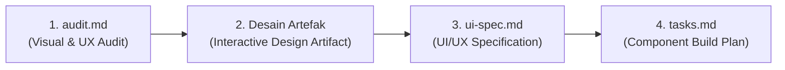

# UI Revamp Development (`.agents/ui-revamps/`)

Folder ini menyimpan artefak perancangan dan perombakan antarmuka pengguna (*UI/UX Revamp*) untuk portal frontend di CMS2 (`frontend/CompanyPortal-Vite` dan `frontend/VendorPortal-Vite`).

Metode ini digunakan saat melakukan redesain halaman, restrukturisasi komponen tabel/filter/modal, audit aksesibilitas, harmonisasi brand tokens (Merah Sirih vs Merah Menyala), dan peningkatan usability tanpa memerlukan migrasi skema database backend.

## Alur 4 Tahap UI Revamp SDLC

Alur UI Revamp bergerak secara sekuensial melalui 4 tahap:

```text
audit → desain artifact → ui-spec → tasks
```



## Struktur Folder per Revamp Layar

Setiap inisiatif UI Revamp dibuat di dalam subfolder kebab-case `.agents/ui-revamps/<nama-layar>/`:

```text
.agents/ui-revamps/<nama-layar>/
├── audit.md            # Tahap 1: Visual & UX Audit (Existing state, pain points, 4 mandatory UI states, brand check)
├── design-artifact.md  # Tahap 2: Desain Artefak (Rangkuman & link ke Brain Artifact interaktif untuk review/feedback user)
├── ui-spec.md          # Tahap 3: UI/UX Specification (Component hierarchy, design tokens, responsive breakpoints, Radix mapping)
└── tasks.md            # Tahap 4: Build Plan (Wave 1: Atoms/Molecules, Wave 2: Organisms/Grid, Wave 3: Integration, Wave 4: Tests)
```

## Pemetaan Skill untuk Desain Artefak

Untuk menyusun artefak desain yang berkualitas tinggi dan sesuai standar CMS2, gunakan kombinasi skill berikut:

| Tahap Artefak | File Target | Skill yang Wajib Digunakan | Fungsi Skill dalam Pembuatan Artefak |
| :--- | :--- | :--- | :--- |
| **Tahap 1: Audit** | `audit.md` | `ui-ux-pro-max`<br>`react-ui-ux-craft`<br>`brand` | Audit heuristik UX, kontras warna OKLCH, verifikasi 4 status wajib UI (Loading, Empty, Error, 202 Maker-Checker), dan audit brand "Merah Sirih" vs "Merah Menyala". |
| **Tahap 2: Desain Artefak** | `design-artifact.md`<br>*(Brain Artifact)* | `generative_ui`<br>`design`<br>`ui-styling` | Pembuatan artefak visual interaktif (Antigravity Brain Artifact) dengan wireframe, mockup ASCII/HTML, 60/30/10 visual balance preview, serta tombol human feedback gate (`Proceed`). |
| **Tahap 3: UI Spec** | `ui-spec.md` | `ui-ux-pro-max`<br>`design-system`<br>`react-ui-ux-craft` | Arsitektur token 3-lapis (Primitive $\to$ Semantic $\to$ Component), diagram pohon komponen (Mermaid), pemisahan Container vs Presentational, pemetaan Radix/shadcn, dan responsive breakpoints. |
| **Tahap 4: Build Plan** | `tasks.md` | `gemini-cms-orchestrator`<br>`react-ui-ux-craft` | Work Breakdown Structure per Wave berbasis komponen (Atoms $\to$ Organisms $\to$ Page $\to$ Tests) dan penugasan model Gemini yang tepat. |

Setelah implementasi selesai, di-review, dan di-merge, folder dipindahkan ke `.agents/ui-revamps/done/<nama-layar>/`.
