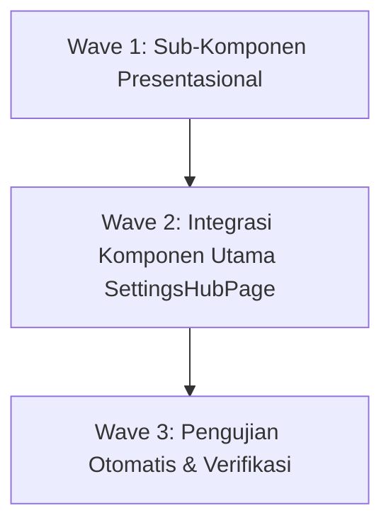

# UI Revamp Tasks: Settings Hub (/settings)

> **Layar**: `http://localhost:3001/settings` (`CompanyPortal-Vite`)  
> **Komponen Target**: `frontend/CompanyPortal-Vite/src/features/rbac-settings/components/SettingsHubPage.tsx`  
> **Dokumen Terkait**: [Audit](audit.md) · [Desain Artefak](design-artifact.md) · [Brain Artifact](file:///C:/Users/RB%20Yudha%20Rangga/.gemini/antigravity/brain/621000c0-409e-48f2-aa61-22fe6d637dea/settings-revamp-plan.md) · [UI Spec](ui-spec.md)  
> **Status**: draft (Tahap 4)  

---

## Task Dependency Graph

---

## Wave Breakdown

### Wave 1: Sub-Komponen Presentasional
- [ ] Task 1.1: Bangun `FeaturedCard` baru (Spotlight hierarki otorisasi & CTA "Kelola hierarki").
- [ ] Task 1.2: Bangun `SectionCard` (Grid card 2-kolom dengan icon wrapper & panah interaktif).
- [ ] Task 1.3: Bangun `CrossTabNotice` (Pemberitahuan pencarian jika modul ditemukan di tab lain).
- [ ] Task 1.4: Pasang `RoleContextBadge` pada PageHeader action bar.

### Wave 2: Integrasi Komponen Utama (`SettingsHubPage.tsx`)
- [ ] Task 2.1: Refactor `SettingsHubPage.tsx` memasang tab dengan badge counter dan clear button pada input pencarian.
- [ ] Task 2.2: Pasang `SectionPanel` berbasis grid 2-kolom dengan tag `<section aria-labelledby={headingId}>` agar kompatibel dengan seluruh test case region.
- [ ] Task 2.3: Pertahankan seluruh hak akses role (`canSeeRoleManagementCard`, `canSeeAdminUsersCard`, `ATM_SPV_CARD_IDS`).

### Wave 3: Verifikasi Otomatis
- [ ] Task 3.1: Jalankan Vitest: `pnpm --dir frontend/CompanyPortal-Vite test src/features/rbac-settings/__tests__/SettingsHubPage`.
- [ ] Task 3.2: Jalankan Lint: `pnpm --dir frontend/CompanyPortal-Vite run lint`.
- [ ] Task 3.3: Jalankan Build: `pnpm --dir frontend/CompanyPortal-Vite run build`.
- [ ] Task 3.4: Catat status verifikasi browser manual sebagai `outstanding (user)` (Golden Rule #10).
