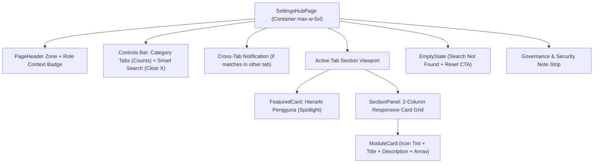

# UI Revamp Specification: Settings Hub (/settings)

> **Layar**: `http://localhost:3001/settings` (`CompanyPortal-Vite`)  
> **Komponen Target**: `frontend/CompanyPortal-Vite/src/features/rbac-settings/components/SettingsHubPage.tsx`  
> **Dokumen Terkait**: [Audit](audit.md) · [Desain Artefak](design-artifact.md) · [Brain Artifact](file:///C:/Users/RB%20Yudha%20Rangga/.gemini/antigravity/brain/621000c0-409e-48f2-aa61-22fe6d637dea/settings-revamp-plan.md) · [Tasks](tasks.md)  
> **Status**: draft (Tahap 3)  
> **Brand Target**: Merah Sirih (`CompanyPortal-Vite`)  

---

## 1. Arsitektur Komponen & Visual Hierarchy

---

## 2. Spesifikasi Detail per Komponen

### 2.1 Header & Role Context Zone
- `PageHeader` standar CMS2 dengan eyebrow `"Administrasi"`, judul `"Pengaturan"`, deskripsi `"Kelola akses, alur persetujuan, dan data master CMS."`
- **Actions Bar**:
  - `RoleContextBadge`: Pill indikator role login aktif (misal `ADMIN · Akses Penuh` atau `ATM-SPV · Khusus PKS & Vendor`) dengan border `--n-200`, latar `--n-50`, teks `--n-700`.
  - Tombol Bantuan dengan icon `HelpCircle` (`w-11 h-11`, touch target $\ge 44\text{px}$).

### 2.2 Category Tabs & Smart Search Bar
- **Tab Bar**: Segmented control pill (`bg-[var(--n-100)]`) dengan role ARIA `tablist`/`tab`.
  - Setiap tab memuat label + count badge (misal: `Akses & persetujuan (6)`, `Data master (8)`, `Export & Import (2)`).
  - Tab aktif berlatar `--n-0`, teks `--n-900`, shadow `--shadow-sm`.
- **Search Input Bar**:
  - Container responsif dengan input `type="search"`, placeholder `"Cari pengaturan..."`.
  - Search icon di sisi kiri.
  - Sisi kanan: Counter modul yang cocok (`N modul`) + Tombol Clear `(X)` ketika query terisi.
- **Cross-Tab Search Notice**:
  - Muncul jika hasil di tab aktif = 0, tetapi ada kecocokan di tab lain.
  - Menampilkan pesan edukatif: *"Ditemukan N modul di [Nama Tab]"* + tombol klik langsung untuk beralih tab.

### 2.3 Featured Spotlight: "Hierarki Pengguna"
- Digunakan di bawah tab `"Akses & persetujuan"`.
- Layout horizontal fleksibel (2-kolom pada tablet/desktop):
  - **Sisi Kiri**:
    - Tag *"FONDASI OTORISASI"* (`text-[var(--red-600)] text-xs font-bold uppercase`).
    - Heading `h2` teks `"Hierarki Pengguna"`.
    - Copywriting peran sentral struktur atasan-bawahan dalam rantai maker-checker.
    - Tombol primer CTA *"Kelola hierarki"* berlatar `--red-600` menuju `/settings/rbac/users` (`screen.getByRole("link", { name: /Kelola hierarki/ })`).
  - **Sisi Kanan (Visual Schematic)**:
    - Approver Tier Card (`Supervisor / Manager` dengan icon `ShieldCheck`).
    - Connecting Line / Rail.
    - Subordinate Tier Card (`Operator / Maker` dengan icon `Users`).

### 2.4 SectionPanel & Module Cards Grid (2-Kolom)
- Menggunakan wrapper `<section aria-labelledby={headingId}>` dengan judul `<h2 id={headingId}>` untuk menjamin pemenuhan selektor `getByRole("region", { name: ... })`.
- Grid responsif: `grid grid-cols-1 md:grid-cols-2 gap-4`.
- **Module Card**:
  - Container `Link` (`@tanstack/react-router`) dengan `group`, `rounded-[var(--radius-lg)]`, `border border-[var(--n-200)]`, `bg-[var(--n-0)]`.
  - Hover effect: micro-elevation `--shadow-md`, icon container background tint `--red-50` dengan warna icon `--red-600`.
  - Teks judul semi-bold (`--n-900`), deskripsi (`--n-600`).
  - Panah `ArrowUpRight` dengan transisi hover `translate-x-0.5 -translate-y-0.5`.

---

## 3. Responsive Breakpoints

| Breakpoint | Layout Grid | Spacing / Container |
|---|---|---|
| **Desktop ($\ge 1024\text{px}$)** | 2-Kolom Grid (`grid-cols-2`), FeaturedCard horizontal side-by-side | `gap-4`, padding `p-6`, container `max-w-5xl` |
| **Tablet ($768\text{px} - 1023\text{px}$)** | 2-Kolom Grid (`grid-cols-2`), FeaturedCard stacked | `gap-4`, padding `p-5` |
| **Mobile ($< 768\text{px}$)** | 1-Kolom Grid (`grid-cols-1`), stack controls | `gap-3`, padding `p-4`, touch target $\ge 44\text{px}$ |

---

## 4. Zero-Regression Test Assurance
Seluruh ID selektor, atribut `href`, teks judul modul, dan role ARIA tetap kompatibel 100% dengan `SettingsHubPage.test.tsx`, `SettingsHubPage.adminUsersCard.test.tsx`, dan `SettingsHubPage.exportsCard.test.tsx`.
