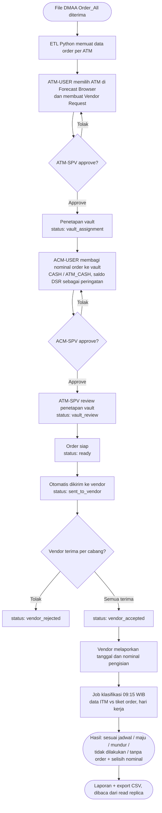
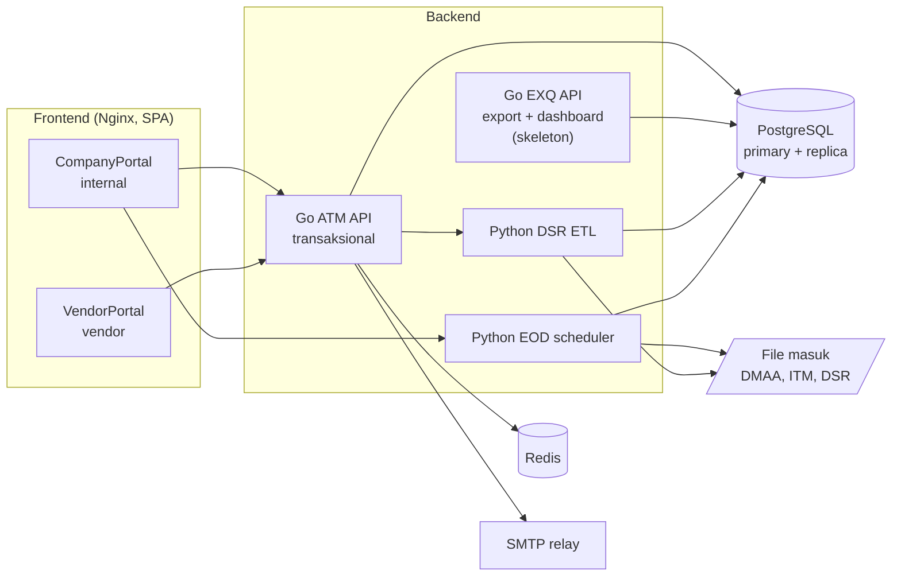
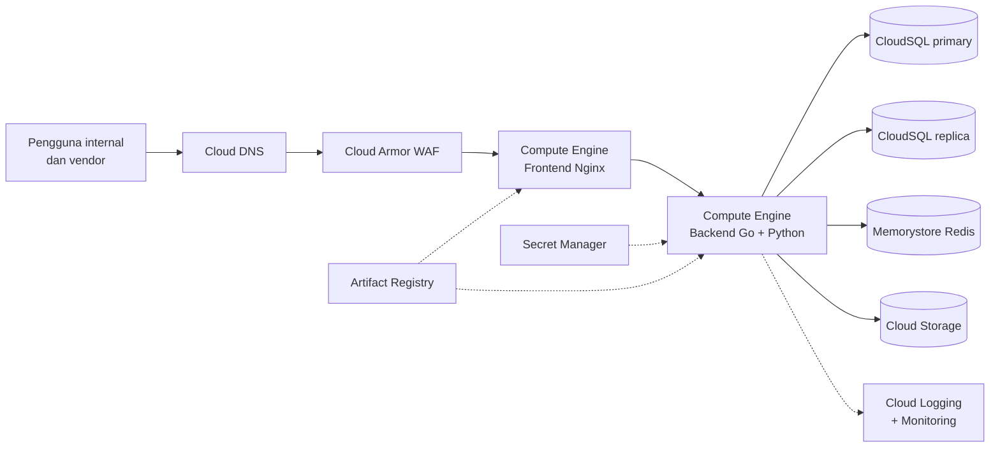
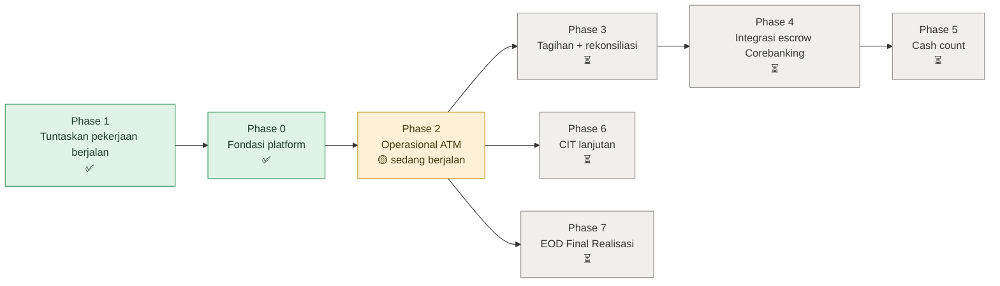
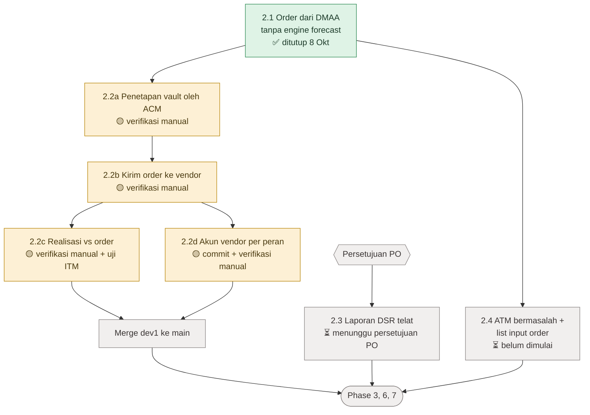

# CROWN: Cash Management System

Dokumentasi requirement, arsitektur, dan rencana pengembangan

| | |
|---|---|
| Sistem | CROWN, End-to-End Cash Management System ATM & CIT, CIMB Niaga |
| Kondisi per | 23 Oktober 2026 (branch `dev1`) |
| Sumber | URS v0.3 Phase 1, FSD v1.0, `.claude/docs/requirements.md`, `.claude/docs/arsitektur-teknologi.md`, `.kiro/steering/development-plan.md`, kode di repo |
| Audiens | Manajemen, bisnis, dan tim teknis. Bagian 1 sampai 5 untuk semua audiens, bagian 6 sampai 7 untuk tim teknis, bagian 8 sampai 10 untuk semua audiens |

## Daftar isi

1. Ringkasan eksekutif
2. Latar belakang dan tujuan
3. Requirement
4. Pengguna, peran, dan portal
5. Alur bisnis utama: siklus Order ATM
6. Arsitektur sistem
7. Kontrol dan tata kelola
8. Status pengembangan
9. Development plan
10. Risiko, gap, dan keputusan terbuka
11. Glosarium

---

## 1. Ringkasan eksekutif

CROWN adalah sistem internal CIMB Niaga untuk mengelola uang tunai ATM dari ujung ke ujung. Cakupannya mulai dari order pengisian ATM, pelaporan saldo harian oleh vendor, penetapan sumber uang di vault, pengiriman order ke vendor, sampai pengecekan realisasi pengisian. Fase berikutnya mencakup cash count, rekonsiliasi escrow, dan validasi tagihan vendor.

Pokok-pokok kondisi saat ini:

- **Fondasi platform selesai.** Login dan sesi, maker-checker berjenjang, audit trail, notifikasi in-app dan email, read replica untuk laporan, serta ingest file yang idempoten.
- **Master data selesai untuk MVP.** Data vendor, cabang vendor, vault, PIC, paket dan harga, ATM, kelolaan ATM, dan region. Setiap perubahan lewat approval.
- **Operasional ATM (Phase 2) sebagian besar sudah dibangun.** Order dari DMAA, penetapan vault oleh ACM, kirim order ke vendor, terima atau tolak oleh vendor, dan klasifikasi realisasi pengisian. Yang tersisa adalah laporan DSR telat dan pengecualian ATM bermasalah.
- **Belum dimulai:** tagihan vendor, rekonsiliasi, integrasi escrow Corebanking, cash count, dan perhitungan EOD Final Realisasi.
- **Langkah dekat:** verifikasi manual fitur Phase 2 di browser, merge `dev1` ke `main`, dan persetujuan PO untuk laporan DSR telat.

---

## 2. Latar belakang dan tujuan

### Masalah

Pengelolaan uang tunai ATM melibatkan banyak pihak: tim forecasting, tim monitoring ATM, ACM (Area Cash Management), cabang, dan vendor CIT/FLM. Banyak langkah kerjanya masih manual, misalnya rekap saldo vendor, penyusunan order, pengecekan realisasi, dan rekap keterlambatan laporan. Akibatnya jejak audit sulit ditelusuri dan keterlambatan sulit dipantau.

### Tujuan CROWN

- Satu sistem untuk seluruh siklus uang tunai ATM, dari order sampai realisasi.
- Kontrol dua orang (maker-checker) dan audit trail di setiap perubahan data keuangan dan master data.
- Portal terpisah untuk vendor, dengan akses hanya ke data milik vendor itu sendiri.
- Data harian yang bisa dipantau, dilaporkan, dan diekspor.

### Batasan yang sudah diputuskan

- **CROWN tidak menghitung forecast.** Nominal order berasal dari file DMAA (`amount_replenish`) dan dianggap final (keputusan 8 Oktober 2026).
- **CROWN tidak mengeksekusi pembayaran.** Tagihan vendor hanya divalidasi dan di-approve, lalu diserahkan ke proses berikutnya.
- **Rekonsiliasi cash count dilakukan di Rec 7.** CROWN hanya menyiapkan rekap dan memantau task-nya.
- **Pindah buku dilakukan manual di BDS.** CROWN hanya mencatat referensinya.

---

## 3. Requirement

### 3.1 Requirement fungsional (URS v0.3, semua prioritas High)

| Kode | Fungsi | Isi |
|---|---|---|
| FNC 001 | ATM Cash Forecasting | Penerimaan DSR, instruksi pengisian (replenishment), proyeksi kebutuhan uang |
| FNC 002 | Cash Count | Penjadwalan, pelaksanaan, rekap, dan laporan cash count vault (ATM/Cash) dan selektif mesin |
| FNC 003 | Dashboard | Nominal instruksi harian per terminal ID, rekap DSR telat, progres harian dan laporan bulanan cash count |

### 3.2 Aturan bisnis kunci

| Area | Aturan |
|---|---|
| Order ATM | Nominal = `amount_replenish` dari DMAA, tanpa dihitung ulang. Refund akan dikirim DMAA kemudian. |
| Cegah order ganda | ATM yang punya order emergency/adhoc sampai H-1, atau order aktif di H0, tidak diberi order tambahan. |
| ATM bermasalah | ATM berstatus bermasalah (menunggu part, vandalisme, dan sejenisnya) dikeluarkan dari rekomendasi. |
| Input tambahan order | List complaint/rekon, list project ATM, list ATM bermasalah, dan adjustment order digabung menjadi draft order, lalu masuk approval berjenjang. |
| DSR | Vendor wajib upload saldo harian paling lambat pukul 09:00. Keterlambatan direkap bulanan per vendor sebagai dasar penalti FLM. |
| Klasifikasi realisasi | Dihitung dalam hari kerja (memperhitungkan hari libur): sesuai jadwal, maju 1-2 hari, mundur 1-2 hari, tidak dilakukan (lebih dari 2 hari atau tidak diisi), dan pengisian tanpa order. |
| Master data | Perubahan lewat maker-checker dan audit trail. Import/export massal dengan validasi struktur dan isi. |
| Cash count vault | Kategori vault High/Medium/Low dari rata-rata saldo escrow 6 bulan. Kunjungan onsite per 6 bulan: High 3 kali, Medium 2 kali, Low 1 kali. Kategori hanya boleh naik. |
| Tagihan vendor | Vendor upload invoice dan dokumen pendukung. Sistem melakukan rekonsiliasi otomatis, tim internal bisa menyesuaikan saat ada sanggahan. Tanpa eksekusi pembayaran. |

### 3.3 Laporan yang dibutuhkan

Refund per ATM ID, nominal isi yang tidak sama dengan order, transaksi tarik/setor, profil ATM, order vs transaksi, laporan user, log login user, dan trip/realisasi per vendor per ATM ID. Dashboard perlu menampilkan status, aging, SLA, tren historis, dan indikator exception, dengan filter, drill-down, dan export CSV/XLSX/PDF.

### 3.4 Requirement non-fungsional

| Aspek | Target |
|---|---|
| Ketersediaan | 24×7 di luar maintenance terencana. Jam operasional 07:00-20:00 |
| Kinerja | Dashboard ≤ 3 detik (p95). Upload DSR ≤ 30 detik per dokumen. Respons awal posting jurnal ≤ 5 detik, konfirmasi async ≤ 2 menit |
| Kapasitas | 300 pengguna aktif bersamaan. Portal vendor bisa diskalakan horizontal |
| Data center | Bintaro dan NTT |
| UI | Responsif, bisa dipakai di mobile, aksesibilitas dasar |
| Operasional | Log terstruktur, telemetri, metrik, dan alert operasional |
| Kepatuhan | Sistem internal dan vendor, bukan untuk nasabah. Pertukaran data dengan vendor perlu Third-Party Risk Assessment dan Data Processing Agreement |

---

## 4. Pengguna, peran, dan portal

### 4.1 Dua portal terpisah

| | CompanyPortal (internal) | VendorPortal (vendor) |
|---|---|---|
| Pengguna | Karyawan CIMB Niaga | Vendor CIT/FLM |
| Tampilan | Tema "Merah Sirih": netral, merah hanya untuk aksi utama | Tema "Merah Menyala": identitas merah CIMB kuat |
| Login | Akun lokal (LDAP direncanakan, belum terpasang) | Akun lokal yang dikelola di CROWN |
| Cakupan data | Sesuai peran | Hanya data vendor sendiri, dan bisa dibatasi per cabang vendor |

Akun vendor ditolak di CompanyPortal, dan sebaliknya.

### 4.2 Peran (14 role aktif)

| Kelompok | Role | Fungsi utama |
|---|---|---|
| Administrasi | `ADMIN`, `ADMIN_PARAM`, `APPACCESS` | Administrasi sistem, master data, pembuatan akun, dan pengaturan hak akses |
| ATM operations | `ATM-USER`, `ATM-SPV` | Menyusun dan meng-approve order (Vendor Request), memantau ATM |
| Cabang | `BRANCH-USER`, `BRANCH-SPV`, `BRANCH-ATM-USER`, `BRANCH-ATM-SPV` | Operasional cabang dan ATM cabang |
| ACM | `ACM-USER`, `ACM-SPV` | Menetapkan vault penyedia uang untuk order dan meng-approve penetapan itu |
| Vendor | `VENDOR-USER`, `VENDOR-ATM-USER`, `VENDOR-VAULT-USER` | Upload DSR, terima/tolak order, lapor realisasi. `VENDOR-ATM-USER` hanya pihak pengisi ATM, `VENDOR-VAULT-USER` hanya pihak penyedia uang di vault |

Hak approval tidak ditentukan oleh role. Approval mengikuti garis atasan (`supervisor_id`) dan level approval (`approval_level`) masing-masing user, termasuk delegasi saat cuti.

---

## 5. Alur bisnis utama: siklus Order ATM

Diagram berikut menggambarkan alur yang **sudah dibangun** di CROWN. Status di kurung adalah status Vendor Request di sistem.

Setiap langkah di atas menulis audit log dan mengirim notifikasi ke pihak berikutnya.

Yang belum termasuk di alur ini:
- Pengecualian ATM bermasalah dan list input tambahan (Phase 2.4).
- Proses pengambilan uang fisik di lokasi (validasi petugas dan kendaraan, serah terima). Ini sudah ada di FSD tetapi berada di luar cakupan fase saat ini.

---

## 6. Arsitektur sistem

### 6.1 Gambaran sistem

Ada tiga runtime yang berbagi satu database:

| Runtime | Peran |
|---|---|
| Go ATM API (`backend/`) | API transaksional jam kerja: login (satu-satunya penerbit token), master data, approval, DSR, Vendor Request, fungsi CIT, realisasi, notifikasi, audit |
| Python (`backend_python/`) | EOD dan ETL: ingest file DMAA, ITM, dan DSR, scheduler retry, cek keterlambatan, job klasifikasi realisasi |
| React + Vite (dua portal) | Antarmuka internal dan vendor |

`backend-exq/` (Go) disiapkan untuk export dan query dashboard, tetapi masih skeleton dan belum di-deploy.

### 6.2 Stack teknologi

| Layer | Teknologi |
|---|---|
| Frontend | React 19, TypeScript 5, Vite 6, TanStack Router/Query/Table, React Hook Form + Zod, Tailwind CSS 4, Recharts |
| Backend transaksional | Go 1.26, Chi v5, pgx v5, sqlc (SQL-first, tanpa ORM), golang-jwt v5, go-redis v9, slog |
| EOD / ETL | Python 3.14, FastAPI, asyncpg, psycopg 3, pandas/openpyxl, APScheduler, PyJWT |
| Database | PostgreSQL 18 (CloudSQL di produksi), primary untuk tulis dan replica untuk laporan |
| Cache | Redis 7: blacklist token dan rate limit, bukan penyimpan data bisnis |
| Kontrak API | OpenAPI 3.0.3 untuk modul Vendor Request dan order vendor. Tipe frontend di-generate dari spec |
| Container | Docker multi-stage, user non-root, healthcheck |
| CI | GitHub Actions: lint, uji keamanan dependency, unit dan integration test di Postgres, cek drift sqlc, gate coverage |

### 6.3 Struktur backend

Alur request di Go ATM API: `handler` (parsing dan respons) → `service` (aturan bisnis, cek role ulang, transaksi, audit) → `repository`/`db` (SQL). Modul lintas fungsi berdiri sendiri: `auth`, `approval`, `audit`, `notification`, `rolemgmt`.

Lapisan pengaman di setiap request: request ID, IP client tepercaya, log terstruktur, recovery, batas waktu 30 detik, batas ukuran body 1 MiB (upload DSR dan import master data dikecualikan), lalu autentikasi dan pengecekan role. Endpoint `/health` dan `/ready` dipakai untuk pemantauan.

### 6.4 Data

- Uang disimpan sebagai `numeric` dan dikirim ke frontend sebagai string desimal, tidak pernah float. Mata uang selalu eksplisit (IDR).
- Waktu disimpan `timestamptz` (UTC) dan ditampilkan dalam WIB.
- Tulis dan baca setelah tulis memakai primary. List, viewer, laporan, dan dashboard memakai replica.
- Migrasi skema berurutan (`001` sampai `032`), dijalankan oleh runner sendiri yang mencatat checksum setiap file.
- File yang di-ingest (DMAA, ITM, DSR) idempoten per hash SHA-256, jadi file yang sama tidak diproses dua kali.

### 6.5 Keamanan

- Access token JWT berumur pendek (15 menit), refresh token di cookie httpOnly, dan sesi dibatasi 1 jam sejak login.
- Rate limit login per username dan per IP. Akun terkunci 30 menit setelah 3 kali gagal. Password lokal kedaluwarsa 90 hari dan wajib diganti saat login pertama.
- Hak akses dicek dua lapis: di route dan di service. Vendor hanya melihat data vendornya sendiri, dan bisa dibatasi sampai level cabang.
- Frontend memakai Content Security Policy dan security header standar. Audit dependency produksi dijaga di 0 temuan.

### 6.6 Deployment (target GCP)

Saat ini satu VM menjalankan backend. Pemisahan menjadi satu VM per backend direncanakan tahun 2028. Struktur modul Go sudah terpisah, jadi pemisahan itu tidak butuh perubahan kode.

---

## 7. Kontrol dan tata kelola

| Kontrol | Penerapan |
|---|---|
| Maker-checker | Satu mesin approval (`internal/approval`) dipakai semua modul. Maker tidak boleh sama dengan checker. Efek perubahan baru berlaku setelah approve final. Approval mengikuti garis atasan, level approval, dan delegasi saat cuti. |
| Master data | Perubahan disimpan sebagai usulan (HTTP 202), lalu diterapkan setelah di-approve. |
| Pengecualian terdokumentasi | Manajemen peran, region, hari libur, Area ACM, dan peran PIC vendor diterapkan langsung, tanpa approval. Sebagai gantinya, audit log ditulis di transaksi yang sama: kalau audit gagal, perubahan dibatalkan. Hak akses dicek di route dan di service. |
| Audit trail | Setiap perubahan state mencatat siapa, apa, sebelum/sesudah, kapan, dan IP. Ada layar viewer audit log untuk admin. |
| Soft delete | Data master tidak pernah dihapus permanen. Penonaktifan memakai `is_active=false`, dan ada test yang menjaga aturan ini. |
| Idempotensi | Ingest file dicatat per hash di `import_jobs`. Sistem mendeteksi baris DMAA yang sudah menjadi bagian dari Vendor Request aktif (`is_requested`) agar ATM yang sama tidak di-order dua kali. |
| Proses panjang | Dimodelkan sebagai state machine yang disimpan di database, bukan satu request panjang. Proses berat dijalankan di background atau EOD, dan status bisa dipantau. |

---

## 8. Status pengembangan

Legenda: ✅ selesai · 🟡 dibangun, verifikasi atau commit tersisa · ⏳ belum dimulai · ⏸ ditunda

### 8.1 Sudah dibangun

| Area | Isi | Status |
|---|---|---|
| Platform | Login dan sesi, maker-checker, audit log, manajemen peran, admin user, notifikasi in-app dan email, read replica, ingest idempoten | ✅ |
| Master data | Vendor, cabang vendor, vault, PIC, paket dan harga, ATM, kelolaan ATM, region, mapping lokasi DSR ke vault, import/export CSV | ✅ |
| Data DMAA | ETL file order DMAA, DMAA viewer, Forecast Browser, ringkasan vendor × region | ✅ |
| DSR | Upload DSR vendor dua tahap (cek dulu, lalu konfirmasi), ETL Python | ✅ |
| Vendor Request | Pembuatan order dari data DMAA, approval, nomor tiket per ATM, kuota kunjungan | ✅ |
| Penetapan vault ACM | Pembagian nominal order ke vault, tiket pemenuhan vault, Area ACM per region | 🟡 menunggu verifikasi manual |
| Kirim ke vendor | Order otomatis terkirim, vendor terima/tolak per cabang di VendorPortal | 🟡 menunggu verifikasi manual |
| Realisasi vs order | Hari libur, laporan vendor, job klasifikasi, laporan CSV | 🟡 menunggu verifikasi manual dan uji ITM |
| Akun vendor per peran | Pisah akun pengisi ATM dan penyedia vault, cakupan per cabang | 🟡 menunggu commit dan verifikasi manual |
| EOD monitoring | Scheduler retry, cek keterlambatan file, halaman monitoring | ✅ |
| Kualitas | CI, gate coverage backend dan frontend, kontrak OpenAPI, perbaikan tech debt | ✅ (sebagian kecil tech debt masih ditahan) |

### 8.2 Belum dibangun

- Laporan DSR telat (Phase 2.3) dan pengecualian ATM bermasalah (Phase 2.4).
- Tagihan vendor dan rekonsiliasi (Phase 3).
- Integrasi escrow Corebanking (Phase 4).
- Cash count vault dan selektif mesin (Phase 5).
- Fungsi CIT lanjutan: jurnal, DSR CIT, rekonsiliasi CIT (Phase 6).
- EOD Final Realisasi dan tabel run EOD (Phase 7).
- Penyimpanan dokumen dan export XLSX/PDF (ditunda sampai ada modul yang membutuhkan).
- Layar yang masih memakai data contoh: dashboard, tagihan, rekonsiliasi, CIT tracker, cash flow, serta jadwal dan evidence di VendorPortal. Layar ini sudah disembunyikan dari menu.

---

## 9. Development plan

### 9.1 Urutan fase

Strateginya adalah menyelesaikan pekerjaan yang sedang berjalan dulu, lalu membangun fondasi bersama, baru kemudian modul bisnis. Dengan begitu tiap modul tidak membuat ulang notifikasi, ingest file, atau approval sendiri.

Nomor fase tidak sama dengan urutan pengerjaan. Phase 1 dan Phase 0 dikerjakan sebelum Phase 2. Nomor tetap dipertahankan karena dirujuk di dokumen lain.

| Fase | Isi | Prasyarat | Status |
|---|---|---|---|
| 0 Fondasi | Read replica, `import_jobs` + idempotensi, notifikasi. Penyimpanan dokumen dan export XLSX/PDF ditunda | – | ✅ (0.4, 0.5 ⏸) |
| 1 Tuntaskan | Region, drill-down cabang vendor, verifikasi ulang DSR, seed data dev | – | ✅ |
| 2 Operasional ATM | Order DMAA, penetapan vault, kirim ke vendor, realisasi, akun vendor per peran, laporan DSR telat, ATM bermasalah | 0, 1 | 🟡 |
| 3 Finance | Validasi dan approval tagihan vendor (tanpa pembayaran), rekonsiliasi tagihan | 2, penyimpanan dokumen | ⏳ |
| 4 Integrasi | Ingest batch escrow dari Corebanking | 0.2, 3 | ⏳ |
| 5 Cash count | Penjadwalan, berita acara digital, rekap untuk Rec 7 | 0.3, 0.4, 4 | ⏳ |
| 6 CIT lanjutan | Jurnal, DSR CIT, rekonsiliasi CIT | 2 stabil | ⏳ |
| 7 EOD | Final Realisasi, tabel run EOD, alert kalau EOD belum selesai sebelum jam kerja | 2, 0.3 | ⏳ |

### 9.2 Detail Phase 2 (fase berjalan)

| Item | Isi | Langkah berikutnya |
|---|---|---|
| 2.1 Order dari DMAA | Nominal DMAA final, Forecast Browser, Vendor Request, tiket per ATM, kuota kunjungan | Perluas ETL saat DMAA mulai mengirim refund |
| 2.2a Penetapan vault | ACM membagi nominal ke vault, approval ACM-SPV dan ATM-SPV, tiket pemenuhan vault | Verifikasi manual di browser |
| 2.2b Kirim ke vendor | Order `ready` otomatis terkirim, vendor terima/tolak per cabang | Verifikasi manual di browser |
| 2.2c Realisasi | Klasifikasi hari kerja dari data ITM, laporan vendor, laporan CSV | Verifikasi manual, uji dengan file ITM |
| 2.2d Akun vendor per peran | Role vendor pengisi ATM dan penyedia vault, cakupan per cabang | Commit sisa perubahan, verifikasi manual |
| 2.3 Laporan DSR telat | Rekap bulanan DSR telat/tidak kirim per vendor, notifikasi keterlambatan | PO menyetujui intent, lalu spec |
| 2.4 ATM bermasalah | Exclude ATM bermasalah, list complaint/project/adjustment sebelum order dibuat | Susun intent dan spec, kemungkinan ada perubahan skema |

### 9.3 Pekerjaan lintas fase

| Item | Status |
|---|---|
| Revamp tampilan shell CompanyPortal (sidebar, topbar, command palette Ctrl+K) | Requirement draft 23 Okt 2026, menunggu review PO |
| Sisa tech debt frontend dan backend | Sebagian besar selesai, sisanya ditahan sampai ada keputusan |
| Kontrak OpenAPI | Pilot selesai, diperluas setiap ada modul baru |
| CI pindah ke Jenkins | Ditunda, direncanakan mulai sekitar Desember 2026 |
| Merge `dev1` ke `main` | Menunggu verifikasi manual dan review code owner |

### 9.4 Cara kerja tim

- Setiap fitur melewati rantai dokumen: intent → spec → plan → test → review, dan setiap tahap disetujui sebelum lanjut.
- Satu pekerjaan = satu item di development plan. Pekerjaan baru ditambahkan ke plan dulu, baru dikerjakan.
- Setiap fitur wajib punya test. Coverage backend minimal 80%, dan frontend punya threshold yang dicek otomatis.
- Verifikasi manual di browser dilakukan oleh PO atau user sebelum fitur dianggap selesai.
- Fitur dianggap "selesai" hanya kalau sudah terhubung ke route, memakai data asli dari database, dan teruji. Folder kosong atau layar contoh tidak dihitung.

---

## 10. Risiko, gap, dan keputusan terbuka

### 10.1 Gap teknis yang diketahui

| Gap | Dampak | Rencana |
|---|---|---|
| Login LDAP belum terpasang | User internal belum bisa login dengan akun domain | Perlu library LDAP dan persetujuan |
| `dev1` jauh di depan `main` | Risiko konflik dan review besar | Merge setelah verifikasi manual Phase 2 |
| Frontend belum masuk CI | Lint, test, dan build frontend hanya dijalankan lokal | Ditambahkan bersama perpindahan CI |
| Beberapa layar masih data contoh | Belum bisa dipakai operasional | Disambungkan oleh fase pemiliknya |
| Seed harga paket vendor belum lengkap | Sebagian harga khusus belum ada | Gap yang diterima untuk MVP |
| Image `backend-exq` belum di-hardening | Belum relevan karena belum di-deploy | Diperbaiki sebelum deploy |

### 10.2 Keputusan yang menunggu bisnis atau PO

- Laporan DSR telat (2.3): persetujuan intent dan perubahan skema DSR per cabang.
- PKS vendor dan limit CIS per area vault: persetujuan intent.
- Alur pengambilan uang fisik (FSD): pemetaan role Provider dan Receiver, langkah setelah pickup ditolak, sumber saldo escrow H-1, approval satu level atau berjenjang.
- Upload master data versi FSD (replace, bukan upsert): perlakuan terhadap data yang tidak ada di file.
- Cash count: rentang nominal kategori High/Medium/Low, format rekap untuk Rec 7, dan apakah hasil Rec 7 di-upload balik ke CROWN.
- Kepatuhan: status Third-Party Risk Assessment dan Data Processing Agreement dengan vendor.

---

## 11. Glosarium

| Istilah | Arti |
|---|---|
| ACM | Area Cash Management, tim yang menetapkan vault penyedia uang untuk order |
| CIT | Cash in Transit, pengambilan dan pengantaran uang fisik oleh vendor |
| DMAA | Tim/sistem data yang mengirim rekomendasi order ATM. Nominalnya final |
| DSR | Daily Status Report, saldo uang per lokasi yang di-upload vendor setiap hari (batas 09:00) |
| EOD | End of Day, pemrosesan batch harian (ingest file dan rekap) |
| Escrow | Rekening penampung uang vendor di Corebanking |
| ETL | Extract-Transform-Load, proses membaca file lalu menyimpannya ke database |
| FLM | First Line Maintenance, vendor yang melayani ATM di lapangan |
| ITM | Data realisasi pengisian ATM yang dipakai untuk klasifikasi |
| Maker-checker | Kontrol dua orang: satu orang mengusulkan, orang lain menyetujui |
| Read replica | Salinan database khusus baca untuk laporan dan dashboard |
| Realisasi | Pengisian ATM yang benar-benar terjadi, dibandingkan dengan order |
| Rec 7 | Aplikasi rekonsiliasi eksternal untuk hasil cash count |
| Vault | Tempat penyimpanan uang milik vendor yang berisi uang bank |
| Vendor Request | Order pengisian ATM yang dikirim ke vendor. Setelah di-approve, berfungsi sebagai instruksi pengisian |
