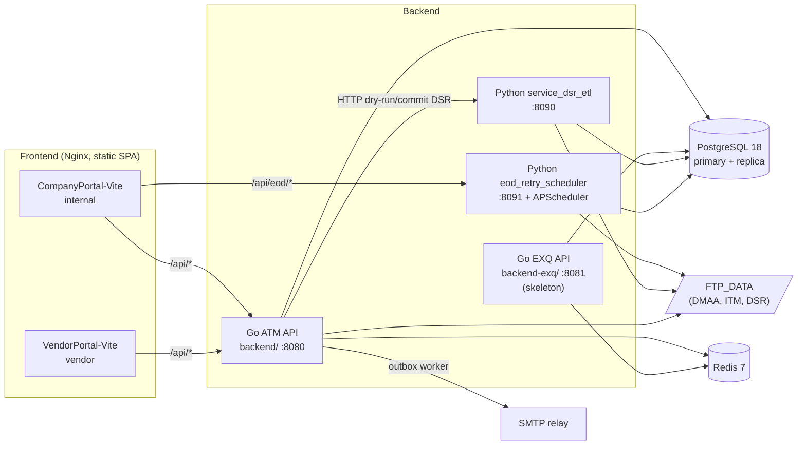

# CROWN — Teknologi & Arsitektur (kondisi per 2026-10-20)

> Diverifikasi langsung dari kode (`package.json`, `go.mod`, `requirements.txt`, Dockerfile, `nginx.conf`, `cmd/api/main.go`, `.github/workflows/ci.yml`), bukan hanya dari steering doc. Bagian "Catatan & gap" di akhir mencatat perbedaan antara dokumen dan kode.

## Gambaran sistem



Tiga runtime backend berbagi satu database dan satu `JWT_SECRET`. Hanya Go ATM API yang menerbitkan token; Go EXQ dan Python hanya memvalidasi.

---

# A. Frontend

## A1. Dua aplikasi terpisah

| | CompanyPortal-Vite (internal) | VendorPortal-Vite (vendor) |
|---|---|---|
| Path | `frontend/CompanyPortal-Vite` | `frontend/VendorPortal-Vite` |
| Pengguna | Karyawan CIMB Niaga (ADMIN, ATM-USER/SPV, BRANCH-*, ACM-*, APPACCESS, ADMIN_PARAM) | `VENDOR-USER` |
| Tema | "Merah Sirih" (netral hangat, merah ≤10%) | "Merah Menyala" (top bar maroon, sidebar merah) |
| Dev server | `:5173` | `:5174` |
| Container (lokal) | `userportal-vite-fe`, port `3001` | `vendorportal-vite-fe`, port `3002` |
| Proxy API | `/api/eod/*` → `:8091` (prefix dibuang), `/api/*` → `:8080` | `/api/*` → `:8080` |
| Header portal | Login mengirim `X-Portal-Type: company`; refresh menolak role `VENDOR-USER` | Login lewat portal vendor |

## A2. Stack

| Layer | Library | Versi (package.json) | Dipakai di |
|---|---|---|---|
| UI | React | ^19.0.0 | CP, VP |
| Bahasa | TypeScript | ^5.7.0 | CP, VP |
| Build | Vite + `@vitejs/plugin-react` | ^6.0.0 / ^4.3.0 | CP, VP |
| Routing | TanStack Router | CP ^1.170.44, VP ^1.93.0 | CP, VP |
| Server state | TanStack Query | ^5.62.0 | CP, VP |
| Tabel | TanStack Table | ^8.21.3 | CP, VP |
| Form + validasi | React Hook Form + Zod (+ `@hookform/resolvers`) | ^7.54 / ^3.24 / ^5.4 | CP, VP |
| Client state | Zustand | ^5.0.0 | CP (auth store). Terpasang di VP tapi tidak dipakai |
| Chart | Recharts | ^3.0.1 | CP saja |
| Styling | Tailwind CSS 4 (`@tailwindcss/vite`), `clsx`, `tailwind-merge` | ^4.0.0 | CP, VP |
| Ikon | lucide-react | ^0.469.0 | CP, VP |
| Tipe API | openapi-typescript | 7.13.0 (exact) | CP saja (`pnpm run gen:api`) |
| Package manager | pnpm | 11.20.0 | CP, VP |

## A3. Struktur kode

```
src/
  components/   # ui/, layout/, feedback/, pages/ (Forbidden, NotFound)
  features/     # satu folder per domain bisnis (lihat A9)
  lib/          # api/ (client, config, schema.d.ts), auth/, config/navigation.ts, hooks/, utils/
  routes/       # definisi route per file (createRoute), guard per route
  styles/       # design token (CSS custom property, OKLCH)
  data/         # JSON contoh untuk layar mock
  test/         # setup vitest + util
```

VendorPortal punya tambahan `src/app/AppShell.tsx` dan auth di `features/auth/` (Context + `ProtectedRoute`).

## A4. Routing & guard

- TanStack Router dengan route **code-based** (`createRoute` per file di `routes/`, dirakit menjadi `routeTree` di `main.tsx`). Tidak memakai plugin file-based generator.
- CompanyPortal: layout `_auth` (login) dan `_protected` (wajib login). Role dicek per route lewat `requireRoles()`; page di-lazy-load dengan `lazyRouteComponent` dan dipreload di loader (FE-04). Ada `defaultErrorComponent` supaya error render tidak jadi layar kosong (FE-07). Build menjalankan `scripts/check-bundle.mjs` untuk menjaga ukuran bundle awal.
- VendorPortal: `_auth`, `_protected` → `_shell` (AppShell). Route internal (`/admin`, `/forecasting`, `/reconciliation`) sengaja dirender sebagai NotFound.
- Navigasi sidebar per role ada di `lib/config/navigation.ts` (CP).

## A5. Data fetching & state

- Semua panggilan HTTP lewat `lib/api/client.ts` (wrapper `fetch`): inject `Authorization: Bearer <access token>`, `credentials: "include"`, dukung JSON, `FormData` (upload), dan `blob` (download, CP).
- 401 → refresh **single-flight** (satu `POST /api/v1/auth/refresh` untuk banyak request paralel) → retry sekali → gagal = redirect ke `/login?reason=session_expired`.
- Server state di TanStack Query (cache, invalidasi setelah mutasi, polling unread notifikasi 60 detik).
- Access token hanya disimpan di memori (Zustand di CP, React Context di VP). Refresh token tidak pernah terlihat oleh JS (cookie httpOnly, lihat B5).

## A6. Kontrak API

- `backend/api/openapi.yaml` (OpenAPI 3.0.3, ditulis manual) → `src/lib/api/schema.d.ts` di CompanyPortal via `openapi-typescript`. Cakupan saat ini: `/vendor-requests*` dan `/vendor/replenish-orders*`. Ada vitest yang gagal kalau file hasil generate basi.
- Modul lain dan seluruh VendorPortal masih memakai tipe yang ditulis manual.

## A7. Design system

- Token warna OKLCH sebagai CSS custom property, light mode saja. Brand merah hue 29 untuk aksi utama; merah error hue 12 khusus destruktif/error, selalu dengan ikon + teks.
- Font system stack, `tabular-nums` untuk angka, nominal uang rata kanan dengan IDR eksplisit.
- Detail lengkap: `.kiro/steering/ui_design.md`.

## A8. Serving & keamanan

- Image: multi-stage `node:22-alpine` (pnpm install `--frozen-lockfile`, `tsc -b`, `vite build`) → `nginx:alpine`, user non-root, HEALTHCHECK.
- Nginx: SPA fallback ke `index.html` (no-cache untuk HTML), asset ber-hash di-cache panjang (CP 1 tahun, VP 30 hari), reverse proxy ke backend, `proxy_cookie_path /api/v1/auth`.
- Security header (`security-headers.conf`, FE-01): CSP `default-src 'self'` (tanpa inline script/style), `X-Frame-Options SAMEORIGIN`, `nosniff`, `Referrer-Policy`, HSTS.
- `xlsx` sudah dihapus dari CompanyPortal (FE-02); `pnpm audit --prod` dijaga di 0.

## A9. Status fitur frontend

| Kategori | CompanyPortal | VendorPortal |
|---|---|---|
| Terhubung ke API | auth, approvals, atm-portal, audit-log, dmaa-forecast, eod-monitoring, notifications, rbac-settings, role-management, master-data + master-data-io, admin-users/vendors/atms/regions/holidays/acm-areas, vendor-request, vault-plan, replenishment (forecast browser) | auth, dsr (upload), orders, realizations, notifications |
| Masih mock (`src/data/*.json`) | dashboard (MetricStrip, AttentionPanel), invoice, reconciliation, cit (CitTracker), cash-flow, sebagian dsr (`useDsrData`) | schedule, invoices, evidence |

## A10. Kualitas & testing

| Alat | Fungsi |
|---|---|
| Biome ^1.9 | Lint + format (`pnpm run lint`) |
| Vitest ^4.1 + jsdom + Testing Library | Unit/komponen test |
| `@vitest/coverage-v8` | Threshold: CP 84/80/80/85, VP 93/84/90/93 (statements/branches/functions/lines) |
| fast-check | Property-based test |
| Playwright ^1.49 | E2E (devDependency CP) |

Catatan: job CI di `.github/workflows/ci.yml` saat ini hanya untuk Go dan Python; lint/test/build frontend belum dijalankan di CI.

---

# B. Backend

## B1. Topologi runtime

| Runtime | Path | Port | Peran | Status |
|---|---|---|---|---|
| Go ATM API | `backend/` | 8080 | API transaksional jam kerja: auth (penerbit JWT), master data, approval, DSR upload, vendor request, CIT (penetapan vault, kirim ke vendor), realisasi, notifikasi, audit | Aktif |
| Go EXQ API | `backend-exq/` | 8081 | Rencana: export + query monitoring dashboard (baca replica) | Skeleton: `/health`, `/ready`, grup route ber-auth kosong; paket `internal/*` masih stub |
| Python DSR ETL | `backend_python/service_dsr_etl` | 8090 | Dry-run/commit upload DSR vendor, laporan late/summary/audit/retry | Aktif |
| Python EOD scheduler | `backend_python/eod_retry_scheduler` | 8091 | Scan + retry ETL DMAA/ITM, late check per SLA, klasifikasi realisasi replenish, API monitoring EOD | Aktif |
| Python ETL CLI | `dmaa/`, `dsr/`, `itm/{cashpos,replenish}/`, `replenish_classify/` | – | Script ETL file → DB, dipanggil scheduler atau manual | Aktif |

Go memakai workspace (`go.work`: `backend`, `backend-exq`, `pkg`). `backend/` dan `backend-exq/` tidak saling import; kode bersama hanya di `pkg/`.

## B2. Stack Go

| Layer | Library | Versi |
|---|---|---|
| Bahasa | Go | 1.26 (toolchain go1.26.9) |
| HTTP router | go-chi/chi | v5.3.0 |
| DB driver/pool | jackc/pgx + pgxpool | v5.9.2 |
| SQL codegen | sqlc | v1.31.1 (pinned) |
| Validasi | go-playground/validator | v10.30.3 |
| JWT | golang-jwt/jwt | v5.3.1 (HS256) |
| Hash password | golang.org/x/crypto (bcrypt) | v0.58.0 |
| Redis | redis/go-redis | v9.7.3 |
| UUID | google/uuid | v1.6.0 |
| Logging | `log/slog` (JSON) | stdlib |
| Email | `net/smtp` | stdlib |
| CSV import/export | `encoding/csv` | stdlib |
| Test OpenAPI | getkin/kin-openapi | v0.151.0 (test only) |
| Property test | pgregory.net/rapid | v1.3.0 |
| Redis mock (test) | alicebob/miniredis | v2.38.0 |

Belum diadopsi (perlu persetujuan): excelize, Typst/PDF, asynq, golang-migrate, LDAP client.

## B3. Struktur & layering (`backend/`)

```
cmd/
  api/        # bootstrap: config, pool primary+replica, Redis, middleware, wiring + mount route, worker notifikasi
  migrate/    # runner migrasi custom (status | up | baseline)
  hashpw/     # helper hash password (dev)
api/          # openapi.yaml + embed.go
queries/      # 32 file SQL sumber sqlc
migrations/   # 001_baseline_schema + 002_baseline_seed + 003..031 (gap 022, 024)
internal/
  handler/    # HTTP handler per resource (41 file non-test)
  service/    # logika bisnis + ApplierRegistry maker-checker (54 file)
  repository/ # akses DB (19 file)
  db/         # kode hasil sqlc
  auth/       # login, provider lokal, lifecycle password, admin user
  approval/   # orchestrator maker-checker, chain resolver, delegasi/cuti
  audit/      # writer audit_logs append-only
  notification/ # in-app + outbox email + worker SMTP
  rolemgmt/   # katalog menu/fitur + role_permissions
```

`pkg/` (bersama): `auth` (TokenService, blacklist), `middleware` (RequireAuth, RequireRoles, rate limiter, TrustedRealIP, RequestLogger, BodyLimit), `config`, `health` (`/ready`), `response` (envelope `{success,data}` untuk EXQ).

Alur request: `handler` (parse, auth context, response) → `service` (aturan bisnis, cek role ulang, transaksi, audit) → `repository`/`db` (SQL).

## B4. Pipeline middleware (ATM API)

`RequestID` → `TrustedRealIP(TRUSTED_PROXIES)` → `RequestLogger` (`http_request` JSON) → `Recoverer` → `Timeout(30s)` → `BodyLimit` 1 MiB (upload DSR + import master data dikecualikan) → per-mount `RequireAuth` + `RequireRoles(...)`.

Server: `ReadTimeout` 10s, `WriteTimeout` 30s, `IdleTimeout` 60s, graceful shutdown 15s. Endpoint publik: `GET /health`, `GET /ready` (cek db, db_replica, redis; 200/503).

## B5. Autentikasi & otorisasi

- Login `POST /api/v1/auth/login` → access token JWT HS256 (default 15 menit, `ACCESS_TOKEN_EXPIRY`) di body + refresh token di cookie `refresh_token` (`HttpOnly`, `Secure`, `SameSite=Strict`, `Path=/api/v1/auth`).
- Refresh: rotasi token, refresh lama di-blacklist di Redis (berdasarkan JTI). Batas sesi absolut `SESSION_MAX_LIFETIME` (1 jam) dihitung dari login, tidak bertambah saat refresh.
- Rate limit login per username (5) dan per IP (20) per 15 menit, counter di Redis.
- Kebijakan password lokal: kedaluwarsa 90 hari, peringatan 7 hari, kunci 30 menit setelah 3x gagal, wajib ganti password saat first login.
- RBAC dua lapis: `RequireRoles` di route dan cek ulang di service. Vendor dibatasi ke data vendornya sendiri. 12 role: ADMIN, ADMIN_PARAM, APPACCESS, ATM-USER, ATM-SPV, BRANCH-USER, BRANCH-SPV, BRANCH-ATM-USER, BRANCH-ATM-SPV, VENDOR-USER, ACM-USER, ACM-SPV.
- Python memvalidasi JWT Go dengan PyJWT (HS256 saja, `exp` wajib, harus access token yang punya `role`). Endpoint EOD dibatasi ADMIN/APPACCESS. Mode `api_key` dipakai untuk panggilan service-to-service dari Go.

## B6. Data access & database

- PostgreSQL 18 (dev + CI), eksternal (tidak di-Docker-kan); CloudSQL di prod. Ekstensi: pgcrypto, pg_trgm, btree_gist.
- Dua pool: `dbPool` (primary: tulis, read-after-write, cek otorisasi) dan `dbReadPool` (replica: list, viewer, dashboard, export). Tanpa `DATABASE_REPLICA_URL`, replica = primary. Python memakai pola yang sama (`create_read_pool`).
- SQL-first dengan sqlc (`sqlc.yaml`: engine postgresql, `sql_package: pgx/v5`, pointer untuk nullable). CI memastikan kode hasil generate sama dengan query/migrasi.
- Migrasi: runner custom `cmd/migrate`, file berurutan di `backend/migrations/`, tercatat di `schema_migrations` dengan checksum SHA-256 dan advisory lock, dieksekusi lewat `psql`. Migrasi lama 001–040 di-squash ke baseline pada 2026-09-18.
- Uang disimpan `numeric` dan dikirim sebagai decimal string; tidak pernah float. Timestamp `timestamptz`.
- Redis 7: blacklist JWT, counter rate limit. Bukan penyimpan data bisnis.

## B7. Maker-checker & audit

- `internal/approval` adalah satu-satunya state machine approval (`approval_requests`, `approval_steps`, `approval_policies`, `approval_delegations`, `user_leaves`).
- Master data: tulis → stage perubahan → HTTP 202 → setelah approve final, `Applier` per entity (`vendor`, `vendor_branch`, `vendor_vault`, `vendor_pic`, `atm`, `vendor_package`, `vendor_package_price`, `atm_assignment`, `dsr_location_map`) menerapkan perubahan.
- Pengecualian terdokumentasi (apply langsung + audit dalam transaksi yang sama): role management, region, hari libur, Area ACM.
- Setiap perubahan state menulis `audit_logs` (who, what, before/after, ip).

## B8. Notifikasi

`notification.Send` menulis `notifications` (in-app) dan `notification_emails` (outbox) di dalam transaksi bisnis. Worker goroutine di `cmd/api` mengirim outbox via SMTP (`NOTIFICATION_EMAIL_POLL_INTERVAL`, default 60s) dan purge setelah 90 hari. Tanpa `SMTP_HOST`, email ditandai `skipped`.

## B9. Integrasi antar-runtime

- Upload DSR: VendorPortal → Go `/api/v1/dsr` (multipart, file disimpan di `FTP_DATA/DSR`) → Go memanggil Python `service_dsr_etl` (:8090) untuk dry-run/commit dengan `DSR_RETRY_SCHEDULER_AUTH` → Python menulis ke DB → Go membaca hasil dari primary.
- DMAA/ITM: file di `FTP_DATA` diproses ETL Python → `dmaa_files`, `dmaa_atm_forecast`, data ITM. Idempoten per hash SHA-256 lewat `import_jobs`.
- Klasifikasi realisasi replenish ditulis Python (termasuk `notifications` + `notification_emails` langsung, harus selaras dengan `notification.Send` di Go); Go hanya membaca.

## B10. Runtime Python (`backend_python/`)

| Layer | Library | Versi |
|---|---|---|
| Bahasa | Python | 3.14 (image `python:3.14-slim`) |
| API | FastAPI + uvicorn[standard] | 0.141.1 / 0.52.4 |
| Model & config | pydantic + pydantic-settings | 2.13.5 / 2.15.0 |
| DB (service async) | asyncpg | 0.31.0 |
| DB (script ETL) | psycopg[binary] | 3.3.4 |
| Scheduler | APScheduler | 3.11.3 |
| JWT | PyJWT | 2.15.1 |
| Parsing file | pandas, openpyxl, xlrd | 3.0.5 / 3.1.5 / 2.0.2 |
| Env | python-dotenv | 1.0.1 |
| Test | `unittest` (stdlib) | – |

Semua versi di-pin `==`. Uang di-parse sebagai `Decimal`.

Struktur:

| Path | Isi |
|---|---|
| `lib/` | `database.py` (pool asyncpg + retry backoff), `dependencies.py` (auth), `schemas.py`, `import_jobs.py`, `services/` (scheduler, detector, retry executor, audit), `utils/` (zona waktu WIB, checksum, proxy) |
| `service_dsr_etl/` | FastAPI :8090, router health/status/process/retry/late/summary/audit |
| `eod_retry_scheduler/` | FastAPI :8091, router yang sama + lifespan yang menyalakan APScheduler |
| `dmaa/`, `dsr/`, `itm/cashpos/`, `itm/replenish/` | Script ETL CLI |
| `replenish_classify/` | Job klasifikasi realisasi vs order (`rules.py`, `job.py`, `run.py` untuk manual) |

Job APScheduler (`lib/services/scheduler_service.py`): failure scan (cron per N menit dalam rentang jam), auto retry (interval), late check per file type pada jam SLA (WIB), klasifikasi replenish (cron 09:15 WIB, juga setelah file `itm_replenish` sukses).

Response envelope Python: `{status, data, error}` (berbeda dari Go). Host/container wajib `TZ=Asia/Jakarta`.

---

# C. Infrastruktur, CI & deployment

| Komponen | Detail |
|---|---|
| Image Go ATM | `golang:1.26.9-alpine` → `alpine:3.24`, `CGO_ENABLED=0`, user non-root, `TZ=Asia/Jakarta`, HEALTHCHECK `/health`, migrasi ikut di-copy. Build context = root repo (untuk `go.work`) |
| Image Go EXQ | Multi-stage terpisah; masih root dan tanpa HEALTHCHECK (open item BE-06) |
| Image Python | `python:3.14-slim`, semua requirements di-resolve sekaligus, user non-root (uid 10001), HEALTHCHECK `/health`; default menjalankan `eod_retry_scheduler`, override command untuk `service_dsr_etl` |
| Image FE | `node:22-alpine` → `nginx:alpine` non-root (lihat A8) |
| Compose lokal | `backend/docker-compose.yaml` (backend + redis, membuat network `cms-net`, mount `FTP_DATA`), `backend-exq/docker-compose.yaml`, `frontend/docker-compose.yml` (join `cms-net`). Tidak ada compose di root |
| CI (GitHub Actions) | Matrix Go (`backend`, `backend-exq`, `pkg`): `go vet`, golangci-lint v2.13.0 (`--build-tags integration`), govulncheck v1.8.0, `go test -race`. Integrasi Go dengan service Postgres 18 + `cmd/migrate up`, gagal kalau ada test skip, cek threshold coverage. Cek sqlc drift. Python unittest di Postgres 18 (gagal kalau ada skip). Build image Python |
| Jenkins | Sudah dispesifikasikan, status on hold (`.claude/sdlc/ci-jenkins/`) |
| Target GCP | Compute Engine (FE + backend; saat ini satu VM untuk backend, rencana split per backend 2028), CloudSQL primary + replica, Memorystore Redis, Cloud Storage, Artifact Registry, Secret Manager, Cloud DNS, Cloud Armor, Cloud Logging/Monitoring |

---

# D. Catatan & gap

- **LDAP belum terpasang.** Konfigurasi `LDAP_*` dibaca di `pkg/config`, tetapi `cmd/api` hanya mendaftarkan provider lokal; login `auth_source=ldap` mengembalikan `503 LDAP authentication tidak tersedia`. Belum ada library LDAP di `go.mod`.
- **`backend-exq` masih skeleton.** Steering `structure.md` dan bagian `project-context.md` masih menyebut `backend-cit` dan `pkg/database`; kode sebenarnya `backend-exq` (rename 2026-10-20) tanpa `pkg/database`. Fungsi CIT dibangun di `backend/`.
- **`cmd/batch` tidak ada.** Golden Rule #8 di `project-context.md` masih menyebutnya; EOD berjalan di Python (keputusan 2026-09-25).
- **Versi TanStack Router berbeda** antar portal (CP ^1.170.44, VP ^1.93.0), dan VendorPortal belum memakai kontrak OpenAPI.
- **Zustand terpasang di VendorPortal tapi tidak dipakai** (auth VP memakai React Context).
- **Frontend belum masuk CI.**
- Beberapa layar masih mock (lihat A9) dan baru disambungkan oleh item fase pemiliknya di `development-plan.md`.
