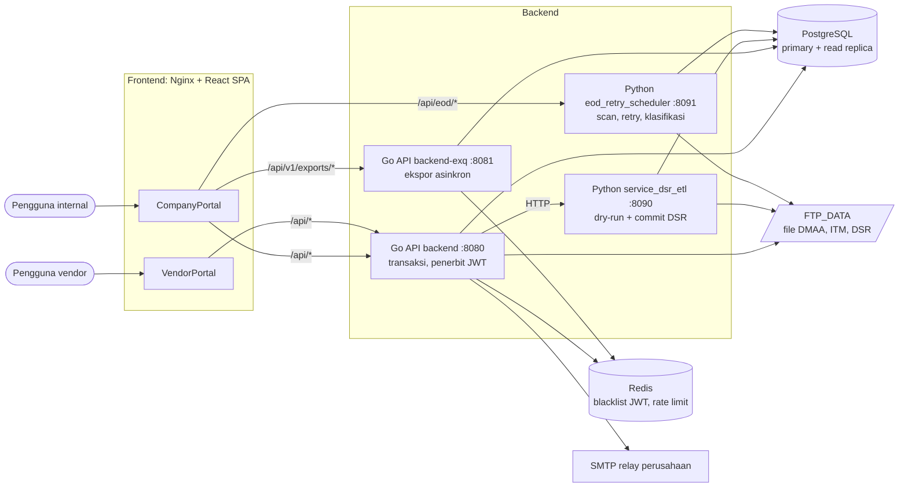
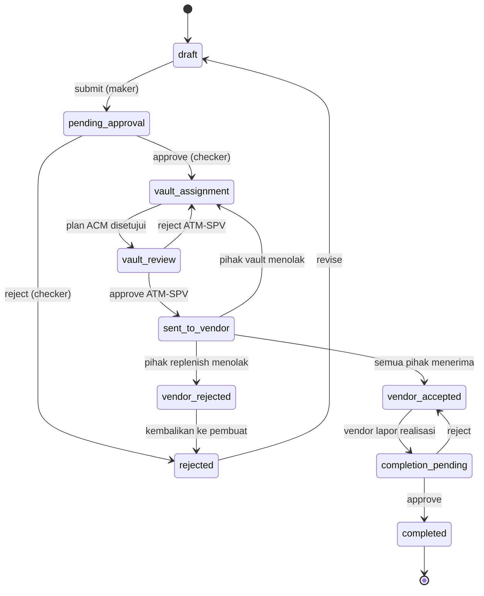

# System Design Document: CROWN

**SYSTEM DESIGN**
**CROWN: End-to-End Cash Management System (ATM & CIT)**
**Oktober 2026**
**Version 0.1 (draft untuk review)**

**Approval Page**

| **Approved by:** | | | |
| --- | --- | --- | --- |
| **IT Developer** | Name: | Position: | Signature/Date: |
| **IT Infrastructure** | Name: | Position: | Signature/Date: |
| **IT Business Analyst/PM (Infrastructure Technology)** | Name: | Position: | Signature/Date: |
| **Business Project Manager** | Name: | Position: | Signature/Date: |
| **Business/Project Owner** | Name: | Position: | Signature/Date: |

_Disclaimer: Signees are responsible for the content of this document_

**Revision History**

| **Date** | **Version** | **Description** | **Author** |
| --- | --- | --- | --- |
| 30 Okt 2026 | 0.1 | Draft awal, disusun dari kode branch `dev1` dan dokumen proyek | (diisi) |

**Status dokumen.** Isi menggambarkan kondisi branch `dev1` per 30 Oktober 2026, yang belum di-merge ke `main` dan belum di-deploy ke produksi. Fitur yang belum dibangun tidak diberi desain teknis dan hanya didaftar di Lampiran A. Hal yang masih perlu keputusan didaftar di Lampiran B.

**TABLE OF CONTENTS**

1. Solution Overview
2. Functional & Technical Design
   - 2.1 Login dan sesi pengguna
   - 2.2 Pengelolaan master data
   - 2.3 Ingest order DMAA dan Forecast Browser
   - 2.4 Upload DSR oleh vendor
   - 2.5 Pembuatan dan persetujuan Vendor Request
   - 2.6 Pemenuhan vault oleh ACM
   - 2.7 Kirim order ke vendor, terima atau tolak
   - 2.8 Realisasi dan klasifikasi pengisian
   - 2.9 Laporan DSR telat
   - 2.10 Notifikasi in-app dan email
   - 2.11 Ekspor data asinkron
   - 2.12 Monitoring EOD
3. Parameter Changes
4. Security and Control Design
5. Backup and Data Retention Design
- Lampiran A: Cakupan yang belum dibangun
- Lampiran B: Hal yang perlu dikonfirmasi

---

## 1. Solution Overview

CROWN mengelola uang tunai ATM dari order pengisian sampai pengecekan realisasi: DSR harian dari vendor, order dari DMAA, penetapan vault, pengiriman order ke vendor, dan klasifikasi realisasi. Fase berikutnya mencakup cash count, rekonsiliasi escrow, dan validasi tagihan vendor.

Batasan yang sudah diputuskan:

- **Tidak ada forecast di CROWN.** Nominal order adalah `amount_replenish` dari file DMAA dan tidak dihitung ulang.
- **Tidak ada eksekusi pembayaran.** Tagihan vendor hanya divalidasi dan di-approve.
- **Pindah buku dilakukan manual di BDS.**
- **Rekonsiliasi cash count dijalankan di Rec 7.** CROWN hanya menyiapkan rekapnya.

| Komponen | Teknologi | Peran |
| --- | --- | --- |
| CompanyPortal | React, Vite, Nginx | Aplikasi pengguna internal |
| VendorPortal | React, Vite, Nginx | Aplikasi vendor, terpisah dari portal internal |
| `backend` | Go, Chi, pgx, sqlc | API transaksional dan satu-satunya penerbit JWT |
| `backend-exq` | Go, Chi, pgx | API, worker, dan janitor ekspor asinkron; hanya memvalidasi JWT |
| `service_dsr_etl` | Python, FastAPI | Validasi dan commit file DSR vendor |
| `eod_retry_scheduler` | Python, FastAPI, APScheduler | Penjadwalan ETL, retry, deteksi keterlambatan, klasifikasi realisasi |
| ETL CLI | Python, pandas, psycopg | Memuat file DMAA, ITM, dan DSR ke database |
| PostgreSQL | CloudSQL (target produksi) | Primary untuk tulis, read replica untuk baca berat dan laporan |
| Redis | Memorystore (target produksi) | Blacklist JWT dan counter rate limit, bukan penyimpan data bisnis |

**Sumber data dan integrasi**

| Sumber | Bentuk | Jadwal | Tujuan |
| --- | --- | --- | --- |
| DMAA | File `Order_All_*.xlsx` | Siap 06:00 WIB | `dmaa_files`, `dmaa_atm_forecast` |
| ITM cash position | File CSV | SLA 07:00 WIB | `itm_cashpos_files`, `itm_cashpos` |
| ITM replenish | File CSV | SLA 07:00 WIB | `itm_replenish_files`, `itm_replenish` |
| Vendor (DSR) | Workbook, upload lewat VendorPortal | Batas 09:00 WIB | `dsr_uploads`, `dsr_daily_rows`, `dsr_rencana_isi_rows`, `dsr_receipts` |
| SMTP relay | Email keluar | Worker outbox | Notifikasi email |

**Deployment target (GCP).** Compute Engine untuk frontend dan backend, CloudSQL primary dan replica, Memorystore, Artifact Registry, Secret Manager, Cloud DNS, Cloud Armor, Cloud Logging, dan Cloud Monitoring. Image ditandai git SHA, dan rollback dilakukan dengan men-deploy SHA sebelumnya. Migrasi database dijalankan sebagai langkah terpisah di luar jam 07:00–20:00 WIB memakai `backend/cmd/migrate`.

**Pemetaan mode dalam template.** Istilah day mode dan night mode di template mengacu pada zona batch SIBS, sedangkan CROWN tidak berjalan di SIBS. Dalam dokumen ini:

- **Online, day mode:** API yang melayani pengguna. Jam operasional 07:00–20:00 WIB, uptime 24×7.
- **Online, night mode:** tidak ada proses CROWN yang terikat ke zona batch SIBS, jadi ditulis "Tidak berlaku" dan tidak diulang per story (lihat Lampiran B).
- **Batch:** pipeline Python. Scan dan retry berjalan 05:00–09:00 WIB, sehingga 07:00–09:00 berjalan bersamaan dengan trafik transaksi.

---

## 2. Functional & Technical Design

Rumusan user story disusun dari spesifikasi fitur dan perlu dikonfirmasi oleh BA atau PO. Semua API berada di bawah `/api/v1`.

### 2.1 Design: Login dan sesi pengguna

| **Items** | **Description** |
| --- | --- |
| **User Story** | Sebagai pengguna internal atau vendor, saya login ke portal masing-masing agar hanya bisa mengakses fungsi sesuai peran saya. |
| **Functional** | **Proses:** login → access token JWT dan refresh token di cookie `HttpOnly` → refresh dengan rotasi token → sesi berakhir pada batas absolut. **Interface:** Redis (blacklist JWT, rate limit). LDAP belum terpasang (Lampiran B). **Layar:** Login dan ganti password di kedua portal; Manajemen User dan Manajemen Peran di CompanyPortal. **Laporan:** tidak ada. |
| **Technical: Online day mode** | **Modul:** `backend/internal/auth`, `pkg/auth`, `pkg/middleware`, `internal/rolemgmt`, `handler/auth_handler.go`. **Tabel:** `users`, `roles`, `menu_features`, `role_permissions`, `audit_logs`. **API:** `/auth`, `/admin/users`, `/admin/roles`. |
| **Technical: Batch** | Tidak ada. |

### 2.2 Design: Pengelolaan master data

| **Items** | **Description** |
| --- | --- |
| **User Story** | Sebagai admin parameter, saya mengelola vendor, cabang, vault, PIC, paket, harga, ATM, dan kelolaan ATM, dan perubahannya baru berlaku setelah disetujui orang lain. |
| **Functional** | **Proses:** maker mengirim perubahan → API membalas 202 → checker menyetujui → `Applier` per entitas menerapkan perubahan dan menulis audit dalam satu transaksi. Data yang berubah sejak diajukan ditandai `stale` dan tidak diterapkan. Kegagalan saat apply menghasilkan 409. **Import CSV:** dry-run lalu confirm; satu file menjadi satu batch dan satu approval, diterapkan semua atau tidak sama sekali. Alur replace dari FSD belum dibangun (Lampiran A). **Layar:** Pengaturan → Vendor (tab cabang, vault, PIC, paket, harga, mapping DSR), ATM, Region, Hari Libur, Area ACM, Approval, Log Audit. **Laporan:** ekspor CSV (lihat 2.11). |
| **Technical: Online day mode** | **Modul:** `service/masterdata_*`, `service/*_admin.go`, `internal/approval`, handler `admin_*`. **Tabel:** `vendors`, `vendor_branches`, `vendor_vaults`, `vendor_pics`, `vendor_packages_branch`, `vendor_package_prices`, `package_frequencies`, `atms`, `atm_vendor_packages`, `dsr_location_vault_maps`, `regions`, `holidays`, `acm_areas`, `master_data_change_requests`, `master_data_import_batches`, `approval_requests`. **API:** `/admin/vendors/*`, `/admin/atms/*`, `/admin/master-data/*`, `/approvals`, `/admin/approval`. **Penghapusan:** soft-delete atau penutupan masa berlaku, tanpa hard delete pada master data. |
| **Technical: Batch** | Tidak ada. |

### 2.3 Design: Ingest order DMAA dan Forecast Browser

| **Items** | **Description** |
| --- | --- |
| **User Story** | Sebagai ATM-USER, saya melihat order harian dari DMAA per ATM dan per vendor agar bisa menyusun permintaan pengisian. |
| **Functional** | **Proses:** file DMAA masuk ke `FTP_DATA/DMAA` → ETL memuat data, idempoten per SHA-256 → file dipindah ke folder backup → pengguna melihat data di Forecast Browser. Refund belum dikirim DMAA, jadi `amount_refund = 0`. **Layar:** Forecast Browser dan ringkasan vendor × region. **Laporan:** tidak ada. |
| **Technical: Online day mode** | **Modul:** `dmaa_forecast` (handler dan service), `vendor_request` (browse forecast). **Tabel:** `dmaa_files`, `dmaa_atm_forecast` (baca dari replica). **API:** `/dmaa-forecast`, `/vendor-requests/forecast`, `/vendor-requests/forecast/summary`. |
| **Technical: Batch** | **Program:** `backend_python/dmaa/dmaa_etl.py`, dipanggil `eod_retry_scheduler`. **Tabel:** `dmaa_files`, `dmaa_atm_forecast`, `import_jobs`, `scan_runs`, `late_detections`, `retry_audit_logs`. **Job:** scan tiap 15 menit pada 05:00–09:00 WIB; auto-retry maksimal 3 kali tiap 30 menit; cek SLA pukul 06:00 WIB. |

### 2.4 Design: Upload DSR oleh vendor

| **Items** | **Description** |
| --- | --- |
| **User Story** | Sebagai vendor, saya mengunggah DSR harian dan melihat hasil validasinya sebelum mengonfirmasi, paling lambat pukul 09:00 WIB. |
| **Functional** | **Proses:** upload → Go menyimpan file ke `FTP_DATA/DSR` → Python menjalankan dry-run → vendor mengonfirmasi → Python commit dan menulis `dsr_receipts` dalam transaksi yang sama. **Interface:** Go memanggil `service_dsr_etl` lewat HTTP dengan kredensial service. **Layar:** VendorPortal → DSR. **Laporan:** lihat 2.9. |
| **Technical: Online day mode** | **Modul:** `handler/dsr_upload_handler.go`, `service/dsr_upload.go`. **API:** `/dsr` (khusus akun vendor; file milik vendor lain ditolak). **Baca:** dari primary karena hasil commit Python langsung dibaca kembali. |
| **Technical: Batch** | **Program:** `backend_python/dsr/dsr_etl.py`, `service_dsr_etl`. **Tabel:** `dsr_uploads`, `dsr_daily_rows`, `dsr_rencana_isi_rows`, `dsr_receipts`. **Catatan:** nominal diparse sebagai `Decimal`, dalam IDR penuh walaupun header bertuliskan "(x 1.000)". |

### 2.5 Design: Pembuatan dan persetujuan Vendor Request

| **Items** | **Description** |
| --- | --- |
| **User Story** | Sebagai ATM-USER, saya membuat Vendor Request dari order DMAA; ATM-SPV menyetujuinya sebelum diproses lebih lanjut. |
| **Functional** | **Proses:** lihat gambar di bawah. Maker dan checker harus orang yang berbeda. **Tiket:** satu tiket aktif per (request, ATM), format `<terminal_id>_<50K\|100K\|MIX>_<YYYYMMDD>_<NNN>`; nomor tidak pernah dipakai ulang. **Nomor request:** `REP-<prefix vendor>-<region_code>-<YYYYMMDD>-<NNN>`. Cabang tanpa `region_code` menghasilkan 422. **Kuota kunjungan:** dari `package_frequencies.cr_frequency`. Kelebihan kuota tidak memblokir, tetapi diberi flag dan notifikasi. **Layar:** Replenishment → Vendor Request, Profil ATM. **Laporan:** riwayat audit per request. |
| **Technical: Online day mode** | **Modul:** `service/vendor_request*.go`, `handler/vendor_request_handler.go`, `service/atm_visit_quota*`. **Tabel:** `vendor_requests`, `vendor_request_tickets`, `vendor_request_number_seq`, `atm_visit_quotas`, `atm_visits`, `audit_logs`. **API:** `/vendor-requests`, `/atm-visit-quotas`. Kontrak di `backend/api/openapi.yaml`. **Deviasi:** memakai state machine sendiri pada `vendor_requests`, bukan `approval_requests`. |
| **Technical: Batch** | Tidak ada. |

**Gambar: siklus status Vendor Request yang sudah dibangun**

Status `approved` dan `ready` tetap ada untuk request lama (`vendor_sent=false`), yang laporan selesainya masih dibuat oleh ATM-USER. Pembatalan lewat `cancelled` tidak digambar agar diagram tetap terbaca.

### 2.6 Design: Pemenuhan vault oleh ACM

| **Items** | **Description** |
| --- | --- |
| **User Story** | Sebagai ACM-USER, saya membagi nominal order ke satu atau beberapa vault; ACM-SPV menyetujuinya agar sumber uang jelas sebelum order dikirim ke vendor. |
| **Functional** | **Proses:** satu plan per request, dimiliki Area ACM dari `region_code` request. Request tanpa area menunggu, dan ADMIN mendapat peringatan. **Aturan:** vault kategori `CASH` atau `ATM_CASH`; nominal kelipatan denominasi; total per denominasi ≥ order; kelebihan menjadi buffer dengan alasan 10–500 karakter. **Tier:** 1 sama vendor dan region, 2 beda vendor sama region, 3 beda region (hanya urgent dengan alasan). **Kapasitas:** saldo DSR dikurangi alokasi plan lain pada tanggal itu; hanya peringatan, tidak memblokir. **Tiket:** `<vault_code>_<YYYYMMDD>_<NNN>`, terbit saat submit. **Layar:** CIT → Penetapan Vault, Pengaturan → Area ACM. |
| **Technical: Online day mode** | **Modul:** `service/vault_plan*.go`, `vault_allocation`, `vault_ticket`, `vault_capacity`, `acm_area_admin`. **Tabel:** `vendor_request_vault_plans`, `vendor_request_vault_allocations` (dan `_amounts`), `vendor_request_vault_tickets`, `acm_areas`, `acm_area_regions`, `acm_area_members`, `dsr_location_vault_maps`. **API:** `/vault-plans`, `/admin/acm-areas`, `/vendor-requests/{id}/vault-approve`, `/vendor-requests/{id}/vault-reject`. **Tidak dipakai lagi:** `acm_area_branches`, `vendor_request_vault_assignments`. |
| **Technical: Batch** | Tidak ada. Saldo berasal dari `dsr_daily_rows.saldo_akhir` hasil ETL DSR. |

### 2.7 Design: Kirim order ke vendor, terima atau tolak

| **Items** | **Description** |
| --- | --- |
| **User Story** | Sebagai vendor, saya melihat order untuk cabang saya lalu menerima atau menolaknya dengan alasan. |
| **Functional** | **Proses:** setelah vault disetujui, setiap cabang replenish dan vault menjadi satu pihak yang memutuskan sendiri. Semua menerima → `vendor_accepted`. Penolakan vault mengembalikan plan ke ACM. Penolakan replenish → `vendor_rejected`, lalu ATM-SPV mengembalikan ke pembuat atau membatalkan. **Pengiriman ulang:** hanya ke pihak yang berubah atau menolak; pihak yang tidak lagi terlibat menjadi `withdrawn`. **Layar:** VendorPortal → Orders, CompanyPortal → panel pihak vendor pada detail request. |
| **Technical: Online day mode** | **Modul:** `service/vendor_order*.go`, `vendor_party`, `handler/vendor_order_handler.go`. **Tabel:** `vendor_request_vendor_parties`, `vendor_request_vendor_party_events` (append-only), `vendor_pics`, `users`. **API:** `/vendor/replenish-orders`, `/vendor-requests/{id}/vendor-parties`, `/vendor-requests/{id}/vendor-return`. **Cakupan akses:** `users.vendor_id` dan `vendor_branch_id` dibaca dari DB tiap request; di luar cakupan → 404. **Deviasi:** keputusan vendor memakai state machine sendiri, dengan audit dalam transaksi. |
| **Technical: Batch** | Tidak ada. |

### 2.8 Design: Realisasi dan klasifikasi pengisian

| **Items** | **Description** |
| --- | --- |
| **User Story** | Sebagai ATM-SPV, saya melihat apakah pengisian sesuai order, dan vendor melaporkan realisasinya per ATM. |
| **Functional** | **Proses:** pihak replenish melaporkan berhasil atau gagal, tanggal, dan nominal per denominasi untuk semua ATM dalam satu submit → `completion_pending` → ATM-SPV atau BRANCH-ATM-SPV approve atau reject. **Klasifikasi:** data ITM dicari dalam ±2 hari kerja dari jadwal, dan yang terdekat dipakai. Hasilnya `on_schedule`, `early`, `late`, `not_done`, `no_order`, atau `void`. Data ITM mengalahkan laporan vendor; selisihnya diberi flag. **Layar:** Replenishment (CompanyPortal), Realisasi (VendorPortal). **Laporan:** nominal tidak sesuai order dan trip per vendor per ATM, maksimal 31 hari. |
| **Technical: Online day mode** | **Modul:** `service/vendor_order_realization.go`, `vendor_request_completion`, `replenishment_read`, `holiday_admin`. **Tabel:** `vendor_request_realizations` (dan `_amounts`), `replenish_classifications` (dan `_amounts`), `holidays`. **API:** `/vendor/replenish-orders/{id}/realization`, `/vendor/replenish-realizations`, `/replenishment`, `/admin/holidays`. Baca dari replica. |
| **Technical: Batch** | **Program:** `backend_python/itm/replenish/itm_replenish_etl.py`, `backend_python/replenish_classify/`. **Job:** setelah file `itm_replenish` sukses, cron 09:15 WIB, atau manual. Hanya baris yang belum final yang dihitung ulang. **Tabel:** `itm_replenish`, `replenish_classifications`, `notifications`, `notification_emails`, `retry_audit_logs`. **Parameter:** `RETRY_REPLENISH_CLASSIFY_START_DATE` (tanpa backfill sebelum tanggal ini). |

### 2.9 Design: Laporan DSR telat

| **Items** | **Description** |
| --- | --- |
| **User Story** | Sebagai ATM-SPV, saya melihat cabang vendor yang telat atau tidak mengirim DSR sebagai dasar penalti FLM. |
| **Functional** | **Aturan:** batas 09:00:00 WIB inklusif. "Diterima" berarti commit ETL yang sukses, bukan saat file diunggah. Cabang wajib kirim adalah cabang FLM aktif dengan minimal satu vault aktif. **Status:** OK, TELAT, TIDAK KIRIM, dan BELUM JATUH TEMPO untuk hari ini sebelum 09:00. **Layar:** Laporan DSR Telat (harian, ringkasan, peringatan). **Laporan:** dihitung saat dibuka, bukan snapshot; ekspor CSV lewat 2.11. |
| **Technical: Online day mode** | **Modul:** `handler/dsr_late_report_handler.go`, `service/dsr_late_report*.go`. **Tabel:** `dsr_receipts`, `vendor_branches`, `vendor_vaults`, `dsr_location_vault_maps` (baca dari replica). **API:** `/dsr-late-reports`. |
| **Technical: Batch** | **Program:** `backend_python/dsr_late_notify/`, cron 09:00 WIB. **Tabel:** `notifications`, `notification_emails`. **Parameter:** `DSR_LATE_START_DATE` harus sama di `backend` dan `backend-exq`, dan sama dengan `RETRY_DSR_LATE_START_DATE` di Python. Kosong berarti laporan nonaktif. |

### 2.10 Design: Notifikasi in-app dan email

| **Items** | **Description** |
| --- | --- |
| **User Story** | Sebagai pengguna, saya menerima pemberitahuan saat ada hal yang perlu saya tindak. |
| **Functional** | **Proses:** notifikasi ditulis dalam transaksi bisnis pemicunya, sehingga ikut batal saat rollback. Email dikirim worker dari tabel outbox, dengan retry 1, 5, dan 15 menit lalu `failed`. Tanpa `SMTP_HOST`, email ditandai `skipped`. **Interface:** SMTP relay perusahaan. **Layar:** ikon lonceng di CompanyPortal, halaman Notifikasi di VendorPortal. |
| **Technical: Online day mode** | **Modul:** `backend/internal/notification`. **Tabel:** `notifications`, `notification_emails`. **API:** `/notifications` (hanya milik sendiri; id milik orang lain → 404). |
| **Technical: Batch** | Python menulis langsung ke dua tabel yang sama (2.8, 2.9), dengan kolom yang harus tetap selaras dengan `notification.Send`. Email tetap dikirim worker Go. |

### 2.11 Design: Ekspor data asinkron

| **Items** | **Description** |
| --- | --- |
| **User Story** | Sebagai admin atau supervisor, saya melihat pratinjau data lalu mengekspornya ke CSV tanpa membebani transaksi. |
| **Functional** | **Proses:** pilih data di katalog → pratinjau dan filter (master data) → permintaan ekspor → worker membuat file di latar belakang → file terunduh → isi file dihapus. **Data:** master data per vendor, cabang, harga paket, dan global; laporan DSR telat; laporan replenishment. **Layar:** Export Data (`/exports`), Ekspor Saya. |
| **Technical: Online day mode** | **Modul:** `backend-exq/internal/exportjob`, `backend-exq/internal/handler`, `pkg/csvexport`, `pkg/reports`. **Tabel:** `export_jobs`, `export_job_chunks`, `audit_logs`. Data sumber dibaca dari replica. **API:** `/exports/*`. **Batas:** 2 worker, waktu kerja 10 menit per job, file disimpan 10 menit setelah selesai. Permintaan yang sama dari user yang sama digabung selama job sebelumnya masih antre atau berjalan. |
| **Technical: Batch** | Worker dan janitor berjalan di dalam proses `backend-exq`, bukan di pipeline EOD. |

### 2.12 Design: Monitoring EOD

| **Items** | **Description** |
| --- | --- |
| **User Story** | Sebagai admin, saya memantau status file harian dan menjalankan ulang yang gagal agar pengguna tidak bekerja dengan data basi. |
| **Functional** | **Proses:** scheduler memindai file, mencatat status, mencoba ulang, dan menandai keterlambatan. **SLA (WIB):** DMAA 06:00; ITM cash position dan replenish 07:00; DSR 09:00. **Layar:** EOD Monitoring (ADMIN, APPACCESS). **Belum ada:** tabel `eod_runs`, perhitungan Final Realisasi, dan alert email saat EOD belum selesai sebelum jam kantor (Lampiran A). |
| **Technical: Online day mode** | Nginx CompanyPortal meneruskan `/api/eod/*` ke `eod_retry_scheduler` :8091 dengan prefix dibuang. Layanan ini wajib `RETRY_AUTH_MODE=jwt`, dan `RETRY_AUTH_SECRET` harus sama dengan `JWT_SECRET`. |
| **Technical: Batch** | **Program:** `eod_retry_scheduler`, `lib/services/*`. **Tabel:** `import_jobs`, `scan_runs`, `late_detections`, `retry_audit_logs`. **Prasyarat host:** `TZ=Asia/Jakarta`, karena `file_date` DMAA diambil dari waktu file. |

---

## 3. Parameter Changes

| Utilize Existing Field? □ YES ☒ No CROWN adalah sistem baru dengan skema sendiri (`backend/migrations/001`–`035`), bukan kustomisasi field yang sudah ada. **If Yes**, Impact Analyst: tidak berlaku Review impact analysis by: IT Application Development: [Name] IT Business Analyst: [Name] |
| --- |
| Data Migration? □ Yes □ No (**belum diputuskan**, lihat Lampiran B) Skema dibangun dengan `go run ./cmd/migrate up`. File `002_baseline_seed.sql` memuat data referensi dan akun dengan password dev, sehingga isinya perlu ditinjau sebelum dijalankan di produksi. |

**Parameter aplikasi (environment)**

| Parameter | Default | Fungsi |
| --- | --- | --- |
| `SESSION_MAX_LIFETIME` | 1 jam | Batas sesi absolut sejak login |
| `ACCESS_TOKEN_EXPIRY` | 15 menit | Masa berlaku access token |
| `RATE_LIMIT_USERNAME`, `RATE_LIMIT_IP`, `RATE_LIMIT_WINDOW` | 5, 20, 15 menit | Batas percobaan login |
| `TRUSTED_PROXIES` | kosong | Proxy yang `X-Forwarded-For`-nya dipercaya. Kosong di produksi membuat semua pengguna berbagi batas login per IP |
| `DSR_LATE_START_DATE`, `RETRY_DSR_LATE_START_DATE` | kosong | Awal laporan DSR telat; nilainya harus sama |
| `RETRY_REPLENISH_CLASSIFY_START_DATE` | – | Awal klasifikasi realisasi |
| `NOTIFICATION_EMAIL_POLL_INTERVAL` | 60 detik | Interval worker email |
| `DATABASE_URL`, `DATABASE_REPLICA_URL` | – | Koneksi primary dan replica; ukuran pool lewat `pool_max_conns` |

Secret (`JWT_SECRET`, kredensial database, SMTP, dan LDAP) disimpan di Secret Manager dan tidak di-commit. `backend`, `backend-exq`, dan `eod_retry_scheduler` harus memakai `JWT_SECRET` yang sama, serta database dan Redis yang sama.

---

## 4. Security and Control Design

**Autentikasi**

| Kontrol | Implementasi |
| --- | --- |
| Pengguna vendor | Kredensial lokal, hash bcrypt |
| Pengguna internal | **Target LDAP, belum terpasang.** Saat ini akun lokal; login `auth_source=ldap` membalas 503 |
| Token | JWT HS256 untuk akses; refresh token di cookie `HttpOnly`, `Secure`, `SameSite=Strict`; token lama masuk blacklist Redis saat rotasi |
| Sesi | Batas absolut 1 jam, tidak bertambah saat refresh |
| Password lokal | Kedaluwarsa 90 hari, peringatan 7 hari, kunci 30 menit setelah 3 kali gagal, wajib ganti saat login pertama |
| Pemisahan portal | Akun vendor ditolak di CompanyPortal |

**Matriks keamanan.** Peran dicek di route dan diperiksa ulang di service.

| Fungsi | Peran | Catatan |
| --- | --- | --- |
| Manajemen user dan peran | `APPACCESS`, `ADMIN` | Berlaku langsung, dengan audit |
| Hierarki, delegasi, kebijakan approval | `ADMIN`, `ADMIN_PARAM`, `APPACCESS` | |
| Master data | `ADMIN`, `ADMIN_PARAM` | Maker-checker |
| Region | `ADMIN`, `ADMIN_PARAM` | Berlaku langsung, audit dalam transaksi |
| Area ACM, hari libur | `ADMIN` | Berlaku langsung, audit dalam transaksi |
| Approve/reject approval | Semua pengguna login | Kewenangan mengikuti hierarki approval; maker ≠ checker |
| Log audit | `ADMIN`, `ADMIN_PARAM` | Hanya baca |
| Lihat Forecast DMAA | `ATM-USER`, `ATM-SPV`, `BRANCH-ATM-USER`, `BRANCH-ATM-SPV`, `ADMIN`, `ADMIN_PARAM` | Hanya baca |
| Vendor Request: buat, revisi | `ADMIN`, `ATM-USER`, `BRANCH-ATM-USER` | |
| Vendor Request: approve, reject, reset kuota | `ADMIN`, `ATM-SPV`, `BRANCH-ATM-SPV` | Checker ≠ maker |
| Pemenuhan vault | `ACM-USER`, `ACM-SPV` | `ADMIN` hanya baca; bukan anggota area → 404 |
| Order dan realisasi vendor | `VENDOR-USER`, `VENDOR-ATM-USER`, `VENDOR-VAULT-USER` | Dibatasi ke vendor, cabang, dan jenis pihak |
| Upload DSR | Akun vendor | Vendor hanya bisa mengakses file miliknya |
| Laporan DSR telat | `ATM-USER`, `ATM-SPV`, `BRANCH-ATM-SPV`, `ADMIN` | |
| Laporan replenishment | `ADMIN`, `ATM-USER`, `ATM-SPV`, `BRANCH-ATM-USER`, `BRANCH-ATM-SPV` | |
| Ekspor | Mengikuti peran datanya | Master data `ADMIN`, `ADMIN_PARAM`; laporan mengikuti peran laporan |
| EOD Monitoring | `ADMIN`, `APPACCESS` | |

**Kontrol maker-checker dan deviasinya**

| Fungsi | Mekanisme |
| --- | --- |
| Master data | `approval_requests`; efek berlaku setelah approval final |
| Vendor Request, plan vault, keputusan vendor | State machine sendiri dengan aturan maker ≠ checker, audit dalam transaksi |
| Role, region, hari libur, Area ACM, reset kuota, peran PIC vendor | **Deviasi terdokumentasi:** berlaku langsung tanpa checker, audit dalam transaksi yang sama, peran diperiksa di route dan service |
| Manajemen user | **Deviasi terdokumentasi:** berlaku langsung tanpa checker, dengan audit; peran diperiksa di route dan service |

**Audit trail dan log**

| Log | Isi | Penulis |
| --- | --- | --- |
| `audit_logs` | Aktor, aksi, entitas, before/after, IP, waktu | Go, untuk aksi pengguna |
| `retry_audit_logs` | Aksi job dan scheduler | Python, append-only |
| `vendor_request_vendor_party_events`, `dsr_receipts` | Keputusan vendor, penerimaan DSR | Append-only |
| Log aplikasi | JSON per request: route, status, durasi, IP; tanpa header, query string, atau body | `backend`, `backend-exq` |

**Kontrol teknis lain**

- **Input:** batas body 1 MiB (upload DSR dan impor dikecualikan) dan timeout request 30 detik.
- **IP klien:** `X-Forwarded-For` hanya dipercaya dari `TRUSTED_PROXIES`.
- **Frontend:** CSP `default-src 'self'`, HSTS, `X-Frame-Options`, `nosniff`; access token hanya di memori.
- **CSV:** nilai ekspor dinetralkan dari formula injection (`pkg/csvexport`).
- **Data:** uang disimpan sebagai `numeric` dan dikirim sebagai decimal string, tidak pernah float; waktu disimpan `timestamptz`.
- **Perimeter (target produksi, belum diterapkan):** Cloud Armor untuk portal vendor; port 8080 tidak dibuka ke luar VM.

**Kepatuhan.** Sistem ini bukan untuk nasabah, tetapi pertukaran data dengan vendor perlu Third-Party Risk Assessment dan Data Processing Agreement. Keduanya belum tercatat selesai.

---

## 5. Backup and Data Retention Design

**Yang sudah berlaku di kode**

| Data | Perlakuan | Retensi |
| --- | --- | --- |
| `notifications`, `notification_emails` | Hard delete otomatis oleh worker | 90 hari |
| `export_job_chunks` (isi file ekspor) | Dihapus setelah unduh, saat gagal, atau oleh janitor | Maksimal 10 menit setelah selesai |
| Master data | Soft-delete atau penutupan masa berlaku | Tidak dihapus |
| File DMAA, DSR, dan ITM yang sudah diproses | Dipindah ke folder backup di `FTP_DATA` | Tidak ada penghapusan otomatis yang ditemukan di ETL DMAA dan DSR |

**Yang perlu diputuskan.** Nilai frekuensi dan retensi di bawah belum ditetapkan di dokumen proyek, sehingga sengaja dikosongkan untuk diisi IT Infrastructure dan Compliance.

| Data | Jenis backup | Frekuensi | Lokasi | Retensi |
| --- | --- | --- | --- | --- |
| Database CloudSQL (primary) | Automated backup dan PITR (usulan) | (diisi) | (diisi) | (diisi) |
| `audit_logs`, `retry_audit_logs` | Ikut backup database | (diisi) | (diisi) | (diisi; belum ada purge) |
| Data transaksi (Vendor Request, DSR, klasifikasi) | Ikut backup database | (diisi) | (diisi) | (diisi) |
| File `FTP_DATA` (mentah dan backup) | Salinan ke Cloud Storage (usulan) | (diisi) | (diisi) | (diisi) |
| Image container | Artifact Registry, tag git SHA | Tiap rilis | Artifact Registry | Minimal SHA sebelumnya, untuk rollback |
| Secret | Secret Manager | (diisi) | Secret Manager | (diisi) |
| Log aplikasi | Cloud Logging | Kontinu | Cloud Logging | (diisi) |

Redis tidak perlu di-backup karena hanya memuat blacklist token dan counter rate limit. Kehilangan datanya berarti token yang sudah dicabut bisa berlaku lagi sampai kedaluwarsa, dan counter login kembali ke nol.

---

## Lampiran A: Cakupan yang belum dibangun

| Item | Status | Catatan |
| --- | --- | --- |
| Pengecualian ATM bermasalah dan list input FSD (Phase 2.4) | Berikutnya, belum dimulai | Kemungkinan butuh perubahan skema |
| Login LDAP | Belum dibangun | Konfigurasi sudah dibaca, tapi provider dan library belum ada |
| Tagihan vendor, rekonsiliasi | Belum dibangun | Layar yang ada masih data contoh |
| Integrasi escrow Corebanking | Belum dibangun | |
| Cash count vault dan selektif mesin | Belum dibangun | Kolom tabel ditetapkan di spec Phase 5 |
| Cash pickup (FSD), jurnal, CIT reconciliation | Belum dibangun | |
| Final Realisasi, `eod_runs`, alert EOD | Belum dibangun | |
| PKS dan limit CIS vendor | Rencana, migrasi `022` belum dibuat | |
| Upload master data model replace (FSD) | Diputuskan, belum dibangun | Kode saat ini upsert semua-atau-tidak-sama-sekali |
| Penyimpanan dokumen, ekspor XLSX dan PDF | Ditunda | |
| Dashboard | Sebagian masih data contoh | Dashboard monitoring di `backend-exq` belum ada |

## Lampiran B: Hal yang perlu dikonfirmasi

| No | Pertanyaan | Pihak |
| --- | --- | --- |
| 1 | Apakah benar tidak ada proses CROWN yang terikat ke zona SIBS, sehingga night mode "Tidak berlaku"? | IT, CIMB |
| 2 | Kapan LDAP dipasang, dan bolehkah produksi awal memakai akun lokal untuk pengguna internal? Ini menyimpang dari aturan auth proyek | IT Security, PO |
| 3 | Retensi dan backup di Bagian 5, termasuk retensi log audit | IT Infrastructure, Compliance |
| 4 | Apakah ada migrasi data awal dari sistem lama, dan bagaimana isi `002_baseline_seed.sql` disesuaikan untuk produksi? | IT, PO |
| 5 | Dokumen menyebut data center Bintaro dan NTT (URS), sedangkan rencana deployment memakai GCP. Mana yang berlaku, dan bagaimana rancangan DR-nya? | IT Infrastructure |
| 6 | Status TPRA dan Data Processing Agreement dengan vendor | Compliance |
| 7 | CI/CD: repo masih memakai GitHub Actions, sedangkan rencana pindah ke Jenkins sedang ditahan. Mana yang ditulis untuk produksi? | IT |
| 8 | Deviasi maker-checker di Bagian 4 perlu diterima resmi oleh pemilik kontrol | PO, Compliance |
| 9 | Rumusan user story di Bagian 2 perlu divalidasi | BA, PO |
