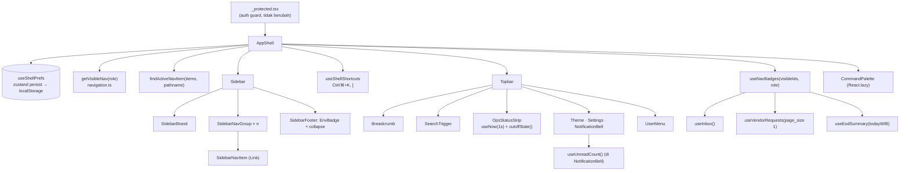

# Design Document

## Overview

Revamp shell CompanyPortal-Vite menjadi "CROWN": Sidebar oxblood (Expanded 264px / Rail 76px), Topbar 64px dengan breadcrumb, pemicu pencarian, strip cut-off CIT, ikon tema/pengaturan/notifikasi, menu user, dan Command Palette Ctrl+K. Frontend only, tanpa endpoint baru.

Prinsip:
- **Route = sumber kebenaran menu aktif** (D12). Tidak ada state "menu aktif" di komponen; semua turunan dari `useRouterState().location.pathname`.
- **NavConfig tetap satu-satunya daftar menu.** Sidebar, Topbar (Pengaturan), breadcrumb, palette, dan badge membaca daftar terfilter yang sama (`getVisibleNav(role)`), sehingga visibilitas tidak bisa melebar (Req 2.7).
- **Logika murni dipisah dari komponen** (`lib/shell/*`, `navigation.ts`) agar bisa diuji property-based tanpa DOM.
- **Token dulu.** Semua warna masuk `tokens.css` sebagai OKLCH `--shell-*` (D3); komponen hanya memakai `var(--shell-*)`.

Keputusan PO (Dn = Qn di requirements):

| # | Keputusan |
| --- | --- |
| D1 | Masuk plan sebagai X.1. |
| D2 | Self-host `@fontsource-variable/plus-jakarta-sans@5.3.0` + `@fontsource-variable/jetbrains-mono@5.3.0` (exact pin). `design.md` steering Sec 6 diperbarui. |
| D3 | Hex brief dikonversi ke OKLCH (`--shell-*`). Dua warna muted disesuaikan agar lolos AA (lihat Data Models). |
| D4 | Indikator aktif = gradient + ikon merah + dot 6px sebelum label (tanpa side-stripe). |
| D5 | Sidebar `dark` default, toggle `dark`/`light` khusus Sidebar. Deviasi dicatat di `design.md`. |
| D6 | Topbar solid `--shell-topbar-bg` tanpa blur; blur hanya overlay palette. Transisi `width` sidebar diizinkan (deviasi), off saat reduced-motion. |
| D7 | UserMenu: baris info (email) + "Keluar". Baris kedua tombol = label role. |
| D8 | Badge Request CIT per role (tabel di Components); dot EOD dari `useEodSummary(today)`. |
| D9 | `VITE_APP_ENV` (`dev`/`uat`/`prod`) + `__APP_VERSION__` dari `package.json`. |
| D10 | `CIT_CUTOFF_WIB = "15:00"`, tiap hari, tanggal ops = tanggal kalender WIB. |
| D11 | Tidak ada item "Vendor Request" baru. |
| D12 | TSX di komponen layout yang ada; menu aktif dari route. |
| D13 | Item `disabled` (Tagihan, Perhitungan Kas) disembunyikan. |
| D14 | ✅ DIPUTUSKAN PO 2026-10-23: CIMB Red brief (hue 22) dipakai **hanya untuk navigasi/shell** (`--shell-accent`). `--red-500` dan tombol primary halaman tidak berubah. |

## Architecture



Alur data:
1. `AppShell` membaca `user.role` dari `useAuthStore`, menghitung `visible = getVisibleNav(role)` (memo).
2. `active = findActiveNavItem(visible.all, pathname)` dipakai Sidebar (highlight), Topbar (breadcrumb, tombol Pengaturan), dan palette (kotak ikon merah).
3. `useNavBadges` hanya mengaktifkan query untuk id yang ada di `visible` (Req 13.4) dan mengembalikan `Record<NavItemId, NavBadge | undefined>`.
4. `useShellPrefs` menyimpan `{ rail, sidebarTheme, collapsedGroups }`. Efektif rail = `prefs.rail || viewport < 1024` (Req 4.7) tanpa menulis ke store.
5. `useShellShortcuts` memasang satu listener `keydown` di `document`: Ctrl/⌘+K → buka palette (simpan `document.activeElement` untuk restore fokus); `[` → toggle rail kecuali target editable.
6. Navigasi selalu lewat TanStack Router (`<Link to>` di sidebar, `router.navigate` di palette/Topbar). Efek "fokus ke `<main>` saat pathname berubah" dipertahankan (Req 16.1).

## Components and Interfaces

### Data & logika (`src/lib`)

#### `src/lib/config/navigation.ts` (Req 2, 3.2, 7, 10.2, 12.3, 13, D11, D13)
Perubahan tipe (additive, nilai lama tetap valid):

```ts
export type NavGroup = "general" | "replenish" | "cit" | "monitoring" | "forecasting"
  | "invoice" | "cash-count" | "system";
export type NavPlacement = "sidebar" | "topbar";
export type NavBadgeSource = "approvals-inbox" | "cit-requests" | "eod-health";

export interface NavItem {
  id: string; label: string; icon: LucideIcon; href: string;
  roles: (DbRole | "*")[]; group: NavGroup; disabled?: boolean;
  placement?: NavPlacement;      // default "sidebar"
  badge?: NavBadgeSource;        // sumber NavBadge, bukan nilai
}

export const GROUP_LABELS: Record<NavGroup, string>; // + system: "Sistem"
export const SIDEBAR_GROUP_ORDER: NavGroup[] = ["general","replenish","cit","monitoring","forecasting"];

export interface VisibleNav { all: NavItem[]; sidebar: Map<NavGroup, NavItem[]>; settings?: NavItem }
export function getVisibleNav(role: DbRole | null): VisibleNav;           // filterNavByRoles + !disabled
export function findActiveNavItem(items: NavItem[], pathname: string): NavItem | undefined;
export function filterPaletteItems(items: NavItem[], query: string): NavItem[];
```

- Ikon diganti: Dashboard `LayoutGrid`, EOD Monitoring `HeartPulse`, Kalender Libur `CalendarDays`; Pengaturan `Settings2`, `group: "system"`, `placement: "topbar"`.
- Badge: Persetujuan `approvals-inbox`, Request CIT `cit-requests`, EOD Monitoring `eod-health`.
- `filterNavByRoles` tidak diubah. `getVisibleNav` = `filterNavByRoles(NAV_CONFIG, role).filter(i => !i.disabled)`; `sidebar` hanya `placement !== "topbar"` dan grup di `SIDEBAR_GROUP_ORDER`, grup kosong dibuang (Req 2.4).
- `findActiveNavItem`: normalisasi trailing slash; item cocok bila `href === "/" ? path === "/" : path === href || path.startsWith(href + "/")`; pilih `href` terpanjang (Req 3.2). `/settings/admin/holidays` → Kalender Libur, `/settings/admin/users` → Pengaturan.
- `filterPaletteItems`: `q = query.trim().toLocaleLowerCase("id-ID")`; kosong → semua; selain itu `label` atau `GROUP_LABELS[group]` mengandung `q`; urutan asli dipertahankan (Req 12.4).

#### `src/lib/shell/prefs.ts` (Req 2.5, 4.6, 6.3)
Zustand `persist` (sudah bagian dari `zustand`, tanpa dependency baru), key `crown.shell.v1`, `version: 1`.

```ts
interface ShellPrefs { rail: boolean; sidebarTheme: "dark" | "light"; collapsedGroups: NavGroup[] }
export const DEFAULT_SHELL_PREFS: ShellPrefs = { rail: false, sidebarTheme: "dark", collapsedGroups: [] };
export function sanitizeShellPrefs(raw: unknown): ShellPrefs;   // dipakai di `merge`
export const useShellPrefs: UseBoundStore<...>;                 // toggleRail, toggleTheme, toggleGroup
```
`sanitizeShellPrefs` membuang field asing/tipe salah dan grup tak dikenal, fallback ke default per field. Storage dibungkus `createJSONStorage(() => safeLocalStorage)` yang menelan error (mode privat/kuota).

#### `src/lib/shell/time.ts` (Req 9, D10)
```ts
export const CIT_CUTOFF_WIB = "15:00";
export function wibParts(now: Date): { y: number; m: number; d: number; hh: number; mm: number; ss: number };
export function formatOpsDate(now: Date): string;               // Intl id-ID, timeZone Asia/Jakarta, {day:"numeric", month:"short"} → "20 Okt"
export function todayWib(now: Date): string;                    // "YYYY-MM-DD" untuk useEodSummary
export type CutoffState = { kind: "open" | "warning" | "closed"; remainingMs: number };
export function cutoffState(now: Date, cutoff = CIT_CUTOFF_WIB): CutoffState;
export function formatHms(ms: number): string;                  // "HH:MM:SS", clamp ≥ 0
export function useNow(intervalMs: number): Date;               // setInterval, cleanup on unmount
```
WIB = UTC+7 tanpa DST, sehingga `cutoffState` menghitung `cutoffUtcMs = Date.UTC(y,m-1,d,15-7,0,0)` dari `wibParts`, tidak bergantung zona perangkat (Req 9.6). `warning` bila `0 < remaining < 3_600_000`, `closed` bila `remaining <= 0`.

#### `src/lib/shell/shortcuts.ts` (Req 4.1, 4.2, 8.2)
```ts
export function isEditableTarget(t: EventTarget | null): boolean; // input/textarea/select/[contenteditable]/role=combobox
export type ShellShortcut = "palette" | "toggle-rail" | null;
export function matchShellShortcut(e: Pick<KeyboardEvent,"key"|"ctrlKey"|"metaKey"|"altKey"|"shiftKey"|"target">): ShellShortcut;
export function useShellShortcuts(h: { onPalette(): void; onToggleRail(): void; enabled: boolean }): void;
```
- `palette`: `key.toLowerCase()==="k"` dan (`ctrlKey` || `metaKey`), berlaku juga di dalam input (Req 8.2), `preventDefault`.
- `toggle-rail`: `key==="["`, tanpa modifier, dan `!isEditableTarget(target)`. Dinonaktifkan saat palette terbuka.

#### `src/lib/config/appEnv.ts` (Req 5.2–5.4, D9)
```ts
export type AppEnv = "dev" | "uat" | "prod";
export function parseAppEnv(raw: string | undefined): AppEnv;   // tak dikenal → "dev"
export const APP_ENV: AppEnv; export const APP_VERSION: string; // __APP_VERSION__
export const ENV_LABEL: Record<AppEnv, string>;                  // DEV / UAT / PRODUKSI
```
`vite.config.ts`: `define: { __APP_VERSION__: JSON.stringify(pkg.version) }`, deklarasi di `src/vite-env.d.ts`. `.env.example` + `.env.local` mendapat `VITE_APP_ENV=dev`. Dockerfile build arg `VITE_APP_ENV` (default `prod`) agar image produksi tidak tampil "DEV".

#### `src/lib/utils/initials.ts` (Req 11.1)
`getInitials(fullName: string): string` → 2 huruf pertama kata pertama+terakhir, uppercase; satu kata → 1–2 huruf; kosong → "?".

### Frontend: komponen layout (`src/components/layout`)

#### `AppShell.tsx` (Req 4.7, 15.4, 16.1–16.3)
- Grid `grid-template-columns: var(--sb-w) 1fr`, `h-screen overflow-hidden`; Sidebar `row-span-2`; `<main id="main-content" tabIndex={-1}>` scroll sendiri, latar `--shell-canvas`.
- Skip link pertama di DOM: `<a href="#main-content" class="sr-only focus:not-sr-only …">Lewati ke konten utama</a>`.
- `effectiveRail = prefs.rail || isNarrow` (`matchMedia("(max-width: 1023px)")`), tidak memanggil `setRail` dari media query.
- Memiliki state `paletteOpen` + `returnFocusRef`; merender `<Suspense fallback={null}><CommandPalette/></Suspense>` hanya saat `paletteOpen` (lazy agar tidak masuk initial-load budget).
- Atribut `data-sidebar-theme={theme}` pada `<aside>` untuk men-scope token tema.
- Props tetap `{ children, notifications? }` sehingga `_protected.tsx` tidak berubah (Req 16.2).

#### `Sidebar.tsx` (Req 1–5)
Dipecah menjadi subkomponen dalam folder `sidebar/`:
- `SidebarBrand` (Req 1): logo 36px `rounded-xl` `--shell-accent`, "C" `--shell-on-accent`; dot `--success-solid` 8px dengan ring warna latar sidebar, `<span class="sr-only">Status: online</span>`. Rail → logo saja, center.
- `SidebarNavGroup` (Req 2.5, 2.6, 4.3): tombol label `<button aria-expanded aria-controls>` uppercase 12px bold `tracking-[0.12em]`, `ChevronDown` rotate. Isi dibungkus `div.grid` dengan `grid-template-rows: 1fr|0fr` + `transition-[grid-template-rows] 200ms` dan anak `min-h-0 overflow-hidden`. Saat terlipat, item aktif tetap dirender di luar wrapper yang terlipat (Req 2.6). Rail: label diganti `<hr>` 24px, grup tidak bisa dilipat (semua item tampil).
- `SidebarNavItem` (Req 3, 4.3, 4.4): `<Link to={href} data-nav-item aria-current>` 40px `rounded-xl` `gap-3` `text-[14px]`, ikon 18px (`strokeWidth` 2.5 aktif / 2 normal). Aktif: `bg-[image:var(--shell-active-bg)]` + dot 6px `--shell-accent` sebelum label (D4) + ikon `--shell-icon-active`. Badge angka: `font-mono text-[12px] tabular-nums` pill `--shell-badge-bg`, aktif `--shell-accent`/`--shell-on-accent`. Badge dot: 8px `--warning-solid` `motion-safe:animate-pulse`. Nama aksesibel: `aria-label="{label}, {n} menunggu"` / `"{label}, perlu perhatian"`. Rail: ikon center, badge → dot 6px `--shell-accent` di pojok ikon, tooltip `role="tooltip"` id unik + `aria-describedby`, tampil pada `mouseenter` dan `focus`, posisi `left-full ml-3`, latar `--shell-tooltip-bg`.
- Keyboard: roving tabindex ArrowUp/ArrowDown yang ada dipindahkan ke `<nav>`; Enter ditangani native oleh `<Link>` (Req 3.8). Hover via kelas Tailwind (`hover:bg-[var(--shell-sb-hover)]`), handler inline `onMouseOver` dihapus.
- `SidebarFooter` (Req 4.5, 5.1–5.4): `border-t var(--shell-sb-line)`. `EnvBadge` (disembunyikan saat rail): eyebrow "LINGKUNGAN", baris `{ENV_LABEL} · v{APP_VERSION}`, chip `--shell-gold` teks + `--shell-gold-bg` (20%) bila `APP_ENV !== "prod"`. Tombol collapse: ikon `ChevronsLeft`/`ChevronsRight`, teks "Ciutkan menu" (rail: hanya ikon, `aria-label="Perluas menu"`), `<kbd>[</kbd>`.
- Area nav `overflow-y-auto` dengan kelas `.shell-scroll` (scrollbar 6px, `scrollbar-width: thin`, thumb `--shell-sb-line`) (Req 5.5).
- Lebar: `--sb-w` 264px/76px, `transition-[width] duration-300 ease-[cubic-bezier(0.22,1,0.36,1)] motion-reduce:transition-none` (D6).

#### `Topbar.tsx` (menggantikan `Header.tsx`) (Req 7–11)
Layout `sticky top-0 h-16 px-6 flex items-center gap-3`, `bg-[var(--shell-topbar-bg)] border-b border-[var(--shell-topbar-line)]` (D6, tanpa blur).
- `Breadcrumb` (Req 7): `<nav aria-label="Breadcrumb"><ol>` grup `--shell-muted` › item `font-semibold --shell-ink aria-current="page"`; separator `ChevronRight` 14px `aria-hidden`. Pengaturan → "Sistem › Pengaturan" otomatis dari `GROUP_LABELS.system`. Tidak dirender bila `active` undefined.
- `SearchTrigger` (Req 8): `<button aria-haspopup="dialog" aria-keyshortcuts="Control+K Meta+K">` `ml-auto w-[260px] 2xl:w-[340px]`, latar `--shell-canvas`, border `--shell-input-line`, teks "Cari menu atau fitur…", `<kbd>` "Ctrl K" / "⌘ K" (deteksi `navigator.platform`/`userAgentData` sekali).
- `OpsStatusStrip` (Req 9): `hidden lg:flex` kapsul `rounded-full border`. Segmen 1: dot `--success-solid` + `motion-safe:animate-ping` halo, `formatOpsDate(now)`. Segmen 2: `Clock3` + "Cut-off CIT" + `<time class="font-mono tabular-nums">`; `warning` → latar `--shell-accent-tint`, angka `--shell-accent`, ikon tetap + teks sr-only "kurang dari 1 jam"; `closed` → teks "ditutup". `useNow(1000)` hanya di komponen ini (re-render terisolasi). Kapsul `role="group" aria-label="Status operasional: {tanggal}, cut-off CIT pukul 15.00 WIB"`; angka berjalan `aria-hidden`, tanpa `aria-live` (Req 9.7).
- `TopbarIconButton` 40×40 `rounded-xl`: toggle tema (`Moon` bila tema saat ini `dark` → label "Gunakan sidebar terang"; `Sun` sebaliknya) (Req 6.2); Pengaturan (`Settings2`, dirender hanya bila `visible.settings`, `aria-current` + `--shell-accent-tint`/`--shell-accent` saat aktif) (Req 10.2, 10.3); slot `notifications` (Req 10.4–10.5). Divider `w-px h-8 --shell-topbar-line`.
- `UserMenu` (Req 11, D7): tombol `aria-haspopup="menu" aria-expanded aria-controls`, avatar 36px `bg-[image:var(--shell-avatar-bg)]` + `getInitials(fullName)`, nama 14px semibold, role label 12px muted (`ROLE_LABELS` bila ada, fallback kode role), `ChevronDown` rotate 180°. Panel `role="menu"` `w-60 rounded-2xl shadow-[var(--shell-shadow-pop)]`, animasi `.shell-pop` (opacity + scale 0.96 → 1, `transform-origin: top right`, 150ms). Isi: header info (fullName + email, non-interaktif), divider, `menuitem` "Keluar" (`LogOut`, `--danger-fg`, hover `--danger-bg`) → `logout()`. Pola menu button: fokus ke item pertama saat buka, ArrowUp/Down/Home/End, Escape menutup + fokus kembali ke tombol, `pointerdown` di luar menutup (ganti `onBlur setTimeout`). `data-testid` lama (`header-user-name`, `header-email`, `header-logout-button`) dipertahankan.

#### `src/features/notifications/NotificationBell.tsx` (Req 10.4, 10.5)
Hanya styling tombol: 40×40 `rounded-xl`, badge `h-[18px] min-w-[18px] rounded-full bg-[var(--shell-accent)] text-[var(--shell-on-accent)] ring-2 ring-[var(--shell-topbar-bg)] text-[11px] font-mono`. Logika panel tidak diubah.

#### `CommandPalette.tsx` (Req 12)
Default export untuk `React.lazy`. Props: `{ items: NavItem[]; activeId?: string; onSelect(item): void; onClose(): void }`.
- Overlay `fixed inset-0 bg-[var(--shell-overlay)] backdrop-blur-sm` (`pointerdown` di overlay → close). Panel `role="dialog" aria-modal="true" aria-label="Cari menu"` `w-[min(560px,calc(100vw-32px))] mt-[12vh] rounded-2xl`, animasi `.shell-pop` (origin top).
- Input `role="combobox" aria-expanded="true" aria-controls="palette-list" aria-activedescendant` 16px, autofocus, `<kbd>Esc</kbd>`.
- List `role="listbox" id="palette-list"`, opsi `role="option" id="palette-opt-{id}" aria-selected`. Baris: kotak ikon 32px (aktif/terpilih: `--shell-accent` + ikon `--shell-on-accent`; normal: `--shell-chip-bg` + ikon `--shell-maroon`), label, label grup kanan muted, `CornerDownLeft` pada baris terpilih. `scrollIntoView({ block: "nearest" })` saat indeks berubah.
- State lokal `query` + `index`, reset ke `""`/0 saat mount (palette di-unmount saat tutup, Req 12.10) dan `index` → 0 saat query berubah. `nextIndex(i, delta, n)` modular (diekspor untuk test).
- Focus trap: Tab/Shift+Tab tetap di input (satu-satunya tabbable). Escape → `onClose`. AppShell me-restore fokus ke `returnFocusRef` setelah unmount (Req 12.8).
- Kosong: `<p role="status">Tidak ada menu "{q}"</p>` (Req 12.9).
- Pilih: `onSelect` → `router.navigate({ to: item.href })` lalu close (Req 12.7).

#### `useNavBadges.ts` (Req 13, D8)
```ts
export type NavBadge = { kind: "count"; value: string; raw: number } | { kind: "dot" };
export function badgeRequestStatuses(role: DbRole): VendorRequestStatus[] | null;
export function useNavBadges(visible: VisibleNav, role: DbRole | null): Partial<Record<NavBadgeSource, NavBadge>>;
```
Setiap query dipanggil selalu (rules of hooks) tetapi dengan `enabled` = item terlihat:
- `approvals-inbox`: `useInbox()` dengan opsi `enabled` baru (default `true` agar pemanggil lama tidak berubah) + `refetchInterval: 60_000`; nilai `data.length`.
- `cit-requests`: `useVendorRequests({ status, pageSize: 1 }, { enabled: status !== null && visible })` → `pagination.total_count`. Mapping D8 (dapat dikoreksi PO):

  | Role | Status dihitung |
  | --- | --- |
  | ATM-SPV, BRANCH-ATM-SPV | `pending_approval`, `completion_pending`, `vault_review` |
  | ATM-USER, BRANCH-ATM-USER | `draft`, `rejected` |
  | lainnya (termasuk ADMIN bypass) | tanpa badge (`null`) |

- `eod-health`: `useEodSummary(todayWib(now), 300_000)` dengan `enabled` hanya bila role ADMIN/ADMIN_PARAM dan item terlihat; dot bila `counts.failed + counts.max_retries_exhausted + counts.late > 0`.
- Semua: `formatBadgeCount(n)`; `null`/error/loading → `undefined` (Req 13.5, 13.6). `useInbox` / `useVendorRequests` / `useEodSummary` diberi parameter `options?: { enabled?: boolean; refetchInterval?: number | false }` additive.

### Styling global (`src/styles`)
- `index.css`: `@import "@fontsource-variable/plus-jakarta-sans/wght.css"` dan `@import "@fontsource-variable/jetbrains-mono/wght.css"` sebelum `tokens.css` (di-bundle Vite, `font-display: swap`, lolos CSP `font-src 'self'`) (Req 14.2, 14.3).
- `@theme { --font-sans: …; --font-mono: …; }` agar utilitas `font-sans`/`font-mono` Tailwind memakai font baru.
- Keyframes `.shell-pop` (150ms ease-out, opacity + scale) dan `.shell-scroll`; blok `@media (prefers-reduced-motion: reduce)` menonaktifkan `.shell-pop`, ping, pulse, rotasi chevron, transisi lebar (Req 15.2).
- Focus ring: `.shell-focus:focus-visible { outline: 2px solid var(--shell-focus); outline-offset: 2px }`; `--shell-focus` ditentukan per tema sidebar (Req 15.3).

## Data Models

Tidak ada tabel, kolom, migrasi, atau endpoint baru. Model data hanya di sisi klien:

**`localStorage["crown.shell.v1"]`** (zustand persist, `{ state, version: 1 }`)

| Field | Tipe | Default | Validasi |
| --- | --- | --- | --- |
| `rail` | boolean | `false` | non-boolean → default |
| `sidebarTheme` | `"dark" \| "light"` | `"dark"` | nilai lain → default |
| `collapsedGroups` | `NavGroup[]` | `[]` | buang nilai di luar `SIDEBAR_GROUP_ORDER`, dedupe |

Tidak ada data sensitif (token/identitas) di storage ini.

**Env build**: `VITE_APP_ENV` (`dev`/`uat`/`prod`), `__APP_VERSION__` (string dari `package.json`).

**Token baru di `tokens.css`** (Req 14.1, D3). Nilai hasil konversi hex brief ke OKLCH:

| Token | OKLCH | Asal brief | Catatan |
| --- | --- | --- | --- |
| `--shell-sb-bg` | `oklch(0.188 0.031 6)` | #1F0D11 | |
| `--shell-sb-glow` | `oklch(0.249 0.064 12)` | #3A1219 | radial-gradient kiri atas |
| `--shell-accent` | `oklch(0.530 0.207 22)` | #C8102E | CIMB Red brief |
| `--shell-accent-hover` | `oklch(0.483 0.188 22)` | #B00E28 | |
| `--shell-icon-active` | `oklch(0.677 0.213 18)` | #FF4D63 | ikon aktif tema dark |
| `--shell-maroon` | `oklch(0.376 0.138 20)` | #7A1020 | |
| `--shell-ink` | `oklch(0.240 0.026 7)` | #2A1A1D | |
| `--shell-muted` | `oklch(0.527 0.030 6)` | #7B6468 | #8A7276 dipakai **hanya** dekoratif: 4.42:1 di putih, gagal AA |
| `--shell-topbar-line` | `oklch(0.932 0.010 17)` | #EFE6E6 | |
| `--shell-input-line` | `oklch(0.912 0.012 17)` | #EADFDF | |
| `--shell-canvas` | `oklch(0.978 0.003 40)` | #FAF7F6 | |
| `--shell-topbar-bg` | `oklch(0.995 0.002 17)` | putih 80% → solid (D6) | bukan #fff murni |
| `--shell-gold` / `--shell-gold-bg` | `oklch(0.791 0.133 79)` / `… / 0.2` | #E8B04B | |
| `--shell-chip-bg` | `oklch(0.958 0.008 17)` | #F6EFEF | |
| `--shell-overlay` | `oklch(0.188 0.031 6 / 0.4)` | #1F0D11 40% | |
| `--shell-tooltip-bg` | `var(--shell-ink)` | #2A1A1D | |
| `--shell-accent-tint` | `oklch(0.530 0.207 22 / 0.08)` | merah 8% | |
| `--shell-active-bg` | `linear-gradient(90deg, oklch(0.530 0.207 22 / .28), oklch(0.530 0.207 22 / .08))` | | tema light: `/ .10 → / .04` |
| `--shell-avatar-bg` | `linear-gradient(135deg, var(--shell-accent), var(--shell-maroon))` | | |
| `--shell-on-accent` | `oklch(0.985 0.006 17)` | putih | |
| `--shell-shadow-pop` | `0 12px 32px oklch(0.25 0.02 20 / 0.12)` | shadow lembut | |

Token yang di-scope per tema (`[data-sidebar-theme="dark"|"light"]`):

| Token | dark | light |
| --- | --- | --- |
| `--shell-sb-surface` | `--shell-sb-bg` + glow | `--n-0` |
| `--shell-sb-text` | `oklch(0.836 0.025 8)` (#D9C3C6, 11.2:1) | `oklch(0.431 0.027 8)` (#5E4A4D, 8.2:1) |
| `--shell-sb-strong` | `oklch(0.978 0.011 17)` (#FFF5F5) | `--shell-ink` |
| `--shell-sb-group` | `oklch(0.640 0.036 6)` (dinaikkan dari #8F7378 yang 4.35:1) | `--shell-muted` |
| `--shell-sb-hover` | `oklch(1 0 0 / 0.05)` | `oklch(0.240 0.026 7 / 0.04)` |
| `--shell-sb-line` | `oklch(1 0 0 / 0.08)` | `--shell-topbar-line` |
| `--shell-badge-bg` | `oklch(1 0 0 / 0.09)` | `--shell-chip-bg` |
| `--shell-icon-active` | `oklch(0.677 0.213 18)` | `--shell-accent` |
| `--shell-focus` | `--shell-icon-active` | `--shell-accent` |

Catatan brand: hue CIMB Red brief (22) berada di antara brand `--red-*` (29) dan danger (12). Danger tetap memakai `--danger-*` hue 12 + ikon + teks (design.md Sec 5), dan "Keluar" memakai `--danger-fg`, jadi aturan brand-vs-error tetap terjaga.

## Correctness Properties

### Property 1: Visibilitas menu tidak melebar
*For any* `DbRole` (dan `null`), himpunan id di `getVisibleNav(role).all` sama dengan `filterNavByRoles(NAV_CONFIG, role)` tanpa item `disabled`; gabungan id item Sidebar dan `settings` sama dengan `all`; Sidebar tidak memuat item `placement: "topbar"` maupun grup kosong; palette tanpa query menampilkan tepat `all`.
**Validates: Requirements 2.1, 2.3, 2.4, 2.7, 10.2, 12.3**

### Property 2: Menu aktif = prefix segmen terpanjang
*For any* daftar item dan pathname, `findActiveNavItem` mengembalikan item yang `href`-nya prefix segmen dari pathname dengan panjang maksimum, `undefined` bila tidak ada; `/` hanya cocok untuk pathname `/`; `href` yang hanya prefix string (mis. `/cash-flow` vs `/cash-flowx`) tidak cocok; trailing slash tidak mengubah hasil.
**Validates: Requirements 3.2, 7.2, 7.3, 7.4, 10.3**

### Property 3: Filter palette
*For any* daftar item dan string query, `filterPaletteItems` mengembalikan subsequence dari input (urutan dipertahankan) yang berisi tepat item yang label atau label grupnya mengandung `query.trim()` tanpa membedakan huruf besar/kecil; query kosong/spasi mengembalikan seluruh daftar; menambah spasi di awal/akhir atau mengubah kapitalisasi tidak mengubah hasil.
**Validates: Requirements 12.4, 12.9**

### Property 4: Navigasi baris palette melingkar
*For any* `n ≥ 1`, indeks awal `0 ≤ i < n`, dan urutan ArrowUp/ArrowDown, `nextIndex` selalu berada di `[0, n)`, dan `n` kali ArrowDown kembali ke indeks awal.
**Validates: Requirements 12.6, 12.10**

### Property 5: Hitung mundur cut-off berbasis WIB
*For any* instant `t` dan zona waktu proses apa pun, `cutoffState(t)` sama dengan perhitungan referensi `cutoff = 15:00 WIB pada tanggal WIB t`: `closed` bila `t ≥ cutoff`, `warning` bila `0 < cutoff − t < 1 jam`, selain itu `open`; `remainingMs = max(0, cutoff − t)`; `formatHms` selalu berpola `^\d{2}:\d{2}:\d{2}$` dan bolak-balik ke detik yang sama.
**Validates: Requirements 9.2, 9.3, 9.4, 9.5, 9.6**

### Property 6: Preferensi shell aman dimuat
*For any* nilai JSON acak di `localStorage["crown.shell.v1"]`, `sanitizeShellPrefs` menghasilkan `ShellPrefs` valid; untuk setiap `ShellPrefs` valid, simpan lalu muat mengembalikan nilai yang sama.
**Validates: Requirements 2.5, 4.6, 6.3**

### Property 7: Shortcut menghormati target editable
*For any* kombinasi key/modifier dan target elemen, `matchShellShortcut` mengembalikan `"palette"` untuk Ctrl/⌘+K di target mana pun, `"toggle-rail"` untuk `[` tanpa modifier hanya bila target tidak editable, dan `null` selain itu.
**Validates: Requirements 4.1, 4.2, 8.2**

### Property 8: Inisial avatar
*For any* string `fullName`, `getInitials` mengembalikan 1–2 karakter uppercase yang diambil dari huruf awal kata pertama dan terakhir, atau `"?"` bila tidak ada huruf.
**Validates: Requirements 11.1**

### Property 9: Badge hanya untuk item terlihat dan nilai positif
*For any* role dan hasil query (angka ≥ 0, error, loading), `useNavBadges` hanya mengaktifkan query untuk sumber badge yang item-nya ada di `getVisibleNav(role)` (dan EOD hanya untuk ADMIN/ADMIN_PARAM), dan menghasilkan badge angka hanya bila nilai > 0 dengan format `formatBadgeCount`.
**Validates: Requirements 13.1, 13.2, 13.3, 13.4, 13.5, 13.6**

### Property 10: Kontras token shell
*For any* pasangan teks/latar yang terdaftar untuk shell (kedua tema sidebar, Topbar, palette, dropdown, tooltip, badge, chip), rasio kontras ≥ 4.5:1 untuk teks normal dan ≥ 3:1 untuk ikon non-dekoratif.
**Validates: Requirements 14.4**

## Error Handling

| Kondisi | Penanganan |
| --- | --- |
| `localStorage` tidak tersedia / kuota / JSON rusak | `safeLocalStorage` menelan error; `sanitizeShellPrefs` jatuh ke default; shell tetap jalan dengan state in-memory. |
| Query badge error / 403 / loading | Badge tidak dirender (Req 13.6); tidak ada toast, error tetap terlihat di halaman fitur terkait. |
| EOD service (:8091) mati | `useEodSummary` error → tanpa dot; `retry` default 1 dari QueryClient. |
| `VITE_APP_ENV` kosong/tak dikenal | `parseAppEnv` → `"dev"` (aman: chip peringatan tampil, bukan menyamar produksi). |
| Font gagal dimuat | Stack fallback `Plus Jakarta Sans Variable, -apple-system, "Segoe UI", system-ui, sans-serif` dan `JetBrains Mono Variable, ui-monospace, Consolas, monospace`. |
| Chunk palette gagal dimuat (lazy) | `Suspense` + error boundary kecil: tutup palette, `console.error`, tombol pencarian tetap bisa dicoba lagi. |
| `fullName` kosong | Inisial `"?"`, nama fallback `username`. |
| Pathname tanpa item | Tidak ada highlight & breadcrumb (Req 7.4). |
| Jam perangkat salah | Countdown mengikuti jam perangkat (tidak ada waktu server); diterima, dicatat di Notes tasks. |

## Testing Strategy

Vitest + React Testing Library + fast-check (sudah terpasang). Setiap property test minimal 100 run, diberi komentar `// Property N`.

| File | Isi |
| --- | --- |
| `src/lib/config/navigation.property.test.ts` | Property 1, 2, 3 (update file yang ada). |
| `src/lib/config/navigation.test.ts` | Contoh konkret: ikon per item, Pengaturan `system/topbar`, `/replenishment/vendor-requests/42` → Request CIT, `/settings/admin/holidays` → Kalender Libur. |
| `src/lib/shell/time.property.test.ts` | Property 5 (`fc.integer` epoch ms; jalankan juga dengan `process.env.TZ` di-set ke `America/New_York` lewat helper). |
| `src/lib/shell/prefs.property.test.ts` | Property 6 (`fc.jsonValue()`). |
| `src/lib/shell/shortcuts.property.test.ts` | Property 7. |
| `src/lib/utils/initials.property.test.ts` | Property 8. |
| `src/components/layout/CommandPalette.test.tsx` (+ `nextIndex` property) | Property 4; buka via Ctrl+K, filter, empty state, Enter navigasi, Escape + restore fokus, klik overlay, ARIA combobox/listbox. |
| `src/components/layout/useNavBadges.test.tsx` | Property 9 (per role via `fc.constantFrom(ROLES)`, assert `enabled`), mapping D8, sembunyi saat 0/error. |
| `src/components/layout/Sidebar.test.tsx` | Brand, grup lipat + `aria-expanded`, item aktif tetap tampil saat grup terlipat, badge + nama aksesibel, rail (divider, dot, tooltip hover/focus), footer EnvBadge (prod vs non-prod), roving keyboard, link `href`. |
| `src/components/layout/Topbar.test.tsx` (ganti `Header.test.tsx` + `Header.property.test.tsx`) | Breadcrumb (termasuk Sistem › Pengaturan, tanpa item), tombol Pengaturan per role + aktif, toggle tema, OpsStatusStrip dengan `vi.useFakeTimers` (open/warning/closed, tanpa `aria-live`), UserMenu (inisial, keyboard, Escape, klik luar, logout, testid lama). |
| `src/components/layout/AppShell.test.tsx` | Fokus ke `<main>` saat route berubah, skip link, `[` toggle + diabaikan di input, rail paksa < 1024px tanpa mengubah prefs, persistensi tema/rail setelah remount, `_protected` tetap merender shell. |
| `src/components/layout/accessibility.property.test.tsx` | Update selector; semua elemen interaktif punya nama aksesibel di kedua tema dan mode rail. |
| `src/styles/contrast.property.test.ts` | Property 10: tambah pasangan `--shell-*` (memakai konverter OKLCH inline yang sudah ada). |
| `src/features/notifications/NotificationBell.test.tsx` | Tetap lulus; tambah assert badge 18px tersembunyi saat 0. |
| `src/lib/config/appEnv.test.ts` | `parseAppEnv`, label, chip non-prod. |

Gate: `pnpm run lint`, `pnpm run test:coverage` (84/80/80/85), `pnpm run build` (termasuk `check-bundle.mjs`; palette lazy + font CSS tidak menambah JS initial-load secara signifikan). Pemeriksaan visual dan pembaca layar dilakukan manual oleh user (Golden Rule #10); kepatuhan WCAG penuh tetap butuh uji manual dengan assistive technology.

## Documented deviation

Disetujui PO 2026-10-23 (D2, D4, D5, D6), dicatat ke `.kiro/steering/design.md` pada task dokumentasi:
- Sec 6 Typography: Plus Jakarta Sans + JetBrains Mono self-hosted untuk CompanyPortal (menggantikan system stack).
- Sec 1 / Sec 11: Sidebar CompanyPortal boleh gelap (oxblood) dengan toggle terang; konten, Topbar, dialog tetap light.
- Sec 10: indikator aktif tanpa side-stripe (patuh); `backdrop-blur` hanya untuk overlay modal sementara; transisi `width` sidebar diizinkan sebagai satu-satunya animasi properti layout, dimatikan saat `prefers-reduced-motion`.
- Sec 2: aksen shell `--shell-accent` (hue 22, dari brief) dicatat sebagai token navigasi khusus shell (D14); tombol primary halaman tetap `--red-500`.

## Files touched

| File | Perubahan |
| --- | --- |
| `frontend/CompanyPortal-Vite/package.json`, `pnpm-lock.yaml` | + 2 dependency font (exact) |
| `vite.config.ts`, `src/vite-env.d.ts`, `.env.example`, `.env.local`, `Dockerfile` | `__APP_VERSION__`, `VITE_APP_ENV` |
| `src/styles/tokens.css`, `src/styles/index.css` | token `--shell-*`, font, `@theme`, keyframes, reduced-motion |
| `src/lib/config/navigation.ts`, `src/lib/config/appEnv.ts` | tipe + helper nav, env |
| `src/lib/shell/{prefs,time,shortcuts}.ts`, `src/lib/utils/initials.ts` | baru |
| `src/features/{approvals,vendor-request,eod-monitoring}/hooks*` | opsi `enabled`/`refetchInterval` additive |
| `src/features/notifications/NotificationBell.tsx` | styling tombol |
| `src/components/layout/{AppShell,Sidebar,Topbar,CommandPalette,useNavBadges}.tsx`, `sidebar/*`, `topbar/*`, `index.ts` | rebuild; `Header.tsx` dihapus |
| Test layout (lihat Testing Strategy) | update/baru |
| `.kiro/steering/design.md`, `.kiro/steering/development-plan.md`, `.claude/development-progress.md` | deviasi + status |
