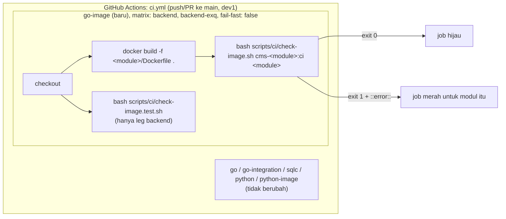
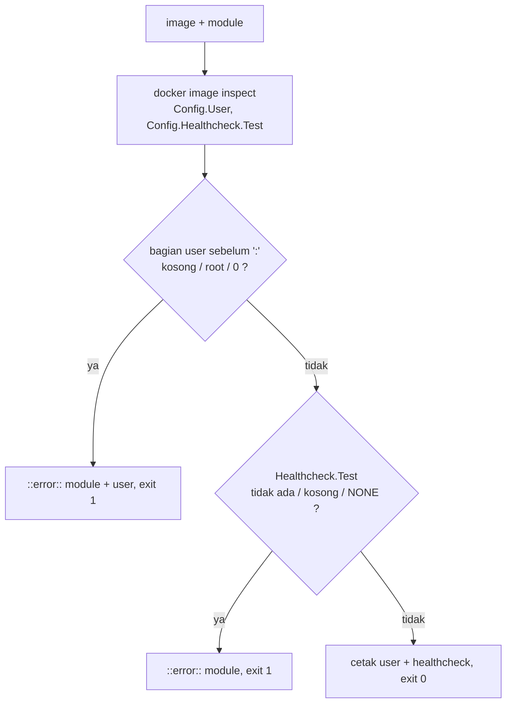
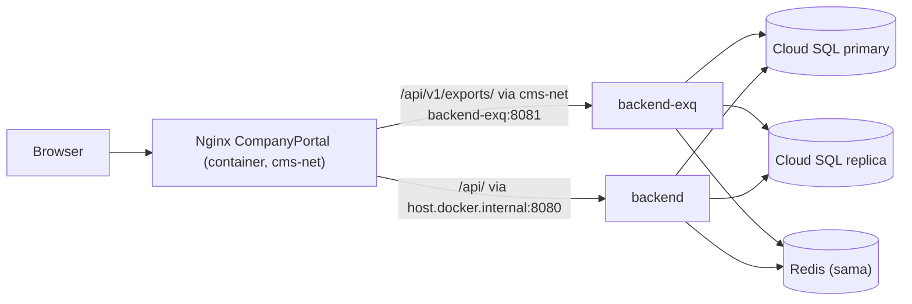

# Design Document

> Status: **design disetujui PO 2026-11-04**. Tasks: `tasks.md`. Requirements: `requirements.md` (disetujui 2026-11-04, D1–D7 mengikuti saran).

## Overview

Spec ini tidak mengubah kode aplikasi. Ada dua jenis perubahan:

1. **CI** (Req 1, 2). Job baru `go-image` di `.github/workflows/ci.yml` membuild image `backend` dan `backend-exq` dari root repo. Setelah itu skrip `scripts/ci/check-image.sh` memeriksa bahwa image tidak berjalan sebagai root dan punya HEALTHCHECK. Skrip punya test fixture sendiri (`scripts/ci/check-image.test.sh`) yang juga dijalankan di CI.
2. **Dokumen** (Req 3–6). Pernyataan usang tentang `backend-exq` di `.claude/docs/deployment.md`, `backend-exq/.env.example`, dan `.kiro/steering/development-plan.md` diperbaiki. `deployment.md` juga mendapat bagian baru "Release checklist: first `backend-exq` deployment".

Pola yang diikuti:
- Job `python-image` yang sudah ada (build saja, tanpa push, tanpa secret).
- `backend/scripts/check-coverage.sh`: skrip bash kecil yang dipanggil dari CI dengan `bash <path>`, sehingga tidak bergantung pada bit executable di checkout Windows. `.gitattributes` menormalkan semua file teks ke LF, jadi skrip `.sh` aman ditulis dari Windows.
- Bahasa `deployment.md` tetap Inggris, mengikuti isi file saat ini.

## Architecture



Alur data `check-image.sh`:



Topologi deploy yang didokumentasikan checklist rilis (Req 4):



Nginx menghubungi `backend-exq` langsung lewat network `cms-net`, sedangkan `backend` dihubungi lewat `host.docker.internal`. Akibatnya `r.RemoteAddr` yang dilihat kedua backend berbeda, dan nilai `TRUSTED_PROXIES`-nya juga berbeda (lihat checklist rilis).

## Components and Interfaces

### CI: GoImageJob (Req 1, Req 2)

#### Job `go-image` di `.github/workflows/ci.yml`

Ditambahkan setelah job `python-image`. Izin workflow tetap `permissions: contents: read` di tingkat atas. Job ini tidak menimpa izin itu dan tidak memakai `secrets.*` (Req 1.4, 1.5).

```yaml
  go-image:
    name: go-image (${{ matrix.module }})
    runs-on: ubuntu-latest
    strategy:
      fail-fast: false # one broken Dockerfile must not cancel the other build (Req 1.3)
      matrix:
        module: [backend, backend-exq]
    steps:
      - uses: actions/checkout@v7
      # Fixture test for the checker itself; once per run, not per module.
      - name: check-image.sh fixture test
        if: matrix.module == 'backend'
        run: bash scripts/ci/check-image.test.sh
      # Same context as <module>/docker-compose.yaml (context: ..): repo root, so pkg/ resolves via go.work.
      - name: docker build (${{ matrix.module }})
        run: docker build -f "${{ matrix.module }}/Dockerfile" -t "cms-${{ matrix.module }}:ci" .
      - name: Image runs as non-root and has a HEALTHCHECK
        run: bash scripts/ci/check-image.sh "cms-${{ matrix.module }}:ci" "${{ matrix.module }}"
```

- Build saja, tanpa `docker push` dan tanpa login registry (Req 1.4, D2).
- Tidak ada `docker run` (D5).
- Image frontend tidak dibuild di sini (D6).
- Nama matrix sama dengan job `go` (`backend`, `backend-exq`), jadi nama check di PR mudah dicocokkan.

#### `scripts/ci/check-image.sh` (baru)

```bash
#!/usr/bin/env bash
# Fails when a built image would run as root or has no HEALTHCHECK.
# Spec: .kiro/specs/backend-exq-deploy-readiness/ (Req 2). Called by ci.yml job go-image.
# Usage: bash scripts/ci/check-image.sh <image> <module>
set -euo pipefail

if [ "$#" -ne 2 ]; then
  echo "usage: $0 <image> <module>" >&2
  exit 2
fi
image="$1"
module="$2"

user="$(docker image inspect --format '{{.Config.User}}' "$image")"
healthcheck="$(docker image inspect --format '{{if .Config.Healthcheck}}{{join .Config.Healthcheck.Test " "}}{{end}}' "$image")"

# USER may be "name", "uid", "name:group" or "uid:gid"; only the user part decides root.
user_part="${user%%:*}"
case "$user_part" in
  "" | root | 0)
    echo "::error::${module} image runs as root (Config.User='${user}'); add a non-root USER to ${module}/Dockerfile"
    exit 1
    ;;
esac

# "HEALTHCHECK NONE" stores Test=["NONE"]; no HEALTHCHECK stores nothing.
case "$healthcheck" in
  "" | NONE)
    echo "::error::${module} image has no HEALTHCHECK; add one to ${module}/Dockerfile"
    exit 1
    ;;
esac

echo "${module}: user=${user} healthcheck=${healthcheck}"
```

- Exit code: `0` lulus, `1` gagal pemeriksaan (Req 2.2, 2.3), `2` salah pemakaian. Kalau image tidak ada, `docker image inspect` gagal dan `set -e` menghentikan skrip dengan exit ≠ 0.
- Format `::error::` membuat pesan muncul sebagai anotasi di GitHub Actions, sama seperti job `go-integration`.
- Untuk image saat ini hasilnya `user=appuser healthcheck=CMD-SHELL wget --no-verbose --tries=1 --spider http://localhost:8081/health || exit 1` (diverifikasi lokal untuk `backend-exq` pada 2026-11-04) (Req 2.4).

#### `scripts/ci/check-image.test.sh` (baru)

Membuild image fixture kecil dari Dockerfile inline lewat stdin (`docker build -t <tag> -`, tanpa context), berbasis `alpine:3.24` (base yang sama dengan runtime kedua backend). Setiap fixture dijalankan melalui `check-image.sh` dan exit code-nya dibandingkan dengan harapan. Image fixture dihapus di akhir (`trap … docker image rm`).

| Fixture | Isi Dockerfile (setelah `FROM alpine:3.24`) | Harapan |
|---|---|---|
| `no-user` | `HEALTHCHECK CMD true` | gagal (user kosong) |
| `user-root` | `USER root` + `HEALTHCHECK CMD true` | gagal |
| `user-0` | `USER 0` + `HEALTHCHECK CMD true` | gagal |
| `user-root-group` | `USER root:nogroup` + `HEALTHCHECK CMD true` | gagal |
| `user-0-0` | `USER 0:0` + `HEALTHCHECK CMD true` | gagal |
| `no-healthcheck` | `USER 65534` | gagal (tanpa HEALTHCHECK) |
| `healthcheck-none` | `USER 65534` + `HEALTHCHECK NONE` | gagal |
| `ok-uid` | `USER 65534` + `HEALTHCHECK CMD true` | lulus |
| `ok-uid-gid` | `USER 65534:65534` + `HEALTHCHECK CMD true` | lulus |
| `ok-name` | `USER nobody` + `HEALTHCHECK CMD true` | lulus |

Untuk fixture yang gagal, test juga memeriksa bahwa output memuat nama modul fixture. Untuk fixture user root, output juga harus memuat nilai user (Req 2.2, 2.3). Skrip keluar dengan exit 1 dan mencetak daftar fixture yang hasilnya tidak sesuai harapan.

`docker build` tidak memeriksa apakah user pada `USER` benar-benar ada, jadi fixture tidak perlu membuat user.

### Dokumen: DeploymentDoc (Req 3)

Perubahan di `.claude/docs/deployment.md`. Teks lain tidak diubah.

| Lokasi | Sekarang | Menjadi | Req |
|---|---|---|---|
| Tabel produk, baris #2 | "`backend-exq/` (8081) is not deployed until it has content (decision 2026-10-08)" | ONE VM runs `backend` (8080); `backend-exq` (8081, async export API + worker + janitor) joins the same VM with the export release (X.7–X.9) | 3.1 |
| Paragraf "Current state (now)" | `backend-exq` "holds only empty `doc.go` files … enters the deploy only once it has real content" | `backend-exq` holds the async export API, worker and janitor (`.kiro/specs/vendor-data-export/`, `report-export-migration/`, `export-menu-revamp/`). Not deployed yet; its first deployment ships with the export release, see "Release checklist: first `backend-exq` deployment". Both backends run as separate containers on the one VM until the 2028 split. | 3.1 |
| Paragraf "Planned (2028)" | tetap | tetap (Redis sama, `JWT_SECRET` sama, firewall) | 3.5 |
| Paragraf "Pipeline", kalimat CI | "… Python unittest; frontend + E2E jobs added by fe-tech-debt E1 / be-tech-debt B5" | "… Python unittest, `python-image` and `go-image` (builds `backend/Dockerfile` and `backend-exq/Dockerfile` from the repo root and fails on a root user or a missing HEALTHCHECK, `scripts/ci/check-image.sh`; build only, no push). There is no frontend or E2E job yet (open item, fe-tech-debt)." | 3.2, 3.6 |
| Paragraf "Pipeline", kalimat CD | "build image (`backend/Dockerfile`; `backend-exq/Dockerfile` is added only when `backend-exq` is deployed)" | "build images (`backend/Dockerfile`, `backend-exq/Dockerfile`, frontend images) … No `cloudbuild.yaml` is in the repo yet; it is set up with the GCP project (infra, user)." | 3.2, D4 |
| Bagian "IP client & proxy tepercaya", bullet `backend-exq` | "`backend-exq` reads the variable but does not use it yet." | "`backend-exq` uses it the same way (`TrustedRealIP` in `backend-exq/cmd/api/main.go`): the IP in the export audit rows (`export_requested`, `master_data_exported`, `report_exported`) comes from it. Nginx reaches `backend-exq` over `cms-net`, not through `host.docker.internal`, so its value differs from `backend`'s (see the release checklist). `backend-exq` does not print the `trusted proxies configured` start line." Kalimat Python EOD di bullet yang sama tetap. | 3.3, D7 |
| Bagian "Ukuran pool DB", bullet primary/replica | "Only `backend` uses the replica pool; `backend-exq` uses the primary only." | "Both APIs open a replica pool when `DATABASE_REPLICA_URL` is set (`backend-exq`: export worker + preview rows; job and scope reads stay on the primary)." | 3.4 |
| Tabel pool, baris Staging | Instances "1 (`backend`)", primary "(100 − 20) / 1 = **80** (start at 20)" | "2 (`backend` + `backend-exq`)", primary "(100 − 20) / 2 = **40** (start at 20)", replica 20 | 3.4 |
| Tabel pool, baris "Prod (1 VM today)" | 1 (`backend`), `(max − 20) / 1, cap 50`, `(max_replica − 10) / 1, cap 50` | Diganti nama "Prod (before the export release)", nilai tetap | 3.4 |
| Tabel pool, baris "Prod (after `backend-exq` is deployed, e.g. 2028 …)" | label menyebut 2028 | Label "Prod (from the export release; same VM today, one VM per backend from 2028)", nilai tetap `(max − 20) / 2` dan `(max_replica − 10) / 2` | 3.4 |

### Dokumen: EXQ_ReleaseChecklist (Req 4)

Bagian baru di `deployment.md`, diletakkan tepat sebelum "Release checklist: report export (X.8 …)" karena checklist X.8 bergantung padanya. Draft teks:

> **Release checklist: first `backend-exq` deployment (X.7–X.9, `.kiro/specs/backend-exq-deploy-readiness/`)**
>
> *Before the release (infra, outside the repo)*
> *   Add `backend-exq/Dockerfile` to the Cloud Build pipeline (image `cms-backend-exq`, git SHA tag). There is no `cloudbuild.yaml` in the repo yet.
> *   Create the `backend-exq` secrets in Secret Manager (`DATABASE_URL`, `DATABASE_REPLICA_URL`, `JWT_SECRET`, `REDIS_URL`).
> *   Do not expose port 8081 outside the VM (drop the `8081:8081` publish or firewall it). Every request goes through Nginx.
>
> *`.env` for `backend-exq` (every variable in `backend-exq/.env.example`)*
>
> | Variable | Production value |
> |---|---|
> | `APP_ENV` | `production` |
> | `PORT` | `8081` (Nginx and the HEALTHCHECK expect it) |
> | `TRUSTED_PROXIES` | The address Nginx connects from **on `cms-net`**: the `cms-net` subnet (`docker network inspect cms-net`, `IPAM.Config[0].Subnet`) or the CompanyPortal container's fixed IP. Not the Docker gateway used for `backend`. Empty = every export audit row records Nginx's IP. Invalid = the service refuses to start. |
> | `DATABASE_URL` | Cloud SQL **primary**, with `?pool_max_conns=N` (pool table above, 2 instances) |
> | `DATABASE_REPLICA_URL` | Cloud SQL **replica**, with `?pool_max_conns=N`. Unset = reads fall back to the primary (start log warns). |
> | `JWT_SECRET` | Exactly the same secret as `backend` (`backend-exq` only validates tokens). |
> | `REDIS_URL` | The same Redis as `backend` (JWT blacklist). |
> | `LOG_LEVEL` | `info` |
> | `EXPORT_WORKERS` | `2` (allowed 1–8) |
> | `EXPORT_POLL_INTERVAL` | `2s` (must be > 0) |
> | `EXPORT_JANITOR_INTERVAL` | `30s` (must be > 0 and ≤ 1m) |
> | `DSR_LATE_START_DATE` | Same value as `backend` and `RETRY_DSR_LATE_START_DATE` (see the X.8 checklist). |
>
> An invalid `EXPORT_*`, `TRUSTED_PROXIES` or `DSR_LATE_START_DATE` stops the service at start, so a bad value shows up in the first deploy, not later.
>
> *Order*
> 1.   Migrations `034_export_jobs` and `035_export_jobs_reports` (procedure "Database migrations at deploy": `status` → `up` → `status`), before any new image starts.
> 2.   Redis and the `cms-net` network up (`backend/docker-compose.yaml` creates both).
> 3.   `backend` (new image: old export endpoints removed).
> 4.   `backend-exq`.
> 5.   CompanyPortal (new image: export routes point to `/api/v1/exports/`).
>
> CompanyPortal, `backend` and `backend-exq` ship in the same release (vendor-data-export D15): the new CompanyPortal needs `backend-exq`, and the new `backend` no longer serves the old export endpoints.
>
> *Verify*
> *   `GET /health` on `backend-exq` returns 200; `docker ps` shows the container `healthy`.
> *   `GET /ready` returns 200 with `db`, `redis` (and `db_replica` when set) all `ok`.
> *   One test export through Nginx CompanyPortal (a master-data export as ADMIN): the file downloads, the `http_request` log line in `backend-exq` shows the user's `remote_ip`, and Log Audit (`export_requested`) shows the same IP, not Nginx's.
>
> *Rollback*
> *   Redeploy the previous `backend` and CompanyPortal images together, then stop `backend-exq`. Migrations `034`/`035` stay (no down migrations; they are additive).

Setiap variabel `.env.example` muncul di tabel (Req 4.1). Urutan langkah memenuhi Req 4.2 dan 4.3, verifikasi memenuhi Req 4.4, kalimat rilis bersama memenuhi Req 4.5, rollback memenuhi Req 4.6, dan bagian infra memenuhi Req 4.7.

### Dokumen: EXQ_EnvExample (Req 5)

Satu baris komentar di `backend-exq/.env.example` berubah:

```diff
-# container_name on the shared `cms-net` external network (see root docker-compose.yml)
+# container_name on the shared `cms-net` external network (Redis + cms-net are created by backend/docker-compose.yaml)
 REDIS_URL=redis://cms-redis:6379
```

Nama variabel, nilai default, dan urutannya tidak berubah (Req 5.2).

### Dokumen: DevelopmentPlan (Req 6)

Di `.kiro/steering/development-plan.md`:
- Bagian "Accepted known gaps": hapus bullet "`backend-exq` image still runs as root without HEALTHCHECK (BE-06 open item; not deployed)" (Req 6.1).
- Baris X.3, kolom Next: ganti "`backend-exq` image hardening" dengan "`go-image` CI job + release checklist (`backend-exq-deploy-readiness`)". Kalimat bahwa `.github/workflows/ci.yml` belum punya job frontend tetap (Req 6.2, 6.3).
- Baris X.7, kolom Next: tambahkan "deploy pertama `backend-exq` mengikuti 'Release checklist: first `backend-exq` deployment' di `.claude/docs/deployment.md`" (Req 6.2).
- Tabel cross-cutting: baris baru untuk spec ini (status + next), mengikuti aturan scope guard "satu task = satu item".

`.claude/development-progress.md` mendapat satu entri, sesuai working convention #4.

## Data Models

Tidak ada tabel baru, kolom baru, atau migrasi. Spec ini merujuk migrasi `034` dan `035` yang sudah ada, dan tidak memakai nomor migrasi baru.

## Correctness Properties

### Property 1: Image root selalu ditolak

*For any* image yang `Config.User`-nya kosong, `root`, `0`, atau berbentuk `root:<grup>` / `0:<gid>`, `check-image.sh` keluar dengan exit 1, dan output-nya memuat nama modul serta nilai `Config.User`.

**Validates: Requirements 2.1, 2.2**

### Property 2: Image tanpa HEALTHCHECK selalu ditolak

*For any* image dengan user non-root yang tidak punya HEALTHCHECK, punya test kosong, atau memakai `HEALTHCHECK NONE`, `check-image.sh` keluar dengan exit 1, dan output-nya memuat nama modul.

**Validates: Requirements 2.1, 2.3**

### Property 3: Image non-root dengan HEALTHCHECK selalu lolos

*For any* image yang bagian user-nya bukan kosong, `root`, atau `0`, dan yang punya HEALTHCHECK dengan test selain kosong dan `NONE`, `check-image.sh` keluar dengan exit 0. Ini termasuk image `backend` dan `backend-exq` saat ini tanpa perubahan Dockerfile.

**Validates: Requirements 2.4**

### Property 4: Setiap modul Go dibuild terpisah dari root repo, tanpa push

*For any* modul di matrix `go-image` (`backend`, `backend-exq`), job menjalankan `docker build -f <modul>/Dockerfile .` dari root repo dan `check-image.sh` pada image itu. Kegagalan satu modul tidak membatalkan modul lain (`fail-fast: false`). Job tidak berisi `docker push`, `docker login`, `secrets.*`, atau blok `permissions` yang menimpa `contents: read`.

**Validates: Requirements 1.1, 1.2, 1.3, 1.4, 1.5**

### Property 5: Checklist rilis mencakup setiap variabel env

*For any* nama variabel yang didefinisikan di `backend-exq/.env.example` (baris aktif maupun yang dikomentari, mis. `DATABASE_REPLICA_URL`), nama itu muncul di tabel `.env` pada EXQ_ReleaseChecklist.

**Validates: Requirements 4.1, 5.2**

### Property 6: Tidak ada lagi pernyataan usang tentang backend-exq

*For any* pernyataan usang yang tercantum di tabel "Dokumen yang tidak sesuai dengan kode" pada `requirements.md`, pernyataan itu tidak lagi ditemukan di file tujuannya: `doc.go` kosong / "not deployed until it has content", "does not use it yet", "uses the primary only", "frontend + E2E jobs added", "root docker-compose.yml", dan "still runs as root without HEALTHCHECK".

**Validates: Requirements 3.1, 3.2, 3.3, 3.4, 3.6, 5.1, 6.1**

## Error Handling

| Kondisi | Perilaku |
|---|---|
| `docker build` gagal (Dockerfile rusak, `go build` gagal, file hilang dari allowlist `.dockerignore`) | Step build merah untuk modul itu; step pemeriksaan tidak jalan; leg matrix lain tetap jalan (`fail-fast: false`). |
| Image tidak ditemukan saat pemeriksaan | `docker image inspect` gagal → `set -e` menghentikan `check-image.sh` dengan exit ≠ 0. Pesan Docker tampil apa adanya. |
| Argumen salah | `check-image.sh` mencetak usage ke stderr dan keluar dengan exit 2. |
| Image root / tanpa HEALTHCHECK | Exit 1 dengan anotasi `::error::` yang menyebut modul dan perbaikannya. |
| Pull `alpine:3.24` gagal di test fixture | Step fixture test merah; build image modul tetap jalan di step berikutnya karena step itu terpisah. Jalankan ulang job. |
| Skrip tersimpan dengan CRLF | Dicegah oleh `.gitattributes` (`* text=auto eol=lf`). |
| Nilai `.env` produksi salah | Di luar CI. Checklist rilis menyebut variabel yang menghentikan start bila tidak valid, serta langkah verifikasi `/ready` dan IP audit. |

## Testing Strategy

- **Fixture test `check-image.test.sh`** (Property 1, 2, 3): sepuluh fixture pada tabel di atas, berjalan di CI (leg `backend`) dan bisa dijalankan lokal dengan `bash scripts/ci/check-image.test.sh`. Di mesin dev Windows, `bash` di `PATH` adalah `C:\Windows\system32\bash.exe` (WSL). Pakai Git Bash, atau WSL dengan integrasi Docker Desktop aktif, supaya perintah `docker` tersedia di shell itu. Jangan menjalankan template `--format` langsung dari PowerShell 5.1: tanda kutip di `join … " "` rusak saat diteruskan ke `docker` (dicek 2026-11-04; dengan kutip yang di-escape, template menghasilkan `CMD-SHELL wget … :8081/health || exit 1` untuk `backend-exq`).
- **Image nyata** (Property 3, Req 2.4): jalankan lokal `docker build -f backend/Dockerfile -t cms-backend:local-check .` dan `… backend-exq …`, lalu `bash scripts/ci/check-image.sh cms-<modul>:local-check <modul>`. Keduanya harus exit 0.
- **Review YAML job** (Property 4): cek manual pada diff `ci.yml` dan cek grep: job `go-image` tidak memuat `push`, `login`, `secrets.`, atau `permissions:`. Bukti akhir adalah run GitHub Actions pertama setelah push ke `dev1`: kedua leg `go-image` hijau. Run ini dicek user di tab Actions karena `gh` CLI tidak terpasang di mesin dev.
- **Grep dokumen** (Property 5, 6): satu perintah PowerShell membaca semua nama variabel dari `backend-exq/.env.example` dan memastikan masing-masing muncul di checklist rilis; perintah lain memastikan frasa usang di Property 6 tidak ditemukan lagi.
- **Tidak ada perubahan kode aplikasi**, jadi suite Go, Python, dan frontend tidak perlu dijalankan ulang. Checkpoint tetap menjalankan `git diff --stat` untuk memastikan tidak ada file di luar daftar "Files touched" yang berubah.

## Files touched

| File | Jenis | Req |
|---|---|---|
| `.github/workflows/ci.yml` | ubah (job baru `go-image`) | 1, 2 |
| `scripts/ci/check-image.sh` | baru | 2 |
| `scripts/ci/check-image.test.sh` | baru | 2 |
| `.claude/docs/deployment.md` | ubah | 3, 4 |
| `backend-exq/.env.example` | ubah (1 baris komentar) | 5 |
| `.kiro/steering/development-plan.md` | ubah | 6 |
| `.claude/development-progress.md` | ubah (1 entri) | 6 |
