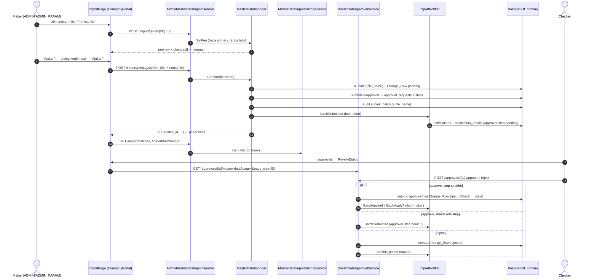
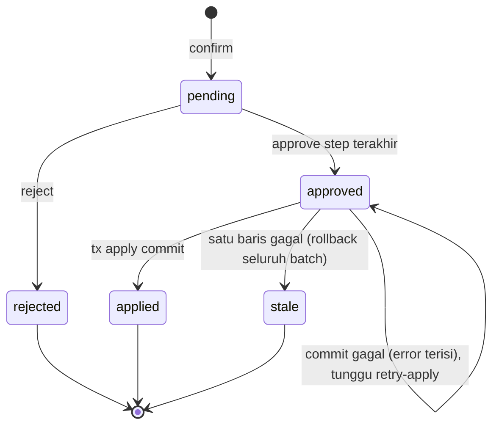

# Design Document

> **Status:** disetujui PO 2026-11-02 (bersama mock UI). Implementasi selesai 2026-11-03 (tasks 1–15); cek browser manual oleh user masih outstanding (task 16). Berdasarkan `requirements.md` yang disetujui 2026-11-02 (D1-D12 = saran Kiro). Mock UI: `ui-mock.html` (Layar A-H) di folder ini.

## Overview

Revamp ini **tidak mengganti** mekanisme persetujuan impor. Alur yang sudah ada tetap jadi inti: dry-run tanpa tulis → confirm menyimpan satu Import_Batch (Change_Row `pending`) dengan satu `approval_requests` → approve menerapkan semua baris dalam satu transaksi, atau reject menandai semua baris `rejected` (D1). Requirement 1 dijaga sebagai invarian dan dikunci oleh integration test.

Yang ditambahkan:

1. **Dry-run lebih kaya** (Req 3): respons membawa Change_Preview per baris dan hitungan Aktifkan/Nonaktifkan terpisah. Masih tanpa tulis.
2. **Nama file** disimpan di batch (Req 4.5, migrasi `036`) dan masuk audit `submit_batch` (Req 9.1).
3. **Riwayat dan detail batch** (Req 5, 6): dua endpoint GET baru di handler impor yang sama, baca primary (D6), status diturunkan dari baris kepala (D4).
4. **Paging detail approval** (Req 7): `GET /approvals/{id}/master-data` menerima `page`/`page_size` dan membawa info batch.
5. **Notifikasi impor** (Req 8): in-app + email ke approver, in-app ke maker; best-effort (D12).
6. **Halaman impor bertahap** di CompanyPortal (Req 2, 4, 5, 6) dan **ReviewDialog** yang menampilkan diff per baris (Req 7).

Tidak ada perubahan pada aturan validasi, header CSV, batas, rate limit, idempotensi per hash, CRUD satu-record, dan ekspor (Req 10.1, 10.2).

## Architecture



Alur data dan state Import_Batch (dibaca dari `master_data_change_requests.status` baris kepala, D4):



`approved` tanpa error adalah keadaan sesaat (atau sisa crash di antara `MarkApproved` dan commit); keduanya ditampilkan sebagai "Disetujui belum diterapkan" dan bisa di-retry (Req 6.3).

## Components and Interfaces

### Backend: migrasi `036` (Req 4.5, 10.3)

`backend/migrations/036_master_data_import_batches_file_name.sql` menambah satu kolom nullable. Detail di Data Models.

### Backend: dry-run dengan Change_Preview (Req 3)

#### `internal/service/masterdata_import.go`

`ImportPreview` mendapat field baru; field lama tetap ada dan maknanya tidak berubah (Req 3.2):

```go
type ImportPreview struct {
    // ... field lama: Entity, TotalRows, ValidRows, Creates, Updates, Unchanged, Errors, ErrorsTruncated
    DataUpdates int                   `json:"data_updates"` // update yang bukan toggle
    Enables     int                   `json:"enables"`
    Disables    int                   `json:"disables"`
    Changes     []ImportChangePreview `json:"changes"` // kosong bila ada kesalahan
}

type ImportChangePreview struct {
    Row    int                 `json:"row"`    // nomor baris file (header = 1)
    Op     string              `json:"op"`     // create | update | enable | disable
    Key    string              `json:"key"`    // mis. "VND01", "VND01 / JKT", "T0001"
    Fields []ImportFieldChange `json:"fields"`
}

type ImportFieldChange struct {
    Field  string `json:"field"`  // nama kolom CSV
    Before string `json:"before"` // "" untuk create
    After  string `json:"after"`
}
```

- `Updates` tetap = semua update termasuk toggle, sehingga `Updates == DataUpdates + Enables + Disables` (kompatibel dengan klien lama).
- Op toggle: `row.Toggle && v["is_active"] == "true"` → `enable`, `row.Toggle` lainnya → `disable`. Sama dengan `stageToggle` di confirm, jadi op pratinjau = op yang di-stage (Property 4).
- `Fields` dihitung dari sel ternormalisasi (`row.Cells`) dibanding `env.cur[id]`: create → semua kolom selain `id` yang tidak kosong (before `""`); update → kolom yang nilainya berbeda; toggle → hanya `is_active`.
- `Key` dari peta baru `importKeyColumns` per entitas, digabung `" / "`: `vendors` [`code`], `vendor-branches` [`vendor_code`,`branch_code`], `vendor-vaults` [`vendor_code`,`branch_code`,`vault_code`], `vendor-pics` [`vendor_code`,`branch_code`,`name`], `atms` [`terminal_id`], `atm-assignments` [`terminal_id`,`effective_start_date`]. Untuk kolom yang kosong di file (mis. `branch_code` PIC tingkat vendor) bagian itu dilewati.
- `Changes` hanya diisi bila `len(Errors) == 0` (Req 3.4). Jumlahnya ≤ 2.000 karena batas baris (Req 3.5). Fungsi pembangunnya pure (`buildChangePreview(entity, header, row, cur)`) agar bisa di-property-test.
- Dry-run tetap tidak menulis (Req 1.1, 3.5); tidak ada query baru.

### Backend: confirm menyimpan nama file (Req 4.5, 9.1)

#### `internal/handler/admin_master_data_import_handler.go`

`uploadedCSV` juga mengembalikan `*multipart.FileHeader`; `Confirm` meneruskan `header.Filename` ke service. Signature interface `MasterDataImportServicer.Confirm` menjadi `Confirm(ctx, makerID, entity, fileName string, r io.Reader, actorIP string)`.

#### `internal/service/masterdata_import_confirm.go`

- `sanitizeImportFileName(raw string) *string` (pure): ganti `\` dengan `/`, ambil `path.Base`, buang rune `unicode.IsControl`, trim spasi, potong ke 255 rune; hasil kosong, `"."`, atau `"/"` → `nil` (Property 6).
- `Batches.Create(ctx, entity, hash, fileName, makerID, params)` menyimpan `file_name`.
- Audit `submit_batch` `After` menambah `"file_name"` (Req 9.1). Untuk batch yang sudah ada (idempoten), nama file lama yang dipakai; tidak ada audit/notifikasi ulang bila approval sudah ada (Req 4.4, 8.4).
- Setelah `SubmitForApproval` + `SetApprovalRequestID` + audit sukses (hanya di cabang yang benar-benar submit), panggil `Notifier.BatchSubmitted(ctx, batchID, approvalRequestID)` (Req 8.1). `ImportConfirmDeps` mendapat field `Notifier ImportNotifier` (nil = tanpa notifikasi).

#### `internal/repository/masterdata_import_batch_repository.go` + `queries/master_data.sql`

`CreateMasterDataImportBatch` menerima `sqlc.narg('file_name')`. `FindOpenMasterDataImportBatch` tidak berubah.

### Backend: riwayat dan detail batch (Req 5, 6)

#### Endpoint (`AdminMasterDataImportHandler`, mount yang sama `/api/v1/admin/master-data/import`)

`Routes()` dipecah supaya rate limit hanya berlaku untuk dry-run dan confirm (Req 10.1):

```go
r := chi.NewRouter()
r.Group(func(g chi.Router) {
    g.Use(h.rateLimit)
    g.Post("/{entity}/dry-run", h.DryRun)
    g.Post("/{entity}/confirm", h.Confirm)
})
r.Get("/batches", h.ListBatches)      // aktif bila WithHistory dipanggil, selain itu 404
r.Get("/batches/{id}", h.GetBatch)
```

Route guard tetap `masterDataAdmin` (`RequireAuth` + `RequireRoles("ADMIN","ADMIN_PARAM")`); service mengecek ulang dengan `authorizeMasterDataAdmin` (Req 5.1).

`GET /batches?entity=&status=&mine=true&page=1&page_size=20`:

| Param | Nilai | Catatan |
| --- | --- | --- |
| `entity` | salah satu dari 6 entitas impor | lain → 400 |
| `status` | `pending` \| `approved` \| `rejected` \| `applied` \| `stale` | nilai status baris kepala; lain → 400 |
| `mine` | `true` | filter `maker_id = user` |
| `page`, `page_size` | default 1 / 20, `page_size` maks. 100 | |

Respons:

```json
{
  "items": [{
    "id": 12, "entity": "vendors", "file_name": "vendor_nov.csv", "row_count": 35,
    "maker_id": 4, "maker_name": "Siti A.", "created_at": "2026-11-02T03:10:00Z",
    "status": "pending", "approval_request_id": 88, "error": null,
    "decided_at": null, "decided_by_name": null
  }],
  "total": 1, "page": 1, "page_size": 20
}
```

`GET /batches/{id}?page=1&page_size=50` → field yang sama di root + `counts` (`{create, update, enable, disable}` untuk seluruh batch) + `changes` (halaman Change_Row, bentuk `masterDataChangeToResponse` ditambah `error` dan `failed`) + `total`, `page`, `page_size`. `id` tidak ada → 404 (Req 6.5).

`status` di API adalah kode mentah; label tampilan dibuat di FE (Req 5.4, 5.6).

#### `internal/service/masterdata_import_history.go` (baru)

```go
type MasterDataImportHistoryRepo interface {
    ListBatches(ctx context.Context, f ImportBatchFilter) ([]ImportBatchSummary, int64, error)
    GetBatch(ctx context.Context, id int64) (ImportBatchSummary, error) // pgx.ErrNoRows → ErrImportBatchNotFound
    ListByBatch(ctx context.Context, batchID int64) ([]db.MasterDataChangeRequest, error)
}

type MasterDataImportHistoryService struct{ repo MasterDataImportHistoryRepo }

func (s *MasterDataImportHistoryService) List(ctx context.Context, userID int64, f ImportBatchFilter) (ImportBatchPage, error)
func (s *MasterDataImportHistoryService) Get(ctx context.Context, id int64, page, pageSize int) (ImportBatchDetail, error)
```

- `Get` memuat semua Change_Row batch (≤ 2.000, query `ListMasterDataChangeRequestsByBatch` yang ada), menghitung `counts` dari seluruh baris, lalu memotong halaman di Go (`pageSlice`, pure, dipakai juga oleh detail approval; Property 7).
- Tidak menulis audit (Req 9.3).
- Pool: primary (D6, Req 5.5).

#### Query sqlc baru (`queries/master_data.sql`)

```sql
-- name: ListMasterDataImportBatches :many
SELECT b.id, b.entity, b.file_name, b.row_count, b.created_at, b.maker_id,
       u.full_name AS maker_name,
       h.id AS head_id, h.status AS head_status, h.error AS head_error, h.approval_request_id,
       d.acted_at AS decided_at, du.full_name AS decided_by_name
FROM master_data_import_batches b
JOIN users u ON u.id = b.maker_id
JOIN LATERAL (SELECT c.id, c.status, c.error, c.approval_request_id
              FROM master_data_change_requests c WHERE c.batch_id = b.id
              ORDER BY c.id LIMIT 1) h ON true
LEFT JOIN LATERAL (SELECT s.acted_at, s.acted_by_id FROM approval_steps s
                   WHERE s.request_id = h.approval_request_id AND s.status <> 'pending'
                   ORDER BY s.acted_at DESC NULLS LAST LIMIT 1) d ON true
LEFT JOIN users du ON du.id = d.acted_by_id
WHERE (sqlc.narg('entity')::text IS NULL OR b.entity = sqlc.narg('entity')::text)
  AND (sqlc.narg('status')::text IS NULL OR h.status = sqlc.narg('status')::text)
  AND (sqlc.narg('maker_id')::bigint IS NULL OR b.maker_id = sqlc.narg('maker_id')::bigint)
ORDER BY b.id DESC
LIMIT sqlc.arg('page_limit')::bigint OFFSET sqlc.arg('page_offset')::bigint;

-- name: CountMasterDataImportBatches :one   -- filter sama
-- name: GetMasterDataImportBatch :one       -- SELECT yang sama, WHERE b.id = sqlc.arg('id')
```

`decided_at`/`decided_by_name` diambil dari step terakhir yang sudah bertindak (`acted_by_id` bisa delegate). Batch kecil (ratusan baris per tahun), jadi lateral join per baris tidak butuh index baru; `ORDER BY b.id DESC` memakai PK.

Repository: `MasterDataImportBatchRepository` mendapat method `ListBatches`, `GetBatch` (primary) sehingga satu repo memenuhi `MasterDataImportHistoryRepo` bersama `MasterDataChangeRepository.ListByBatch` lewat struct adaptor kecil di `main.go`, atau repo impor menambah `ListByBatch` sendiri (pilih yang terakhir, lebih sederhana).

### Backend: detail approval berpaging (Req 7)

#### `internal/handler/approval_master_data_detail.go`

- Query `page` (default 1) dan `page_size` (default 200, maks. 200). Tanpa parameter perilakunya sama dengan sekarang: 200 baris pertama + `truncated` (Req 7.2).
- Respons tambahan: `page`, `page_size`, dan untuk batch objek `batch` = `{id, entity, file_name, maker_name, row_count}` dari `GetBatch` (Req 7.3). `counts` tetap menghitung seluruh batch.
- Otorisasi tidak berubah: maker atau approver dengan step pending (Req 7.4).
- `MasterDataApprovalDetailReader` ditambah `GetBatch(ctx, id)`; diisi repo impor lewat `WithMasterDataDetail(changeRepo, batchRepo)` atau reader gabungan. Satu-record (`batch_id` null) tidak berubah (Req 7.5).

### Backend: notifikasi impor (Req 8)

#### `internal/service/masterdata_import_notify.go` (baru)

```go
type ImportNotifier interface {
    BatchSubmitted(ctx context.Context, batchID, approvalRequestID int64)      // approver step pending
    BatchApplied(ctx context.Context, batchID, makerID int64)
    BatchRejected(ctx context.Context, batchID, makerID int64)
    BatchApplyFailed(ctx context.Context, batchID, makerID int64)
}
```

Implementasi `notificationImportNotifier{svc *notification.Service, pool *pgxpool.Pool}`:

- Setiap method memanggil `svc.Send(ctx, db.New(pool), msg, to)` di luar transaksi bisnis, karena orchestrator approval tidak berjalan dalam satu tx. Error **tidak** dikembalikan: dicatat `slog.Warn("import notification failed", "type", ..., "batch_id", ...)` (D12, Req 8.3). Method tidak punya return value supaya pemanggil tidak bisa gagal karenanya.
- Penerima `BatchSubmitted`: `approval_steps.assigned_approver_id` dari step `pending` dengan `step_level` terkecil pada `approvalRequestID` (query baru `ListPendingApproversForRequest`). Sama dengan yang muncul di inbox (`ListPendingStepsForApprover` juga memakai assigned approver).

| Type | Penerima | Judul | Link | Email |
| --- | --- | --- | --- | --- |
| `master_data_import.submitted` | approver step pending | "Impor data master menunggu persetujuan" | `/approvals` | ya |
| `master_data_import.applied` | maker | "Impor data master diterapkan" | `/settings/admin/master-data-io?tab=history&batch={id}` | tidak |
| `master_data_import.rejected` | maker | "Impor data master ditolak" | sama | tidak |
| `master_data_import.apply_failed` | maker | "Impor data master gagal diterapkan" | sama | tidak |

Body menyebut entitas (label Indonesia), nomor batch, nama file bila ada, dan jumlah baris. `EntityType = "master_data_import_batch"`, `EntityID = batchID`.

#### Titik pemanggilan di `MasterDataApprovalService` (`masterdata_approval.go`)

`MasterDataApprovalService` mendapat `WithImportNotifier(n ImportNotifier)`; nil = tidak ada notifikasi. Hanya untuk Change_Row kepala dengan `BatchID != nil` (D7):

- `Approve`: request `pending` setelah approve (masih ada level) → `BatchSubmitted`. Request `approved` → setelah `applyMasterDataChange`: sukses → `BatchApplied`; error → `BatchApplyFailed`. Nilai kembali `Approve` tidak berubah.
- `Reject` → `BatchRejected` setelah semua baris `rejected` dan audit tertulis.
- `RetryApply` → sukses `BatchApplied`, gagal `BatchApplyFailed`.

Mekanisme approve/apply/reject itu sendiri tidak diubah (Req 1.4, 1.5, 9.2).

Satu perubahan kecil pada pesan rollback batch di `applyMasterDataChange`, supaya detail batch bisa menunjuk baris penyebab (Req 6.2, mock Layar F): baris yang gagal menyimpan error aslinya (`err.Error()`), baris lain menyimpan `BatchRollbackPrefix + "change request %d failed"` (konstanta ekspor di `masterdata_import_history.go`). Status tetap `stale` untuk semua baris; transaksi dan urutan langkah tidak berubah. `MasterDataImportHistoryService.Get` menandai `failed = error != nil && !strings.HasPrefix(error, BatchRollbackPrefix)`; FE menampilkan "Gagal" + pesan untuk baris itu dan "Dibatalkan" untuk baris lain.

#### Wiring `cmd/api/main.go`

`importNotifier := service.NewImportNotifier(notificationService, dbPool)` dibuat setelah `notificationService`; diteruskan ke `ImportConfirmDeps.Notifier` dan `masterDataApprovalService.WithImportNotifier(importNotifier)`. Karena `notificationService` saat ini dibuat setelah approval handler, urutan konstruksinya dipindah ke atas (hanya `loadNotificationConfig` + `notification.NewService`, tanpa efek lain). Handler impor: `.WithHistory(service.NewMasterDataImportHistoryService(importBatchRepo))`.

### Frontend: route dan state URL (Req 2.5, 2.6, 5, 6)

#### `src/routes/settings/admin/master-data-io.tsx`

Tambah `validateSearch: MASTER_DATA_IO_SEARCH_SCHEMA` (zod, pola `ADMIN_VENDORS_SEARCH_SCHEMA`):

```ts
z.object({
  tab: z.enum(["new", "history"]).optional(),          // default "new"
  batch: z.number().int().positive().optional(),       // buka detail batch
  h_entity: z.enum(IO_ENTITY_IDS).optional(),
  h_status: z.enum(["pending","approved","rejected","applied","stale"]).optional(),
  h_mine: z.boolean().optional(),
  h_page: z.number().int().min(1).optional(),
})
```

Guard `requireRoles(["ADMIN","ADMIN_PARAM"])` tidak berubah (Req 2.6). Link notifikasi maker membuka `?tab=history&batch=ID`.

### Frontend: komponen `src/features/master-data-io/`

| File | Isi | Req |
| --- | --- | --- |
| `api.ts` | tipe `ImportPreview` diperluas (`data_updates`, `enables`, `disables`, `changes`), `ImportBatchSummary`, `ImportBatchDetail`, `listImportBatches`, `getImportBatch`, `retryApplyImport(approvalRequestId)` → `POST /approvals/{id}/retry-apply` | 3, 5, 6 |
| `hooks.ts` (baru) | query key `masterDataImportKeys`, `useImportBatches(filter)`, `useImportBatch(id, page)`, `useRetryApply()` (invalidate list + detail) | 5, 6 |
| `batchStatus.ts` (baru, pure) | `BATCH_STATUS` peta kode → `{label, variant, icon}`: `pending` "Menunggu persetujuan" (warning, `Clock`), `approved` "Disetujui belum diterapkan" (info, `RotateCw`), `rejected` "Ditolak" (neutral, `XCircle`), `applied` "Diterapkan" (success, `CheckCircle2`), `stale` "Gagal diterapkan" (danger, `AlertTriangle`); `canRetry(status) = status === "approved"` | 5.4, 5.6, 6.3, 6.4 |
| `components/MasterDataIOPage.tsx` | shell: `PageHeader` judul "Impor CSV Data Master", deskripsi "Unduh templat, ubah di spreadsheet, lalu impor. Data baru berubah setelah pengajuan disetujui.", tab "Impor baru" / "Riwayat impor" (`role="tablist"`, tombol `role="tab"` + `aria-selected`, keyboard kiri/kanan) | 2.1, 2.5 |
| `components/ImportWizard.tsx` | state langkah (entitas, file, preview, hasil); reset ke langkah 2 saat entitas/file berubah; isi langkah 1 = select entitas + "Unduh templat" + "Ekspor data ini" + catatan aturan (dipindah apa adanya) | 2.2, 2.3, 2.4 |
| `components/ImportSteps.tsx` | indikator `<ol>` tiga langkah; langkah aktif `aria-current="step"`, nomor + teks + ikon centang untuk langkah selesai | 2.2 |
| `components/ImportSummary.tsx` | ringkasan Total, Baru, Ubah (`data_updates`), Aktifkan, Nonaktifkan, Tanpa perubahan, Kesalahan; `tabular-nums` | 3.2 |
| `components/ImportChangeTable.tsx` | tabel Change_Preview: Baris, Kunci, Operasi (badge `OpBadge` dari approvals), Perubahan (`field: before → after`, kolom angka rata kanan, `tabular-nums`); filter operasi (`FilterSelect`); paging 50 di klien (`PageNumbers`) | 3.3 |
| `components/ImportErrorTable.tsx` | tabel kesalahan yang ada dipindah ke komponen sendiri, perilaku sama | 3.4, 4.6 |
| `components/ImportConfirmDialog.tsx` | `ConfirmActionDialog`: entitas, nama file, hitungan per operasi, kalimat "Data belum berubah sampai pengajuan disetujui." | 4.2 |
| `components/ImportResultPanel.tsx` | nomor batch, jumlah baris, badge status, pesan beda untuk `existing`, tombol "Lihat di riwayat" (`?tab=history&batch=ID`), tombol "Impor file lain" | 4.3, 4.4 |
| `components/ImportHistoryTab.tsx` | filter Entitas, Status, kotak centang "Hanya milik saya"; tabel Batch, Entitas, Nama file, Baris, Diajukan oleh, Diajukan (WIB), Status, Diputuskan (WIB); paging 20 (`PageNumbers`); `EmptyState` "Belum ada impor. Ajukan file lewat tab Impor baru." | 5.2, 5.3, 5.6, 5.7 |
| `components/ImportBatchDialog.tsx` | `Dialog` dari `?batch=ID`: ringkasan, hitungan per operasi, tabel Change_Row (paging 50 server) memakai `diffFields`/`changeSubject` dari `features/approvals/lib/changeDiff.ts`, kolom Status + pesan error per baris; untuk `stale` `NoticeBanner` danger ikon + teks penyebab + "File yang sama boleh diajukan ulang setelah diperbaiki."; tombol "Coba terapkan lagi" hanya bila `canRetry` | 6.1-6.5 |

Waktu ditampilkan WIB dengan formatter tanggal yang sudah dipakai halaman audit log. Tidak ada library baru.

`MasterDataIOPage` lama (satu komponen ~250 baris) dipecah menjadi komponen di atas; file `MasterDataIOPage.test.tsx` diperbarui.

#### `features/rbac-settings/components/SettingsHubPage.tsx`

Kartu `admin-master-data-io`: judul "Impor CSV Data Master", deskripsi "Impor perubahan massal data master vendor dan ATM, lalu pantau persetujuannya." (Req 2.1).

### Frontend: ReviewDialog (Req 7)

#### `features/approvals/api.ts`, `hooks.ts`

`getMasterDataDetail(requestId, page?, pageSize?)`; `MasterDataDetail` mendapat `page`, `page_size`, `batch?: {id, entity, file_name, maker_name, row_count}`. `useMasterDataDetail(requestId, page)` memakai key yang menyertakan page.

#### `features/approvals/components/MasterDataReviewDialog.tsx`

Untuk batch:
- Kepala: "Impor CSV · {entitas} · {nama file}", "Diajukan oleh {maker}", badge hitungan Baru/Ubah/Aktifkan/Nonaktifkan (Req 7.3), catatan semua-atau-tidak tetap.
- Tabel baris: Data (`changeSubject`), Operasi, lalu tombol "Lihat perubahan" per baris yang membuka `ChangeDiffTable` yang sudah ada secara inline (`<details>`/disclosure dengan `aria-expanded`) (Req 7.1).
- Paging 50 server (`page_size=50`), `PageNumbers`. Teks "Menampilkan X dari Y" diganti paging.
- Tombol Setujui/Tolak tetap, tetap aktif di halaman mana pun.

Satu-record tidak berubah (Req 7.5).

## Data Models

### Migrasi `036_master_data_import_batches_file_name.sql`

```sql
-- Master-data import revamp (.kiro/specs/master-data-import-revamp, D5):
-- remember the uploaded file name so the import history can show it.
-- SAFETY: additive nullable column; existing batches stay NULL. Forward-only.
BEGIN;
ALTER TABLE public.master_data_import_batches
    ADD COLUMN file_name text NULL,
    ADD CONSTRAINT master_data_import_batches_file_name_chk
        CHECK (file_name IS NULL OR char_length(file_name) BETWEEN 1 AND 255);
COMMENT ON COLUMN public.master_data_import_batches.file_name IS
    'Original upload file name (base name, control chars stripped, max 255). NULL for batches before 036.';
COMMIT;
```

Diterapkan dengan `go run ./cmd/migrate up` (Req 10.3). Setelah diterapkan, catat di `.claude/CLAUDE.md` Sec 3 dan `development-plan.md` (next free → `037`).

### Tidak ada tabel baru

- Batch_Status tidak disimpan; diturunkan dari `master_data_change_requests.status` baris kepala (D4).
- Notifikasi memakai `notifications` + `notification_emails` yang ada (`025_notifications.sql`).
- `approval_requests`, `approval_steps`, `approval_policies` tidak berubah.

### Tabel entitas yang dijaga Requirement 1

`vendors`, `vendor_branches`, `vendor_vaults`, `vendor_pics` (beserta tabel peran PIC), `atms`, `atm_vendor_packages`.

## Correctness Properties

### Property 1: Tidak ada perubahan entitas sebelum persetujuan final

*For any* file impor valid dari entitas mana pun dan *for any* urutan aksi berisi dry-run, confirm, confirm ulang file yang sama, approve oleh maker sendiri (ditolak 403), approve step non-final, dan reject, isi Entity_Table setelah urutan itu sama persis dengan isinya sebelum urutan dimulai.

**Validates: Requirements 1.1, 1.2, 1.3, 1.4, 1.6, 3.5**

### Property 2: Penerapan semua atau tidak sama sekali

*For any* Import_Batch berisi n ≥ 1 Change_Row yang disetujui di step terakhir, salah satu dari dua keadaan berlaku: semua n Change_Row `applied` dan Entity_Table memuat semua perubahannya, atau tidak satu pun perubahan ada di Entity_Table dan semua Change_Row berstatus `stale` (atau kepala `approved` dengan error bila commit gagal).

**Validates: Requirements 1.5**

### Property 3: Satu batch, satu approval, satu notifikasi pengajuan

*For any* file yang di-confirm k ≥ 1 kali (berurutan atau bersamaan) selama batch-nya terbuka, hanya ada satu Import_Batch, satu `approval_requests`, satu audit `submit_batch`, dan satu set notifikasi `master_data_import.submitted` untuk file itu.

**Validates: Requirements 1.7, 4.4, 8.4**

### Property 4: Pratinjau konsisten dengan yang di-stage

*For any* file valid, `creates + data_updates + enables + disables == len(changes)`, `updates == data_updates + enables + disables`, setiap `changes[i].op` sama dengan `op` Change_Row yang dibuat confirm untuk baris itu, dan setiap field di `changes[i].fields` punya `before != after`.

**Validates: Requirements 3.1, 3.2**

### Property 5: Pemetaan status batch total dan retry hanya untuk approved

*For any* status baris kepala di {`pending`, `approved`, `rejected`, `applied`, `stale`}, `BATCH_STATUS` menghasilkan tepat satu label beserta ikon, dan `canRetry` bernilai true jika dan hanya jika status `approved`.

**Validates: Requirements 5.4, 5.6, 6.3, 6.4**

### Property 6: Nama file selalu aman

*For any* string masukan, `sanitizeImportFileName` menghasilkan nil atau string 1-255 rune tanpa karakter kontrol, tanpa `/` dan `\`, dan idempoten (sanitasi dua kali = sekali).

**Validates: Requirements 4.5**

### Property 7: Paging lengkap tanpa duplikat

*For any* jumlah baris n ≤ 2.000 dan ukuran halaman p ≥ 1, menggabungkan semua halaman `pageSlice` menghasilkan n baris dalam urutan id, masing-masing tepat sekali, dan `counts` selalu menghitung seluruh n baris.

**Validates: Requirements 6.1, 7.1, 7.2**

### Property 8: Akses riwayat dan detail terbatas

*For any* peran selain ADMIN dan ADMIN_PARAM, `GET /import/batches` dan `GET /import/batches/{id}` menjawab 403 di route dan service; *for any* pengguna yang bukan maker dan tidak punya step pending, `GET /approvals/{id}/master-data` menjawab 403 dengan atau tanpa parameter paging.

**Validates: Requirements 2.6, 5.1, 7.4**

### Property 9: Kegagalan notifikasi tidak mengubah hasil

*For any* titik kegagalan ImportNotifier (submit, approve, reject, retry), status Import_Batch, `approval_requests`, Entity_Table, dan `audit_logs` sama dengan run yang notifikasinya berhasil, dan respons HTTP tetap sukses.

**Validates: Requirements 8.3, 9.1, 9.2**

## Error Handling

| Kasus | Perilaku |
| --- | --- |
| File dengan kesalahan (dry-run) | 200, `errors` terisi, `changes` kosong; FE menampilkan tabel kesalahan, tombol ajukan nonaktif (Req 3.4) |
| File berubah validitas antara periksa dan ajukan | confirm 422 `validation_failed` + `errors`; FE kembali ke langkah 2 dan menampilkan kesalahan (Req 4.6) |
| Baris bentrok dengan perubahan pending lain | 409 `change_pending` (tidak berubah); FE toast ikon + teks |
| File sama masih terbuka | confirm 200 `existing: true`; panel hasil memakai pesan "sudah diajukan sebelumnya" (Req 4.4) |
| Rate limit | 429 seperti sekarang; endpoint riwayat tidak terkena (Req 10.1) |
| Filter riwayat tidak valid | 400 `validation_error` field yang salah |
| Batch tidak ada | 404 `not_found` (Req 6.5); FE dialog menampilkan "Batch tidak ditemukan" dan menghapus `batch` dari URL |
| Peran bukan ADMIN/ADMIN_PARAM | 403 di route + service (Req 5.1) |
| Retry-apply bukan status `approved` | 409 dari endpoint yang ada; FE toast + refetch detail |
| Retry-apply gagal lagi | 500/409 dari endpoint yang ada; detail di-refetch, error baris tampil, notifikasi `apply_failed` |
| Kegagalan notifikasi | log `slog.Warn`, respons tetap sukses (D12, Req 8.3) |
| Batch tanpa `approval_request_id` (crash di antara staging dan submit) | status tetap "Menunggu persetujuan"; detail menampilkan catatan "Pengajuan belum lengkap. Ajukan ulang file yang sama untuk menyelesaikannya." (confirm ulang memanggil `finish`) |
| Nama file kosong/aneh | `file_name` NULL, tampil "—" |

Semua pesan error di UI memakai ikon + teks, tidak pernah hanya warna.

## Testing Strategy

### Backend (Go)

- **Unit, table-driven:** `buildChangePreview` per entitas (create, update, enable, disable, kolom kosong di kunci), `sanitizeImportFileName`, `pageSlice`, validasi filter riwayat, handler `ListBatches`/`GetBatch` (403, 400, 404, bentuk JSON), detail approval dengan/tanpa paging, `Routes()` rate limit tidak berlaku untuk `/batches`.
- **Property (`pgregory.net/rapid`, sudah dipakai backend):** Property 4 (generator baris CSV valid atas `env` sintetis), Property 6, Property 7.
- **Notifier:** fake `ImportNotifier` di test `MasterDataApprovalService` untuk memastikan titik panggil (submitted/applied/rejected/apply_failed, tidak dipanggil untuk satu-record dan untuk confirm `existing`); test `notificationImportNotifier` dengan querier yang gagal → tidak panic, tidak mengembalikan error (Property 9 unit).
- **Integration (`//go:build integration`, Postgres nyata, migrasi via `cmd/migrate up` di CI):**
  - Property 1: snapshot `count(*)` + hash isi Entity_Table sebelum/sesudah urutan dry-run → confirm → confirm ulang → approve maker (403) → reject; ulangi dengan approve step non-final bila dev seed punya rantai 2 level (kalau tidak, pakai policy test sementara di dalam tx test).
  - Property 2: batch dengan satu baris dibuat stale (ubah entitas di antara confirm dan approve) → tidak ada perubahan, semua `stale`; batch bersih → semua `applied`.
  - Property 3: confirm bersamaan (goroutine) file sama → satu batch, satu approval, satu audit, satu set notifikasi.
  - Property 8 dan 9 di level handler/service dengan notifier yang gagal.
  - Query `ListMasterDataImportBatches`/`GetMasterDataImportBatch` (status turunan, `decided_*`, filter) dan migrasi `036` (CHECK panjang).
- Gate: `go test ./...`, `golangci-lint run --build-tags integration ./...` (Req 10.4).

### Frontend (Vitest + RTL, fast-check)

- `batchStatus.test.ts`: Property 5 (fast-check atas semua kode status).
- `ImportWizard`/`MasterDataIOPage`: langkah dan reset (Req 2.2, 2.3), ringkasan + tabel perubahan + filter + paging (Req 3.2, 3.3), kesalahan (3.4), dialog konfirmasi (4.2), panel hasil baru/existing (4.3, 4.4), 422 saat ajukan (4.6), elemen langkah 1 tetap ada (2.4).
- `ImportHistoryTab`: filter → parameter API, paging, empty state, badge ikon + label (Req 5.2, 5.3, 5.6, 5.7).
- `ImportBatchDialog`: diff baris, penyebab stale, tombol retry hanya untuk `approved` (Req 6.1-6.4), 404.
- `MasterDataReviewDialog`: paging, kepala batch, disclosure diff, satu-record tidak berubah (Req 7.1, 7.3, 7.5).
- Route: `validateSearch` membuang key asing; guard peran (Req 2.6).
- `SettingsHubPage`: judul kartu (Req 2.1).
- Gate: `pnpm run lint`, `pnpm run test:coverage` (84/80/80/85), `pnpm run build`, `check-bundle.mjs` (Req 10.5).

### Manual (user, Golden Rule #10)

Browser: impor tiap entitas, riwayat, detail, retry (dengan memaksa commit gagal tidak praktis; cek tombol muncul di batch `approved`), checker review 2.000 baris, notifikasi bell + email outbox, keyboard/screen reader pada tab, langkah, disclosure.

## Files touched

**Backend**
- `backend/migrations/036_master_data_import_batches_file_name.sql` (baru)
- `backend/queries/master_data.sql`, `backend/internal/db/master_data.sql.go` (regenerate sqlc v1.31.1; hand-fix `UserLeafe` → `UserLeave`)
- `backend/internal/service/masterdata_import.go`, `masterdata_import_confirm.go`, `masterdata_import_history.go` (baru), `masterdata_import_notify.go` (baru), `masterdata_approval.go`
- `backend/internal/repository/masterdata_import_batch_repository.go`
- `backend/internal/handler/admin_master_data_import_handler.go`, `approval_master_data_detail.go`
- `backend/cmd/api/main.go`
- test `*_test.go` di samping masing-masing

**Frontend (CompanyPortal)**
- `src/routes/settings/admin/master-data-io.tsx`
- `src/features/master-data-io/` (`api.ts`, `hooks.ts`, `batchStatus.ts`, `components/*`, test)
- `src/features/approvals/api.ts`, `hooks.ts`, `components/MasterDataReviewDialog.tsx`, test
- `src/features/rbac-settings/components/SettingsHubPage.tsx`

**Docs**
- `.claude/CLAUDE.md` Sec 3 (kolom baru), `.kiro/steering/development-plan.md` (X.10, next free migration), `.claude/development-progress.md`, `.kiro/steering/rbac-role-feature-matrix.md` (judul menu)
