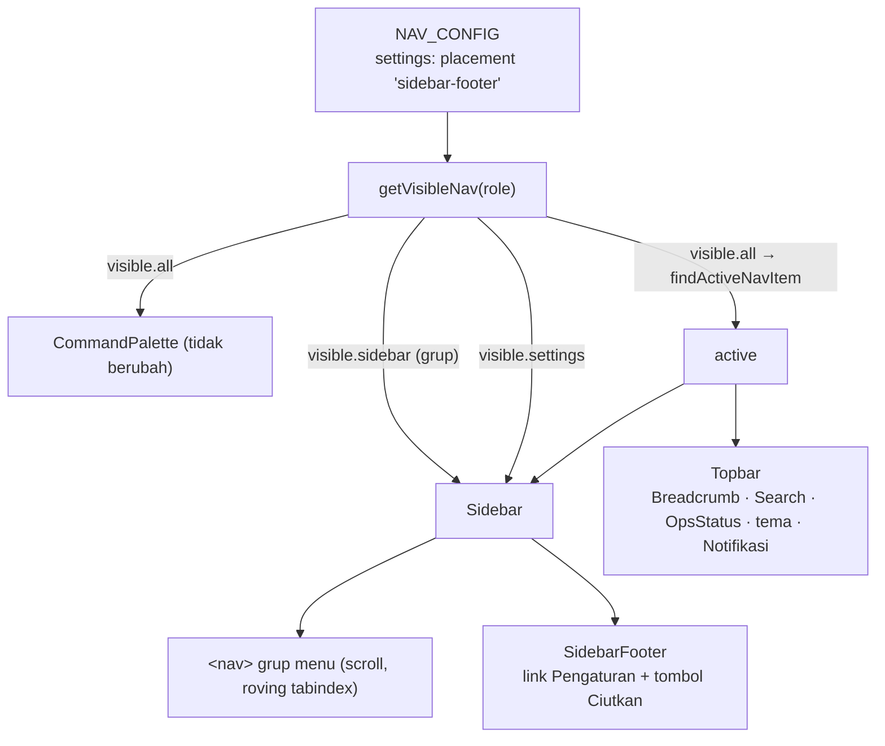

# Design Document

## Overview

Perubahan murni frontend di CompanyPortal-Vite. SettingsItem tetap satu entri di `NAV_CONFIG`; yang berubah hanya penanda lokasinya (`placement`) dan komponen yang merendernya. Sidebar sudah menerima `visible: VisibleNav`, jadi `visible.settings` cukup dibaca langsung oleh Sidebar dan diteruskan ke `SidebarFooter`. Topbar kehilangan prop `settings`. EnvBadge dihapus dari `SidebarFooter`.

Tidak ada API, tabel, atau dependency baru.

## Architecture



Alur data: `AppShell` menghitung `visible` dan `active` seperti sekarang. Sidebar memberi `SidebarFooter` dua nilai: `settings = visible.settings` dan `settingsActive = active?.id === visible.settings?.id`. `AppShell` berhenti meneruskan `settings` ke `Topbar`.

## Components and Interfaces

### Frontend

#### `src/lib/config/navigation.ts` (Req 1.1)
- `NavPlacement = "sidebar" | "sidebar-footer"` (nilai `"topbar"` dihapus).
- Item `settings`: `placement: "sidebar-footer"`.
- `getVisibleNav`: filter grup memakai `i.placement !== "sidebar-footer"`; `settings: all.find((i) => i.placement === "sidebar-footer")`. Nama field `VisibleNav.settings` dipertahankan.

#### `src/components/layout/Sidebar.tsx` (Req 1.2, 1.3, 4.1)
- Meneruskan `settings={visible.settings}` dan `settingsActive={!!visible.settings && active?.id === visible.settings.id}` ke `SidebarFooter`.
- `SidebarFooter` tetap sibling setelah `<nav>` (di luar `overflow-y-auto`), jadi selalu di bawah (Req 1.3). Handler roving tabindex hanya membaca `navRef`, sehingga link Pengaturan tidak ikut roving (Req 4.1) dan menjadi tab stop biasa (Req 1.6).

#### `src/components/layout/sidebar/SidebarFooter.tsx` (Req 1.2, 1.4–1.6, 3.1, 3.2)
- Hapus `EnvBadge`, `EnvBadgeProps`, prop `env`/`version`, dan import `appEnv`.
- Props baru:
  ```ts
  interface SidebarFooterProps {
    rail: boolean;
    onToggleRail: () => void;
    /** `visible.settings`; undefined → link Pengaturan tidak dirender (Req 1.2). */
    settings?: NavItem;
    settingsActive: boolean;
  }
  ```
- Urutan: garis atas → `SidebarNavItem item={settings} active={settingsActive} rail={rail}` (bila ada) → tombol Ciutkan/Lebarkan (tidak berubah).
- Memakai ulang `SidebarNavItem` sehingga gaya aktif, `aria-current`, focus ring, ikon `Settings2`, dan tooltip Rail identik dengan item lain (Req 1.4–1.6). `tabIndex` tidak diisi (default fokusable).

#### `src/components/layout/Topbar.tsx` + `topbar/TopbarIconButton.tsx` (Req 2.1, 2.2)
- `TopbarProps`: hapus `settings`. `TopbarIconGroup`: hapus `settings`/`settingsActive`, hanya tema + `children` (Notifikasi) + divider.
- `TopbarIconButton`: hapus varian `Link` (`to`, `active`, import `Link`/`Settings2`) karena tidak ada pemakai lain.
- `Breadcrumb` tidak berubah, tetap memakai `active` (Req 2.2).

#### `src/components/layout/AppShell.tsx` (Req 2.1, 2.3)
- Hapus `settings={visible.settings}` pada `<Topbar>`. `CommandPalette items={visible.all}` tidak berubah (Req 2.3).

## Data Models

Tidak ada tabel baru, tidak ada migrasi. Satu-satunya "model" yang berubah adalah union type `NavPlacement` di frontend.

## Correctness Properties

### Property 1: Pengaturan hanya di footer Sidebar, mengikuti role
*For any* role internal (termasuk `null`), link "Pengaturan" ke `/settings` muncul di SidebarFooter tepat ketika `filterNavByRoles(NAV_CONFIG, role)` memuat SettingsItem yang tidak `disabled`, dan tidak pernah muncul di Topbar maupun di dalam `<nav>` grup menu.

**Validates: Requirements 1.2, 2.1, 4.1**

### Property 2: Pemisahan grup vs footer di NavConfig
*For any* role, `getVisibleNav(role).sidebar` tidak memuat item ber-`placement: "sidebar-footer"`, dan bila `settings` terdefinisi maka `settings.placement === "sidebar-footer"` dan `settings ∈ all`.

**Validates: Requirements 1.1, 2.3**

### Property 3: Footer tanpa info lingkungan
*For any* mode (`rail` true/false) dan *for any* role, Sidebar tidak mengandung teks "Lingkungan", nilai `ENV_LABEL` mana pun (`DEV`/`UAT`/`PRODUKSI`), maupun `v{APP_VERSION}`, dan tetap memuat tombol Ciutkan/Lebarkan. Karena `SidebarFooter` tidak lagi menerima `env`/`version` dan tidak meng-import `appEnv`, variasi lingkungan tidak bisa (dan tidak perlu) disuntik; property diuji dengan semua nilai `ENV_LABEL` sebagai teks terlarang.

**Validates: Requirements 3.1, 3.2**

## Error Handling

Tidak ada jalur error baru. `settings` undefined (role tanpa akses atau belum login) → link tidak dirender; footer tetap berisi tombol Ciutkan.

## Testing Strategy

- **Unit / property (Vitest + fast-check):**
  - `navigation.test.ts` + `navigation.property.test.ts`: ganti asersi `"topbar"` → `"sidebar-footer"` (Property 2).
  - `Sidebar.test.tsx`: ganti test Req 2.3 lama menjadi "Pengaturan di footer, di luar `<nav>` menu"; test aktif (`aria-current`), Rail tooltip, Tab reachability; property per role (Property 1, sisi Sidebar); ganti test EnvBadge dengan Property 3; test keyboard yang ada tetap hijau (Req 4.1).
  - `Topbar.test.tsx`: test "Pengaturan for %s" diganti asersi tidak ada link Pengaturan untuk semua role (Property 1, sisi Topbar); test breadcrumb "Sistem › Pengaturan" dipertahankan (Req 2.2).
  - `CommandPalette.test.tsx`: fixture `placement` diperbarui; `AppShell.test.tsx` palette → `/settings` tetap hijau (Req 2.3).
- **Gate:** `pnpm run lint`, `pnpm run test:coverage`, `pnpm run build` (Req 4.2).
- **Type-check file test:** `build` hanya menjalankan `tsc -b tsconfig.app.json` (test dikecualikan) dan Vitest tidak type-check, jadi sisa `"topbar"`, prop `settings` di Topbar, atau `env`/`version` di SidebarFooter pada file test **tidak akan tertangkap** oleh gate di atas. Jalankan `pnpm exec tsc -b tsconfig.test.json` dan pastikan tidak ada error baru di file yang disentuh. Baseline 2026-10-27: 138 error total di repo (pre-existing), 0 di `Sidebar.test.tsx`, `Topbar.test.tsx`, `AppShell.test.tsx`, `navigation*.test.ts`; 3 di `CommandPalette.test.tsx` (baris 105/120/125, `possibly undefined`, bukan dari spec ini).
- **Manual (user):** cek browser Expanded/Rail, role ADMIN vs ATM-USER.

## Files touched

| File | Perubahan |
| --- | --- |
| `src/lib/config/navigation.ts` | `NavPlacement`, placement settings, `getVisibleNav` |
| `src/components/layout/Sidebar.tsx` | teruskan settings ke footer |
| `src/components/layout/sidebar/SidebarFooter.tsx` | hapus EnvBadge, render link Pengaturan |
| `src/components/layout/Topbar.tsx` | hapus prop `settings` |
| `src/components/layout/topbar/TopbarIconButton.tsx` | hapus tombol Pengaturan + varian Link |
| `src/components/layout/AppShell.tsx` | berhenti meneruskan settings ke Topbar |
| Test: `navigation*.test.ts`, `Sidebar.test.tsx`, `Topbar.test.tsx`, `CommandPalette.test.tsx` | sesuaikan |

## Documented deviation

Menggantikan `app-shell-revamp` Req 2.3, 5.1–5.4, 10.1–10.3 dan bagian "menyembunyikan EnvBadge" pada Req 4.3. Setelah spec ini selesai, tambahkan catatan singkat di `app-shell-revamp/requirements.md` bahwa criteria tersebut disupersede oleh `sidebar-settings-footer`.
