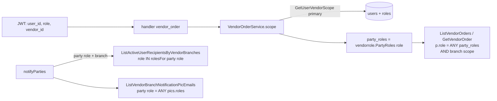

# Design Document — Vendor Party Scope

## Overview

Fitur ini menambah dua role vendor (`VENDOR-ATM-USER`, `VENDOR-VAULT-USER`) di samping `VENDOR-USER`, mempersempit cakupan VendorPortal Orders/Realisasi per role + cabang, memisahkan PIC vendor per peran, dan merapikan pengaturan akun vendor di admin users. Semua di backend ATM (`backend/`, flat JSON), `CompanyPortal-Vite`, dan `VendorPortal-Vite`. Python runtime tidak tersentuh (notifikasinya hanya ke role internal).

Prinsip yang dipakai ulang:
- **Cakupan di SQL, dibaca dari primary per request** (pola 2.2b FR5.2). Handler hanya meneruskan actor.
- **Satu sumber pemetaan role → peran pihak** di Go (paket `internal/vendorrole`), dipakai service order, realisasi, dan notifikasi.
- **Immediate-apply + audit dalam tx** untuk peran PIC (pola `region_admin.go` / `rolemgmt`). Deviasi GR#3 terdokumentasi.
- **Maker-checker master data yang ada** untuk create PIC dan impor CSV (Applier `masterdata_applier_vendor_pic.go`).

## Architecture

Alur cakupan request vendor dan notifikasi pihak:



## Data Models

### Migrasi `032_vendor_party_scope.sql`

Satu tx, forward-only (konvensi proyek). Urutan:

```sql
BEGIN;

-- 1. Role vendor baru + hak menu = VENDOR-USER (Req 1.1, 1.2)
INSERT INTO public.roles (role, description) VALUES
  ('VENDOR-ATM-USER',   'Vendor pengisian ATM: pihak replenish saja (vendor-party-scope)'),
  ('VENDOR-VAULT-USER', 'Vendor penyedia uang di vault: pihak vault saja (vendor-party-scope)')
ON CONFLICT (role) DO NOTHING;

INSERT INTO public.role_permissions (role_id, menu_feature_id, granted_by)
SELECT nr.id, rp.menu_feature_id, rp.granted_by
FROM public.role_permissions rp
JOIN public.roles vu ON vu.id = rp.role_id AND vu.role = 'VENDOR-USER'
CROSS JOIN public.roles nr
WHERE nr.role IN ('VENDOR-ATM-USER', 'VENDOR-VAULT-USER')
ON CONFLICT (role_id, menu_feature_id) DO NOTHING;

-- 2. Cabang akun harus milik vendor akun (Req 2.5). Pre-check lalu FK komposit (pola 030).
DO $$ BEGIN
  IF EXISTS (SELECT 1 FROM public.users u JOIN public.vendor_branches b ON b.id = u.vendor_branch_id
             WHERE u.vendor_id IS DISTINCT FROM b.vendor_id) THEN
    RAISE EXCEPTION 'users.vendor_branch_id bukan milik users.vendor_id; perbaiki data sebelum migrasi 032';
  END IF;
END $$;
ALTER TABLE public.vendor_branches ADD CONSTRAINT vendor_branches_id_vendor_uq UNIQUE (id, vendor_id);
ALTER TABLE public.users
  ADD CONSTRAINT users_vendor_branch_owner_fk
  FOREIGN KEY (vendor_branch_id, vendor_id) REFERENCES public.vendor_branches (id, vendor_id);

-- 3. Peran PIC (Req 5.1, 5.2): DEFAULT mengisi semua baris lama dengan ketiga peran (D6d)
ALTER TABLE public.vendor_pics
  ADD COLUMN roles text[] NOT NULL DEFAULT ARRAY['replenish', 'vault', 'cashcount']::text[],
  ADD CONSTRAINT vendor_pics_roles_chk CHECK (roles <@ ARRAY['replenish', 'vault', 'cashcount']::text[]);
COMMENT ON COLUMN public.vendor_pics.roles IS
  'Peran PIC: replenish (PIC replenish ATM), vault (PIC penyedia uang), cashcount (PIC cash count). Kosong = kontak saja. Ubah lewat layar = langsung + audit (deviasi GR#3, vendor-party-scope).';

COMMIT;
```

Keputusan desain:
- **`text[]` + CHECK, bukan tabel relasi `vendor_pic_roles`** (D6c minta desain memilih). Peran diganti sebagai satu himpunan (satu UPDATE, satu audit before/after), cocok untuk payload maker-checker jsonb dan sel CSV, dan `$1 = ANY(roles)` cukup untuk filter notifikasi (≤ ribuan PIC, tanpa index). Duplikat dicegah di service (sorted + unique sebelum simpan). Tabel relasi menambah join di export, Applier, dan notifikasi tanpa manfaat di skala ini.
- FK komposit MATCH SIMPLE: hanya dicek bila `vendor_branch_id` dan `vendor_id` sama-sama terisi. `users_vendor_branch_fk` yang lama tetap.
- Role id tidak di-hardcode; semua query memakai nama role.
- Catat di CLAUDE.md Sec 3 (tabel) + Sec 12 (deviasi peran PIC) + `docs/data-map.md` saat diterapkan.

## Components and Interfaces

### Backend

#### Pemetaan role → peran pihak (satu sumber)

Paket kecil baru **`backend/internal/vendorrole`** (tanpa dependensi), diimpor `internal/service` dan `internal/auth`. `internal/auth` tidak boleh mengimpor `internal/service`, jadi helper tidak ditaruh di `service`.

```go
package vendorrole

const (
    User      = "VENDOR-USER"       // dua peran (D2)
    ATMUser   = "VENDOR-ATM-USER"   // replenish (D3)
    VaultUser = "VENDOR-VAULT-USER" // vault (D3)
)

// All is every VendorPortal role (route guards, admin users validation).
var All = []string{User, ATMUser, VaultUser}

func IsVendor(role string) bool

// PartyRoles: party roles a vendor role may see and decide. nil = not a vendor role.
func PartyRoles(role string) []string

// ForParty: vendor roles that receive notices for a party role (D6a).
func ForParty(partyRole string) []string
```

`vendorUserRole` di `vendor_order.go` dihapus; semua pemakaian ke paket ini. Unit test tabel untuk ketiga fungsi (termasuk role non-vendor → nil/false).

#### Cakupan (Req 3)

`backend/queries/vendor_parties.sql`:
- `GetUserVendorScope` → tambah `r.role` (join `roles`): `SELECT u.vendor_id, u.vendor_branch_id, r.role FROM users u JOIN roles r ON r.id = u.role_id WHERE …`.
- `ListVendorOrders`, `CountVendorOrders`, `GetVendorOrder` → tambah `AND p.role = ANY(sqlc.arg('party_roles')::text[])`.

`VendorOrderService.scope()`:
1. `vendorrole.PartyRoles(va.Role) == nil` → `ErrNotAuthorized`.
2. Baca baris; tidak ada / `vendor_id` beda claim / **`row.Role != va.Role`** → `ErrNotAuthorized` (Req 3.8: token dengan role lama ditolak segera; 403).
3. `vendorScope{vendorID, branchID, partyRoles}`; semua query cakupan meneruskan `partyRoles`.

Route: `RequireRoles(vendorrole.All...)` di `VendorOrderHandler.Routes()` dan `RealizationRoutes()`.

#### Realisasi (Req 4)

- `SubmitRealization`: tidak berubah logikanya; `getScoped` sudah memfilter `party_roles`, jadi `VENDOR-VAULT-USER` → 404. `checkReportsWholeRequest` tetap.
- `ListRealizations`: tambah guard `!slices.Contains(sc.partyRoles, partyRoleReplenish)` → `ErrNotAuthorized` (403).

#### Notifikasi (Req 7)

`internal/notification`:
- `Recipients.VendorBranchIDs []int64` diganti `VendorParties []VendorPartyTarget` dengan `VendorPartyTarget{BranchID int64; UserRoles []string; PicRole string}`. Hanya `notifyParties` yang memakai field lama (dicek: `grep VendorBranchIDs`), jadi penggantian aman; test notification ikut diperbarui.
- `ListActiveUserRecipientsByVendorBranches` → parameter `branch_id bigint` + `roles text[]` (per target; jumlah target per kiriman kecil): `JOIN roles r ON r.id = u.role_id AND r.role = ANY(roles)`.
- `ListVendorBranchNotificationPicEmails` → parameter `branch_id` + `pic_role text`: `AND sqlc.arg('pic_role')::text = ANY(p.roles)`.
- Dedup email/user lintas target tetap di `Send` (perilaku yang ada).

`vendor_party.go`: `partyNotice` + `role string`; `notifyParties` mengirim `VendorPartyTarget{BranchID: nt.branchID, UserRoles: vendorrole.ForParty(nt.role), PicRole: nt.role}`. `cashcount` tidak pernah menjadi `PicRole` (Req 7.3).

#### Admin users (Req 2)

`backend/queries/users_admin.sql`:
- `ListUsersAdmin`, `GetUserAdminByID`, `CreateUserAdmin`, `UpdateUserAdmin` → `vendor_branch_id` (+ `LEFT JOIN vendor_branches` untuk `vendor_branch_name` pada list/detail).
- `VendorBranchBelongsToVendor :one` → `SELECT EXISTS (… WHERE id = $1 AND vendor_id = $2 AND is_active)`.
- `ListVendorOptionsAdmin :many`, `ListVendorBranchOptionsAdmin :many` (replica) untuk `vendor-options`.

`backend/internal/auth/user_admin.go`:
- `CreateUserRequest` / `UpdateUserRequest` + `VendorBranchID *int64`.
- Validasi baru `vendorFields(role, authSource, vendorID, branchID)`: role vendor → `local` + `vendor_id` wajib; role lain → `vendor_branch_id` harus nil; branch → `VendorBranchBelongsToVendor` (400 `vendor_branch_id`). Aturan `local` ⇒ `vendor_id` yang ada tetap.
- Cek role vendor memakai `vendorrole.IsVendor`.

Handler `admin_user_handler.go`: body + respons memuat `vendor_branch_id`, `vendor_branch_name`; route baru `r.Get("/vendor-options", h.VendorOptions)` (didaftarkan **sebelum** `/{id}`).

Guard (D8): `cmd/api/main.go` mount `/api/v1/admin/users` berubah dari `RequireRoles("APPACCESS", "ADMIN", "ADMIN_PARAM")` menjadi `RequireRoles("APPACCESS", "ADMIN")`. `UserAdminService` tidak punya cek role sendiri hari ini; tambahkan re-check yang sama di `Create`/`Update` (RBAC di route **dan** service). Frontend: kartu Manajemen User di `SettingsHubPage` disembunyikan untuk `ADMIN_PARAM` (route `requireRoles` tetap meloloskan ADMIN/ADMIN_PARAM — gap bersama route settings lain, backend yang menolak).

#### Peran PIC (Req 5, 6)

- `vendor_pics_admin.sql`: list/get mengembalikan `roles`; `CreateVendorPicAdmin` menerima `roles`; `UpdateVendorPicAdmin` **tidak** menyentuh `roles`; query baru `SetVendorPicRoles :one` (`UPDATE … SET roles = $3 WHERE id = $1 AND vendor_id = $2 AND deleted_at IS NULL RETURNING id, roles`) + `GetVendorPicRolesForUpdate` (`SELECT roles … FOR UPDATE`).
- `VendorPicPayload` (create) + `Roles *[]string` (nil = ketiga peran, Req 5.6). `VendorPicUpdatePayload` + `Roles *[]string` **hanya diisi oleh impor CSV** (form update mengirim nil → Applier tidak mengubah peran, Req 5.7 / 6.3). Applier update: bila `Roles != nil` → `SetVendorPicRoles` di tx apply yang sama.
- `VendorPicRoleService.SetRoles(ctx, actor, vendorID, picID, roles, ip)` (baru, `service/vendor_pic_roles.go`): re-check role `ADMIN`/`ADMIN_PARAM` → normalisasi (trim, sort, unique, validasi kode) → tx: `GetVendorPicRolesForUpdate` → `SetVendorPicRoles` → `audit.NewWriter(tx).Write(vendor_pic_roles_updated, before, after)` → commit. Tidak ada perubahan = 200 tanpa audit (pola region `ErrStatusUnchanged`, dijawab sukses idempoten).
- Handler `admin_vendor_pic_handler.go`: `r.Put("/{id}/roles", h.SetRoles)` di mount `masterDataAdmin` yang ada (route guard `ADMIN`/`ADMIN_PARAM`).
- CSV (`masterdata_export.go`, `masterdata_import_*.go`): header PIC + `roles` di akhir; ekspor `strings.Join(roles, ";")` atau `none`; header lama didaftarkan sebagai legacy (`legacyFill["roles"] = ""`); validasi `parsePicRoles` (kosong → nil, `none` → `[]`, lainnya split `;`); `picFields` mengisi `Roles`.

#### `/auth/me` (Req 8.3)

`GetMe` (`queries/auth.sql`) + `LEFT JOIN vendors`, `LEFT JOIN vendor_branches` → `vendor_name`, `vendor_branch_id`, `vendor_branch_name`. Respons `/me` menambah ketiganya (`omitempty` tidak dipakai; `null` eksplisit). `/me` di luar pilot OpenAPI.

### Frontend

#### VendorPortal
- `src/lib/types.ts`: `DbRole = "VENDOR-USER" | "VENDOR-ATM-USER" | "VENDOR-VAULT-USER"`; `VENDOR_ROLES` + `isVendorRole()` + `partyRolesOf(role)` di `src/lib/vendorRoles.ts`.
- `features/auth/AuthContext.tsx`: kedua guard (`init` refresh, `refresh`) memakai `isVendorRole`. `AuthUser` + `vendorName`, `vendorBranchId`, `vendorBranchName` dari `/me`/login.
- Shell (header/sidebar): baris cakupan Req 8.4; label peran dari `ROLE_LABEL` (`features/orders/labels.ts`) + label gabungan untuk `VENDOR-USER`.
- Nav: item Realisasi disembunyikan bila `!partyRolesOf(role).includes("replenish")`; `routes/realizations.tsx` merender `EmptyState` "Tidak tersedia untuk peran Anda" (ikon + teks).

#### CompanyPortal
- `lib/auth/store.ts`: guard tolak vendor memakai `isVendorRole` (Req 8.2); `UserRole` union + dua role baru.
- `features/admin-users`: `ROLE_OPTIONS` + dua role; `userFormSchema` (role vendor ⇒ `local` + `vendor_id`; `vendor_branch_id` nullable, non-vendor ⇒ null); `UserFormDialog` select Cabang dari `useVendorOptions()` (hook baru, `GET /admin/users/vendor-options`), reset saat vendor berubah; `UsersTable` kolom Cabang; `AdminUsersPage` + `UserFilterBar` pakai `useVendorOptions` (bukan `useVendorsList`).
- `features/rbac-settings`: `types.ts` badge variant + `RoleBadge.tsx` ikon untuk dua role baru (pola `VENDOR-USER`).
- `features/admin-vendors`: `PicsPanel` kolom Peran (label teks dipisah koma); `VendorPicFormDialog` checkbox peran hanya di mode create; dialog baru `PicRolesDialog` (aksi "Ubah peran", catatan "Langsung berlaku, tanpa persetujuan"), hook `useSetPicRoles` (invalidate list PIC).
- Label peran PIC: `replenish` = "Replenish ATM", `vault` = "Penyedia uang (vault)", `cashcount` = "Cash count".

Tema Merah Sirih (CompanyPortal) / Merah Menyala (VendorPortal); tanpa warna baru; status/peran selalu teks (+ ikon bila badge).

### API ringkas

| Method | Path | Role | Perubahan |
|---|---|---|---|
| GET · POST | `/api/v1/vendor/replenish-orders` · `/{id}` · `/{id}/accept` · `/{id}/reject` · `/{id}/realization` | 3 role vendor | cakupan role + cabang; role JWT ≠ DB → 403 |
| GET | `/api/v1/vendor/replenish-realizations` | 3 role vendor | `VENDOR-VAULT-USER` → 403 |
| semua | `/api/v1/admin/users*` (termasuk `set-initial-password`) | **APPACCESS, ADMIN** (`ADMIN_PARAM` dicabut, D8) | guard route diubah di `cmd/api/main.go` |
| POST · PUT · GET | `/api/v1/admin/users` · `/{id}` | APPACCESS, ADMIN | `vendor_branch_id`, `vendor_branch_name`; validasi role vendor |
| GET | `/api/v1/admin/users/vendor-options` | idem | **baru** |
| PUT | `/api/v1/admin/vendors/{vendorID}/pics/{id}/roles` | ADMIN, ADMIN_PARAM | **baru**, immediate + audit |
| GET · POST | `/api/v1/admin/vendors/{vendorID}/pics` · `/{id}` | ADMIN, ADMIN_PARAM | `roles` di respons; `roles` opsional di create |
| GET · POST | `/api/v1/admin/master-data/export|import` (PIC) | tetap | kolom `roles` |
| GET | `/api/v1/auth/me` | semua | `vendor_name`, `vendor_branch_id`, `vendor_branch_name` |

Error memakai bentuk flat JSON yang ada (`writeForbidden`, `writeError`, `writeValidationError`). Tidak ada kode error baru.

## Seed dev (`backend/scripts/dev/seed_vendor_users.sql`)

Bagian lama tetap. Bagian baru (idempoten, `ON CONFLICT (username) DO NOTHING`, password dev yang sama):

| username | role | cabang |
|---|---|---|
| `vendor.abacus.mdn.atm` | `VENDOR-ATM-USER` | `ABACUS_004` (Abacus Medan) |
| `vendor.abacus.mdn.vault` | `VENDOR-VAULT-USER` | `ABACUS_004` |
| `vendor.abacus.bdg.atm` | `VENDOR-ATM-USER` | `ABACUS_002` (Abacus Bandung) |
| `vendor.abacus.bdg.vault` | `VENDOR-VAULT-USER` | `ABACUS_002` |

Cabang dicari lewat `branch_code`, bukan id. Email `<username>@vendor.dev.local`.

## Correctness Properties

### Property 1: Tanpa kebocoran peran

*For any* akun vendor dan *any* pihak `p` yang dikembalikan daftar/detail, `p.role ∈ PartyRoles(account.role)`.

**Validates: Requirements 3.2, 3.3, 3.4, 3.5, 4.1**

### Property 2: Tanpa kebocoran cabang

*For any* akun dengan `vendor_branch_id = b`, setiap pihak yang diterima memiliki `vendor_branch_id = b`.

**Validates: Requirements 3.2, 3.3, 3.4**

### Property 3: `VENDOR-USER` tidak berubah

*For any* data pihak, hasil daftar `VENDOR-USER` sama dengan perilaku sebelum fitur (regresi).

**Validates: Requirements 1.3, 3.6, 3.7, 4.4**

### Property 4: Token basi ditolak

*For any* endpoint vendor, role JWT ≠ role DB ⇒ 403.

**Validates: Requirements 3.8, 3.9**

### Property 5: Notifikasi = cakupan

*For any* notifikasi pihak, setiap user penerima juga dapat membuka pihak itu (Property 1 + 2), dan setiap PIC penerima memuat peran pihak.

**Validates: Requirements 7.1, 7.2, 7.3**

### Property 6: Audit-or-nothing peran PIC

*For any* perubahan peran PIC lewat layar, terdapat tepat satu entri audit, atau perubahan tidak terjadi.

**Validates: Requirements 5.4**

### Property 7: Round-trip CSV peran

*For any* himpunan peran PIC (termasuk `none`), ekspor → impor tanpa perubahan ⇒ peran PIC sama.

**Validates: Requirements 6.1, 6.2, 6.4**

## Error Handling

| Kondisi | Respons |
|---|---|
| Role bukan role vendor / role JWT ≠ DB / vendor claim ≠ DB | 403 (`ErrNotAuthorized`) |
| Pihak di luar cakupan | 404 (`ErrVendorOrderNotFound`) |
| `VENDOR-VAULT-USER` → daftar realisasi | 403 |
| Admin users: cabang bukan milik vendor / role vendor tanpa vendor / non-vendor dengan cabang | 400 per field |
| Peran PIC tidak dikenal/duplikat | 400 `roles` |
| PIC tidak ada / nonaktif / bukan milik vendor | 404 |
| Audit gagal saat ubah peran PIC | 500, perubahan di-rollback |

## Testing Strategy

- **Unit (Go)**: `internal/vendorrole` (tabel role → peran), `parsePicRoles`, normalisasi peran PIC, validasi `vendorFields`.
- **Integration (Go, Postgres nyata, `//go:build integration`)**: `vendor_order_integration_test.go` + kasus Req 10.1 (a)–(d) dengan satu request yang punya pihak replenish + vault di Medan dan pihak replenish di Bandung; `notification/integration_test.go` (e); `user_admin` (f) termasuk FK; `vendor_pic_roles` (g) dengan audit writer yang gagal; Applier PIC create/update + impor CSV round-trip.
- **Property (rapid)**: Property 1–2 atas kombinasi acak role × cabang akun × pihak.
- **Frontend (Vitest)**: VendorPortal guard 3 role + tolak role lain, nav Realisasi, baris cakupan; CompanyPortal guard tolak 3 role, form user (cabang reset, validasi), `PicRolesDialog`, kolom peran PIC.
- **OpenAPI**: `go test ./internal/handler -run OpenAPI` + `pnpm --dir frontend/CompanyPortal-Vite run gen:api`.
- **Manual (user)**: login empat akun seed + `vendor.abacus`, buka `REP-ABA-MDN-…`, ubah peran PIC, ekspor/impor CSV PIC.

## Documented deviation (CLAUDE.md Sec 12)

Peran PIC vendor (`vendor_pics.roles`) yang diubah lewat `PUT …/pics/{id}/roles` langsung berlaku tanpa `approval_requests`. Kontrol pengganti: audit `vendor_pic_roles_updated` dalam tx yang sama (gagal audit = rollback) + guard `ADMIN`/`ADMIN_PARAM` di route dan service. Field PIC lain dan impor CSV tetap maker-checker. Keputusan PO 2026-10-20 (D6e).
