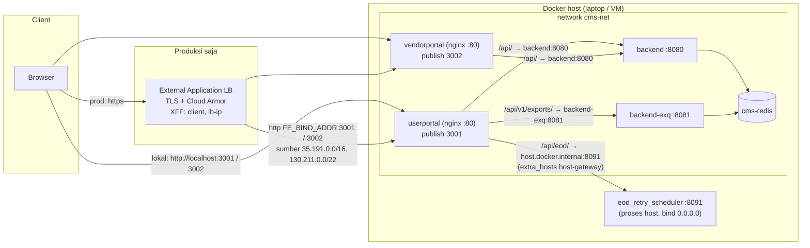

# Design Document

> Status: **design disetujui PO 2026-11-04** ("lanjut ke task.md"). Mengikuti `requirements.md` (disetujui 2026-11-04, D1–D7 = saran Kiro). Tasks: `tasks.md`.
> Satu keputusan teknis sengaja ditunda ke hasil Linux_Probe (task 1): bentuk blok `/api/eod/` (varian R atau S, lihat CP_Nginx). Aturan pilihnya ditulis di sini supaya tidak perlu keputusan PO baru.

## Overview

Perubahan hanya di konfigurasi deploy frontend:

1. **Upstream (D1).** `/api/` CP dan VP diarahkan ke service `backend:8080` lewat `cms-net`, sama seperti `/api/v1/exports/` ke `backend-exq:8081`. `/api/eod/` CP tetap ke host (`host.docker.internal:8091`); nama itu dijamin ada di Linux lewat `extra_hosts: host.docker.internal:host-gateway` di Base_Compose.
2. **Image (D2, D3).** `FROM` di-pin dengan tag persis + digest. Nama image dibentuk dari `FE_REGISTRY` + `IMAGE_TAG` dengan default lokal (`companyportal-vite-fe:local`).
3. **Produksi (D3, D4).** File baru `frontend/docker-compose.prod.yml` mewajibkan `FE_REGISTRY`, `IMAGE_TAG`, `FE_BIND_ADDR`, menghapus `build:` dan mengganti mapping port. TLS diakhiri di GCP external Application Load Balancer.
4. **Kebersihan (D5, D6).** `VendorPortal-Vite/docker-compose.yml` dihapus. Job CI `fe-image` membuild kedua image, menjalankan `check-image.sh` dan `nginx -t`.
5. **Dokumen.** `deployment.md` mendapat bagian deploy frontend dan nilai `TRUSTED_PROXIES` yang baru. `development-plan.md` X.15.

Lokal tetap: `docker compose -f frontend/docker-compose.yml up` di Docker Desktop tidak butuh env atau file tambahan; `vite.config.ts` dan `dev.ps1` tidak disentuh.

## Architecture

### Lokal (Docker Desktop) dan produksi (satu VM, D7)



### Alur data per path (CP)

| Path (prioritas nginx) | Upstream | Resolusi nama | Prefix |
|---|---|---|---|
| `/api/eod/` | `host.docker.internal:8091` | varian R: resolver `127.0.0.11` + variabel; varian S: `proxy_pass` statis (getaddrinfo saat start, membaca `/etc/hosts` yang diisi `extra_hosts`) | `/api/eod/` dibuang (`rewrite … break`) |
| `/api/v1/exports/` | `backend-exq:8081` | resolver + variabel (tidak berubah) | tetap |
| `/api/` | `backend:8080` (baru; sebelumnya `host.docker.internal:8080`) | resolver + variabel | tetap |
| `/`, aset | file statis | — | — |

VP hanya punya `/api/` → `backend:8080`.

### Alamat yang dilihat backend (dasar nilai `TRUSTED_PROXIES`)

| Hop | Lokal | Produksi |
|---|---|---|
| Browser → nginx | IP gateway Docker Desktop | IP GFE (35.191.0.0/16, 130.211.0.0/22); `X-Forwarded-For` = `<client>,<lb-ip>` dari LB ([GCP request distribution](https://cloud.google.com/load-balancing/docs/https/request-distribution)) |
| nginx → `backend` / `backend-exq` | IP container CP/VP di `cms-net` | sama |
| nginx → EOD (host) | ditentukan Linux_Probe (dugaan: IP container CP di `cms-net`, karena trafik bridge → alamat host tidak di-NAT) | sama |

`TrustedRealIP` membaca `X-Forwarded-For` dari kanan dan melewati hop tepercaya. Rantai di produksi: `RemoteAddr` = nginx (subnet `cms-net`) → hop paling kanan = IP GFE (ditambahkan nginx lewat `$proxy_add_x_forwarded_for`) → `lb-ip` → `client`. Jadi nilai produksi `backend` dan `backend-exq`: **subnet `cms-net`, `35.191.0.0/16`, `130.211.0.0/22`, `<lb-ip>/32`**. Nilai persis diverifikasi dari log `remote_ip` saat deploy pertama (outstanding user).

## Components and Interfaces

### CP_Nginx (`frontend/CompanyPortal-Vite/nginx.conf`) — Req 2, 11.3

#### Blok `/api/`
Hanya baris upstream dan komentar yang berubah:

```nginx
    # Go API (backend, :8080) on the same cms-net network (frontend-deploy-readiness D1).
    location /api/ {
        resolver 127.0.0.11 valid=30s ipv6=off;
        set $backend_upstream http://backend:8080;
        proxy_pass $backend_upstream;
        # proxy_set_header … dan proxy_cookie_path tidak berubah
    }
```

Resolver + variabel dipertahankan: nama `backend` di-resolve per request, jadi nginx tetap start bila `backend` belum up dan menjawab 502 (Req 2.5).

#### Blok `/api/eod/`
Dipilih dari hasil Linux_Probe kriteria 1.2(c):

- **Varian R** (nginx dengan resolver `127.0.0.11` berhasil me-resolve `host.docker.internal` yang diisi `extra_hosts`, di Linux_Engine dan Docker_Desktop): blok tidak berubah. Hanya Base_Compose yang menambah `extra_hosts`.
- **Varian S** (resolver gagal di salah satu engine): resolver dan variabel dibuang, nama di-resolve sekali saat start lewat getaddrinfo (membaca `/etc/hosts`):

```nginx
    location /api/eod/ {
        rewrite ^/api/eod/(.*)$ /$1 break;
        proxy_pass http://host.docker.internal:8091;
        # proxy_set_header … tidak berubah
    }
```

Varian S aman untuk start karena `extra_hosts` selalu menulis entri `/etc/hosts` (alamat gateway), jadi nama selalu ada; bila EOD mati, nginx tetap start dan path dijawab 502 (Req 2.5). Varian yang dipakai dicatat di `evidence.md` dan di catatan `deployment.md`.

#### Blok lain
`listen 80` (TLS diakhiri di LB, D4; Req 6.3), `/api/v1/exports/`, `location /`, blok aset, `include security-headers.conf`, dan semua `proxy_set_header` tidak berubah (Req 2.3, 2.6, 11.3).

### VP_Nginx (`frontend/VendorPortal-Vite/nginx.conf`) — Req 2.2, 11.3

Sama dengan blok `/api/` CP: `set $backend_upstream http://backend:8080;` + komentar. VP tidak butuh `extra_hosts`.

### Frontend_Image (kedua `Dockerfile`) — Req 5

Hanya dua baris `FROM` yang berubah:

```dockerfile
FROM node:22.23.4-alpine3.24@sha256:<digest-index> AS builder
…
FROM nginx:1.31.8-alpine3.24@sha256:<digest-index>
```

- Versi diambil dari image yang berjalan saat requirements ditulis (Node 22.23.4, nginx 1.31.8 mainline, Alpine 3.24.3).
- Digest = digest **index multi-arch**, diambil dengan `docker buildx imagetools inspect <tag>` (baris `Digest:`), bukan digest manifest satu platform. Bila tag `-alpine3.24` tidak tersedia, pakai `-alpine` dengan digest yang sama versinya; tag yang dipakai dicatat di `evidence.md`.
- HEALTHCHECK (`http://127.0.0.1:80/`), `USER appuser`, `LABEL`, langkah build tidak berubah (Req 5.3).
- Update versi berikutnya = edit tag + digest secara manual (belum ada Dependabot/Renovate); dicatat di `deployment.md`.

### Base_Compose (`frontend/docker-compose.yml`) — Req 3, 4.1, 6.1

```yaml
  userportal:
    build: { context: ./CompanyPortal-Vite, dockerfile: Dockerfile }   # tidak berubah
    image: ${FE_REGISTRY:-}companyportal-vite-fe:${IMAGE_TAG:-local}
    container_name: userportal-vite-fe
    ports:
      - "3001:80"
    # Linux Docker Engine has no host.docker.internal; Docker Desktop also accepts this.
    # Used only by /api/eod/ (eod_retry_scheduler runs on the host).
    extra_hosts:
      - "host.docker.internal:host-gateway"
    # restart, healthcheck, networks tidak berubah

  vendorportal:
    image: ${FE_REGISTRY:-}vendorportal-vite-fe:${IMAGE_TAG:-local}
    # sisanya tidak berubah
```

Tanpa env: image `companyportal-vite-fe:local` dan `vendorportal-vite-fe:local`, port `3001`/`3002` di semua interface (lokal), `cms-net` eksternal. Image lama bertag `latest` di laptop tidak dipakai lagi dan boleh dihapus manual.

### Prod_Override (`frontend/docker-compose.prod.yml`, baru) — Req 4.2, 4.3, 6.2

```yaml
# Production only, on the VM, together with the base file (frontend-deploy-readiness):
#   docker compose -f docker-compose.yml -f docker-compose.prod.yml pull
#   docker compose -f docker-compose.yml -f docker-compose.prod.yml up -d --no-build
# Needs Docker Compose >= 2.24.4 (!reset / !override). Values come from frontend/.env on the VM.
services:
  userportal:
    build: !reset null
    image: ${FE_REGISTRY:?set FE_REGISTRY to the Artifact Registry prefix ending in /}companyportal-vite-fe:${IMAGE_TAG:?set IMAGE_TAG to the git SHA}
    ports: !override
      - "${FE_BIND_ADDR:?set FE_BIND_ADDR to the VM internal IP}:3001:80"

  vendorportal:
    build: !reset null
    image: ${FE_REGISTRY:?set FE_REGISTRY to the Artifact Registry prefix ending in /}vendorportal-vite-fe:${IMAGE_TAG:?set IMAGE_TAG to the git SHA}
    ports: !override
      - "${FE_BIND_ADDR:?set FE_BIND_ADDR to the VM internal IP}:3002:80"
```

- `build: !reset null` membuat VM tidak bisa membuild (Req 4.3); `--no-build` di perintah jadi pengaman kedua.
- `ports: !override` mengganti list dasar. Tanpa tag ini Compose menggabungkan list sehingga `3001:80` dasar tetap terbuka di semua interface (Req 6.2).
- `${VAR:?pesan}` membuat `config`/`up` gagal dengan pesan yang menyebut variabel (Req 4.2).
- `extra_hosts`, `healthcheck`, `networks`, `restart` diwarisi dari Base_Compose.

### VP_Standalone_Compose — Req 7

`frontend/VendorPortal-Vite/docker-compose.yml` dihapus. Rujukan aktif yang diberi catatan: `.kiro/specs/.on-hold/gke-deploy/design.md` (baris 294, 747) dan `tasks.md` (baris 60), cukup satu catatan di bagian atas tiap file ("file dihapus 2026-11-04, spec `frontend-deploy-readiness`"). `bugfixes.md` dan `.kiro/specs/.done/**` dibiarkan.

### FeImageJob (`.github/workflows/ci.yml`) — Req 8

```yaml
  fe-image:
    name: fe-image (${{ matrix.portal }})
    runs-on: ubuntu-latest
    strategy:
      fail-fast: false # one broken portal must not cancel the other
      matrix:
        include:
          - portal: CompanyPortal-Vite
            image: companyportal-vite-fe
          - portal: VendorPortal-Vite
            image: vendorportal-vite-fe
    steps:
      - uses: actions/checkout@v7
      # Same context as frontend/docker-compose.yml (portal folder).
      - name: docker build (${{ matrix.portal }})
        run: docker build -t "${{ matrix.image }}:ci" "frontend/${{ matrix.portal }}"
      - name: Image runs as non-root and has a HEALTHCHECK
        run: bash scripts/ci/check-image.sh "${{ matrix.image }}:ci" "frontend/${{ matrix.portal }}"
      # --add-host: varian S resolves host.docker.internal at config load.
      - name: nginx -t
        run: docker run --rm --add-host host.docker.internal:host-gateway --entrypoint nginx "${{ matrix.image }}:ci" -t
```

- Nama image lewat `matrix.image` karena nama Docker wajib huruf kecil (`CompanyPortal-Vite` tidak valid).
- `check-image.sh` tidak diubah; argumen kedua hanya label untuk pesan error (`frontend/<portal>/Dockerfile`).
- Tanpa push, tanpa secret; izin `contents: read` diwarisi dari level workflow (Req 8.5).
- Job lint/test/coverage frontend tetap X.3 (D6).

### DeploymentDoc (`.claude/docs/deployment.md`) — Req 9

| Bagian | Perubahan |
|---|---|
| Tabel produk #1 | "Frontend (internal + vendor): CP dan VP sebagai container di VM yang sama dengan backend (`cms-net`), di belakang external Application LB" (D7) |
| Paragraf "Pipeline" | Tambah job `fe-image`; hapus kalimat "There is no frontend … job yet" untuk image (lint/test tetap terbuka, X.3); `cloudbuild.yaml` = spec terpisah (D3) |
| Bagian baru **"Deploy frontend (CompanyPortal + VendorPortal)"** | Prasyarat; tabel env; build + push; deploy di VM; verifikasi; rollback; TLS/LB/firewall (detail di bawah) |
| "EOD monitoring routing (S6)" | Jalur `/api/eod/` lewat `extra_hosts: host-gateway`, varian R/S yang dipakai, EOD harus listen di alamat yang bisa dicapai dari bridge Docker (sekarang `0.0.0.0`) dan port 8091 ditutup dari luar VM lewat firewall |
| "IP client & proxy tepercaya" | Nilai produksi `backend` diganti dari "Docker network gateway" menjadi subnet `cms-net` + rentang GFE + `<lb-ip>/32`; `backend-exq` sama; `RETRY_TRUSTED_PROXIES` = alamat yang diukur Linux_Probe (Req 9.2, 9.3). Port 8080 tidak perlu di-publish lagi untuk frontend |
| Release checklist `backend-exq`, baris `TRUSTED_PROXIES` | Disesuaikan: nilai `backend` dan `backend-exq` kini sama |

Isi bagian baru:

- **Prasyarat:** `cms-net` dan Redis sudah dibuat oleh `backend/docker-compose.yaml`; `backend` dan `backend-exq` up; Docker Compose ≥ 2.24.4 (`docker compose version`); VM tanpa IP publik.
- **Tabel env** (`frontend/.env` di VM, di-ignore git):

| Variabel | Default lokal | Produksi |
|---|---|---|
| `FE_REGISTRY` | kosong | `<region>-docker.pkg.dev/<project>/<repo>/` (akhiri `/`) |
| `IMAGE_TAG` | `local` | git SHA pendek release |
| `FE_BIND_ADDR` | tidak dipakai | IP internal VM |

- **Build + push** (host operator, checkout di SHA release): `docker build` per portal dengan tag `${FE_REGISTRY}<image>:${SHA}`; CP dengan `--build-arg VITE_APP_ENV=prod` (tertanam di bundle, jadi image staging dan prod dibuild terpisah bila nilainya beda); `gcloud auth configure-docker <region>-docker.pkg.dev`; `docker push`.
- **Deploy di VM:** `pull` lalu `up -d --no-build` dengan kedua file.
- **Verifikasi tanpa browser:** `docker ps` dua container `healthy`; dari VM `curl -s -o /dev/null -w '%{http_code}' http://$FE_BIND_ADDR:3001/` = 200, `…:3001/api/v1/auth/me` = 401 (dari Go), `…:3002/api/v1/auth/me` = 401, `…:3001/api/eod/health` = 200; satu baris `http_request` di log `backend` dengan `remote_ip` yang diharapkan.
- **Rollback:** set `IMAGE_TAG` ke SHA sebelumnya, `pull`, `up -d --no-build`.
- **TLS/LB:** external Application LB, sertifikat Google-managed per domain (Cloud DNS #10), Cloud Armor (#11) di backend service, redirect HTTP → HTTPS di LB, instance group dengan named port `cp=3001`, `vp=3002`, health check HTTP `/` di port tersebut; firewall VPC ingress tcp:3001,3002 hanya dari `35.191.0.0/16` dan `130.211.0.0/22`. HTTPS wajib karena cookie refresh `Secure` dan HSTS. Catatan: bila CP nanti memakai **internal** Application LB, rentang sumbernya adalah proxy-only subnet, dan `TRUSTED_PROXIES` disesuaikan.

### DevelopmentPlan (`.kiro/steering/development-plan.md`) — Req 9.5

Baris X.15 sudah ditambahkan saat requirements disetujui; diperbarui saat design/tasks disetujui dan saat implementasi selesai.

### Linux_Probe dan harness verifikasi — Req 1, 10

Bukan file di repo; perintah dan hasilnya disimpan di `.kiro/specs/frontend-deploy-readiness/evidence.md` (Req 1.4, 10.4).

#### Lingkungan Linux_Engine
1. `docker run -d --privileged --name fe-dind -v "<repo>:/repo:ro" docker:29-dind` (Engine major sama dengan Docker Desktop 29.9.2). Hanya untuk verifikasi lokal, dihapus di akhir (Req 11.2).
2. Image dibuild di Docker Desktop lalu dipindah dengan `docker save -o $env:TEMP\fe-probe.tar …`, `docker cp`, `docker exec fe-dind docker load -i …`. Tidak lewat pipe PowerShell (pipe merusak data biner).
3. Di dalam `fe-dind`: `docker network create cms-net`; `cms-redis` (`redis:7-alpine`); `backend` dari image `cms-backend-api` dengan `--network cms-net --network-alias backend --env-file /repo/backend/.env --add-host host.docker.internal:<H> -p 8080:8080`; `backend-exq` serupa dengan `/repo/backend-exq/.env`. `<H>` = hasil `getent hosts host.docker.internal` di container `fe-dind` (alamat host Windows dari Docker Desktop), supaya backend bisa mencapai Postgres dev. `-p 8080:8080` meniru publish port host yang dipakai jalur lama.
4. Stub EOD sebagai "proses host": container `nginx` (image ter-pin yang sama) dengan `--network host` di `fe-dind`, listen `8091`, `location = /health { return 200 "eod-stub remote=$remote_addr\n"; }`. Container dengan network host setara proses host, jadi alamat sumber yang terlihat sama dengan yang akan dilihat `eod_retry_scheduler` (dasar `RETRY_TRUSTED_PROXIES`).
5. Bila Postgres dev tidak bisa dicapai dari `fe-dind`, `backend`/`backend-exq` diganti stub nginx yang menjawab `401 {"stub":"backend"}` dan mencatat `$remote_addr`; penggantian ini dicatat di `evidence.md` dan dilaporkan ke PO karena Req 2.1 meminta jawaban dari Backend_API asli.

#### Probe sebelum perbaikan (Req 1)
- Image CP/VP dari HEAD dijalankan di `cms-net` dalam `fe-dind`, port 3001/3002. Request `wget -S -O- http://127.0.0.1:300x/<path>` dari `fe-dind` untuk `/api/v1/auth/me` (CP, VP), `/api/v1/exports/jobs` (CP), `/api/eod/health` (CP); catat status dan `docker logs` nginx (mis. `host.docker.internal could not be resolved`).
- 1.2: `getent hosts host.docker.internal` di container CP (a) tanpa dan (b) dengan `--add-host host.docker.internal:host-gateway`; (c) request `/api/eod/health` dan `/api/v1/auth/me` ke container (b).
- 1.3: langkah yang sama di Docker Desktop memakai Base_Compose HEAD.

#### Verifikasi sesudah perbaikan (Req 10)
- `docker compose config` di Docker Desktop: Base_Compose saja (tanpa env); Base + Prod_Override dengan env diisi; Base + Prod_Override tanpa `IMAGE_TAG` (harus gagal). Bagian `ports` dan `image` hasil `config` disalin ke `evidence.md`.
- Docker Desktop: backend compose up, `eod_retry_scheduler` di host (`python -m eod_retry_scheduler.run`), Base_Compose `up -d --build`; status `healthy`; Upstream_Check dari host Windows (`curl.exe`) untuk path yang sama.
- Linux_Engine: image baru di-load ke `fe-dind`, ditag ulang sebagai `probe.registry.local/<image>:<sha>`; `docker compose -f /repo/frontend/docker-compose.yml -f /repo/frontend/docker-compose.prod.yml up -d --no-build` dengan `FE_REGISTRY=probe.registry.local/`, `IMAGE_TAG=<sha>`, `FE_BIND_ADDR=<IP eth0 fe-dind>`; status `healthy`; Upstream_Check ke `FE_BIND_ADDR`. Ini juga menguji Prod_Override di Linux.
- Log `backend` (`http_request`, `remote_ip`) dan body stub EOD dicatat sebagai bukti alamat sumber untuk `TRUSTED_PROXIES` / `RETRY_TRUSTED_PROXIES`.

## Data Models

Tidak ada tabel baru, kolom baru, atau migrasi.

Model konfigurasi (env Compose):

| Variabel | Dipakai di | Default | Wajib di Prod_Override | Validasi |
|---|---|---|---|---|
| `FE_REGISTRY` | `image` kedua service | kosong | ya (`:?`) | tidak divalidasi Compose; harus diakhiri `/` (dokumen) |
| `IMAGE_TAG` | `image` kedua service | `local` | ya (`:?`) | — |
| `FE_BIND_ADDR` | `ports` Prod_Override | — (tidak ada di Base) | ya (`:?`) | Compose menolak alamat tidak valid saat `up` |

## Correctness Properties

### Property 1: Routing `/api/` ke Go API
*For any* path di bawah `/api/` yang tidak diawali `/api/eod/` atau `/api/v1/exports/`, pada CP dan VP di Linux_Engine maupun Docker_Desktop, request lewat nginx diteruskan ke `backend:8080` dengan URI yang sama, sehingga jawabannya berasal dari Backend_API (bukan 502/504 nginx) selama `backend` up.
**Validates: Requirements 2.1, 2.2, 3.2, 10.3**

### Property 2: Routing ekspor tidak berubah
*For any* path di bawah `/api/v1/exports/` pada CP, request diteruskan ke `backend-exq:8081` dengan URI yang sama, tanpa buffering dan dengan timeout baca 300 dtk.
**Validates: Requirements 2.3, 10.3**

### Property 3: Routing EOD membuang prefix
*For any* `/api/eod/<p>?<q>` pada CP, EOD_Service di host menerima `/<p>?<q>`, di Linux_Engine maupun Docker_Desktop.
**Validates: Requirements 2.4, 10.3**

### Property 4: Start tidak bergantung pada upstream
*For any* subset upstream (`backend`, `backend-exq`, EOD) yang mati saat container frontend start, nginx tetap start, container menjadi `healthy`, `/` = 200, dan path yang upstream-nya mati dijawab 502.
**Validates: Requirements 2.5**

### Property 5: Header proxy dan konfigurasi lain tidak berubah
*For any* blok `location` di CP_Nginx dan VP_Nginx, `diff` HEAD vs hasil perubahan hanya berisi baris upstream (`set $…_upstream`, dan untuk varian S: `resolver`/`set`/`proxy_pass` blok `/api/eod/`) serta komentar; `proxy_set_header`, `proxy_cookie_path`, `include security-headers.conf`, `add_header`, dan aturan cache identik.
**Validates: Requirements 2.6, 11.3**

### Property 6: Base_Compose tanpa env = lokal
*For any* lingkungan tanpa `FE_REGISTRY`, `IMAGE_TAG`, `FE_BIND_ADDR`, `docker compose -f frontend/docker-compose.yml config` berhasil dan menghasilkan image `companyportal-vite-fe:local` / `vendorportal-vite-fe:local`, port `3001:80` / `3002:80`, `build` ada, dan service CP + VP.
**Validates: Requirements 3.1, 3.3, 4.1, 6.1, 7.3, 10.1**

### Property 7: Prod_Override aman
*For any* kombinasi env, Base + Prod_Override (a) gagal di `config` bila salah satu dari `FE_REGISTRY`, `IMAGE_TAG`, `FE_BIND_ADDR` kosong, dengan pesan yang menyebut variabel itu; (b) bila semuanya terisi, menghasilkan tepat satu mapping port per service pada `FE_BIND_ADDR`, image `${FE_REGISTRY}<image>:${IMAGE_TAG}`, dan tanpa `build`.
**Validates: Requirements 4.2, 4.3, 6.2, 10.1**

### Property 8: Invarian image
*For any* Frontend_Image yang dibuild dari spec ini, `Config.User` bukan root, HEALTHCHECK = `wget … http://127.0.0.1:80/`, `nginx -t` lolos, `nginx -v` = versi ter-pin, dan `FROM` memuat tag persis + digest.
**Validates: Requirements 5.1, 5.2, 5.3, 5.4, 8.3, 8.4**

### Property 9: Permukaan yang tidak boleh berubah
*For any* file di `frontend/*/src/**`, Dev_Proxy, `security-headers.conf`, `backend/`, `backend-exq/`, `backend_python/`, `pkg/`, `git diff` terhadap HEAD awal kosong.
**Validates: Requirements 3.4, 11.1, 11.2**

## Error Handling

| Kondisi | Akibat | Penanganan |
|---|---|---|
| `backend`/`backend-exq` belum up | `/api/…` 502 | Nama di-resolve per request (resolver + variabel); nginx tetap jalan, pulih sendiri saat upstream up (Property 4) |
| Varian S, `host.docker.internal` tidak bisa di-resolve saat start (image dijalankan tanpa `extra_hosts`, mis. `docker run` manual di Linux) | nginx gagal start `host not found in upstream` | Base_Compose selalu memasang `extra_hosts`; CI `nginx -t` memakai `--add-host`; `deployment.md` menyebut syarat ini |
| EOD mati | `/api/eod/…` 502 | Sama seperti sekarang |
| Env Prod_Override kosong | `config`/`up` gagal dengan pesan variabel | Disengaja (Property 7) |
| Docker Compose < 2.24.4 di VM | `!reset`/`!override` tidak dikenali, parse error | Prasyarat versi di `deployment.md`; dicek dengan `docker compose version` |
| Pull gagal (auth Artifact Registry, tag salah) | `pull` gagal, container lama tetap jalan | `gcloud auth configure-docker`; cek tag; tidak ada `up` sebelum `pull` berhasil |
| Firewall LB belum dibuat | Health check LB gagal, LB menjawab 502 | Aturan firewall di `deployment.md` |
| `TRUSTED_PROXIES` tidak memuat subnet `cms-net` | Semua user tercatat dengan IP nginx; batas login per IP dibagi semua user | Nilai baru di `deployment.md`; verifikasi `remote_ip` saat deploy pertama |
| `TRUSTED_PROXIES` memuat GFE tetapi tidak `<lb-ip>` | `remote_ip` = IP LB untuk semua user | Sama; `<lb-ip>/32` disebut eksplisit |
| Postgres dev tidak tercapai dari `fe-dind` | Backend asli tidak start di probe | Stub backend, dicatat dan dilaporkan ke PO (Linux_Probe langkah 5) |

## Testing Strategy

Spec ini hanya mengubah konfigurasi, jadi tidak ada unit test atau property test kode. Setiap property dibuktikan dengan perintah yang hasilnya dicatat di `evidence.md`, ditambah job CI.

| Property | Bukti |
|---|---|
| P1, P2, P3 | Upstream_Check di Linux_Engine (`fe-dind`, Prod_Override) dan Docker_Desktop (Base_Compose): `/api/v1/auth/me`, `/api/v1/exports/jobs`, `/api/eod/health` + satu path dengan query string untuk P3 (`/api/eod/health?probe=1`, stub mencatat `$request_uri`) |
| P4 | Start container frontend saat `backend`, `backend-exq`, dan stub EOD dimatikan; cek `healthy`, `/` = 200, ketiga path = 502; lalu nyalakan upstream dan cek pulih |
| P5 | `git diff -- frontend/*/nginx.conf` ditinjau baris per baris; `diff` bagian non-upstream harus kosong |
| P6, P7 | `docker compose config` tiga kombinasi (tanpa env, env lengkap, satu variabel kosong per variabel) |
| P8 | CI `fe-image` (`check-image.sh`, `nginx -t`) + lokal `docker image inspect` dan `nginx -v` |
| P9 | `git diff --stat` terhadap HEAD awal, difilter per path |

Lainnya:
- Regresi bugfix HEALTHCHECK 2026-11-03: container `healthy` di kedua engine (P8).
- `./dev.ps1 company|vendor` tidak dijalankan ulang; cukup `git diff` kosong (Req 3.4).
- Run GitHub Actions pertama untuk `fe-image` terjadi setelah push (outstanding).
- **Cek browser manual (user, Golden Rule #10, outstanding):** login CP dan VP lewat `localhost:3001`/`3002`, halaman EOD Monitoring tampil, satu unduhan ekspor, IP di Log Audit sesuai (Req 10.5).
- Tidak ada commit sampai user menulis "commit" (Req 10.6); `fe-dind` dan file `fe-probe.tar` dihapus setelah verifikasi.

## Files touched

| File | Perubahan |
|---|---|
| `frontend/CompanyPortal-Vite/nginx.conf` | upstream `/api/` → `backend:8080`; `/api/eod/` varian R (tidak berubah) atau S |
| `frontend/VendorPortal-Vite/nginx.conf` | upstream `/api/` → `backend:8080` |
| `frontend/CompanyPortal-Vite/Dockerfile`, `frontend/VendorPortal-Vite/Dockerfile` | dua baris `FROM` |
| `frontend/docker-compose.yml` | `image` dari env, `extra_hosts` (CP) |
| `frontend/docker-compose.prod.yml` | baru |
| `frontend/VendorPortal-Vite/docker-compose.yml` | dihapus |
| `.github/workflows/ci.yml` | job `fe-image` |
| `.claude/docs/deployment.md` | bagian baru + bagian yang disebut di DeploymentDoc |
| `.kiro/specs/.on-hold/gke-deploy/design.md`, `tasks.md` | catatan file dihapus |
| `.kiro/steering/development-plan.md` | X.15 |
| `.kiro/specs/frontend-deploy-readiness/evidence.md` | baru, bukti probe dan verifikasi |
