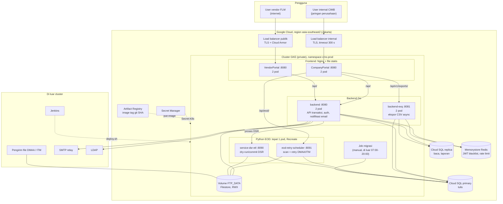

# Desain arsitektur CROWN di GKE

> **Status: ⏸ ON HOLD (user, 2026-11-04).** GKE belum diperlukan; CROWN tetap berjalan di Compute Engine sesuai `.claude/docs/deployment.md` dan CLAUDE.md Sec 10. Spec ini disimpan untuk dipakai bila nanti pindah ke GKE. Jangan dikerjakan sampai user memintanya lagi. Saat dilanjutkan, cek ulang kondisi kode (Dockerfile, `nginx.conf`, `.env.example`, nomor migrasi) karena bisa sudah berubah.

> Ringkasan visual dari `design.md` (spec `gke-deploy`, draft 2026-11-04) untuk pembaca non-teknis dan tim infra. Bila ada perbedaan, `design.md` yang berlaku.
> Diagram dan angka menggambarkan lingkungan **prod**. Dev dan UAT bentuknya sama, dengan 1 pod per komponen.

## Diagram arsitektur

## Jalur masuk

| Pengguna | Masuk lewat | Diteruskan ke | Catatan |
|---|---|---|---|
| User internal CIMB | Load balancer internal (hanya jaringan perusahaan) | Pod CompanyPortal | TLS berhenti di load balancer. Timeout 300 detik supaya unduhan ekspor tidak terputus. |
| User vendor FLM | Load balancer publik + Cloud Armor | Pod VendorPortal | TLS berhenti di load balancer. Cloud Armor menyaring trafik internet. |

Hanya kedua portal yang bisa dijangkau dari luar cluster. Backend Go dan Python hanya bisa dipanggil dari dalam cluster.

## Komponen dan jumlah pod

| Komponen | Pod berjalan (prod) | Pod backup (prod) | Total pod prod | Total pod dev / UAT | Peran |
|---|---|---|---|---|---|
| CompanyPortal | 1 | 1 | 2 | 1 | Nginx menyajikan file statis portal internal dan meneruskan `/api/*` ke backend. Alamat backend dibaca dari env. |
| VendorPortal | 1 | 1 | 2 | 1 | Sama dengan CompanyPortal, khusus portal vendor. |
| `backend` | 1 | 1 | 2 | 1 | API transaksi, penerbit JWT, worker email notifikasi. |
| `backend-exq` | 1 | 1 | 2 | 1 | API ekspor + worker + janitor. |
| `eod-retry-scheduler` | 1 | 0 (tidak boleh) | 1 | 1 | Scan dan retry file DMAA/ITM, menjalankan skrip ETL. |
| `service-dsr-etl` | 1 | 0 (tidak boleh) | 1 | 1 | Dry-run dan commit upload DSR vendor. |
| Job migrasi | 1, hanya saat dijalankan operator | 0 | 0 di luar migrasi | 0 di luar migrasi | `migrate status` → `up` → `status`, di luar 07:00–20:00 WIB. |

- **Pod berjalan** = jumlah minimum pod agar layanan hidup.
- **Pod backup** = pod tambahan agar layanan tetap hidup saat satu pod mati, diganti versi baru, atau node-nya di-upgrade.
- Pod backup **tidak diam menunggu**. Kedua pod menerima trafik bersamaan, dan request dibagi ke keduanya. Bila satu pod mati, pod lain melayani semua request sampai K8s membuat pengganti.
- Selama deploy versi baru ada 1 pod tambahan sementara per komponen (pod baru dinyalakan dulu sebelum pod lama dimatikan).
- **Python tidak boleh punya pod backup.** Dua scheduler yang aktif bersamaan bisa memproses file atau retry dua kali. Saat pod Python mati atau di-update, layanan EOD berhenti sebentar sampai pod pengganti jalan.

## Kebutuhan node

Perkiraan dari resource request di `design.md`, bukan dari uji beban (baseline yang ada hanya mengukur idle).

| Lingkungan | Total request | GKE Standard | GKE Autopilot |
|---|---|---|---|
| prod | ≈ 2,05 vCPU, ≈ 2,7 GiB | 3 node `e2-standard-2`, satu per zona Jakarta | Google memilih node; biaya dari total request |
| dev + UAT (satu cluster) | ≈ 2,2 vCPU, ≈ 3,2 GiB | 2 node `e2-standard-2` | sama |

- Satu `e2-standard-2` (2 vCPU, 8 GB) menyisakan sekitar 1,5 vCPU untuk aplikasi setelah dipakai Kubernetes dan pod sistem GKE.
- Prod butuh 3 node supaya semua pod tetap muat saat satu node mati (sisa ≈ 3,0 vCPU ≥ 2,05).
- Dua pod satu komponen tidak pernah ditaruh di node yang sama, dan diutamakan beda zona. Tanpa aturan ini pod backup bisa ikut mati bersama node pod utama.
- Angka final ditetapkan setelah uji beban.
## Routing di Nginx frontend

Browser hanya memanggil domain portal. Nginx di pod portal meneruskan request API ke service di dalam cluster:

| Request dari browser | CompanyPortal meneruskan ke | VendorPortal meneruskan ke |
|---|---|---|
| `/api/eod/...` | `eod-retry-scheduler` (prefix `/api/eod` dibuang) | tidak ada |
| `/api/v1/exports/...` | `backend-exq` | tidak ada |
| `/api/...` lainnya | `backend` | `backend` |
| selain `/api/` | file statis React (SPA) | file statis React (SPA) |

Alamat tujuan dibaca dari env saat container start, jadi image yang sama dipakai di laptop dan di GKE:

| Variabel | Compose lokal | GKE prod |
|---|---|---|
| `CROWN_BACKEND_UPSTREAM` | `http://host.docker.internal:8080` | `http://backend.cms-prod.svc.cluster.local:8080` |
| `CROWN_EXQ_UPSTREAM` (CompanyPortal) | `http://backend-exq:8081` | `http://backend-exq.cms-prod.svc.cluster.local:8081` |
| `CROWN_EOD_UPSTREAM` (CompanyPortal) | `http://host.docker.internal:8091` | `http://eod-retry-scheduler.cms-prod.svc.cluster.local:8091` |

Bila variabel wajib kosong, container berhenti dengan pesan yang menyebut nama variabelnya.

## Siapa boleh memanggil siapa (NetworkPolicy)

| Dari | Ke | Port |
|---|---|---|
| Load balancer Google | CompanyPortal, VendorPortal | 8080 |
| CompanyPortal, VendorPortal | `backend` | 8080 |
| CompanyPortal | `backend-exq` | 8081 |
| CompanyPortal | `eod-retry-scheduler` | 8091 |
| `backend` | `service-dsr-etl` | 8090 |

Semua jalur lain ke pod CROWN ditolak. Pod lain di cluster bersama tidak bisa memanggil backend.

## Layanan di luar cluster

| Layanan | Dipakai oleh | Fungsi |
|---|---|---|
| Cloud SQL primary | `backend`, `backend-exq`, Python, Job migrasi | Semua tulis dan baca transaksional. Private IP + TLS. |
| Cloud SQL replica | `backend`, `backend-exq` | Laporan, dashboard, ekspor. |
| Memorystore Redis (satu per lingkungan) | `backend`, `backend-exq` | JWT blacklist dan rate limit login. Harus sama untuk kedua backend. |
| Filestore (volume `FTP_DATA`) | `backend`, `eod-retry-scheduler`, `service-dsr-etl`, pengirim file DMAA/ITM | File upload DSR, file DMAA, file ITM, beserta folder `backups/`. Semua penulis memakai uid 10001. |
| Secret Manager | semua pod | Sumber Secret K8s (password DB, `JWT_SECRET`, SMTP, LDAP). Tidak ada secret di repo. |
| Artifact Registry | semua pod | Image dengan tag git SHA, tanpa `latest`. |
| SMTP relay, LDAP | `backend` | Email notifikasi dan login internal. Jalur egress disiapkan tim infra. |
| Jenkins | operator / pipeline | Menjalankan `deploy/k8s/deploy.sh <env> <sha>`. |

## Perbedaan dengan VM sekarang

| Aspek | Sekarang (Compute Engine VM) | Di GKE |
|---|---|---|
| Tempat jalan | Satu VM, docker compose | Cluster GKE, satu namespace per lingkungan |
| Ketersediaan | Satu container per service; deploy = jeda singkat | Portal dan backend Go 2 pod; deploy bergantian tanpa jeda |
| Alamat antar service | `host.docker.internal`, network `cms-net` | Nama Service K8s (`backend.cms-prod.svc.cluster.local`) |
| `FTP_DATA` | Bind mount folder di VM | Volume Filestore yang di-mount beberapa pod |
| Migrasi | Dari host operator (butuh Go + `psql`) | Job dengan image migrasi yang SHA-nya sama dengan rilis |
| Health check | `HEALTHCHECK` Docker | Liveness `/health`, readiness `/ready` (Go) di manifest |
| Rencana 2028 | Split ke satu VM per backend | Tidak perlu; `backend` dan `backend-exq` sudah Deployment terpisah |

## Yang masih menunggu tim infra

Nilai berikut memakai default saran Kiro sampai tim infra mengonfirmasi:
- Region dan jenis cluster (Autopilot / Standard, private).
- Jenis load balancer dan sertifikat TLS.
- Rentang IP proxy untuk `TRUSTED_PROXIES`.
- Cara Secret Manager masuk ke Secret K8s.
- Cara file DMAA/ITM dikirim ke volume Filestore.
- Tier Cloud SQL (`max_connections`) untuk menghitung ukuran pool DB.
