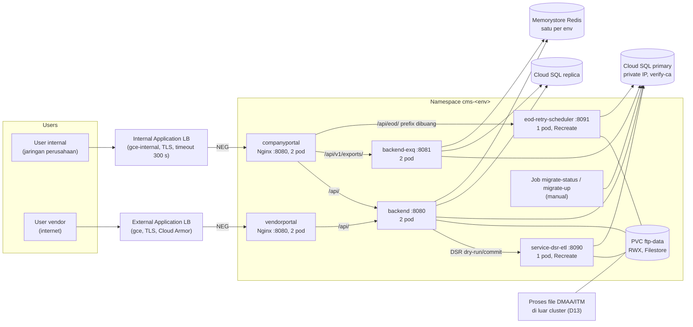
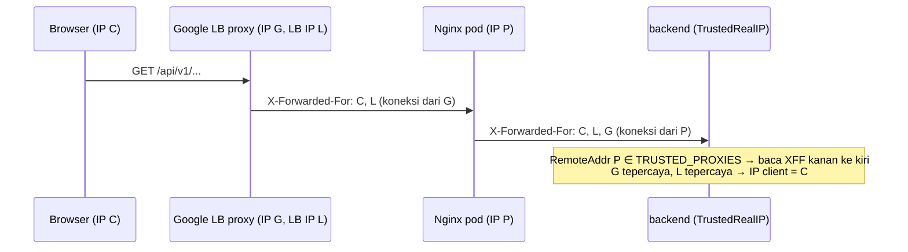
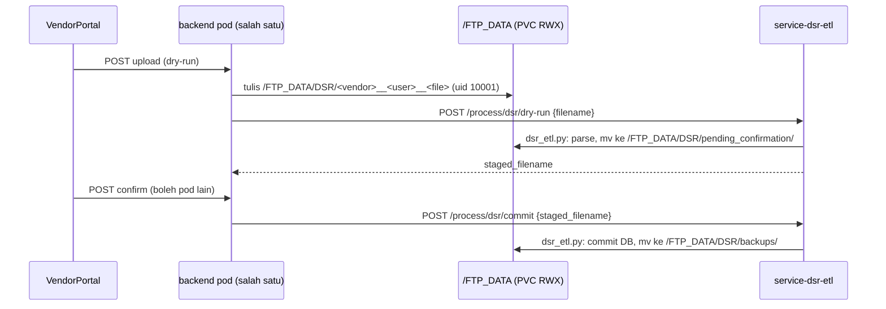
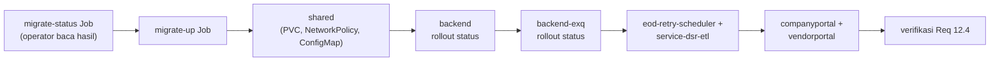

# Design Document

> **Status: ⏸ ON HOLD (user, 2026-11-04).** GKE belum diperlukan; CROWN tetap berjalan di Compute Engine sesuai `.claude/docs/deployment.md` dan CLAUDE.md Sec 10. Spec ini disimpan untuk dipakai bila nanti pindah ke GKE. Jangan dikerjakan sampai user memintanya lagi. Saat dilanjutkan, cek ulang kondisi kode (Dockerfile, `nginx.conf`, `.env.example`, nomor migrasi) karena bisa sudah berubah.
> DD1–DD7 belum diputuskan PO.

> Status: **draft 2026-11-04, menunggu PO.** Requirements: `requirements.md` (disetujui PO 2026-11-04, D1–D31 mengikuti saran Kiro).
> Keputusan design yang perlu persetujuan PO tercantum di `## Design Decisions` (DD1–DD7). Tasks: `tasks.md`.

## Overview

Spec ini memindahkan deploy produksi CROWN dari satu VM Compute Engine ke GKE tanpa mengubah kode aplikasi. Perubahannya ada di empat tempat:

1. **Manifest K8s baru** di `deploy/k8s/` (Kustomize): base untuk enam workload, overlay `dev`/`uat`/`prod`, dan kustomization terpisah untuk Job migrasi (Req 1, 2, 4–10).
2. **Image frontend**: `nginx.conf` menjadi template yang membaca upstream dari env, listen di 8080, dan user dengan uid tetap 10001 (Req 3).
3. **Image migrasi baru** `backend/Dockerfile.migrate` berisi `migrate` + `psql` + `migrations/` (Req 8).
4. **Dokumen**: Deploy_Runbook di `deployment.md`, CLAUDE.md, steering, `decisions.md`, catatan kepala di spec terkait (Req 11–14).

Ditambah skrip pendukung: `deploy/k8s/render.sh` dan `deploy/k8s/deploy.sh` (render + apply berurutan, Req 12.5), `scripts/k8s/check_manifests.py` (validator Correctness Properties tanpa cluster, Req 15.5), dan `scripts/k8s/test-frontend-nginx.sh` (uji image frontend, Req 3).

Yang tidak berubah: kode Go, Python, dan frontend (TypeScript), skema DB, migrasi, `backend/Dockerfile`, `backend-exq/Dockerfile`, dan perilaku compose lokal selain port frontend (Req 15.1, 15.2).

Pola yang diikuti:
- `scripts/ci/check-image.sh` + `check-image.test.sh` (skrip bash kecil dengan test fixture).
- Python stdlib `unittest` untuk test (CLAUDE.md Sec 2a, pytest tidak dipakai).
- Bahasa Inggris untuk `deployment.md`, mengikuti isi file sekarang.

## Architecture

### Topologi



Service Go dan Python bertipe `ClusterIP`. Hanya Service frontend yang menjadi backend Ingress (Req 1.6). NetworkPolicy membatasi siapa boleh memanggil siapa (lihat Components).

### Alur IP client (`TRUSTED_PROXIES`, Req 9.6, 9.7)



Load balancer Google menambahkan IP client dan IP load balancer ke `X-Forwarded-For`, lalu Nginx menambahkan `$remote_addr` (IP proxy Google) lewat `$proxy_add_x_forwarded_for`. Akibatnya `TRUSTED_PROXIES` berisi tiga jenis alamat: rentang pod cluster (P), rentang proxy Google (G), dan IP load balancer (L). Format persis header dibuktikan dengan request uji setelah deploy pertama (Req 9.7); nilai final dicatat di Deploy_Runbook.

### Alur file DSR (Req 7)



Go tidak menyimpan state upload di memori (`dsr_upload.go` hanya menulis file dan meneruskan nama file), jadi dry-run dan confirm boleh dilayani pod `backend` yang berbeda selama keduanya me-mount PVC yang sama (Req 7.5).

### Urutan rilis (Req 12.1)



Migrasi hanya dijalankan bila rilis membawa file migrasi baru, di luar 07:00–20:00 WIB.

## Components and Interfaces

### Struktur `deploy/k8s/` (Req 1)

```
deploy/k8s/
  render.sh                         # kubectl kustomize + ganti tag GIT_SHA (Req 1.3, 12.5)
  deploy.sh                         # apply berurutan per komponen + rollout status (Req 12.1, 12.5)
  base/
    kustomization.yaml
    shared/      ftp-data-pvc.yaml, networkpolicy.yaml
    backend/     deployment.yaml, service.yaml
    backend-exq/ deployment.yaml, service.yaml
    companyportal/ deployment.yaml, service.yaml
    vendorportal/  deployment.yaml, service.yaml
    eod-retry-scheduler/ deployment.yaml, service.yaml
    service-dsr-etl/     deployment.yaml, service.yaml
  overlays/
    dev/  kustomization.yaml, config/*.env, patches/*.yaml, ingress.yaml, backendconfig.yaml, db-budget.yaml
    uat/  (sama)
    prod/ (sama) + pdb.yaml
  migrate/
    base/ kustomization.yaml, job-status.yaml, job-up.yaml
    overlays/dev|uat|prod/kustomization.yaml
```

- Semua image di base memakai tag literal `GIT_SHA`, mis. `asia-southeast2-docker.pkg.dev/<project>/cms/cms-backend-api:GIT_SHA`. Registry path diisi per overlay lewat `images:` (`newName`); tag diganti `render.sh` dengan SHA 40 karakter. Tag `latest` atau image tanpa tag ditolak validator (Req 1.3).
- Label standar di setiap objek: `app.kubernetes.io/part-of: crown`, `app.kubernetes.io/name: <komponen>`; objek bersama memakai `app.kubernetes.io/name: shared`. `deploy.sh` memakai label ini untuk apply berurutan.
- ConfigMap dibuat lewat `configMapGenerator` dari `overlays/<env>/config/<komponen>.env` (hanya nilai non-rahasia). Hash suffix dari generator membuat pod di-restart saat config berubah.
- Secret tidak ada di repo. Deployment merujuk Secret dengan nama tetap per komponen (`backend-secrets`, dst.) lewat `envFrom.secretRef`. Kontrak key ada di tabel "Kontrak config dan secret" (Req 1.4, 9.1, 9.2).
- Namespace per Environment: `cms-dev`, `cms-uat`, `cms-prod` (overlay `namespace:`).

#### `render.sh` dan `deploy.sh` (Req 12.5)

```bash
# Usage: deploy/k8s/render.sh <dev|uat|prod> <git-sha-40>
#        deploy/k8s/deploy.sh <dev|uat|prod> <git-sha-40> [--dry-run]
```

- `render.sh` memvalidasi argumen (env dikenal, SHA `^[0-9a-f]{40}$`, exit 2 bila salah), menjalankan `kubectl kustomize deploy/k8s/overlays/<env>`, lalu mengganti `:GIT_SHA` dengan `:<sha>` ke stdout. Tidak mengubah file di repo.
- `deploy.sh` menyimpan image yang sedang terpasang (`kubectl get deploy -o jsonpath`) ke `deploy-<env>-<timestamp>.previous` untuk rollback, lalu menjalankan `render.sh | kubectl apply -f - -l app.kubernetes.io/name=<x>` berurutan: `shared`, `backend`, `backend-exq`, `eod-retry-scheduler`, `service-dsr-etl`, `companyportal`, `vendorportal`. Setelah tiap komponen: `kubectl rollout status deploy/<x> --timeout=5m`; gagal = berhenti dengan exit ≠ 0 (komponen berikutnya tidak di-apply).
- `--dry-run` meneruskan `--dry-run=server` ke `kubectl apply`.
- Pipeline Jenkins nanti memanggil `deploy.sh` apa adanya (D24, D25). Migrasi tidak dijalankan `deploy.sh` (D20).

### Pod security dan resource (Req 2)

Setiap Deployment memakai template yang sama:

```yaml
spec:
  template:
    spec:
      enableServiceLinks: false          # cegah env BACKEND_PORT=tcp://... dari K8s bentrok dengan env aplikasi
      automountServiceAccountToken: false
      securityContext:
        runAsNonRoot: true
        runAsUser: 10001
        runAsGroup: 10001
        seccompProfile: { type: RuntimeDefault }
      containers:
        - securityContext:
            allowPrivilegeEscalation: false
            capabilities: { drop: ["ALL"] }
```

- `runAsUser` wajib numerik: image Go memakai `USER appuser` (nama), dan kubelet menolak `runAsNonRoot: true` bila user image berupa nama tanpa `runAsUser` numerik. Go berjalan sebagai 10001 walaupun pemilik file di `/app` adalah `appuser`; binary dan migrasi bisa dibaca dan dieksekusi user lain (mode default `COPY`), dan Go tidak menulis ke `/app`.
- Python sudah `uid 10001` di image. Frontend diubah ke uid 10001 (lihat "Image frontend"), karena Nginx menulis ke `/var/cache/nginx` dan file pid yang dimiliki user image.
- Tanpa `hostNetwork`, `hostPath`, `privileged` (Req 2.3).
- Resource awal (request / limit memori), dikoreksi setelah pemantauan:

| Workload | CPU request | Memori request | Memori limit |
|---|---|---|---|
| backend | 250m | 256Mi | 512Mi |
| backend-exq | 250m | 256Mi | 512Mi |
| companyportal, vendorportal | 50m | 64Mi | 128Mi |
| eod-retry-scheduler | 250m | 512Mi | 1Gi (pandas membaca xlsx) |
| service-dsr-etl | 250m | 512Mi | 1Gi |
| migrate Job | 100m | 128Mi | 256Mi |

Limit CPU tidak dipasang (menghindari throttling); Autopilot menyesuaikan sendiri bila dipakai (D1).

### NetworkPolicy (Req 1.6, 9.6)

`base/shared/networkpolicy.yaml`:
- Default: tolak semua ingress ke pod di namespace.
- Izinkan ingress ke `companyportal` dan `vendorportal` port 8080 dari mana saja (proxy load balancer dan health check Google).
- Izinkan ke `backend:8080` hanya dari `companyportal` dan `vendorportal`.
- Izinkan ke `backend-exq:8081` dan `eod-retry-scheduler:8091` hanya dari `companyportal`.
- Izinkan ke `service-dsr-etl:8090` hanya dari `backend`.
- Egress tidak dibatasi di spec ini (tujuan egress diatur tim infra, D11).

Dengan kebijakan ini, mempercayai rentang pod cluster di `TRUSTED_PROXIES` aman: hanya pod Nginx CROWN yang bisa menghubungi backend, jadi pod lain di cluster bersama tidak bisa memalsukan `X-Forwarded-For`.

### Image frontend (Req 3)

#### Template Nginx

`frontend/CompanyPortal-Vite/nginx.conf` dan `frontend/VendorPortal-Vite/nginx.conf` diganti menjadi `nginx.conf.template`, disalin ke `/etc/nginx/templates/default.conf.template`. Saat container start, entrypoint resmi image `nginx:alpine` menjalankan:
1. `15-local-resolvers.envsh` (aktif bila `NGINX_ENTRYPOINT_LOCAL_RESOLVERS` diisi): membaca `nameserver` dari `/etc/resolv.conf` ke `NGINX_LOCAL_RESOLVERS`. Di Docker hasilnya `127.0.0.11`, di GKE IP kube-dns. Resolver tidak perlu env sendiri.
2. `20-envsubst-on-templates.sh`: `envsubst` template ke `/etc/nginx/conf.d/default.conf`, hanya untuk variabel yang cocok `NGINX_ENVSUBST_FILTER`.

Perubahan isi dibanding `nginx.conf` sekarang (CompanyPortal):

```nginx
server {
    listen 8080;
    # ... root, index, include security-headers.conf: tidak berubah

    location /api/eod/ {
        resolver ${NGINX_LOCAL_RESOLVERS} valid=30s ipv6=off;
        set $eod_upstream ${CROWN_EOD_UPSTREAM};
        rewrite ^/api/eod/(.*)$ /$1 break;
        proxy_pass $eod_upstream;
        # proxy_set_header ... tidak berubah
    }
    location /api/v1/exports/ {
        resolver ${NGINX_LOCAL_RESOLVERS} valid=30s ipv6=off;
        set $exq_upstream ${CROWN_EXQ_UPSTREAM};
        proxy_pass $exq_upstream;
        proxy_buffering off;
        proxy_read_timeout 300s;
        # ... tidak berubah
    }
    location /api/ {
        resolver ${NGINX_LOCAL_RESOLVERS} valid=30s ipv6=off;
        set $backend_upstream ${CROWN_BACKEND_UPSTREAM};
        proxy_pass $backend_upstream;
        proxy_cookie_path /api/v1/auth /api/v1/auth;
        # ... tidak berubah
    }
    # location / dan location ~* static: tidak berubah
}
```

VendorPortal hanya punya `/api/` dengan `${CROWN_BACKEND_UPSTREAM}`.

- Nama variabel memakai prefix `CROWN_` dan `NGINX_ENVSUBST_FILTER=^(CROWN_|NGINX_LOCAL_RESOLVERS$)`, supaya `envsubst` tidak menyentuh variabel Nginx (`$host`, `$remote_addr`, `$1`) dan tidak memakai env lain yang kebetulan ada.
- Resolver Nginx tidak memakai search domain dari `resolv.conf`, jadi di GKE upstream ditulis FQDN: `http://backend.cms-prod.svc.cluster.local:8080`.
- Nilai per lingkungan:

| Variabel | Compose lokal | GKE (`cms-<env>`) |
|---|---|---|
| `CROWN_BACKEND_UPSTREAM` | `http://host.docker.internal:8080` | `http://backend.cms-<env>.svc.cluster.local:8080` |
| `CROWN_EXQ_UPSTREAM` (CP) | `http://backend-exq:8081` | `http://backend-exq.cms-<env>.svc.cluster.local:8081` |
| `CROWN_EOD_UPSTREAM` (CP) | `http://host.docker.internal:8091` | `http://eod-retry-scheduler.cms-<env>.svc.cluster.local:8091` |

Nilai compose sama dengan `nginx.conf` sekarang, jadi perilaku lokal tidak berubah (Req 3.6).

#### Pemeriksaan env wajib (Req 3.7)

Skrip baru `frontend/<app>/docker-entrypoint.d/05-require-upstream-env.sh` (disalin ke `/docker-entrypoint.d/`, executable). Isinya memeriksa `CROWN_BACKEND_UPSTREAM` (dan untuk CP juga `CROWN_EXQ_UPSTREAM`, `CROWN_EOD_UPSTREAM`): kosong → `echo "05-require-upstream-env: <NAME> is required" >&2; exit 1`. Skrip juga gagal bila `/etc/nginx/conf.d` tidak bisa ditulis, karena skrip `20-envsubst` resmi hanya mencatat error dan lanjut (dicek di sumber `docker-nginx` 2026-11-04). Lapisan kedua: variabel yang tidak tersubstitusi tersisa sebagai `${CROWN_...}`, yang dibaca Nginx sebagai variabel tak dikenal, sehingga `nginx` menolak start.

#### Dockerfile frontend

```dockerfile
FROM nginx:alpine
RUN addgroup -S -g 10001 appgroup && adduser -S -u 10001 -G appgroup appuser \
    && rm -f /etc/nginx/conf.d/default.conf \
    && chown -R appuser:appgroup /usr/share/nginx/html /var/cache/nginx /var/log/nginx /etc/nginx/conf.d \
    && touch /var/run/nginx.pid && chown appuser:appgroup /var/run/nginx.pid
ENV NGINX_ENTRYPOINT_LOCAL_RESOLVERS=1 \
    NGINX_ENVSUBST_FILTER="^(CROWN_|NGINX_LOCAL_RESOLVERS$)"
COPY --from=builder /app/dist /usr/share/nginx/html
COPY nginx.conf.template /etc/nginx/templates/default.conf.template
COPY --chmod=0755 docker-entrypoint.d/05-require-upstream-env.sh /docker-entrypoint.d/
COPY security-headers.conf /etc/nginx/snippets/security-headers.conf
USER appuser
EXPOSE 8080
HEALTHCHECK ... CMD wget --no-verbose --tries=1 --spider http://127.0.0.1:8080/ || exit 1
```

Stage build (pnpm 12.16.1, `VITE_APP_ENV`) tidak berubah.

#### Compose lokal

- `frontend/docker-compose.yml`: port `3001:8080` dan `3002:8080`, healthcheck ke `127.0.0.1:8080`, blok `environment:` dengan nilai compose di tabel di atas.
- `frontend/VendorPortal-Vite/docker-compose.yml`: port `${PORT:-3001}:8080`, healthcheck 8080, `CROWN_BACKEND_UPSTREAM`.

### Ingress (Req 4)

Per overlay, `ingress.yaml` + `backendconfig.yaml`:

| Objek | CompanyPortal | VendorPortal |
|---|---|---|
| Ingress class | `kubernetes.io/ingress.class: gce-internal` (butuh proxy-only subnet dari tim infra) | `kubernetes.io/ingress.class: gce` |
| Service annotation | `cloud.google.com/neg: '{"ingress": true}'`, `cloud.google.com/backend-config: '{"default": "companyportal"}'` | sama, `vendorportal` |
| BackendConfig | `timeoutSec: 300`; `healthCheck: {requestPath: /, port: 8080}` | `securityPolicy: {name: <policy Cloud Armor dari infra>}`; `healthCheck` sama |
| TLS | sertifikat dari tim infra (`ingress.gcp.kubernetes.io/pre-shared-cert` atau Secret TLS) | `ManagedCertificate` (Google-managed) + `FrontendConfig` redirect HTTP → HTTPS |
| Host | domain internal per env | domain vendor per env |

Nama host, nama sertifikat, dan nama policy Cloud Armor diisi di overlay dari nilai tim infra (D5, D6, D9). Load balancer ke pod memakai HTTP di dalam VPC (D9).

Egress yang dibutuhkan, dicatat di Deploy_Runbook untuk tim infra (Req 4.6): Cloud SQL primary + replica (5432), Memorystore (6379), SMTP relay (`SMTP_HOST:SMTP_PORT`), LDAP (`LDAP_URL`), Artifact Registry (pull image), dan sumber file DMAA/ITM bila proses itu ditarik dari cluster (D13).

### Probe, replica, dan shutdown (Req 5)

| Workload | Liveness | Readiness | `terminationGracePeriodSeconds` | Strategi |
|---|---|---|---|---|
| backend | `GET /health :8080`, period 10 s, failure 3 | `GET /ready :8080`, period 10 s, failure 3 (= 30 s) | 30 | RollingUpdate `maxSurge: 1`, `maxUnavailable: 0` |
| backend-exq | `GET /health :8081` | `GET /ready :8081` (sama) | 40 | RollingUpdate (sama) |
| companyportal | `GET / :8080` | `GET / :8080` | 30 (default) | RollingUpdate (sama) |
| vendorportal | `GET / :8080` | `GET / :8080` | 30 (default) | RollingUpdate (sama) |
| eod-retry-scheduler | `GET /health :8091` | `GET /health :8091` | 30 | `Recreate` |
| service-dsr-etl | `GET /health :8090` | `GET /health :8090` | 30 | `Recreate` |

Jumlah pod per workload (`replicas` di overlay):

| Workload | Pod berjalan (prod) | Pod backup (prod) | Total pod prod | Total pod dev / UAT |
|---|---|---|---|---|
| backend | 1 | 1 | 2 | 1 |
| backend-exq | 1 | 1 | 2 | 1 |
| companyportal | 1 | 1 | 2 | 1 |
| vendorportal | 1 | 1 | 2 | 1 |
| eod-retry-scheduler | 1 | 0 (tidak boleh, Req 6) | 1 | 1 |
| service-dsr-etl | 1 | 0 (tidak boleh, Req 6) | 1 | 1 |
| Job migrasi | 1, hanya saat dijalankan operator | 0 | 0 di luar migrasi | 0 di luar migrasi |

- **Pod berjalan** = jumlah minimum pod agar layanan hidup. **Pod backup** = pod tambahan agar layanan tetap hidup saat satu pod mati, diganti versi baru, atau node-nya di-upgrade.
- Pod backup bukan cadangan yang diam. Kedua pod menerima trafik bersamaan, dan load balancer / Service K8s membagi request ke keduanya. Bila satu pod mati, pod lain melayani semua request sampai K8s membuat pengganti.
- `replicas` di manifest = Total pod. Selama rolling update ada 1 pod tambahan sementara (`maxSurge: 1`); pod ini ikut dihitung di anggaran koneksi DB (Req 10).
- Python tidak boleh punya pod backup: dua scheduler aktif bersamaan bisa memproses file atau retry dua kali. Saat pod Python mati atau di-update, layanan EOD berhenti sebentar sampai pod pengganti start (strategi `Recreate`).

- Semua Go dan Python punya `startupProbe` ke path liveness (period 5 s, failure 12 = 60 s), supaya liveness tidak me-restart pod yang masih start.
- Grace period mengikuti kode: `backend` `srv.Shutdown` 15 s; `backend-exq` 15 s HTTP + `workerShutdownGrace` 10 s (Req 5.5).
- `overlays/prod/pdb.yaml`: PodDisruptionBudget `minAvailable: 1` untuk `backend`, `backend-exq`, `companyportal`, `vendorportal` (Req 5.6). Tidak ada PDB atau HPA untuk Python (Req 6.7).
- Jendela maintenance GKE (D23): 21:00–04:00 WIB = 14:00–21:00 UTC, diminta ke tim infra lewat Deploy_Runbook (Req 5.7).

### Penyebaran pod dan kebutuhan node (Req 5.8, 5.9)

Setiap Deployment Go_Workload dan Frontend_Workload di base memakai dua aturan sebar:

```yaml
topologySpreadConstraints:
  - maxSkew: 1
    topologyKey: topology.kubernetes.io/zone
    whenUnsatisfiable: ScheduleAnyway
    labelSelector: { matchLabels: { app.kubernetes.io/name: <komponen> } }
  - maxSkew: 1
    topologyKey: kubernetes.io/hostname
    whenUnsatisfiable: DoNotSchedule
    labelSelector: { matchLabels: { app.kubernetes.io/name: <komponen> } }
```

- Aturan per node `DoNotSchedule`: dua pod satu komponen tidak pernah satu node selama ada node lain. Aturan per zona `ScheduleAnyway`: diutamakan beda zona, tetapi pod tetap jalan bila hanya satu zona tersedia (mis. cluster dev zonal).
- Dengan `maxSurge: 1` dan `maxSkew: 1`, pod tambahan saat rollout boleh berbagi node dengan salah satu pod lama, jadi rollout tidak macet di cluster 2 node.
- Python_Workload (1 pod) tidak memakai aturan ini.

Perkiraan kebutuhan node, dari resource request di atas (dicatat di Deploy_Runbook untuk tim infra):

| Lingkungan | Total request | GKE Standard | GKE Autopilot |
|---|---|---|---|
| prod | ≈ 2,05 vCPU, ≈ 2,7 GiB (12 pod + 1 pod rollout + Job migrasi) | 3 node `e2-standard-2`, satu per zona `asia-southeast2-a/b/c`; saat 1 node mati sisa ≈ 3,0 vCPU yang bisa dialokasikan ≥ 2,05 | Tanpa jumlah node; biaya dari total request |
| dev + uat (satu cluster) | ≈ 2,2 vCPU, ≈ 3,2 GiB (2 × 6 pod + rollout) | 2 node `e2-standard-2`; jeda saat upgrade node diterima | sama |

- Kapasitas yang bisa dialokasikan per `e2-standard-2` (2 vCPU, 8 GB) diperkirakan ≈ 1,5 vCPU dan ≈ 5 GiB setelah cadangan kubelet dan pod sistem GKE (logging, kube-dns, driver Filestore CSI). Angka persis dibaca dari `kubectl describe node` (`Allocatable`) setelah cluster ada.
- Upgrade node memakai surge upgrade (1 node tambahan sementara), jadi tidak perlu node tetap tambahan.
- Angka ini berbasis request awal, bukan uji beban. Baseline yang ada (`.claude/perf-test-results-2026-10-13.md`) hanya mengukur idle. Ukuran final ditetapkan setelah uji beban k6 (rencana di dokumen yang sama), terutama memori Python saat memproses file DSR/DMAA besar.
### Workload Python (Req 6, 7.2)

Satu image `backend_python` untuk dua Deployment:
- `eod-retry-scheduler`: `command: ["python", "-m", "eod_retry_scheduler.run"]`, port 8091.
- `service-dsr-etl`: `command: ["python", "-m", "service_dsr_etl.run"]`, port 8090.

Keduanya: `replicas: 1`, `strategy: {type: Recreate}`, volume `ftp-data` di `/FTP_DATA`, Secret CA Cloud SQL di `/etc/cloudsql/server-ca.pem` (read-only), env `TZ=Asia/Jakarta`.

Env untuk skrip ETL (dibaca subprocess dari `lib/services/retry_executor.py`, Req 6.5): `DB_HOST`, `DB_PORT`, `DB_NAME`, `DB_USER` (ConfigMap), `DB_PASS` (Secret), plus `PGSSLMODE=verify-ca` dan `PGSSLROOTCERT=/etc/cloudsql/server-ca.pem`. Skrip memanggil `psycopg.connect(host=..., ...)` tanpa `sslmode`; libpq membaca `PGSSLMODE`/`PGSSLROOTCERT` dari env, jadi TLS aktif tanpa ubah kode.

Path `FTP_DATA` (D15):

| Variabel / path | Nilai | Dipakai oleh |
|---|---|---|
| mount PVC | `/FTP_DATA` | kedua pod Python |
| `RETRY_FTP_DATA_ROOT`, `DSR_ETL_FTP_DATA_ROOT` | `/FTP_DATA` | scan folder di service |
| `ITM_INPUT_DIR` | `/FTP_DATA/ITM/atm_replenish` | `itm_replenish_etl.py` |
| (tetap di kode) | `/FTP_DATA/DMAA`, `/FTP_DATA/DSR`, `/FTP_DATA/ITM/atm_caspos` | `dmaa_etl.py`, `dsr_etl.py` (`parents[2]`), `itm_cashpos_etl.py` (`parents[3]`) |
| `RETRY_ETL_*_SCRIPT`, `DSR_ETL_ETL_DSR_SCRIPT` | nilai default di `backend_python/Dockerfile` (`dmaa/dmaa_etl.py`, dst.) | path skrip relatif ke `/app` |

`backend_python/Dockerfile`: hanya komentar mount yang diperbaiki ke `/FTP_DATA` (Req 14.6).

### Shared_Volume (Req 7)

`base/shared/ftp-data-pvc.yaml`:

```yaml
apiVersion: v1
kind: PersistentVolumeClaim
metadata: { name: ftp-data }
spec:
  accessModes: ["ReadWriteMany"]
  storageClassName: ""        # diikat ke PV statis dari tim infra (overlay)
  volumeName: ftp-data-<env>  # overlay
  resources: { requests: { storage: 1Ti } }
```

- PV statis menunjuk share Filestore yang dibuat tim infra (bukan provisioning dinamis), karena proses file DMAA/ITM di luar cluster (D13) harus me-mount share yang sama. Ukuran mengikuti minimum tier Filestore yang dipilih tim infra (D12).
- `backend` me-mount PVC di `/FTP_DATA` dan memakai `DSR_UPLOAD_DIR=/FTP_DATA/DSR` (Req 7.3).
- Kepemilikan: semua pod yang menulis berjalan sebagai `10001:10001` (Req 7.4). `fsGroup` tidak dipakai karena kubelet tidak mengubah kepemilikan volume NFS. Folder awal (`DSR/`, `DSR/pending_confirmation/`, `DSR/backups/`, `DMAA/`, `DMAA/backup/`, `ITM/atm_caspos/`, `ITM/atm_replenish/` beserta `backups/` dan `logs/`) dibuat sekali dari host yang me-mount share, lalu `chown -R 10001:10001` (Deploy_Runbook, cutover). Tidak ada init container root di cluster (Req 2).
- Mode file Go tetap `0644`/`0755` (`dsr_upload.go`); karena uid sama, Python bisa memindahkan file dari folder milik Go (D14).
- Proses file DMAA/ITM di luar cluster harus menulis dengan uid/gid 10001 atau mode yang bisa ditulis grup 10001 (Deploy_Runbook, Req 7.6).

### Image dan Job migrasi (Req 8)

#### `backend/Dockerfile.migrate` (baru)

```dockerfile
FROM golang:1.26.10-alpine AS builder
WORKDIR /src
COPY go.work go.work.sum ./
COPY pkg/ ./pkg/
COPY backend/ ./backend/
COPY backend-exq/go.mod backend-exq/go.sum ./backend-exq/
WORKDIR /src/backend
RUN CGO_ENABLED=0 GOOS=linux go build -ldflags="-s -w" -o /app/bin/migrate ./cmd/migrate

FROM alpine:3.24
RUN apk add --no-cache ca-certificates tzdata postgresql18-client \
    && addgroup -S -g 10001 appgroup && adduser -S -u 10001 -G appgroup appuser
WORKDIR /app
COPY --from=builder /app/bin/migrate .
COPY --from=builder /src/backend/migrations ./migrations
USER 10001:10001
ENV TZ=Asia/Jakarta
ENTRYPOINT ["./migrate", "-dir", "migrations"]
CMD ["status"]
```

- Build dari root repo (`docker build -f backend/Dockerfile.migrate .`), sama seperti image `backend`, sehingga `migrations/` dan binary berasal dari SHA yang sama (Req 8.1). Nama image `cms-backend-migrate`, tag git SHA.
- Nama paket `postgresql18-client` dicek saat task build (versi mayor `psql` = versi Cloud SQL, Postgres 18). Bila Alpine 3.24 memakai nama lain, pakai paket client versi 18 yang tersedia.
- Tanpa `HEALTHCHECK` (Job, bukan service). Pemeriksaan non-root memakai `docker image inspect` langsung, bukan `check-image.sh` (Req 15.4).

#### Job (`deploy/k8s/migrate/`)

- `job-status.yaml`: `metadata.name: migrate-status`, label `crown.cimbniaga.co.id/job: status`, `args: ["status"]`.
- `job-up.yaml`: `metadata.name: migrate-up`, label `crown.cimbniaga.co.id/job: up`, `command: ["/bin/sh", "-c"]`, `args: ["./migrate -dir migrations status && ./migrate -dir migrations up && ./migrate -dir migrations status"]`. `status` keluar ≠ 0 pada `MISMATCH`, jadi `up` tidak jalan (Req 8.3).
- Keduanya: `restartPolicy: Never`, `backoffLimit: 0`, `ttlSecondsAfterFinished: 604800` (7 hari), `activeDeadlineSeconds: 3600`, security context sama dengan workload, `DATABASE_URL` dari `migrate-secrets` lewat `secretKeyRef`, `PGSSLROOTCERT=/etc/cloudsql/server-ca.pem` dari Secret CA (Req 8.4, 8.5).
- Password tidak pernah ada di argumen: `migrate` mengirim koneksi ke `psql` lewat env `PG*` (`psqlEnv` di `runner.go`), dan `PGSSLROOTCERT` yang diwarisi tetap berlaku (komentar `psqlEnv`).
- Job tidak termasuk overlay workload dan tidak dijalankan `deploy.sh` (Req 8.6). Operator menjalankan (Deploy_Runbook):
  1. `kubectl delete job migrate-status -n cms-<env> --ignore-not-found`, lalu `deploy/k8s/render.sh --migrate <env> <sha> | kubectl create -f - -l crown.cimbniaga.co.id/job=status`, lalu `kubectl logs -f job/migrate-status -n cms-<env>`. Pending harus sama persis dengan file migrasi rilis ini.
  2. Bila cocok, langkah yang sama untuk `migrate-up`. Simpan log ke catatan deploy.
  3. Gagal = Job `Failed`, tidak diulang otomatis. Perbaiki dengan file migrasi baru (fix forward), lalu ulangi langkah 1.
- `render.sh --migrate <env> <sha>` me-render `deploy/k8s/migrate/overlays/<env>` dengan aturan tag yang sama.

### Kontrak config dan secret (Req 9)

Setiap variabel di `.env.example` komponen masuk ke salah satu kolom (Req 9.1). Variabel yang dikomentari di `.env.example` tetap tercantum. Secret diisi dari Secret Manager oleh mekanisme tim infra (D19); aplikasi membacanya sebagai env (Req 9.2).

**backend** (`backend-config` ConfigMap / `backend-secrets` Secret)

| ConfigMap | Secret |
|---|---|
| `APP_ENV=production`, `PORT=8080`, `ACCESS_TOKEN_EXPIRY`, `SESSION_MAX_LIFETIME`, `RATE_LIMIT_USERNAME`, `RATE_LIMIT_IP`, `RATE_LIMIT_WINDOW`, `TRUSTED_PROXIES`, `LDAP_URL`, `LDAP_BASE_DN`, `LDAP_BIND_DN`, `SMTP_HOST`, `SMTP_PORT`, `SMTP_FROM`, `NOTIFICATION_EMAIL_POLL_INTERVAL`, `DSR_UPLOAD_DIR=/FTP_DATA/DSR`, `DSR_RETRY_SCHEDULER_BASE_URL=http://service-dsr-etl.cms-<env>.svc.cluster.local:8090`, `DSR_LATE_START_DATE`, `LOG_LEVEL`, `TZ=Asia/Jakarta` | `JWT_SECRET`, `DATABASE_URL`, `DATABASE_REPLICA_URL`, `REDIS_URL`, `LDAP_BIND_PASSWORD`, `SMTP_USER`, `SMTP_PASSWORD`, `DSR_RETRY_SCHEDULER_AUTH` |

**backend-exq** (`backend-exq-config` / `backend-exq-secrets`)

| ConfigMap | Secret |
|---|---|
| `APP_ENV=production`, `PORT=8081`, `TRUSTED_PROXIES`, `LOG_LEVEL`, `EXPORT_WORKERS=2`, `EXPORT_POLL_INTERVAL=2s`, `EXPORT_JANITOR_INTERVAL=30s`, `DSR_LATE_START_DATE`, `TZ=Asia/Jakarta` | `JWT_SECRET`, `DATABASE_URL`, `DATABASE_REPLICA_URL`, `REDIS_URL` |

**eod-retry-scheduler** (`eod-retry-scheduler-config` / `eod-retry-scheduler-secrets`)

| ConfigMap | Secret |
|---|---|
| `RETRY_AUTH_MODE=jwt`, `RETRY_SLA_*`, `RETRY_RETRY_INTERVAL_MINUTES`, `RETRY_MAX_AUTO_RETRIES`, `RETRY_STALE_AFTER_MINUTES`, `RETRY_DB_RETRY_*`, `RETRY_SCAN_CRON_*`, `RETRY_SCAN_INTERVAL_MINUTES`, `RETRY_FTP_DATA_ROOT=/FTP_DATA`, `RETRY_*_INPUT_DIR` / `RETRY_*_NOT_PROCESSED_DIR` (dibiarkan tidak di-set; default dari root), `RETRY_ETL_*_SCRIPT` (nilai image), `RETRY_SERVICE_VERSION`, `RETRY_LOG_LEVEL`, `RETRY_TRUSTED_PROXIES` (= `TRUSTED_PROXIES` Go), `RETRY_REPLENISH_CLASSIFY_START_DATE`, `RETRY_DSR_LATE_START_DATE`, `RETRY_NOTIFY_EMAIL_ENABLED`, `ITM_INPUT_DIR`, `DB_HOST`, `DB_PORT`, `DB_NAME`, `DB_USER`, `PGSSLMODE`, `PGSSLROOTCERT`, `TZ` | `RETRY_DATABASE_URL`, `RETRY_DATABASE_REPLICA_URL`, `RETRY_AUTH_SECRET` (entri Secret Manager yang sama dengan `JWT_SECRET`), `DB_PASS` |

**service-dsr-etl** (`service-dsr-etl-config` / `service-dsr-etl-secrets`)

| ConfigMap | Secret |
|---|---|
| `DSR_ETL_AUTH_MODE=api_key`, `DSR_ETL_SLA_DSR`, `DSR_ETL_RETRY_INTERVAL_MINUTES`, `DSR_ETL_MAX_AUTO_RETRIES`, `DSR_ETL_STALE_AFTER_MINUTES`, `DSR_ETL_DB_RETRY_*`, `DSR_ETL_SCAN_CRON_*`, `DSR_ETL_SCAN_INTERVAL_MINUTES`, `DSR_ETL_FTP_DATA_ROOT=/FTP_DATA`, `DSR_ETL_DSR_INPUT_DIR` / `DSR_ETL_DSR_NOT_PROCESSED_DIR` (tidak di-set), `DSR_ETL_ETL_DSR_SCRIPT=dsr/dsr_etl.py`, `DSR_ETL_SERVICE_VERSION`, `DSR_ETL_LOG_LEVEL`, `DSR_ETL_TRUSTED_PROXIES=` (kosong, Req 9.8), `DB_HOST`, `DB_PORT`, `DB_NAME`, `DB_USER`, `PGSSLMODE`, `PGSSLROOTCERT`, `TZ` | `DSR_ETL_DATABASE_URL`, `DSR_ETL_DATABASE_REPLICA_URL`, `DSR_ETL_AUTH_SECRET`, `DB_PASS` |

**companyportal / vendorportal**: ConfigMap `CROWN_*_UPSTREAM` (tabel Image frontend). Tanpa Secret.

**migrate**: Secret `migrate-secrets` key `DATABASE_URL` (primary). ConfigMap `PGSSLROOTCERT`.

**Bersama**: Secret `cloudsql-ca` (key `server-ca.pem`), di-mount read-only di pod Go, Python, dan migrate.

Aturan nilai yang harus sama (diperiksa validator, Property 7):
- `JWT_SECRET` (backend, backend-exq) dan `RETRY_AUTH_SECRET` berasal dari satu entri Secret Manager. Di manifest, ketiganya merujuk key dengan nama entri yang sama di anotasi `crown.cimbniaga.co.id/secret-source` (Req 9.3).
- `DSR_RETRY_SCHEDULER_AUTH` (backend) = `Bearer <DSR_ETL_AUTH_SECRET>`; Go mengirim nilainya apa adanya dan `lib/dependencies.py` membandingkan token setelah skema (mode `api_key`).
- `REDIS_URL` backend dan backend-exq menunjuk Memorystore yang sama per Environment (Req 9.4). Karena `REDIS_URL` di Secret (bisa memuat AUTH string), kesamaannya dijaga lewat entri Secret Manager yang sama, dicatat di anotasi yang sama.
- `DSR_LATE_START_DATE` (backend, backend-exq) = `RETRY_DSR_LATE_START_DATE` (Req 9.5).
- `TRUSTED_PROXIES` backend = backend-exq = `RETRY_TRUSTED_PROXIES` (Req 9.6, 9.8): rentang pod cluster, `130.211.0.0/22`, `35.191.0.0/16` (proxy dan health check Google untuk load balancer eksternal), proxy-only subnet load balancer internal, dan IP kedua load balancer (`/32`). Nilai persis dari tim infra; dibuktikan dengan Req 9.7.

Koneksi Cloud SQL (D16, Req 9.9): private IP, `sslmode=verify-ca`. Go: `?sslmode=verify-ca&sslrootcert=/etc/cloudsql/server-ca.pem&pool_max_conns=N`. asyncpg (`lib/database.py`, DSN): `?sslmode=verify-ca&sslrootcert=/etc/cloudsql/server-ca.pem`; dukungan parameter DSN asyncpg diverifikasi di task (bila tidak didukung, `PGSSLROOTCERT` env dipakai).

### Anggaran koneksi DB (Req 10)

Rumus per instance Cloud SQL (primary dan replica terpisah):

`Σ_Go ((replicas + maxSurge) × pool_max_conns) + cadangan ≤ max_connections`

Cadangan primary, dihitung dari kode (`lib/database.py`: asyncpg `max_size=10` per pool):

| Sumber | Koneksi maks |
|---|---|
| `superuser_reserved_connections` | 3 |
| `eod-retry-scheduler` pool primary | 10 |
| `service-dsr-etl` pool primary | 10 |
| Subprocess ETL (satu file per waktu per service) | 2 |
| Migration_Job (`migrate` + `psql`) | 2 |
| Operator / psql manual | 3 |
| **Total** | **30** |

Cadangan replica: 3 + 10 + 10 (pool replica Python bila `*_DATABASE_REPLICA_URL` diisi) + 3 = **26**.

Angka ini menggantikan cadangan "≈ 20" di `deployment.md` (yang menghitung Python ~10). Contoh prod (backend 2 + backend-exq 2, `maxSurge: 1` → 6 instance Go saat rollout):

| Env | Instance Go maks | `pool_max_conns` primary | `pool_max_conns` replica |
|---|---|---|---|
| dev, uat (1 + 1, surge 1 → 4) | 4 | `(max − 30) / 4`, cap 50, mulai 20 | `(max_replica − 26) / 4`, cap 50 |
| prod | 6 | `(max − 30) / 6`, cap 50, mulai 20 | `(max_replica − 26) / 6`, cap 50 |

`pool_max_conns` ada di URL di dalam Secret, jadi tidak bisa dibaca dari repo. Overlay mencatat niatnya di `db-budget.yaml` (ConfigMap `db-budget`, tidak dipakai aplikasi): `max_connections_primary`, `max_connections_replica`, `reserve_primary`, `reserve_replica`, dan `pool_max_conns_primary`/`_replica` per Go_Workload. Validator memeriksa ketidaksamaan di atas dari nilai itu plus `replicas` dan `maxSurge` di manifest (Property 9). Deploy_Runbook meminta operator mencocokkan log start `db pool pool=primary max_conns=N` dengan `db-budget` (Req 10.3, 10.4).

### Log dan metrik (Req 11)

- Tidak ada perubahan format log. GKE mengirim stdout container ke Cloud Logging dan mem-parse baris JSON ke `jsonPayload` dengan `resource.type="k8s_container"`.
- Filter metrik di `deployment.md` menjadi: `resource.type="k8s_container" AND resource.labels.namespace_name="cms-prod" AND resource.labels.container_name=("backend" OR "backend-exq") AND jsonPayload.msg="http_request"`. YAML `http_request_latency` dan `http_5xx` lain tetap; alert p95 > 3 s dan 5xx tetap; pembuatan di GCP tetap tugas user/tim infra (Req 11.2, 11.3).

### Deploy_Runbook di `deployment.md` (Req 4.6, 5.7, 7.6, 8.7, 10, 11, 12, 13, 14.1)

Bagian baru (bahasa Inggris) menggantikan bagian VM untuk produksi:

| Bagian | Isi |
|---|---|
| Product map | #1/#2 GKE (namespace per env); Filestore; Cloud Build dihapus, CI/CD = Jenkins (spec `ci-jenkins`) |
| Prerequisites (infra) | cluster (D1–D3) + perkiraan node (Req 5.9), namespace, Artifact Registry, Filestore + PV statis, Memorystore per env, Cloud SQL private IP + CA, proxy-only subnet, sertifikat, Cloud Armor policy, Secret sync (D19) + daftar key per Secret, egress (Req 4.6), jendela maintenance 21:00–04:00 WIB |
| One-time volume setup | buat folder `FTP_DATA`, `chown -R 10001:10001`; syarat proses file DMAA/ITM (uid/gid 10001) |
| Migrations | Job `migrate-status` → `migrate-up` (langkah di "Job"), jendela waktu, fix forward |
| Deploy | `deploy/k8s/deploy.sh <env> <sha>`, urutan, rilis bersama untuk perubahan kontrak (Req 12.2) |
| Verify | semua pod `Ready`; `/ready` 200 lewat `kubectl port-forward`; login lewat Ingress internal dan vendor; ekspor uji lewat Ingress internal; IP browser di log `http_request` dan Log Audit (Req 9.7); log `db pool` cocok dengan `db-budget` |
| Rollback | `deploy.sh <env> <sha-sebelumnya>` dari file `.previous`; migrasi tidak di-rollback |
| DB pool | rumus dan cadangan di atas |
| Logs/metrics | filter `k8s_container` |
| Cutover VM → GKE | langkah Req 13 (di bawah) |

Bagian VM yang lama ("Current state", "Planned (2028)", checklist `backend-exq` versi VM, "IP client" versi Docker gateway, "EOD monitoring routing" via `host.docker.internal`, "Python EOD host prerequisite", "DSR upload file permissions") dipindah ke subbagian "Legacy: Compute Engine VM (until cutover)" dengan catatan bahwa isinya berlaku sampai cutover (D28, D29), lalu dihapus setelah periode rollback selesai.

#### Cutover (Req 13)

Jendela: di luar 07:00–20:00 WIB dan di luar 05:00–09:00 WIB, mis. 22:00–02:00 WIB malam akhir pekan (Req 13.1).

1. GKE siap: `deploy.sh <prod> <sha>` dengan `replicas: 0` untuk kedua Python_Workload (patch sementara), semua Go dan frontend `Ready`, verifikasi dari `kubectl port-forward`.
2. Umumkan jeda. Hentikan di VM: frontend, `backend`, `backend-exq`, lalu `eod_retry_scheduler` dan `service_dsr_etl` (Req 13.2).
3. Dari VM, mount share Filestore (NFS), `rsync -a FTP_DATA/ <mount>/` termasuk `DSR/pending_confirmation/` dan semua `backups/`, `chown -R 10001:10001`, bandingkan `find <dir> -type f | wc -l` di kedua sisi per folder (Req 13.3).
4. Naikkan Python_Workload ke 1 replica di GKE.
5. Verifikasi Req 12.4 di GKE lewat host sementara (`/etc/hosts`) atau URL load balancer.
6. Pindahkan DNS portal internal dan vendor ke Ingress (Req 13.4).
7. VM dibiarkan berhenti tapi utuh selama periode rollback (ditetapkan PO). Rollback ke VM: kembalikan DNS, hentikan Python_Workload di GKE, salin balik `FTP_DATA` yang berubah, nyalakan service di VM (Req 13.5).

### Dokumen lain (Req 14)

| File | Perubahan | Req |
|---|---|---|
| `.claude/CLAUDE.md` Sec 9 | compose = dev lokal saja; produksi = manifest `deploy/k8s/` | 14.2 |
| `.claude/CLAUDE.md` Sec 10 | GKE, namespace per env; Redis + `JWT_SECRET` sama per env; tag SHA; rujukan Deploy_Runbook; rencana split VM 2028 dihapus | 14.2 |
| `.claude/CLAUDE.md` Sec 12 "Backend topology" | dua Deployment terpisah di GKE; pemisahan modul tetap | 14.2 |
| `.claude/CLAUDE.md` Sec 14 | "same VM" → cluster yang sama; Python singleton `Recreate`; kontensi ditangani resource request | 14.2 |
| `.claude/docs/decisions.md` | entri "2026-11-04: deploy produksi pindah ke GKE" + D1–D31 ringkas + DD1–DD7 | 14.3 |
| `.kiro/steering/tech.md` | baris Container/Cloud: GKE + Kustomize; `deploy/k8s/`; Jenkins | 14.4 |
| `.kiro/steering/structure.md` | folder `deploy/k8s/`, `scripts/k8s/`, `backend/Dockerfile.migrate` | 14.4 |
| `.kiro/steering/project-context.md` Sec 8–9 | catatan "usang, lihat deployment.md" | 14.4 |
| `.kiro/steering/development-plan.md` | X.14 status; X.13 "committed `cf53038`" | 14.4 |
| `.claude/sdlc/.done/ci-jenkins/spec.md` | catatan kepala: FR5/S4 digantikan `deploy/k8s/deploy.sh` | 14.5 |
| `.kiro/specs/backend-exq-deploy-readiness/requirements.md` | catatan kepala: Req 3–4 berlaku sampai cutover | 14.5 |
| `backend_python/Dockerfile` | komentar mount `/FTP_DATA` | 14.6 |
| `.claude/development-progress.md` | satu entri | konvensi |

## Data Models

Tidak ada tabel baru, kolom baru, atau migrasi. Spec ini tidak memakai nomor migrasi baru.

Objek K8s baru (bukan data aplikasi): Deployment, Service, ConfigMap, PersistentVolumeClaim, NetworkPolicy, PodDisruptionBudget, Ingress, BackendConfig, FrontendConfig, ManagedCertificate, Job. Secret, PersistentVolume, dan sertifikat internal disediakan tim infra.

## Correctness Properties

### Property 1: Setiap container berjalan dengan hak minimum

*For any* overlay (`dev`, `uat`, `prod`) dan kustomization migrate, setiap container di setiap Deployment dan Job yang di-render punya `runAsNonRoot: true`, `runAsUser` numerik ≠ 0, `allowPrivilegeEscalation: false`, `capabilities.drop` berisi `ALL`, `seccompProfile.type: RuntimeDefault`, `resources.requests.cpu`, `resources.requests.memory`, dan `resources.limits.memory`; dan tidak ada pod dengan `hostNetwork: true`, volume `hostPath`, atau container `privileged: true`.

**Validates: Requirements 2.1, 2.2, 2.3, 2.4, 8.2**

### Property 2: Image selalu ditandai git SHA

*For any* overlay dan SHA 40 karakter heksadesimal, output `render.sh` hanya berisi referensi image yang tag-nya sama dengan SHA itu; tidak ada `:latest`, tidak ada image tanpa tag, dan tidak ada sisa `GIT_SHA`. *For any* argumen SHA yang bukan 40 karakter heksadesimal, `render.sh` keluar dengan exit 2 tanpa output manifest.

**Validates: Requirements 1.3, 12.5**

### Property 3: Tidak ada nilai rahasia di repo

*For any* overlay, manifest yang di-render tidak berisi objek `kind: Secret` dengan `data`/`stringData`, dan tidak ada ConfigMap atau env literal dengan nama dari daftar rahasia (`JWT_SECRET`, `*_PASSWORD`, `*_AUTH_SECRET`, `DSR_RETRY_SCHEDULER_AUTH`, `DATABASE_URL`, `DATABASE_REPLICA_URL`, `*_DATABASE_URL`, `*_DATABASE_REPLICA_URL`, `REDIS_URL`, `DB_PASS`) atau nilai yang cocok `postgres(ql)?://[^ ]*:[^ ]*@`.

**Validates: Requirements 1.4, 9.2**

### Property 4: Hanya frontend yang terjangkau dari luar

*For any* overlay, setiap Service bertipe `ClusterIP`; setiap backend Ingress adalah Service `companyportal` (Ingress kelas `gce-internal`) atau `vendorportal` (kelas `gce`); BackendConfig `companyportal` punya `timeoutSec ≥ 300`, BackendConfig `vendorportal` punya `securityPolicy`, dan health check keduanya `/` di port 8080; dan NetworkPolicy hanya mengizinkan ingress ke `backend`, `backend-exq`, `eod-retry-scheduler`, dan `service-dsr-etl` dari pod sumber yang tercantum di design.

**Validates: Requirements 1.6, 4.1, 4.2, 4.3, 4.5**

### Property 5: Python EOD selalu singleton

*For any* overlay, Deployment `eod-retry-scheduler` dan `service-dsr-etl` punya `replicas: 1` dan `strategy.type: Recreate`; tidak ada HorizontalPodAutoscaler atau PodDisruptionBudget yang memilih pod keduanya; keduanya punya env `TZ=Asia/Jakarta`, me-mount `ftp-data` di `/FTP_DATA`, dan mengisi `*_FTP_DATA_ROOT=/FTP_DATA`; scheduler juga mengisi `ITM_INPUT_DIR=/FTP_DATA/ITM/atm_replenish` dan `RETRY_AUTH_MODE=jwt`; keduanya mendapat `DB_HOST`, `DB_PORT`, `DB_NAME`, `DB_USER` dari ConfigMap dan `DB_PASS` dari Secret.

**Validates: Requirements 6.1, 6.2, 6.3, 6.4, 6.5, 6.7, 7.1, 7.2**

### Property 6: Setiap variabel `.env.example` punya tempat

*For any* komponen dan *for any* nama variabel di `.env.example` komponen itu (baris aktif dan baris `# NAME=`), nama itu muncul sebagai key ConfigMap komponen di setiap overlay, atau tercantum di kontrak Secret komponen itu (daftar di validator, sama dengan tabel design), dan tidak di keduanya.

**Validates: Requirements 9.1**

### Property 7: Nilai yang harus sama tetap sama

*For any* overlay, `DSR_LATE_START_DATE` di ConfigMap `backend` dan `backend-exq` sama dengan `RETRY_DSR_LATE_START_DATE`; `TRUSTED_PROXIES` di `backend` dan `backend-exq` sama dengan `RETRY_TRUSTED_PROXIES`; `DSR_ETL_TRUSTED_PROXIES` kosong; anotasi `crown.cimbniaga.co.id/secret-source` untuk `JWT_SECRET` (backend, backend-exq) dan `RETRY_AUTH_SECRET` menunjuk entri yang sama; anotasi yang sama untuk `REDIS_URL` backend dan backend-exq menunjuk entri yang sama; `DSR_RETRY_SCHEDULER_BASE_URL` dan setiap `CROWN_*_UPSTREAM` memakai FQDN Service di namespace overlay itu.

**Validates: Requirements 3.3, 3.4, 6.4, 6.6, 7.3, 9.3, 9.4, 9.5, 9.6, 9.8**

### Property 8: Probe, grace period, dan ketersediaan

*For any* overlay, Go_Workload punya liveness `/health` dan readiness `/ready` dengan `periodSeconds × failureThreshold ≥ 30`; Python_Workload punya liveness dan readiness `/health` di port masing-masing; Frontend_Workload punya liveness dan readiness `/` di port 8080; `terminationGracePeriodSeconds` ≥ 30 untuk `backend` dan ≥ 40 untuk `backend-exq`; Go_Workload dan Frontend_Workload punya `topologySpreadConstraints` dengan `topologyKey: kubernetes.io/hostname` + `whenUnsatisfiable: DoNotSchedule` dan `topologyKey: topology.kubernetes.io/zone`, keduanya memilih label komponen itu sendiri. *For the* overlay `prod`, Go_Workload dan Frontend_Workload punya `replicas ≥ 2` dan masing-masing dipilih tepat satu PodDisruptionBudget dengan `minAvailable: 1`.

**Validates: Requirements 5.1, 5.2, 5.3, 5.4, 5.5, 5.6, 5.8**

### Property 9: Anggaran koneksi DB tidak terlampaui

*For any* overlay, dengan nilai di ConfigMap `db-budget` dan `replicas` + `maxSurge` di manifest: `Σ_Go ((replicas + maxSurge) × pool_max_conns_primary) + reserve_primary ≤ max_connections_primary`, dan hal yang sama untuk replica; `reserve_primary ≥ 30` dan `reserve_replica ≥ 26`.

**Validates: Requirements 10.1, 10.2, 10.3, 10.4**

### Property 10: Nginx memakai upstream dari env dan gagal tanpa env

*For any* image frontend dan *for any* nilai URL upstream yang valid di `CROWN_*_UPSTREAM`, konfigurasi hasil start (`nginx -T`) memuat nilai itu di `set $..._upstream`, memuat `listen 8080`, memuat `resolver` dengan nameserver dari `/etc/resolv.conf` container, dan tidak memuat `host.docker.internal` atau `127.0.0.11` kecuali nilai itu sendiri yang diberikan. *For any* variabel wajib yang dikosongkan, container keluar dengan exit ≠ 0 dan log memuat nama variabel itu.

**Validates: Requirements 3.1, 3.2, 3.7**

### Property 11: Perilaku Nginx selain upstream tidak berubah

*For any* image frontend yang dijalankan dengan nilai compose, `nginx -T` memuat blok `location` yang sama dengan urutan yang sama seperti `nginx.conf` sebelum perubahan, dengan direktif `proxy_buffering off` dan `proxy_read_timeout 300s` di `/api/v1/exports/`, `rewrite ^/api/eod/(.*)$ /$1 break` di `/api/eod/`, `proxy_cookie_path /api/v1/auth /api/v1/auth`, header `X-Forwarded-For`/`X-Forwarded-Proto`, `include security-headers.conf`, aturan cache statis, dan `try_files $uri $uri/ /index.html`. Perbedaannya hanya `listen` dan nilai di baris `resolver`/`set $..._upstream`.

**Validates: Requirements 3.5, 3.6**

### Property 12: Job migrasi tidak bisa mengulang diri atau membocorkan password

*For any* overlay migrate, Job `migrate-status` dan `migrate-up` punya `restartPolicy: Never` dan `backoffLimit: 0`; `DATABASE_URL` hanya berasal dari `secretKeyRef`; `command`/`args` tidak memuat `postgres://` atau `postgresql://`; `migrate-up` menjalankan `status` sebelum dan sesudah `up` dengan `&&`; dan tidak ada objek di overlay workload yang menjalankan `migrate`.

**Validates: Requirements 8.3, 8.4, 8.5, 8.6**

### Property 13: Base sama untuk semua lingkungan

*For any* dua overlay, objek hasil render hanya berbeda pada namespace, tag/nama image, `replicas`, `resources`, isi ConfigMap, nama Secret, host/sertifikat/policy Ingress, PV, `db-budget`, dan PDB (`prod`); setiap Deployment dan Service dari base ada di ketiga overlay.

**Validates: Requirements 1.1, 1.2, 1.5**

## Error Handling

| Kondisi | Perilaku |
|---|---|
| `CROWN_*_UPSTREAM` kosong | `05-require-upstream-env.sh` exit 1 dengan nama variabel; container `CrashLoopBackOff`; pod tidak `Ready`, load balancer tidak mengirim trafik. |
| `/etc/nginx/conf.d` tidak bisa ditulis | `05-require-upstream-env.sh` exit 1 (skrip resmi `20-envsubst` hanya mencatat error). |
| Service upstream belum ada / DNS gagal | Nginx tetap start (resolver dinamis per request); request ke `/api/*` mendapat 502 sampai Service ada. Urutan `deploy.sh` (backend sebelum frontend) mencegah ini saat rilis normal. |
| DB atau Redis tersendat < 30 s | Readiness `/ready` belum gagal; pod tetap di Service. |
| DB atau Redis putus > 30 s | Pod Go keluar dari Service (bukan restart); Nginx menerima 502/503 dari Service tanpa endpoint. Pulih otomatis saat `/ready` kembali 200. |
| Proses Go macet | Liveness `/health` gagal 3× → restart container. |
| Rollout pod baru gagal ready | `maxUnavailable: 0`: pod lama tetap melayani; `deploy.sh` berhenti setelah `rollout status` timeout 5 menit, exit ≠ 0, komponen berikutnya tidak di-apply. Operator rollback dengan SHA dari file `.previous`. |
| Unduhan ekspor lebih lama dari 15 s saat pod `backend-exq` dihentikan | `srv.Shutdown` memutus koneksi setelah 15 s; browser bisa mengulang dari Ekspor Saya bila file belum diunduh (perilaku `export_jobs` sekarang). Deploy dijadwalkan di luar jam kerja. |
| `migrate status` melapor `MISMATCH` | Job `migrate-up` gagal di `status` pertama, `up` tidak jalan, Job `Failed` tanpa retry. Operator menyelidiki file yang berubah. |
| `migrate up` gagal di satu file | `migrate` berhenti di file itu tanpa mencatatnya; Job `Failed`; fix forward lalu jalankan ulang. Advisory lock mencegah dua `up` bersamaan. |
| Dua pod scheduler sempat aktif | Dicegah `Recreate` + `replicas: 1` (Property 5). Saat cutover, scheduler di VM dihentikan sebelum pod GKE dinaikkan (langkah 2–4). |
| Volume `ftp-data` tidak ter-mount / izin salah | Upload DSR gagal di `os.MkdirAll`/`os.WriteFile` (Go mengembalikan error, tidak ada data DB yang berubah); ETL gagal dan dicatat di `import_jobs`/`retry_audit_logs` sebagai gagal, bisa di-retry setelah mount diperbaiki. |
| `TRUSTED_PROXIES` salah | Tidak terdeteksi otomatis. Langkah verifikasi Req 9.7 (IP browser di log dan Log Audit) wajib sebelum DNS dipindah. Nilai tidak valid membuat Go menolak start (perilaku `pkg/config` sekarang). |
| `pool_max_conns` di Secret tidak cocok dengan `db-budget` | Tidak bisa dicek dari repo. Deploy_Runbook mencocokkan log start `db pool ... max_conns=N` dengan `db-budget`. |
| Argumen `render.sh`/`deploy.sh` salah | Exit 2 dengan usage, tidak ada `kubectl apply`. |

## Testing Strategy

Tidak ada cluster yang bisa dipakai agent, jadi pengujian dibagi dua: otomatis tanpa cluster (agent) dan verifikasi di cluster (user/tim infra, GR#10).

**Validator manifest** `scripts/k8s/check_manifests.py` (Property 1–9, 12, 13):
- Menjalankan `deploy/k8s/render.sh <env> <sha-uji>` untuk ketiga overlay dan kustomization migrate, mem-parse YAML, lalu memeriksa setiap property. Exit 0 lulus, exit 1 dengan daftar pelanggaran per property dan objek.
- Membaca `.env.example` keempat komponen untuk Property 6; kontrak Secret ditulis sebagai konstanta di validator (sama dengan tabel design).
- Test `scripts/k8s/test_check_manifests.py` (stdlib `unittest`): mulai dari output render yang valid, buat satu mutasi per kasus (hapus `runAsNonRoot`, tag `latest`, Secret dengan `data`, Service `LoadBalancer`, scheduler `replicas: 2`, variabel `.env.example` hilang, `DSR_LATE_START_DATE` berbeda, readiness 20 s, `backend` tanpa `topologySpreadConstraints`, pool melebihi anggaran, Job `backoffLimit: 1`, overlay tanpa Deployment), lalu pastikan validator gagal dengan property yang tepat. Kasus valid harus lulus. Ini bentuk pengujian property dengan mutasi terarah.
- `render.sh` diuji di test yang sama untuk Property 2: SHA valid, SHA pendek, huruf besar, kosong, env tidak dikenal.

**Image frontend** `scripts/k8s/test-frontend-nginx.sh` (Property 10, 11):
- Build kedua image, jalankan dengan `--user 10001:10001 --cap-drop ALL --security-opt no-new-privileges` (meniru pod).
- Kasus: env lengkap nilai compose → `nginx -T` dibandingkan dengan daftar direktif Property 11 dan urutan `location`; env lengkap nilai GKE → nilai FQDN muncul; setiap variabel wajib dikosongkan satu per satu → exit ≠ 0 dan nama variabel di log; `GET /` di 8080 → 200.
- `scripts/ci/check-image.sh` dijalankan untuk kedua image frontend (non-root + HEALTHCHECK, Req 15.3).

**Image migrasi** (Req 15.4): `docker build -f backend/Dockerfile.migrate .`; `docker image inspect` → `Config.User` = `10001:10001`; `docker run --rm -e DATABASE_URL=<dev lokal via host.docker.internal> cms-backend-migrate:local status` → daftar migrasi `001`–`036` applied, exit 0.

**Non-regresi lokal** (Req 15.2, 15.3):
- `docker compose -f backend/docker-compose.yaml up -d --build`, `backend-exq/docker-compose.yaml`, `frontend/docker-compose.yml` → semua container `healthy`; CompanyPortal di `localhost:3001` memanggil `/api/v1/auth/...` dan `/api/v1/exports/...` lewat Nginx.
- `check-image.sh` untuk `backend`, `backend-exq`, `backend_python` (Dockerfile Go dan Python tidak berubah selain komentar).
- `git diff --stat` tidak memuat file `.go`, `.py`, `.ts`, `.tsx`, atau `backend/migrations/` (Req 15.1).

**Alat yang dipakai** (lihat DD5): `kubectl` (Kustomize bawaan), `bash`, `docker`, Python 3 + PyYAML. Di mesin dev Windows, skrip bash dijalankan lewat Git Bash atau WSL dengan Docker (catatan yang sama dengan `backend-exq-deploy-readiness`).

**Di cluster (user/tim infra, outstanding)** (Req 15.6): `deploy.sh --dry-run` ke namespace dev; deploy pertama dev; Job migrasi; login lewat kedua Ingress; ekspor uji; IP browser di log dan Log Audit (Req 9.7); upload DSR dry-run + confirm dilayani pod berbeda (Req 7.5); scheduler EOD memproses satu file DMAA dan ITM; rollback ke SHA sebelumnya; cutover prod (Req 13).

## Design Decisions

Keputusan yang muncul saat menulis design, di luar D1–D31. Status: **menunggu PO**. `tasks.md` ditulis mengikuti DD1–DD7; bila PO memilih lain, design dan task terkait diubah sebelum dikerjakan.

| ID | Keputusan | Alasan | Alternatif |
|---|---|---|---|
| DD1 | Nginx memakai template `envsubst` bawaan image `nginx:alpine` + resolver dari `/etc/resolv.conf` (`NGINX_ENTRYPOINT_LOCAL_RESOLVERS`) | Satu image untuk compose dan GKE; tanpa skrip entrypoint buatan sendiri selain cek env | Dua `nginx.conf` (compose dan GKE) yang dipilih saat build: image berbeda per lingkungan |
| DD2 | Pod Go `backend` dan Python berjalan sebagai `10001:10001`; frontend Dockerfile memakai uid tetap 10001 | `runAsNonRoot` butuh uid numerik; uid sama menggantikan `fsGroup` di volume NFS tanpa ubah mode file di kode | `fsGroup` (tidak berlaku untuk NFS); ubah `dsr_upload.go` ke `0664`/`2775` (ubah kode) |
| DD3 | NetworkPolicy default-deny ingress + izin per pasangan | Membuat `TRUSTED_PROXIES` berisi rentang pod cluster aman di cluster bersama | Tanpa NetworkPolicy, `TRUSTED_PROXIES` sempit ke IP pod Nginx (IP pod berubah tiap restart, tidak praktis) |
| DD4 | Cadangan koneksi DB primary 30 dan replica 26 (dari `max_size=10` asyncpg) | Angka "≈ 20" di `deployment.md` mengecilkan pool Python | Turunkan `max_size` asyncpg (ubah kode Python) |
| DD5 | Validator manifest ditulis di Python dengan PyYAML; PyYAML sudah ter-install sebagai dependency `uvicorn[standard]` di lingkungan `backend_python`, tidak ditambahkan ke `requirements.txt` aplikasi | Tanpa alat baru selain `kubectl`; test stdlib `unittest` sesuai konvensi | `kubeconform`/`conftest` (alat baru, butuh persetujuan GR#1); pin PyYAML di `scripts/k8s/requirements.txt` |
| DD6 | Validator dan uji Nginx dijalankan lokal; belum ditambahkan ke `.github/workflows/ci.yml` | D25: pipeline mengikuti spec `ci-jenkins`; GitHub Actions akan diganti | Tambah job `k8s-manifests` di `ci.yml` sekarang |
| DD7 | Pod Go dan frontend disebar per node (wajib) dan per zona (diutamakan); perkiraan prod 3 node `e2-standard-2` (satu per zona), dev + uat 2 node, bila GKE Standard | Pod backup hanya berguna bila tidak satu node dengan pod utama; 3 node menampung semua pod prod saat 1 node mati | 2 node prod (tidak cukup saat 1 node mati); pod anti-affinity (lebih kaku saat rollout) |

## Files touched

| File | Jenis | Req |
|---|---|---|
| `deploy/k8s/base/**` | baru | 1, 2, 5 (termasuk 5.8), 6, 7 |
| `deploy/k8s/overlays/{dev,uat,prod}/**` | baru | 1, 4, 5, 9, 10 |
| `deploy/k8s/migrate/**` | baru | 8 |
| `deploy/k8s/render.sh`, `deploy/k8s/deploy.sh` | baru | 1.3, 12 |
| `scripts/k8s/check_manifests.py`, `scripts/k8s/test_check_manifests.py` | baru | 15.5 |
| `scripts/k8s/test-frontend-nginx.sh` | baru | 3, 15.3 |
| `backend/Dockerfile.migrate` | baru | 8 |
| `frontend/CompanyPortal-Vite/nginx.conf` → `nginx.conf.template` | ubah (rename) | 3 |
| `frontend/VendorPortal-Vite/nginx.conf` → `nginx.conf.template` | ubah (rename) | 3 |
| `frontend/*/docker-entrypoint.d/05-require-upstream-env.sh` | baru | 3.7 |
| `frontend/CompanyPortal-Vite/Dockerfile`, `frontend/VendorPortal-Vite/Dockerfile` | ubah | 3.2, 3.6 |
| `frontend/docker-compose.yml`, `frontend/VendorPortal-Vite/docker-compose.yml` | ubah | 3.6 |
| `backend_python/Dockerfile` | ubah (komentar) | 14.6 |
| `.claude/docs/deployment.md` | ubah | 4.6, 5.7, 5.9, 7.6, 8.7, 10, 11, 12, 13, 14.1 |
| `.claude/CLAUDE.md` | ubah | 14.2 |
| `.claude/docs/decisions.md` | ubah | 14.3 |
| `.kiro/steering/{tech,structure,project-context,development-plan}.md` | ubah | 14.4 |
| `.claude/sdlc/.done/ci-jenkins/spec.md`, `.kiro/specs/backend-exq-deploy-readiness/requirements.md` | ubah (catatan kepala) | 14.5 |
| `.claude/development-progress.md` | ubah (1 entri) | konvensi |
