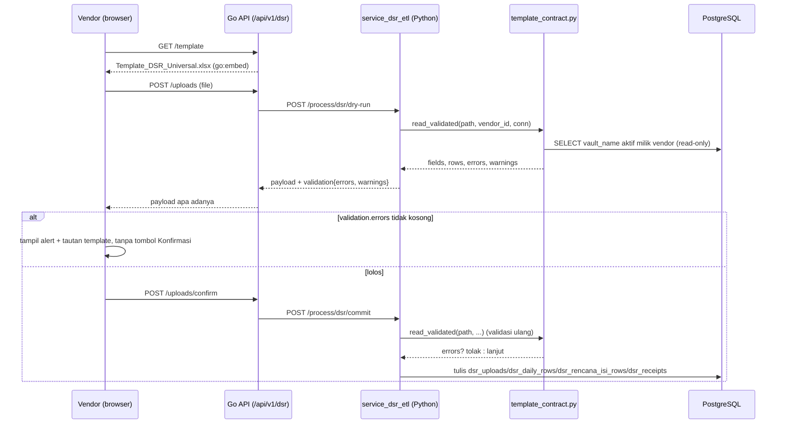

# Design Document

> Status: accepted 2026-11-25 (PO)
## Overview

Fitur ini menyatukan format upload DSR menjadi satu Template_Universal dan memaksanya di sisi server.

Empat perubahan:

1. **Template.** Generator `backend_python/dsr/make_template.py` dirapikan: label baris diambil dari satu daftar kontrak bersama, dan header `Daily` mendapat sel wajib `Vault` (D10). Hasilnya satu berkas `.xlsx` yang di-embed ke binary Go (D9).
2. **Unduh.** Endpoint `GET /api/v1/dsr/template` (Go) menyajikan berkas itu. Tombol "Unduh template" ditambahkan di dialog upload vendor.
3. **Validasi kontrak.** Modul baru `backend_python/dsr/template_contract.py` membungkus `read_daily_rows` / `read_rencana_isi_rows`. Dry-run dan commit memakai satu jalur yang sama, sehingga file yang ditolak saat dry-run juga ditolak saat commit (tidak bisa dilewati lewat panggilan langsung ke `/uploads/confirm`).
4. **Alert di dialog.** Hasil dry-run membawa daftar `errors` dan `warnings`. Dialog menampilkan alert, dan menyembunyikan tombol konfirmasi bila ada error.

Tidak ada migrasi dan tidak ada tabel baru (R7.1). Format lama (TAG JAKARTA `.xls`, BIJAK JAKARTA `.xlsx`) tidak punya jalur khusus lagi: file itu gagal kontrak dan ditolak (R5).

**Area sensitif (project-context Sec 3 rule 7):** parser memproses nominal uang, dan `location` dipakai laporan keterlambatan DSR (dasar penalti FLM) serta alokasi vault. Karena itu Property 1, 2, 5, dan 6 diuji ketat, dan Task yang menyentuh parser ditandai Opus.

## Architecture



Alur data: file → `read_daily_rows` / `read_rencana_isi_rows` (parser, tidak berubah kecuali dua hal di bawah) → `template_contract` (normalisasi total + validasi) → dry-run (JSON) atau commit (DB).

Dua perubahan kecil pada parser, keduanya hanya aktif bila header memuat `Vault`:
- field header `vault` dikenali (`HEADER_FIELD_KEYS`);
- baris `SALDO AKHIR` ikut dikeluarkan sebagai baris `flow='saldo_akhir'`, `section='d0'`. Hari ini baris itu hanya keluar untuk blok vault bernama pada file multi-vault. `vault_allocations.sql` (baris 54) membaca baris ini sebagai sumber kapasitas vault, jadi file satu-vault harus tetap menghasilkannya.

## Components and Interfaces

### Backend Go (`backend/`)

#### DsrTemplateAPI

- Rute: `GET /api/v1/dsr/template`, ditambahkan di `DsrUploadHandler.Routes()` (`backend/internal/handler/dsr_upload_handler.go`). Sudah berada di mount `authed` + `vendorPerm("vendor-dsr")` (`cmd/api/main.go` baris 321) (R1.3).
- Guard: handler memeriksa `authCtx.VendorID != nil`, selain itu 403 "Endpoint ini khusus untuk vendor". Handler **tidak** memakai `vendorContext()` karena fungsi itu query DB untuk mengambil kode vendor (R1.4).
- Berkas: paket baru `backend/internal/service/dsrtemplate` dengan `embed.go`:
  ```go
  //go:embed Template_DSR_Universal.xlsx
  var Bytes []byte
  ```
  Berkas `.xlsx` berada di folder yang sama. Tidak ada path dari request (R7.2). Ukuran `Bytes == 0` terdeteksi sebagai 500 (R1.5), tanpa menyebut path.
- Respons 200: `Content-Type: application/vnd.openxmlformats-officedocument.spreadsheetml.sheet`, `Content-Disposition: attachment; filename="Template_DSR_Universal.xlsx"`, `X-Content-Type-Options: nosniff`, `Cache-Control: no-store` (R1.2).
- Tanpa query DB, tanpa `audit_logs` (R1.4), dan tidak mencatat isi atau token ke log (R7.4).
- Handler Go lain (`Upload`, `Confirm`) tidak berubah: `result.Raw` sudah diteruskan apa adanya, jadi blok `validation` baru ikut sampai ke browser tanpa kode tambahan.

### Python (`backend_python/dsr/`)

#### `template_contract.py` (baru)

Sumber kebenaran kontrak. Dipakai oleh generator dan validator, jadi keduanya tidak bisa berbeda (Property 4).

```python
REQUIRED_META = ("company", "report_date", "vault")          # R4.3, R6.3
DAILY_LINES: tuple[tuple[str, str, str], ...] = (            # (section, flow, label)
    ("d0", "saldo_awal",   "SALDO AWAL"),
    ("d0", "penerimaan",   "Dari Rekonsiliasi Cartridge ATM dan CRM"),
    ("d0", "penerimaan",   "Hasil bongkaran CDM"),
    ("d0", "penerimaan",   "Uang nyangkut CRM"),
    ("d0", "penerimaan",   "Dari CIMB Niaga CIT"),
    ("d0", "penerimaan",   "Penyelesaian Klaim Nasabah"),
    ("d0", "penerimaan",   "Penyelesaian Klaim Selisih Kurang Fisik"),
    ("d0", "pengeluaran",  "Untuk Cartridge Replenishment ATM & CRM"),
    ("d0", "pengeluaran",  "Setoran Ke Cash Management"),
    ("d1", "penerimaan",   "Dari Batal Replenishment"),
    ("d1", "pengeluaran",  "Untuk Cartridge Replenishment"),
    ("d1", "pengeluaran",  "Untuk Kas Cadangan"),
    ("d1", "pengeluaran",  "Untuk Lain-lain"),
    ("d1", "status_cadangan", "Kondisi Layak Edar"),
    ("d1", "status_cadangan", "Kondisi Rusak & Tidak Layak Edar"),
)
RENCANA_HEADERS = ("ATM ID", "Lokasi ATM", "50/100", "Jumlah Isi Denom 100rb",
                   "Jumlah Isi Denom 50rb", "Saldo Splank Pukul 08:00", "Keterangan")
```

Fungsi publik:

```python
@dataclass(frozen=True)
class Issue:
    code: str            # SHEET_MISSING, LABEL_MISSING, META_MISSING, CELL_INVALID,
                         # TOTAL_MISMATCH, TOTAL_ZERO, MULTI_BLOCK, VAULT_MISSING,
                         # VAULT_UNKNOWN, FORMULA_NOT_CALCULATED, ...
    message: str         # Indonesia, menyebut sheet/baris/kolom/label (R4.4)
    sheet: str | None = None
    row: int | None = None
    column: str | None = None

@dataclass(frozen=True)
class Validated:
    daily_fields: dict[str, Any]
    daily_rows: list[dict[str, Any]]      # total ternormalisasi, location = vault_name kanonik
    daily_error_count: int
    plan_date: date | None
    rencana_rows: list[dict[str, Any]]
    errors: tuple[Issue, ...]
    warnings: tuple[Issue, ...]

def read_validated(path: Path, vendor_id: int, conn) -> Validated: ...
```

Urutan di `read_validated` (semua temuan dikumpulkan, tidak berhenti di yang pertama, R4.6):

1. **Sheet.** `pd.ExcelFile(path).sheet_names` harus memuat `Daily` dan `Rencana Isi` (R4.1, R2.1). Bila `Daily` hilang, tahap 2–7 untuk sheet itu dilewati dan error `SHEET_MISSING` tercatat.
2. **Parse.** Memanggil `read_daily_rows` / `read_rencana_isi_rows` (exception parser diubah menjadi `Issue`, bukan dilempar).
3. **Satu blok.** Bila `_find_deno_header_rows` menemukan lebih dari satu blok, error `MULTI_BLOCK` (R6.2).
4. **Meta.** `company`, `report_date`, `vault` tidak boleh kosong (R4.3, R6.3).
5. **Vault.** `vault` dicocokkan (trim, tanpa beda huruf besar kecil) dengan `vendor_vaults.vault_name` aktif milik `vendor_id`. Query read-only:
   ```sql
   SELECT v.vault_name
   FROM public.vendor_vaults v
   JOIN public.vendor_branches b ON b.id = v.vendor_branch_id
   WHERE b.vendor_id = %s AND v.is_active AND b.is_active
   ```
   Tak cocok: error `VAULT_UNKNOWN` yang menyebut nilai yang dikenali sistem (R6.4). Cocok: `location` semua baris Daily diisi nama kanonik dari DB.
6. **Label wajib.** Setiap tuple di `DAILY_LINES` harus muncul tepat satu kali di baris hasil parse (R4.2). Header `Rencana Isi` harus memuat `RENCANA_HEADERS` (R4.2) dan tanggal rencana harus ada.
7. **Sel nominal.** Sel yang tidak terbaca (`cell_number` mengembalikan error, termasuk `#REF!`) dilaporkan dengan sheet/baris/kolom. Untuk melokalisasi sel, `_cell_issues` membaca ulang grid dengan koordinat yang sama dengan parser (R4.4).
8. **Total.** Untuk tiap baris Daily dengan `s = sum(denom_*)`:
   - Total sel adalah **rumus tanpa nilai tersimpan** (`.xlsx` saja; dideteksi membuka workbook dua kali dengan openpyxl, `data_only=False` dan `True`) dan `s > 0` → `line_total_idr = s`, warning `FORMULA_NOT_CALCULATED` (R4.9).
   - Selain itu, total terbaca `0` dan `s > 0` → error `TOTAL_ZERO` (R4.10).
   - Selain itu, total `≠ s` → error `TOTAL_MISMATCH` (R4.5).
9. **Pemetaan.** Bila vault valid tetapi tidak ada baris aktif di `dsr_location_vault_maps` untuk `(vendor_id, lower(vault_name))`, warning `VAULT_NOT_MAPPED` (R6.5). Query read-only:
   ```sql
   SELECT 1 FROM public.dsr_location_vault_maps
   WHERE vendor_id = %s AND is_active AND lower(dsr_location) = lower(%s)
   ```n10. **Saldo akhir.** Baris `flow='saldo_akhir'` ditambahkan oleh parser (lihat Architecture); total file (`saldo_akhir_0000_total_idr`) tetap diisi seperti sebelumnya.

Aturan prioritas pada langkah 8 adalah satu-satunya tempat R4.9 dan R4.10 bisa bertabrakan: rumus yang belum dihitung dicek lebih dulu. Hasil `warnings` tidak memblokir konfirmasi; `errors` memblokir.

#### `dsr_etl.py` (diubah minimal)

- `HEADER_FIELD_KEYS` ditambah `"vault": "vault"`.
- Cabang `SALDO AKHIR` pada blok tanpa nama (`location is None`) mengeluarkan baris `saldo_akhir` bila `file_fields.get("vault")` terisi, selain mengisi total file.
- `dry_run_file(conn, path)`: ganti pemanggilan `read_daily_rows` / `read_rencana_isi_rows` dengan `read_validated(path, vendor_id, conn)`; `result["validation"] = {"errors": [...], "warnings": [...]}`. Perilaku staging file tetap (file yang ditolak tetap dipindah ke `pending_confirmation` seperti dry-run yang ditinggalkan vendor; tidak ada jalur pembersihan baru).
- `_upsert_upload` (jalur commit): memakai `read_validated` yang sama; bila `errors` tidak kosong, melempar `TemplateRejected` sebelum menulis apa pun (R4.8, R7.3). Pesan error memuat daftar `Issue`, lalu diteruskan Go sebagai `ErrDsrCommitFailed` yang sudah ada.
- Format JSON output tidak berubah untuk bagian lain; field `validation` bersifat tambahan, jadi klien lama tidak rusak.

#### `make_template.py` (diubah)

- Label baris dan header diambil dari `template_contract` (tidak lagi ditulis ulang di generator).
- Menambah `D7 = "Vault"`, `E7` sel input. Petunjuk diperbarui: satu file satu vault; isi `Vault` persis `vault_name` (R6.1).
- Default `OUT` menunjuk ke `backend/internal/service/dsrtemplate/Template_DSR_Universal.xlsx`, sehingga ada **satu** berkas yang di-commit dan di-embed. Folder `backend_python/dsr/templates/` dari prototipe dihapus.
- Mode `--sample` tetap untuk uji.

#### DsrLocationSeed (migrasi data)

`backend/migrations/048_dsr_location_seed.sql`, dijalankan lewat `go run ./cmd/migrate up` (bukan `psql -f` manual):

```sql
INSERT INTO public.dsr_location_vault_maps (vendor_id, dsr_location, vendor_vault_id)
SELECT b.vendor_id, btrim(v.vault_name), v.id
FROM public.vendor_vaults v
JOIN public.vendor_branches b ON b.id = v.vendor_branch_id
WHERE v.is_active AND b.is_active
  AND NOT EXISTS (
    SELECT 1 FROM public.dsr_location_vault_maps m
    WHERE m.is_active AND m.vendor_id = b.vendor_id
      AND lower(m.dsr_location) = lower(btrim(v.vault_name)));
```

Idempoten karena `NOT EXISTS` (R9.3), tidak menyentuh baris lama (R9.2), dan hanya vault aktif (R9.1, R9.4). Dibungkus transaksi, dengan komentar yang memuat cara rollback (`DELETE` baris yang `created_at`-nya sama dengan waktu seed). Seed melewati maker-checker (D11); baris yang dibuat bisa dikelola seperti pemetaan lain lewat layar admin yang ada. Vault yang dibuat setelah seed tidak otomatis dipetakan: kasus itu ditangani warning `VAULT_NOT_MAPPED`.
### Frontend (`frontend/VendorPortal-Vite/src/features/dsr/`)

#### DsrTemplateButton

- Komponen baru `DsrTemplateButton.tsx`, dipasang di tahap `pick` dan di tampilan error/penolakan `DsrUploadDialog.tsx` (R1.1, R5.1).
- `dsrUploadApi.ts` mendapat `downloadDsrTemplate()`: `GET /api/v1/dsr/template` dengan token, hasilnya `Blob` yang diunduh lewat anchor sementara dengan nama `Template_DSR_Universal.xlsx`. (Tautan biasa tidak bisa dipakai karena endpoint butuh header `Authorization`.) Bila `api` client yang ada hanya mengurai JSON, ditambahkan helper blob tipis di client itu.
- Kegagalan: pesan error dengan ikon `AlertTriangle` dan teks, bukan hanya warna (R1.6; aturan design system).

#### Alert validasi di `DsrUploadDialog`

- `DsrDryRunResponse` (di `dsrUploadApi.ts`) mendapat `validation?: { errors: Issue[]; warnings: Issue[] }`.
- `validation.errors.length > 0`: tahap `preview` menampilkan alert merah-rose (`--danger`, ikon + teks) berisi daftar error, tautan `DsrTemplateButton`, dan **tanpa tombol "Konfirmasi & Simpan"** (R4.8, R5.1).
- Hanya `warnings`: alert kuning berisi daftar peringatan; tombol konfirmasi tetap ada (R4.9).
- Tidak ada `validation` (respons dari server lama): perilaku dialog seperti sekarang.
- Kondisi "sel bermasalah tetap bisa disimpan" yang ada hari ini (`daily.error_count > 0`) dihapus untuk template, karena sel tak terbaca sekarang menjadi error validasi (R4.4).

## Data Models

**Tidak ada tabel atau kolom baru** (R7.1). Satu migrasi **data saja** ditambahkan untuk DsrLocationSeed (R9), tanpa DDL. Tabel yang disentuh hanya lewat jalur yang sudah ada:

| Tabel | Perubahan |
|---|---|
| `dsr_uploads`, `dsr_daily_rows`, `dsr_rencana_isi_rows`, `dsr_receipts` | Tidak berubah. `dsr_daily_rows.location` sekarang berisi `vault_name` kanonik; baris `flow='saldo_akhir'` kini juga muncul pada file satu vault. |
| `vendor_vaults`, `vendor_branches` | Dibaca saja untuk validasi `Vault` (migrasi `040` menambah `vault_name`). |
| `dsr_location_vault_maps` | Dibaca oleh laporan keterlambatan dan alokasi vault. DsrLocationSeed menambah baris awal (data saja, tanpa perubahan struktur), lihat DD1 dan Requirement 9. |

Payload dry-run (tambahan saja):

```json
"validation": {
  "errors":   [{"code":"TOTAL_MISMATCH","message":"...","sheet":"Daily","row":13,"column":"M"}],
  "warnings": [{"code":"FORMULA_NOT_CALCULATED","message":"...","sheet":"Daily","row":19,"column":"M"}]
}
```

## Correctness Properties

### Property 1: Nominal terbaca persis

For any pengisian nominal rupiah penuh (integer atau dua desimal) pada sel input denominasi Template_Universal, hasil parse menyimpan nilai itu sebagai `Decimal` yang sama persis, tanpa pembulatan dan tanpa skala x1.000.

**Validates: Requirements 2.2, 3.1, 3.4, 3.5**

### Property 2: Dry-run dan commit konsisten

For any file unggahan dan vendor yang sama, `read_validated` pada dry-run dan pada commit menghasilkan `fields`, `rows`, `errors`, dan `warnings` yang identik, dan commit menulis ke DB jika dan hanya jika `errors` kosong.

**Validates: Requirements 4.7, 4.8, 4.11, 7.3**

### Property 3: Semua pelanggaran dilaporkan

For any file yang memiliki k pelanggaran kontrak yang saling lepas (sheet, label, meta, sel, total, vault), `errors` memuat satu `Issue` untuk masing-masing k pelanggaran itu, tidak berhenti di yang pertama.

**Validates: Requirements 4.1, 4.2, 4.3, 4.4, 4.6**

### Property 4: Template dan kontrak tidak bisa berbeda

For any isi `DAILY_LINES` dan `RENCANA_HEADERS`, berkas yang dibangun generator memuat setiap label itu, berhasil dibaca parser ke `(section, flow, label)` yang sama, dan lolos `read_validated` baik dalam keadaan kosong maupun terisi.

**Validates: Requirements 2.1, 2.3, 2.5, 2.6, 3.1, 3.2, 3.3**

### Property 5: Integritas total

For any baris Daily yang lolos validasi, `line_total_idr` sama dengan jumlah `denom_*` pada baris itu. Baris dengan total sel `≠` jumlah ditolak, dan total `0` dengan jumlah `> 0` ditolak kecuali sel total adalah rumus tanpa nilai tersimpan, yang menghasilkan warning dan total dihitung dari jumlah.

**Validates: Requirements 4.5, 4.9, 4.10**

### Property 6: Satu vault, milik pengunggah

For any file yang lolos validasi, tepat satu blok `SALDO HARIAN ATM` ada, dan seluruh baris Daily memiliki `location` yang sama dengan `vault_name` aktif milik vendor pengunggah. File dengan lebih dari satu blok, `Vault` kosong, atau `Vault` yang bukan milik vendor itu ditolak.

**Validates: Requirements 6.2, 6.3, 6.4, 6.5**

### Property 7: Endpoint template tetap

For any request ke `GET /api/v1/dsr/template` dengan token vendor yang sah, respons selalu 200 dengan byte yang sama dengan `dsrtemplate.Bytes`, terlepas dari query string atau header lain. Tanpa token 401, tanpa claim vendor atau tanpa permission 403.

**Validates: Requirements 1.2, 1.3, 1.4, 7.2**

### Property 8: Format lama selalu ditolak

For any file yang tidak memenuhi kontrak (termasuk file sampel TAG JAKARTA dan BIJAK JAKARTA), `read_validated` mengembalikan minimal satu error dan tidak ada cabang pembacaan khusus per vendor.

**Validates: Requirements 5.1, 5.2, 5.3**

## Error Handling

| Situasi | Perilaku |
|---|---|
| Sheet `Daily` / `Rencana Isi` hilang | Error `SHEET_MISSING` dengan nama sheet; sheet lain tetap divalidasi (R4.1, R4.6). |
| Label wajib hilang / ganda | Satu error per label (R4.2). |
| `Company`, tanggal, atau `Vault` kosong | Error `META_MISSING` menyebut field (R4.3). |
| Nilai `Vault` tidak dikenal | Error `VAULT_UNKNOWN`, menyebut nilai dan daftar `vault_name` milik vendor (R6.4). |
| Banyak blok vault | Error `MULTI_BLOCK` (R6.2). |
| Sel nominal berisi teks / `#REF!` | Error `CELL_INVALID` dengan sheet, baris, kolom (R4.4). |
| Total tidak sama dengan jumlah denominasi | Error `TOTAL_MISMATCH` (R4.5). |
| Total 0 padahal denominasi terisi | Error `TOTAL_ZERO` (R4.10). |
| Rumus total belum dihitung | Warning `FORMULA_NOT_CALCULATED`; total dihitung dari jumlah denominasi (R4.9). |
| File format lama | Gagal kontrak (biasanya `MULTI_BLOCK`, `VAULT_MISSING`, `LABEL_MISSING`); alert mengarah ke tombol unduh (R5.1). |
| Commit dipanggil untuk file yang ditolak | `TemplateRejected`, tidak ada penulisan ke DB (R4.8, R7.3). |
| Berkas template di server kosong | 500 `internal_error`, pesan umum (R1.5). |
| Unduhan gagal di browser | Pesan error dengan ikon dan teks (R1.6). |
| Query vault gagal | Exception memicu error dry-run yang sudah ada (`dry_run_failed`, 502 di Go). File tidak dianggap lolos. |

Semua pesan untuk vendor ditulis dalam bahasa Indonesia, tanpa em dash dan tanpa stack trace.

## Testing Strategy

Python memakai `unittest` (pytest tidak terpasang); Go memakai table-driven test dan `pgregory.net/rapid` yang sudah ada; frontend memakai Vitest dan `fast-check` yang sudah ada.

| Property | Pengujian | File |
|---|---|---|
| 1 | Loop acak seed tetap: isi nominal acak (integer dan dua desimal) di template sampel, parse, bandingkan `Decimal` | `backend_python/dsr/test_template_contract.py` |
| 2 | Parse file yang sama lewat jalur dry-run dan commit (dengan DB uji bila `DATABASE_URL` ada, skip bila kosong); bandingkan hasil; pastikan commit menolak file ber-error | `test_template_contract.py` |
| 3 | Mutasi acak k pelanggaran terpisah pada template sampel; periksa jumlah dan kode error | `test_template_contract.py` |
| 4 | Generator → `read_validated` untuk template kosong dan terisi; periksa bahwa setiap label di `DAILY_LINES` ada di berkas dan di hasil parse | `test_make_template.py` |
| 5 | Mutasi total tiap baris (sama, beda, nol, rumus tanpa cache); periksa error, warning, dan total hasil | `test_template_contract.py` |
| 6 | Template satu blok, banyak blok, vault kosong, vault milik vendor lain (fake `conn`) | `test_template_contract.py` |
| 7 | Handler Go: 200 (byte sama dengan `dsrtemplate.Bytes`), 401, 403 (tanpa VendorID); tidak ada panggilan repository | `backend/internal/handler/dsr_upload_handler_template_test.go` |
| 8 | Dua file sampel di `FTP_DATA/DSR_DATA` harus menghasilkan error (di-skip bila file sampel tidak ada) | `test_template_contract.py` |

Uji lain:
- **Template basi (R8.2):** uji membangun template dari generator dan membandingkan **isi sel dan rumus** (bukan byte) dengan berkas yang di-embed, karena metadata `.xlsx` berubah setiap dibuat.
- **Frontend (R8.4):** komponen `DsrTemplateButton` (sukses, gagal), `DsrUploadDialog` dengan `validation.errors` (alert tampil, tombol konfirmasi tidak ada), dengan `validation.warnings` saja (tombol ada), dan tanpa `validation` (perilaku lama).
- **Regresi (R8.1, R8.3):** semua kondisi gagal pada Requirement 4 punya satu kasus uji.
- **Cakupan:** `go test ./...` (backend), `python -m unittest discover -s dsr`, `pnpm --dir frontend/VendorPortal-Vite run test` dan `lint`.
- **Cek browser manual** (unduh template, isi, unggah, lihat alert): **outstanding (user)**, tidak ditandai selesai oleh AI.

## Files touched

| Berkas | Perubahan |
|---|---|
| `backend_python/dsr/template_contract.py` | Baru |
| `backend_python/dsr/dsr_etl.py` | `HEADER_FIELD_KEYS`, baris `saldo_akhir`, `dry_run_file`, `_upsert_upload` |
| `backend_python/dsr/make_template.py` | Pakai kontrak, sel `Vault`, OUT baru |
| `backend_python/dsr/templates/` | Dihapus (prototipe) |
| `backend_python/dsr/test_template_contract.py`, `test_make_template.py` | Baru |
| `backend/internal/service/dsrtemplate/embed.go` + `Template_DSR_Universal.xlsx` | Baru |
| `backend/internal/handler/dsr_upload_handler.go` | Rute + handler `Template` |
| `backend/internal/handler/dsr_upload_handler_template_test.go` | Baru |
| `backend/migrations/048_dsr_location_seed.sql` | Baru: seed data idempoten (R9). Nomor 048 dicek ulang saat implementasi; berkas terakhir yang terlihat adalah `047_role_portal.sql`. |
| `frontend/VendorPortal-Vite/src/features/dsr/dsrUploadApi.ts`, `DsrUploadDialog.tsx`, `DsrTemplateButton.tsx` (+ tes) | Diubah / baru |

## Open Design Decisions

**DD1. Pemetaan `dsr_location_vault_maps` untuk `vault_name`.** ✅ DIPUTUSKAN PO 2026-11-25: opsi A (D11).

Laporan keterlambatan DSR (`dsr_late_report.sql`, baris 40, 53–55) dan alokasi vault hanya menghitung label `location` yang punya baris aktif di `dsr_location_vault_maps` (`vendor_id`, `lower(dsr_location)`). Setelah fitur ini, `location` berisi `vault_name`. Bila admin belum membuat pemetaan `vault_name → vault`, DSR vendor itu tetap tersimpan, tetapi **tidak dihitung** di laporan keterlambatan, yang menjadi dasar penalti FLM. Itu bisa merugikan vendor tanpa terlihat.

Pilihan (dipilih: A):
- **A: seed sekali + peringatan.** Skrip idempoten mengisi satu baris pemetaan (`dsr_location = vault_name`) untuk setiap vault aktif, dan `read_validated` menambah warning `VAULT_NOT_MAPPED` (tidak memblokir) bila belum ada pemetaan aktif. Tabel pemetaan tetap dipertahankan. Catatan: pemetaan lewat maker-checker (`DsrLocationMapApplier`); seed langsung ke tabel melewati maker-checker, yang dapat diterima pada tahap greenfield (`project-context` Sec 0a) tetapi perlu persetujuan Anda.
- **B: ubah query laporan** agar mencocokkan `vault_name` langsung. Menyentuh SQL laporan keterlambatan dan alokasi vault, yaitu area uang dan penalti. Cakupannya lebih besar.
- **C: tolak upload** bila belum dipetakan. Memblokir vendor karena urusan internal, jadi kurang tepat.

## Documented deviation

Tidak ada penyimpangan dari design system maupun project-context. Fitur ini mengikuti pola dry-run/confirm yang sudah ada; blok `validation` hanya penambahan pada payload.
