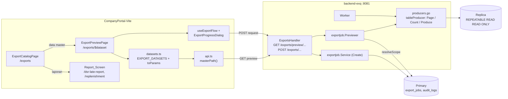

# Design Document

> **Status:** design disetujui 2026-10-30. Requirements disetujui 2026-10-30 (D1-D11 mengikuti saran Kiro).

## Overview

Menu Export Data diubah dari form menjadi tiga langkah: **katalog → pratinjau → ekspor**.

- **Katalog** (`/exports`, item sidebar "Export Data"): daftar data yang boleh diekspor peran pengguna, plus bagian Ekspor Saya. Kartu laporan membuka layar laporan yang ada (D3).
- **Pratinjau** (`/exports/$dataset`): tabel 50 baris per halaman, filter, dan jumlah total baris. Data berasal dari **ExportPreviewAPI** baru di `backend-exq`.
- **Ekspor**: tombol "Ekspor N baris" memanggil endpoint `POST /api/v1/exports/...` yang sudah ada dengan parameter dari Applied_Filter, lalu memakai `useExportFlow` + `ExportProgressDialog` tanpa perubahan.

Prinsip utama: **tabel dan file tidak boleh bisa berbeda**. Dicapai dengan memakai bersama tiga hal di setiap lapis:

| Lapis | Yang dipakai bersama pratinjau dan ekspor |
| --- | --- |
| Frontend | Satu fungsi `toParams(dataset, filter)` dan satu fungsi `masterPath(params)` untuk path permintaan dan path pratinjau |
| Validasi backend | `exportjob.ParseParams` + `resolveScope` (400/404 identik) |
| Baca data | Fungsi `fetch` keyset dan pemetaan sel `cells` yang sama di setiap producer; `Produce` (file) hanya loop di atas fungsi `Page` yang dipakai pratinjau |

Tidak ada tabel baru, migrasi, atau library baru (D7, Req 9.2). Endpoint permintaan, siklus job, worker, janitor, dan format CSV tidak berubah (Req 8.3, 9.1).

## Architecture



### Alur data

1. Pengguna membuka `/exports`. `datasetsForRole(role)` memilih Export_Dataset yang Export_Kind-nya diizinkan untuk peran itu (Req 1.2).
2. Pengguna memilih data master → `/exports/vault?status=active`. Filter di URL = Applied_Filter (Req 2.5).
3. `toParams("vendor-vaults", applied)` menghasilkan `ExportRequestParams` (mis. `{kind:"cabang", vendorId:3, branchId:9, entity:"vaults", status:"active"}`) atau `null` bila filter wajib belum diisi (Req 3.4).
4. `previewExport(params, after, limit)` memanggil `GET /api/v1/exports/preview` + `masterPath(params)` + `&after=&limit=`.
5. Handler: guard peran per kind (route) → `ParseParams` → `Previewer.Preview` (cek peran ulang, `resolveScope`, buka snapshot replica, `Count` + `Page`) → envelope `pkg/response`.
6. Pengguna menekan "Ekspor N baris" → `useExportFlow().request(params)` dengan objek `params` yang sama → `POST /api/v1/exports` + `masterPath(params)` (Req 5.2).
7. Worker menjalankan `Produce`, yang memanggil `Page` berulang dengan `PageSize` 1000 di snapshot replica-nya sendiri (Req 5.9: data diambil saat ekspor diproses).

### Keputusan teknis

| # | Keputusan | Alasan / tradeoff |
| --- | --- | --- |
| T1 | Path pratinjau = `"/exports/preview" + path permintaan`, method GET | Guard peran per kind tetap statis di router seperti route `POST`; frontend membangun kedua path dari satu fungsi. Satu path generik `?kind=` butuh guard dinamis di handler. |
| T2 | Producer master data direfaktor menjadi `tableProducer[R]` dengan `Page`, `Count`, `Produce` | `Produce` menjadi loop di atas `Page`, jadi query dan pemetaan sel pratinjau tidak bisa menyimpang dari file. |
| T3 | Kursor keyset `after` = `id` baris terakhir; `next_after` dihitung dengan mengambil `limit + 1` baris | Semua header entity diawali `id` dan semua query sudah `ORDER BY id`. Tombol Sebelumnya memakai tumpukan kursor di klien (D9). |
| T4 | Query hitung baru per entity di `backend-exq/queries/export_preview.sql` | Query bersama di `backend/queries/master_data_export.sql` tidak disentuh (menghindari regenerate `backend/`). Risiko kondisi WHERE menyimpang ditutup Property 2 (integration test). |
| T5 | Cek scope (`resolveScope`) tetap di primary | Dua lookup kecil per permintaan, sehingga 404 vendor/cabang identik dengan `Create`. Baris data dan hitungan tetap dari replica. |
| T6 | Daftar Export_Dataset + peran per data disimpan sebagai konstanta frontend (`datasets.ts`) yang mencerminkan `KindRoles` | Tanpa endpoint katalog baru (YAGNI). Backend tetap menolak 403 bila konstanta basi. Konstanta **tidak** memakai bypass ADMIN/ADMIN_PARAM `requireRoles`, karena `ADMIN_PARAM` tidak boleh mengekspor laporan. |
| T7 | Header tabel = nama kolom CSV apa adanya (mis. `vault_code`) | Req 2.1: pengguna melihat kolom persis seperti di file. Label tampilan hanya untuk caption dan filter. |

## Components and Interfaces

### Backend `backend-exq`

#### `internal/exportjob/producers.go` (refaktor, Req 4.4, 4.5, 4.7, 5.10)

```go
// PreviewProducer is a master-data producer that can also serve one preview page.
type PreviewProducer interface {
    Producer
    // Page returns up to limit rows with id > afterID in id order, raw cells (no CSVSafe).
    Page(ctx context.Context, q Querier, p Params, asOf time.Time, afterID int64, limit int) (rows [][]string, lastID int64, err error)
    // Count returns how many rows Produce would emit for p in the same snapshot.
    Count(ctx context.Context, q Querier, p Params, asOf time.Time) (int64, error)
}

type tableProducer[R any] struct {
    header []string
    fetch  func(ctx context.Context, q Querier, p Params, asOf time.Time, afterID int64, limit int) ([]R, error)
    id     func(R) int64
    cells  func(R) []string
    count  func(ctx context.Context, q Querier, p Params, asOf time.Time) (int64, error)
}
```

- `Produce` = loop `Page(after, PageSize)` sampai halaman lebih pendek dari `PageSize` (perilaku `paged` sekarang).
- Delapan producer (`vendors`, `branches`, `vaults`, `pics`, `atms`, `atm-assignments`, `dsr-location-maps`, `package-prices`) dipindah ke `tableProducer`. `fetch` dan `cells` adalah isi closure yang ada sekarang, `BatchSize` diganti argumen `limit`.
- `vendorsProducer(forceAll=true)` (kind `vendor`, entity `vendor`) memakai status `all` di `fetch` **dan** `count`.
- `packagePricesProducer` memakai `wibDate(asOf)` di `fetch` dan `count`.
- Producer laporan (`producers_report.go`) tidak berubah dan tidak mengimplementasikan `PreviewProducer`.
- `Querier` ditambah delapan method hitung (lihat Data Models).

#### `internal/exportjob/preview.go` (baru, Req 4.1-4.3, 4.6-4.9, 4.11)

```go
const (
    DefaultPreviewLimit = 50
    MaxPreviewLimit     = 100
    PreviewTimeout      = 10 * time.Second
)

type Preview struct {
    Columns   []string   `json:"columns"`
    Rows      [][]string `json:"rows"`
    Total     int64      `json:"total"`
    NextAfter *int64     `json:"next_after"` // null on the last page
    Limit     int        `json:"limit"`
}

// ParsePaging validates after (>= 0, default 0) and limit (1..100, default 50); else ErrValidation.
func ParsePaging(rawAfter, rawLimit string) (after int64, limit int, err error)

type Previewer struct { /* scope createQueries (primary), reader snapshotReader (replica),
                           producers map[Kind]map[string]Producer, now func() time.Time */ }

func NewPreviewer(primary, replica *pgxpool.Pool, producers map[Kind]map[string]Producer) *Previewer

// Preview: UserID 0 -> ErrUnauthenticated; !allowed(kind, role) -> ErrForbidden;
// producer not a PreviewProducer -> ErrUnknownEntity; resolveScope -> ErrNotFound;
// then one replica snapshot: Count, Page(after, limit+1). Recovery conflict -> ErrUnavailable.
func (v *Previewer) Preview(ctx context.Context, a Actor, p Params, after int64, limit int) (Preview, error)
```

- `resolveScope` dipisah dari `*Service` menjadi fungsi `resolveScope(ctx, q createQueries, p)` yang dipakai `Service.Create` dan `Previewer.Preview` (Req 4.1: 404 identik).
- Snapshot memakai `pgReader` yang sudah ada (`REPEATABLE READ READ ONLY`, Req 4.6). `Count` dan `Page` berjalan di transaksi yang sama. Konteks dibatasi `PreviewTimeout`.
- `asOf = v.now()`, sehingga Harga Paket memakai tanggal WIB saat permintaan (Req 4.9).
- Tidak ada penulisan audit (D5, Req 4.11).
- `ErrUnavailable` baru di `errors.go` untuk konflik pemulihan replica (`isRecoveryConflict`, sudah ada di `worker.go`).

#### `internal/handler/exports_handler.go` (Req 4.1, 4.8, 4.10)

- `NewExportsHandler(svc ExportsService, preview PreviewService)`; `PreviewService` = `Preview(ctx, Actor, Params, int64, int) (exportjob.Preview, error)`.
- Fungsi `create(...)` dipecah menjadi `parseMaster(w, r, kind, entity, vid, bid, priceLevel) (Params, bool)` dan aksi. Route `POST` memanggil `parseMaster` lalu `createJob`; route `GET /preview/...` memanggil `parseMaster`, `ParsePaging`, lalu `Preview`.
- Route baru, masing-masing dengan `guard(kind)` yang sama dengan route `POST` padanannya:

| Method + path (di bawah `/api/v1/exports`) | Kind | Query |
| --- | --- | --- |
| `GET /preview/vendors/{vendorID}/{entity}` | `vendor` | `status`, `after`, `limit` |
| `GET /preview/vendors/{vendorID}/branches/{branchID}/{entity}` | `cabang` | `status`, `after`, `limit` |
| `GET /preview/vendors/{vendorID}/package-prices` | `harga_paket` | `branch_id`, `price_level`, `status`, `after`, `limit` |
| `GET /preview/master-data/{entity}` | `master_data_global` | `status`, `after`, `limit` |

- Respons `200 {success:true, data: Preview}`. Galat lewat `writeServiceError` yang sama, ditambah `ErrUnavailable` → `503 preview_unavailable`.

#### `cmd/api/main.go`

`exportjob.NewProducers(dsrLateStart)` dibuat sekali dan dipakai `NewWorker` dan `NewPreviewer(dbPool, dbReadPool, producers)`. Previewer diteruskan ke `NewExportsHandler`.

#### `api/openapi.yaml` (Req 8.2)

- Empat path GET di atas. Parameter baru `PreviewAfter` (`after`, int64 ≥ 0) dan `PreviewLimit` (`limit`, 1..100).
- Schema `ExportPreview` {`columns`: string[], `rows`: string[][], `total`: int64, `next_after`: int64 nullable, `limit`: int} dan `PreviewEnvelope`.
- Response `Unavailable` (503). Test kontrak yang ada mencocokkan route chi dengan path spec.

### Frontend CompanyPortal (`src/features/exports/`)

#### `datasets.ts` (baru, Req 1.1-1.3, 1.5, 3.1-3.5)

```ts
export type DatasetId =
  | "vendors" | "vendor-branches" | "vendor-vaults" | "vendor-pics"
  | "dsr-location-maps" | "package-prices" | "atms" | "atm-assignments";

export interface PreviewFilter {
  vendorId?: number; branchId?: number; status: StatusFilter; priceLevel?: PriceLevel;
}

export interface MasterDataset {
  group: "master"; id: DatasetId; label: string; description: string;
  filters: { vendor: "none" | "optional" | "required"; branch: boolean; priceLevel: boolean };
  numericColumns: string[];   // rata kanan + tabular-nums (Req 2.9)
  moneyColumns: string[];     // + monospace
  roles: DbRole[];            // = KindRoles kind master data (ADMIN, ADMIN_PARAM)
}
export interface ReportDataset {
  group: "report"; id: string; label: string; description: string; href: string; roles: DbRole[];
}

export const EXPORT_DATASETS: (MasterDataset | ReportDataset)[];
export function datasetsForRole(role: DbRole): (MasterDataset | ReportDataset)[]; // tanpa bypass
export function toParams(id: DatasetId, f: PreviewFilter): MasterExportParams | null;
export function parseFilterSearch(id: DatasetId, search: Record<string, unknown>): PreviewFilter;
```

- Slug data = nama entity `pkg/csvexport`, sehingga `MasterDataIOPage` bisa menautkan `/exports/${entity}` langsung (Req 6.7).
- `toParams` mengikuti tabel Req 3.1 dan mengembalikan `null` saat vendor wajib kosong atau cabang terisi tanpa vendor.
- Data laporan: "Laporan DSR telat" (`href: "/dsr-late-report"`, peran `DsrLateViewerRoles`) dan "Laporan replenishment" (`href: "/replenishment"`, peran `ReplenishmentViewerRoles`). Satu kartu per layar, karena satu layar memuat dua jenis CSV.
- `parseFilterSearch` membuang nilai tidak valid ke default (status `active`, tingkat harga `all`, id bukan bilangan positif = kosong, cabang tanpa vendor = kosong).

#### `api.ts` (Req 3.5, 5.2)

- `masterPath(p: MasterExportParams): string` mengembalikan path + query tanpa prefix (mis. `/vendors/3/branches/9/vaults?status=active`). `requestExport` untuk kind master data memakai `post("/exports" + masterPath(p))`.
- `previewExport(p, after, limit)` = `api.get("/exports/preview" + masterPath(p) + paging)`. `MasterExportParams` = union `ExportRequestParams` tanpa varian `report`.
- Tipe `ExportPreview` dari `@/lib/api/exq-schema` (`gen:api:exq`).

#### `hooks.ts`

- `useExportPreview(params | null, after)`: TanStack Query, `enabled: params !== null`, `placeholderData: keepPreviousData` (Req 2.6), query key `["exports","preview", params, after]`.
- `useExportFlow` tidak berubah.

#### `components/ExportCatalogPage.tsx` (baru, Req 1, 6.2)

- `PageHeader` "Export Data". Dua `section` berjudul "Data master" dan "Laporan", masing-masing berupa **daftar** (`<ul>`, satu baris per data: ikon, nama, deskripsi, ringkasan filter, chevron), bukan grid kartu identik (`ui_design.md` Sec 10).
- Setiap baris berupa `<Link>` dengan nama yang dapat dibaca (Req 1.7). Grup tanpa data tidak dirender.
- Bagian "Ekspor Saya" memakai `MyExportsTable` (Req 6.2, 7.4).

#### `components/ExportPreviewPage.tsx` (baru, Req 2, 3, 5)

- Kepala halaman: tombol kembali ke `/exports` (Req 2.10), judul data, jumlah total "1.240 baris" (`Intl.NumberFormat("id-ID")`, `tabular-nums`).
- `PreviewFilterBar`: `VendorSelect`, `BranchSelect` (hanya saat vendor terpilih; mengosongkan vendor juga mengosongkan cabang, Req 3.3), `FilterSelect` status dan tingkat harga, tombol "Terapkan". Isian = state lokal (draft), "Terapkan" menulis ke search URL dengan `navigate({ search })` (Req 2.4, 2.5).
- `PreviewTable`: `DataTable` tanpa `pageSize` (paging klien mati). Kolom dibangun dari `columns`; `meta.align = "right"` untuk `numericColumns`, kelas `font-mono` untuk `moneyColumns`; `is_active` dirender sebagai `Badge` ikon + "Aktif"/"Nonaktif" (Req 2.9). Caption "Pratinjau <nama data>" (Req 2.11).
- Paging: state `cursors: number[]` (tumpukan `after`), reset ke `[0]` saat Applied_Filter berubah; "Berikutnya" mendorong `next_after`, "Sebelumnya" mengambil dari tumpukan (Req 2.3).
- Keadaan: memuat (tabel lama tetap tampil + indikator), kosong (`EmptyState` ikon + teks, Req 2.7), galat (`NoticeBanner` ikon + teks + "Coba lagi", Req 2.8), filter wajib kosong (petunjuk pilih vendor, Req 3.4).
- `PreviewExportBar`: tombol primer "Ekspor {total} baris" + `RequestError` + catatan "File diambil saat ekspor diproses; perubahan data setelah tabel dimuat bisa ikut masuk." (Req 5.9). Status tombol dari `exportButtonState({dirty, loading, total})`:
  - `dirty` → nonaktif + "Terapkan filter dulu" (Req 5.4)
  - `loading` atau `total === 0` → nonaktif (Req 5.5)
  - `total > 1_000_000` → nonaktif + pesan ikon + teks "Persempit filter" (Req 5.6)
- Klik → `request(toParams(id, applied))` lalu `ExportProgressDialog` (Req 5.7). Penolakan 400/403/429 tampil lewat `RequestError` (Req 5.8).

#### Rute dan navigasi (Req 6)

| File | Perubahan |
| --- | --- |
| `routes/exports.tsx` | Komponen jadi `ExportCatalogPage`; guard tetap `EXPORTS_PAGE_ROLES` (gabungan peran ekspor, ADMIN/ADMIN_PARAM lewat bypass). Diekspor juga `exportPreviewRoute` path `/exports/$dataset`, `requireRoles(["ADMIN","ADMIN_PARAM"])`, `validateSearch` = `parseFilterSearch`; slug tidak dikenal → `UnknownDatasetState` lokal (ikon + teks + tautan kembali ke `/exports`), mengikuti pola `NotFoundState` lokal di `VendorRequestDetailParts.tsx`; tidak ada komponen NotFound bersama. |
| `routes/settings/admin/exports.tsx` | `beforeLoad: () => { throw redirect({ to: "/exports" }) }`, tanpa komponen (Req 6.4) |
| `routeTree.ts` | Tambah `exportPreviewRoute` |
| `lib/config/navigation.ts` | Item `{ id: "exports", label: "Export Data", icon: Download, href: "/exports", roles: EXPORTS_PAGE_ROLES, group: "general" }` (Req 6.1) |
| `rbac-settings/components/SettingsHubPage.tsx` | Kartu `admin-exports` → `href: "/exports"`, deskripsi disesuaikan (Req 6.5) |
| `exports/components/ExportProgressDialog.tsx` | Satu konstanta `MY_EXPORTS_PATH = "/exports"` untuk semua kind (Req 6.6) |
| `master-data-io/components/MasterDataIOPage.tsx` | Hapus select "Status data ekspor", tombol "Minta ekspor", `useExportFlow`, dialog; tambah tautan "Ekspor data ini" ke `/exports/${entity}` (Req 6.7) |

#### Dihapus (Req 8.1)

`ExportDataPage.tsx`, `VendorExportForm.tsx`, `PackagePriceExportForm.tsx`, `ExportForms.test.tsx`, `MyExportsPage.tsx`, `MyExportsPage.test.tsx`. `exportFormParts.tsx` tetap (dipakai `PreviewFilterBar`).

### Cakupan requirement

| Req | Komponen |
| --- | --- |
| 1 | `datasets.ts`, `ExportCatalogPage`, `routes/exports.tsx` |
| 2 | `ExportPreviewPage`, `PreviewTable`, `useExportPreview` |
| 3 | `datasets.ts` (`toParams`, `parseFilterSearch`), `PreviewFilterBar`, `masterPath` |
| 4 | `preview.go`, `producers.go`, `export_preview.sql`, handler, OpenAPI |
| 5 | `PreviewExportBar`, `exportButtonState`, `useExportFlow` |
| 6 | rute, navigasi, SettingsHub, dialog, MasterDataIOPage |
| 7 | `KindRoles` tidak berubah, `Previewer` cek peran, `MyExportsTable` |
| 8 | file dihapus, OpenAPI + `gen:api:exq` |
| 9 | refaktor producer diuji non-regresi, gate coverage |

## Data Models

**Tidak ada tabel, kolom, atau migrasi baru** (D7). `export_jobs` tidak berubah.

Query sqlc baru `backend-exq/queries/export_preview.sql` (read-only, tanpa perubahan skema). Setiap query menyalin kondisi `WHERE` query batch padanannya **tanpa** `id > after_id` dan `LIMIT`:

| Query | Padanan batch | Argumen |
| --- | --- | --- |
| `CountVendors :one` | `ExportVendorsBatch` | `vendor_id`, `status` |
| `CountVendorBranches :one` | `ExportVendorBranchesBatch` | `vendor_id`, `status` |
| `CountVendorVaults :one` | `ExportVendorVaultsBatch` | `vendor_id`, `branch_id`, `status` |
| `CountVendorPics :one` | `ExportVendorPicsBatch` | `vendor_id`, `branch_id`, `status` |
| `CountATMs :one` | `ExportATMsBatch` | `status` |
| `CountATMAssignments :one` | `ExportATMAssignmentsBatch` | `status` |
| `CountDsrLocationMaps :one` | `ExportDsrLocationMapsBatch` | `vendor_id`, `branch_id`, `status` |
| `CountPackagePrices :one` | `ExportPackagePricesBatch` | `vendor_id`, `branch_id`, `price_level`, `status`, `as_of` |

Komentar di kepala file dan di setiap query batch bersama mengingatkan bahwa kondisi harus diubah bersama; Property 2 menangkap penyimpangan.

Respons `ExportPreview` (JSON):

```json
{
  "success": true,
  "data": {
    "columns": ["id", "vendor_code", "branch_code", "vault_code", "..."],
    "rows": [["12", "ABA", "MDN", "V-01", "..."]],
    "total": 1240,
    "next_after": 61,
    "limit": 50
  }
}
```

Nominal (`min_capacity_amount`, `base_price`, `tier_min`, dll.) dikirim sebagai teks persis dari database (`::text`), tidak pernah lewat float (Req 4.5).

## Correctness Properties

### Property 1: Pratinjau berhalaman sama dengan isi file

*For any* Params master data yang valid, isi tabel sumber, dan ukuran halaman `limit` 1..100, gabungan baris dari `Page` yang dipanggil berulang mulai `after = 0` dengan `after` = `lastID` halaman sebelumnya sampai `next_after` kosong sama persis (isi sel dan urutan) dengan baris yang dikirim `Produce`; dan setiap baris file sama dengan `CSVSafe` dari sel pratinjau yang sama.

**Validates: Requirements 4.4, 4.5, 5.3, 5.10, 9.1**

### Property 2: Jumlah total sama dengan jumlah baris file

*For any* entity master data, scope (global / vendor / cabang), status, tingkat harga, dan `as_of` pada snapshot yang sama, `Count` sama dengan jumlah baris yang dikirim `Produce`.

**Validates: Requirements 2.2, 3.6, 4.6, 4.7**

### Property 3: Paging keyset terbatas dan lengkap

*For any* `after` ≥ 0 dan `limit` 1..100, satu halaman berisi paling banyak `limit` baris, semua dengan `id > after` dan urut naik; `next_after` kosong jika dan hanya jika tidak ada baris dengan `id` lebih besar dari baris terakhir halaman; dan `after`/`limit` di luar rentang ditolak `ErrValidation`.

**Validates: Requirements 2.3, 4.2, 4.3**

### Property 4: Validasi pratinjau sama dengan validasi ekspor

*For any* kombinasi mentah kind, entity, vendor, cabang, status, dan tingkat harga, endpoint pratinjau menolak dengan kode status yang sama (400 / 404) dengan endpoint permintaan padanannya, dan menerima jika dan hanya jika permintaan ekspor juga diterima.

**Validates: Requirements 4.1**

### Property 5: Hak pratinjau sama dengan hak ekspor

*For any* Export_Kind master data dan peran, `Previewer.Preview` diizinkan jika dan hanya jika `allowed(kind, role)`; peran lain mendapat `ErrForbidden` tanpa membaca replica.

**Validates: Requirements 4.8, 7.1**

### Property 6: Satu pemetaan filter untuk pratinjau dan ekspor

*For any* Export_Dataset master data dan PreviewFilter, `toParams` mengembalikan `null` jika dan hanya jika filter wajib kosong (vendor untuk Pemetaan lokasi DSR / Harga Paket) atau cabang terisi tanpa vendor; selain itu kind dan entity sesuai tabel Req 3.1, dan path pratinjau dikurangi prefix `/preview` serta parameter `after`/`limit` sama dengan path permintaan ekspor.

**Validates: Requirements 3.1, 3.4, 3.5, 5.2**

### Property 7: Filter URL bulat-balik

*For any* objek search URL, `parseFilterSearch` menghasilkan PreviewFilter yang valid (status dan tingkat harga dalam enum, id positif atau kosong, cabang hanya bila vendor ada), dan `parseFilterSearch(toSearch(f))` sama dengan `f` untuk setiap PreviewFilter valid `f`.

**Validates: Requirements 2.5, 3.2, 3.3**

### Property 8: Katalog mengikuti peran ekspor

*For any* peran, `datasetsForRole` memuat sebuah Export_Dataset jika dan hanya jika peran itu ada di `roles` data tersebut, tanpa bypass ADMIN/ADMIN_PARAM (mis. `ADMIN_PARAM` tidak melihat data laporan), dan `roles` setiap data sama dengan `KindRoles` kind-nya.

**Validates: Requirements 1.2, 6.1, 7.2**

### Property 9: Status tombol ekspor

*For any* kombinasi `dirty`, `loading`, dan `total`, tombol ekspor aktif jika dan hanya jika `!dirty && !loading && 0 < total <= 1_000_000`, dan setiap keadaan nonaktif karena `dirty` atau batas baris menampilkan pesan ikon + teks.

**Validates: Requirements 5.4, 5.5, 5.6**

## Error Handling

| Kondisi | Lapis | Respons / perilaku |
| --- | --- | --- |
| Tanpa token / token tidak valid | `RequireAuth` | 401 (middleware) |
| Peran tidak diizinkan untuk kind | guard route, lalu `Previewer` | 403 `forbidden`, tanpa baca replica |
| Status / tingkat harga / id / bentuk scope salah | `ParseParams` | 400 `bad_request` |
| Entity tidak cocok dengan kind | `ParseParams` | 404 `not_found` |
| Vendor tidak ada, atau cabang bukan milik vendor | `resolveScope` | 404 `not_found` |
| `after` < 0, `limit` di luar 1..100, bukan angka | `ParsePaging` | 400 `bad_request` |
| Konflik pemulihan replica (40001) | `Previewer` | 503 `preview_unavailable` "Data sedang diperbarui, coba lagi" |
| Melewati `PreviewTimeout` / galat DB lain | `Previewer` | 500 `internal_error`, log `slog.Error` tanpa data baris |
| Galat jaringan / 5xx di frontend | `ExportPreviewPage` | `NoticeBanner` ikon + teks + "Coba lagi"; tabel lama tetap tampil |
| Slug data tidak dikenal | rute frontend | `UnknownDatasetState` (ikon + teks + tautan ke `/exports`) |
| Filter URL tidak valid | `parseFilterSearch` | nilai dibuang ke default, tanpa galat |
| Permintaan ekspor ditolak (400/403/429) | `useExportFlow` | `RequestError` di dekat tombol, dialog tidak terbuka |

Pratinjau tidak menulis apa pun, jadi tidak ada keadaan setengah jadi untuk dipulihkan. Konflik replica aman diulang oleh pengguna.

## Testing Strategy

### Go (`backend-exq`)

- **Property test (rapid)** `producers_property_test.go` dengan `Querier` palsu di memori (tabel id acak, status acak, scope acak): Property 1 dan 3. Fake menerapkan `id > after ORDER BY id LIMIT n` sehingga loop `Produce` dan `Page` diuji tanpa DB.
- **Integration test** (`//go:build integration`, Postgres nyata, pola `producers_integration_test.go`): Property 2 untuk 8 entity × scope (global, vendor, cabang) × status (`active`, `disabled`, `all`) × tingkat harga (Harga Paket); juga semantik PIC cabang (D3, Req 3.6) dan satu snapshot untuk `Count` + `Page`.
- **Unit test** `preview_test.go`: Property 5 (tabel kind × peran), `ParsePaging`, `ErrUnavailable` dari konflik replica, `ErrUnknownEntity` untuk producer laporan, `as_of` = `now`.
- **Handler test** `exports_handler_preview_test.go`: Property 4 (generator parameter mentah dikirim ke route POST dan GET padanan, kode status dibandingkan), envelope `pkg/response`, 403 dari guard, 503.
- **Non-regresi**: test producer, worker, dan golden header yang ada tetap lulus tanpa perubahan ekspektasi setelah refaktor `tableProducer` (Req 9.1).
- **Kontrak**: test OpenAPI `backend-exq` (route chi ↔ path spec) mencakup empat path baru.

### Frontend (Vitest + fast-check + Testing Library)

- `datasets.property.test.ts`: Property 6, 7, 8.
- `exportButtonState.property.test.ts`: Property 9.
- `ExportCatalogPage.test.tsx`: grup per peran (ADMIN, ADMIN_PARAM, ATM-USER, BRANCH-ATM-USER), tautan laporan ke layar yang ada, Ekspor Saya tampil, navigasi keyboard.
- `ExportPreviewPage.test.tsx` (API dimock): kolom = `columns`, total, Berikutnya/Sebelumnya dengan kursor, terapkan filter mereset halaman, petunjuk vendor wajib, keadaan kosong/galat, tombol ekspor mengirim Applied_Filter bukan draft, dialog terbuka, `RequestError` 429, badge `is_active`, rata kanan + monospace nominal, caption dan label.
- `api.test.ts`: `masterPath` untuk semua varian, `previewExport` memakai prefix `/exports/preview`.
- Test rute: `/settings/admin/exports` mengalihkan ke `/exports`; slug tidak dikenal = `UnknownDatasetState`; guard peran preview.
- Test yang ada disesuaikan: `MasterDataIOPage.test.tsx` (tautan baru, tanpa tombol ekspor), `SettingsHubPage.exportsCard.test.tsx` (href `/exports`), `ExportProgressDialog.test.tsx` (satu path), `navigation.property.test.ts` (item baru).

### Gate (Req 9.3)

`go test ./...` + `golangci-lint run --build-tags integration` di `backend-exq` dan `pkg`, coverage Go ≥ 80%; `pnpm run lint`, `pnpm run test:coverage` (84/80/80/85), `pnpm run build` + `check-bundle.mjs`; `gen:api:exq` bersih. Cek browser manual oleh pengguna (GR#10).

## Files touched

**Backend `backend-exq`**
- `internal/exportjob/producers.go` (refaktor `tableProducer`), `preview.go` (baru), `errors.go` (`ErrUnavailable`), `service.go` (`resolveScope` jadi fungsi bersama)
- `internal/handler/exports_handler.go` (route preview, `parseMaster`)
- `queries/export_preview.sql` (baru) → `internal/repository/export_preview.sql.go` (generate sqlc v1.31.1)
- `cmd/api/main.go`, `api/openapi.yaml`
- Test: `producers_property_test.go`, `preview_test.go`, `preview_integration_test.go`, `exports_handler_preview_test.go`

**Frontend `CompanyPortal-Vite`**
- Baru: `features/exports/datasets.ts`, `components/ExportCatalogPage.tsx`, `ExportPreviewPage.tsx`, `PreviewFilterBar.tsx`, `PreviewTable.tsx`, `PreviewExportBar.tsx` + test
- Ubah: `features/exports/{api,hooks,types,index}.ts`, `components/ExportProgressDialog.tsx`, `routes/exports.tsx`, `routes/settings/admin/exports.tsx`, `routeTree.ts`, `lib/config/navigation.ts`, `rbac-settings/components/SettingsHubPage.tsx`, `master-data-io/components/MasterDataIOPage.tsx`, `lib/api/exq-schema.d.ts` (generate)
- Hapus: `ExportDataPage.tsx`, `VendorExportForm.tsx`, `PackagePriceExportForm.tsx`, `ExportForms.test.tsx`, `MyExportsPage.tsx`, `MyExportsPage.test.tsx`

**Dokumen**: `development-plan.md` (X.9), `.claude/development-progress.md`, `ui_design.md` tidak berubah (tidak ada deviasi).
