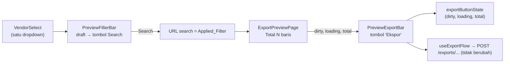

# Design Document

> **Status:** draft 2026-10-30. Requirements disetujui 2026-10-30 (D1 dibatalkan, D2-D5 mengikuti saran Kiro).

## Overview

Empat perbaikan UI di halaman pratinjau Export Data CompanyPortal (`/exports/<data>`). Semuanya frontend; `backend-exq`, `pkg/`, OpenAPI, migrasi, katalog, dan rute tidak berubah (Req 5.1, 5.2).

| Permintaan | Perubahan |
| --- | --- |
| 1. Tanpa kotak pencarian vendor | `VendorSelect` tinggal satu `FilterSelect` (Req 1) |
| 2. "Terapkan" → "Search" | Label tombol di `PreviewFilterBar` + pesan `dirty` di `exportButtonState` (Req 2) |
| 3. Hapus catatan pengambilan file | Paragraf di `PreviewExportBar` dihapus (Req 3) |
| 4. Tombol tanpa jumlah | Label "Ekspor"; total tetap di kepala halaman, aturan nonaktif tetap (Req 4) |

`toParams`, `parseFilterSearch`, paging, dan permintaan ekspor tidak disentuh, sehingga isi tabel dan file tetap sama (Req 5.3).

## Architecture



Alur data tidak berubah. Yang berubah hanya isi tampilan tiga komponen dan satu string pesan.

### Keputusan teknis

| # | Keputusan | Alasan / tradeoff |
| --- | --- | --- |
| T1 | `VendorSelect` memanggil `useVendorsList({ page: 1, page_size: 100, status: "active" })` tanpa `q` | Satu permintaan memuat semua vendor aktif sampai batas endpoint (D4). Query key konstan, jadi hasilnya di-cache dan dipakai bersama semua halaman pratinjau. |
| T2 | `total` tetap dikirim ke `PreviewExportBar` walau tidak tampil di tombol | `exportButtonState` masih butuh `total` untuk nonaktif saat 0 atau > 1.000.000 (D2). |
| T3 | Pesan `dirty` diganti di `exportButtonState`, bukan di komponen | Satu sumber pesan untuk unit test, property test, dan UI. |

## Components and Interfaces

### `features/exports/components/exportFormParts.tsx` (Req 1.1-1.3)

```tsx
/** Vendor picker: one dropdown of active vendors (first 100, endpoint cap). */
export function VendorSelect({ value, onChange }: PickerProps) {
  const { data } = useVendorsList({ ...LIST_PARAMS, status: "active" });
  const options = (data?.vendors ?? []).map((v) => ({ value: String(v.id), label: `${v.name} (${v.code})` }));
  return <FilterSelect label="Vendor" placeholder="Pilih vendor" options={options}
            value={toValue(value)} onChange={(v) => onChange(fromValue(v))} />;
}
```

- Hapus input "Cari vendor", `useState`, `useId`, dan `INPUT_CLASS` (tidak dipakai lagi di file ini).
- `BranchSelect`, `STATUS_OPTIONS`, `RequestError` tidak berubah.
- Berlaku otomatis di semua data dengan filter vendor, karena `PreviewFilterBar` adalah satu-satunya pemakai `VendorSelect` (Req 1.3).

### `features/exports/components/PreviewFilterBar.tsx` (Req 1.4, 2.1, 2.3)

- Isi tombol submit `Terapkan` → `Search`. `type="submit"`, `variant="secondary"`, `disabled={missingVendor}` tetap.
- Komentar "nothing reaches the table until …" disesuaikan.
- `setVendor` tetap mengosongkan cabang (Req 1.4).

### `features/exports/exportButtonState.ts` (Req 2.2, 4.2)

Pesan `dirty`: `"Klik Search untuk memperbarui tabel sebelum mengekspor."`. Urutan cek (`dirty` → `loading` → `total <= 0` → `total > MAX_EXPORT_ROWS`) dan pesan lain tetap.

### `features/exports/components/PreviewExportBar.tsx` (Req 3.1, 4.1, 4.2)

- Isi tombol: `<Download …/>` + "Ekspor". `formatCount` dihapus dari file ini.
- Paragraf "File diambil saat ekspor diproses; …" dihapus.
- Prop `total` tetap untuk `exportButtonState` (T2). Komentar komponen disesuaikan.

### `features/exports/components/ExportPreviewPage.tsx` (Req 4.3)

Tidak berubah. "Total N baris" di kepala halaman tetap.

### Cakupan requirement

| Req | Komponen |
| --- | --- |
| 1 | `exportFormParts.tsx` (`VendorSelect`), `PreviewFilterBar` |
| 2 | `PreviewFilterBar`, `exportButtonState.ts` |
| 3 | `PreviewExportBar` |
| 4 | `PreviewExportBar`, `exportButtonState.ts`, `ExportPreviewPage` (tidak berubah) |
| 5 | Tidak ada perubahan backend, `datasets.ts`, rute; test regresi + gate |

## Data Models

**Tidak ada tabel, kolom, atau migrasi baru.** Tidak ada perubahan kontrak API atau parameter URL.

## Correctness Properties

### Property 1: Status tombol ekspor

*For any* `dirty`, `loading`, dan `total`, tombol ekspor aktif jika dan hanya jika `!dirty && !loading && 0 < total <= 1_000_000`, dan saat `dirty` pesannya "Klik Search untuk memperbarui tabel sebelum mengekspor.".

**Validates: Requirements 2.2, 4.2**

### Property 2: Dropdown vendor memuat persis vendor dari endpoint

*For any* daftar vendor aktif yang dikembalikan endpoint (0 sampai 100 vendor), VendorSelect menampilkan tepat satu dropdown berlabel "Vendor" tanpa input pencarian, dengan opsi `nama (kode)` untuk setiap vendor dalam urutan yang sama, ditambah satu opsi placeholder; dan permintaan ke endpoint tidak pernah membawa `q`.

**Validates: Requirements 1.1, 1.2**

## Error Handling

| Kondisi | Perilaku |
| --- | --- |
| Daftar vendor gagal dimuat atau belum ada | Dropdown hanya berisi placeholder "Pilih vendor", sama dengan perilaku sekarang saat respons belum ada |
| Vendor aktif > 100 | Hanya 100 pertama yang tampil (D4, batas diterima) |
| Penolakan pratinjau/ekspor | Tidak berubah (`NoticeBanner`, `RequestError`) |

## Testing Strategy

### Property test (Vitest + fast-check)

- `exportButtonState.property.test.ts`: Property 1 (pesan `dirty` baru).
- `components/exportFormParts.test.tsx` (baru): Property 2. `useVendorsList` dimock; generator daftar vendor 0..100 (`id`, `name`, `code`); cek satu `combobox` berlabel "Vendor", tidak ada `searchbox`, opsi = placeholder + `nama (kode)` berurutan, argumen hook tanpa `q`.

### Unit / component test

- `exportButtonState.test.ts`: ekspektasi pesan `dirty` baru.
- `ExportPreviewPage.test.tsx`:
  - Tombol "Search" (tanpa "Terapkan") menerapkan filter dan mereset ke halaman 1; Enter men-submit; nonaktif saat vendor wajib kosong (Req 2.1, 2.3).
  - Tidak ada label "Cari vendor"; label Vendor, Cabang, Status, Tingkat harga tetap di Harga Paket (Req 1.1, 1.3).
  - Mengosongkan vendor menyembunyikan Cabang (Req 1.4).
  - Tombol bernama "Ekspor" tanpa angka; "Total 1.240 baris" tetap di kepala (Req 4.1, 4.3).
  - Catatan pengambilan file tidak ada (Req 3.1).
  - Draft berubah → pesan "Klik Search …"; batas 1.000.000 dan total 0 tetap menonaktifkan tombol (Req 2.2, 4.2).
  - Paging, `RequestError`, dan dialog tetap lulus tanpa perubahan ekspektasi (Req 5.2).

### Gate (Req 5.4)

`pnpm run lint`, `pnpm run test:coverage` (84/80/80/85), `pnpm run build` + `check-bundle.mjs` di `frontend/CompanyPortal-Vite`. `git diff --stat` hanya menyentuh `frontend/CompanyPortal-Vite/src/features/exports/` dan dokumen (Req 5.1-5.3). Cek browser manual oleh pengguna (GR#10).

## Files touched

**Frontend `CompanyPortal-Vite`** (`src/features/exports/`)
- Ubah: `exportButtonState.ts`, `components/exportFormParts.tsx`, `components/PreviewFilterBar.tsx`, `components/PreviewExportBar.tsx`
- Test diubah: `exportButtonState.test.ts`, `exportButtonState.property.test.ts`, `components/ExportPreviewPage.test.tsx`
- Test baru: `components/exportFormParts.test.tsx`

**Dokumen**: `.kiro/steering/development-plan.md` (follow-up di bawah X.9, D5), `.claude/development-progress.md`, catatan "digantikan oleh `export-preview-simplify`" di kepala `.kiro/specs/export-menu-revamp/requirements.md` untuk Req 5.1 dan 5.9. `ui_design.md` tidak berubah.
