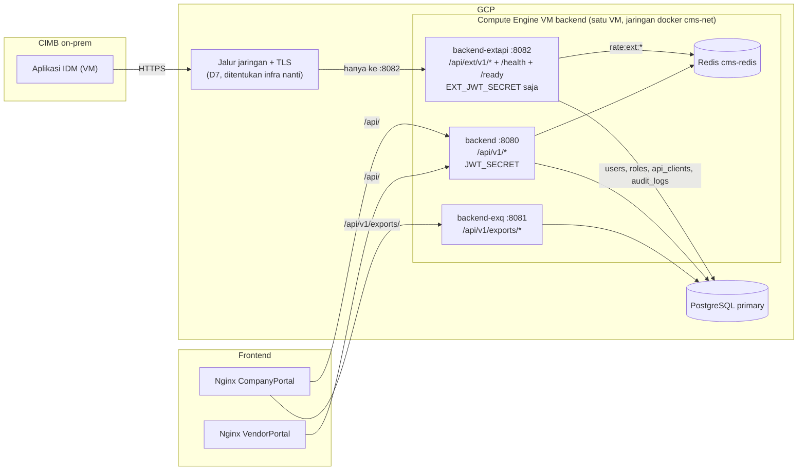
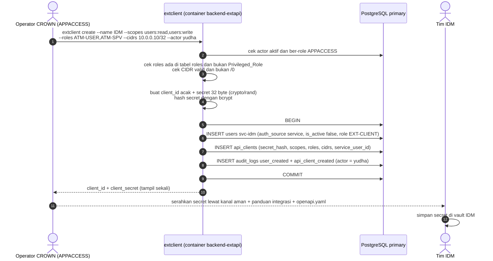
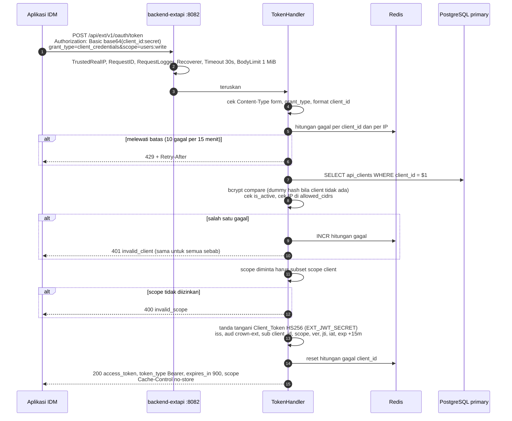
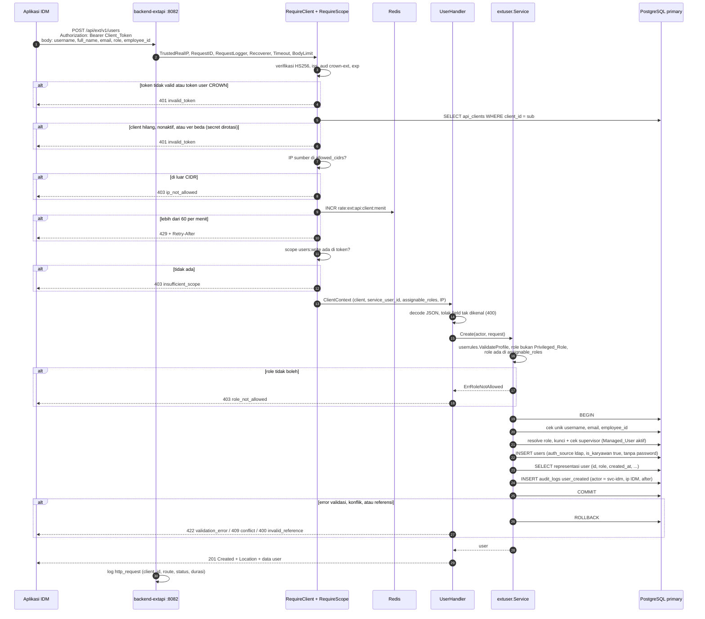
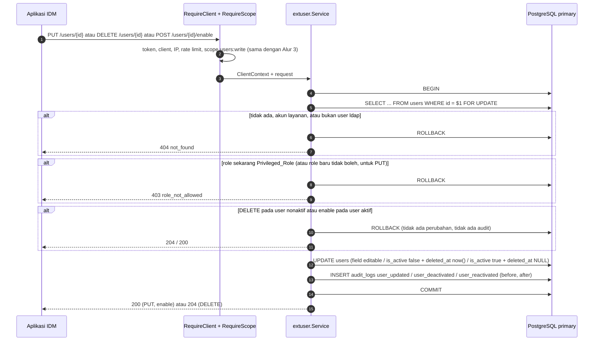
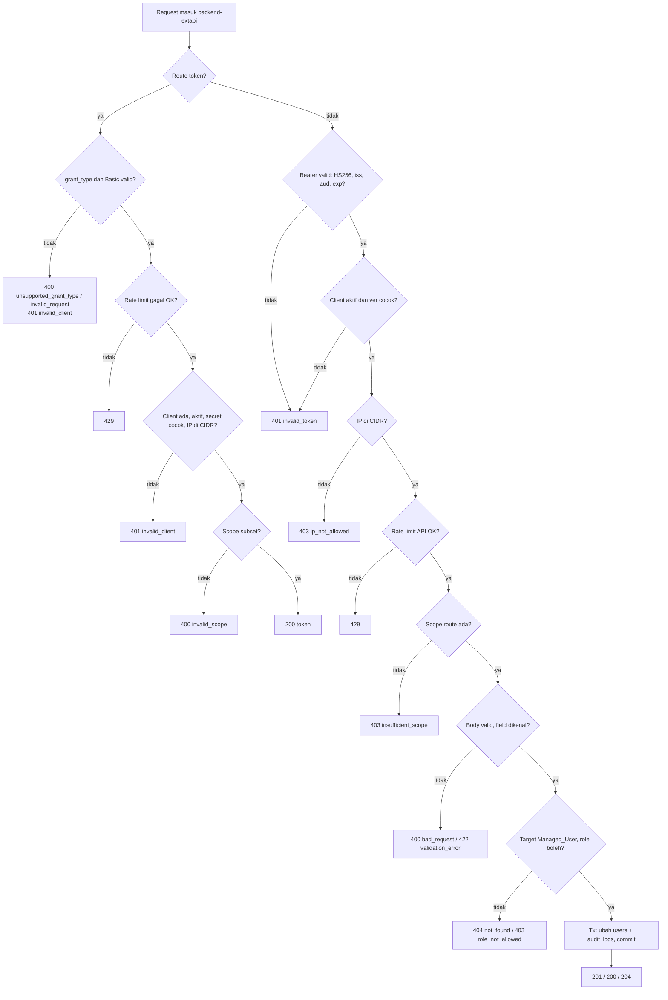

# Design Document

> Status: accepted 2026-11-10 (engineer)

## Overview

Design ini membangun API eksternal user sebagai **service Go terpisah, `backend-extapi/`** (D22), supaya aplikasi IDM bisa membuat, mengubah, menonaktifkan, membaca, dan mengaktifkan kembali user CROWN. Dasarnya `requirements.md` Req 1–13 dan keputusan PO D1–D23 (semua ✅ 2026-11-10; D7 jaringan dan D23 CI di luar scope).

Ringkasan pilihan:

- **Modul workspace ketiga (D22).** `backend-extapi/` punya `go.mod`, `sqlc.yaml`, Dockerfile, compose, `.env`, dan port `8082` sendiri, dengan pola yang sama seperti `backend-exq/`. Service ini hanya melayani `/api/ext/v1/*`, `/health`, dan `/ready`. `backend` dan `backend-exq` tidak me-mount route eksternal.
- **Tanpa `JWT_SECRET`.** Service hanya memegang `EXT_JWT_SECRET` dan menolak start bila `JWT_SECRET` ada di env-nya (Req 3.4). Kalau service ini bocor, penyerang tidak bisa membuat token user CROWN.
- **OAuth2 client credentials (D2).** IDM mengirim `client_id:client_secret` lewat HTTP Basic ke `POST /api/ext/v1/oauth/token` dan mendapat Client_Token HS256 berumur 15 menit (D8, D10).
- **Pemeriksaan ulang setiap request (Req 4).** Tanda tangan, `iss`, `aud`, `exp`, status client dan versi kredensial di DB primary, IP sumber, rate limit, dan scope.
- **Aturan validasi bersama di `pkg/userrules` (Req 12.6).** Validasi profil, format email, pemetaan constraint unik, Privileged_Role, dan konstanta akun layanan dipindah dari `backend/internal/auth/user_admin.go` ke `pkg/`. `backend` dan `backend-extapi` memanggil fungsi yang sama. Perilaku admin tidak berubah.
- **Satu transaksi per perubahan (D15).** Kunci baris target (`FOR UPDATE`), cek aturan, tulis perubahan, tulis audit, lalu commit. Audit gagal berarti tidak ada perubahan.
- **Pelaku audit = akun layanan (D6, D16 opsi a).** Setiap ApiClient punya satu baris `users` (`svc-idm`), `auth_source='service'`, `is_active=false`, tanpa password, role `EXT-CLIENT` tanpa hak. `audit_logs` tidak berubah.
- **CLI `backend-extapi/cmd/extclient` (D9, D22).** Dijalankan operator di container `backend-extapi`. Setiap aksi diaudit atas nama user APPACCESS yang disebut di `--actor`.
- **Migrasi tetap di `backend/migrations/` (`039`).** `backend-extapi` membaca skema lewat sqlc, seperti `backend-exq`.
- **Paket informasi untuk IDM (Req 11, 13).** `backend-extapi/api/openapi.yaml` + `backend-extapi/api/panduan-integrasi-idm.md`.

Tidak ada library baru. Modul baru hanya memakai dependensi yang sudah ada di workspace: `chi/v5`, `pgx/v5`, `go-redis/v9`, `golang-jwt/jwt/v5`, `golang.org/x/crypto`, `google/uuid`, `kin-openapi`, `pgregory.net/rapid`, `alicebob/miniredis/v2` (test saja, sudah ada di `pkg/go.mod`).

## Architecture

### Topologi



- Tiga service Go, satu VM, satu PostgreSQL, satu Redis (key `backend-extapi` diberi prefix `rate:ext:`).
- `backend-extapi` tidak memanggil `backend` lewat HTTP dan tidak meng-import kodenya (aturan workspace). Keduanya berbagi tabel dan paket `pkg/`.
- Kedua Nginx portal meneruskan `/api/` ke `:8080`, bukan ke `:8082`. Request `/api/ext/*` lewat domain portal sampai di `backend`, yang tidak punya route itu, jadi hasilnya 404.
- Jalur jaringan IDM ke `:8082` dan tempat TLS diterminasi menunggu D7. Syarat dari design: TLS wajib (secret dikirim lewat Basic), hanya `:8082` yang dibuka ke jalur itu, dan IP proxy/LB di depannya dimasukkan ke `TRUSTED_PROXIES` milik `backend-extapi`.

### Alur 1: Onboarding client (sekali, oleh operator)



### Alur 2: IDM meminta token



### Alur 3: IDM membuat user (dari kirim request sampai berhasil)



### Alur 4: Ubah, nonaktifkan, aktifkan kembali



### Urutan pemeriksaan (ringkas)



## Components and Interfaces

### Struktur modul `backend-extapi/` (Req 3.4, 3.5, 12.1, 12.7)

```
backend-extapi/
  go.mod                     module github.com/cimb-niaga/cms/backend-extapi; require pkg; replace ../pkg
  sqlc.yaml                  schema ../backend/migrations/, queries queries/, out internal/repository
  coverage-thresholds.txt
  Dockerfile                 multi-stage, context = repo root, non-root, HEALTHCHECK :8082/health
  docker-compose.yaml        service backend-extapi, port 8082, env_file .env, network cms-net (external)
  .env.example
  api/
    openapi.yaml             ExtContract (Req 11)
    embed.go                 //go:embed openapi.yaml -> Spec
    panduan-integrasi-idm.md paket informasi untuk tim IDM (Req 13)
  cmd/
    api/main.go              bootstrap HTTP service
    extclient/main.go        CLI ClientRegistry
  queries/
    api_clients.sql  ext_users.sql  audit.sql
  internal/
    config/                  loader env milik service ini
    extauth/                 client, secret, token, ratelimit, middleware
    extuser/                 service + interface store
      pgstore/               implementasi Store/Reader (pgx + sqlc + audit.Writer); lihat catatan import cycle
    audit/                   writer (Before + After, per-tx)
    handler/                 token, users, errors, router
    repository/              hasil sqlc + ApiClientRepository + TxRunner
```

Perubahan workspace:
- `go.work`: tambah `./backend-extapi` di `use`.
- `backend/Dockerfile` dan `backend-exq/Dockerfile`: tambah `COPY backend-extapi/go.mod backend-extapi/go.sum ./backend-extapi/` (Go butuh `go.mod` setiap modul workspace, pola yang sama dengan baris `backend-exq` yang sudah ada).
- `.dockerignore`: tambah `!backend-extapi/` ke allowlist.

### Konfigurasi (Req 3.4, 12.1)

#### `backend-extapi/internal/config/config.go`

`pkg/config.Load` tidak dipakai karena mewajibkan `JWT_SECRET`. Loader sendiri:

| Env | Default | Aturan |
| --- | --- | --- |
| `DATABASE_URL` | (wajib) | primary; semua baca dan tulis di primary (DD8) |
| `REDIS_URL` | (wajib) | Redis bersama |
| `PORT` | `8082` | |
| `TRUSTED_PROXIES` | (kosong) | lewat `config.ParseTrustedProxies` (fungsi `pkg/config` yang diekspor, lihat bawah) |
| `EXT_JWT_SECRET` | (wajib) | min 32 byte |
| `JWT_SECRET` | harus **tidak ada** | ada → error "JWT_SECRET must not be set for backend-extapi" (Req 3.4) |
| `EXT_TOKEN_ISSUER` | `crown` | claim `iss` |
| `EXT_TOKEN_TTL` | `15m` | 1m sampai 60m (Req 2.8) |
| `EXT_TOKEN_FAIL_LIMIT` | `10` | 1 sampai 1000 (D19) |
| `EXT_TOKEN_FAIL_WINDOW` | `15m` | 1m sampai 24h |
| `EXT_API_RATE_PER_MINUTE` | `60` | 1 sampai 10000 (D19) |

`Load(getenv func(string) string) (Config, error)`. Nilai yang tidak bisa diparse atau di luar batas adalah error, bukan diam-diam default (lebih ketat dari `pkg/config`). Pesan error menyebut nama env, tidak pernah nilainya. `LoadCLI(getenv)` untuk `extclient` hanya membaca `DATABASE_URL`.

#### Perubahan kecil di `pkg/config`

`func ParseTrustedProxies(raw string) ([]netip.Prefix, error)` diekspor (pembungkus fungsi yang sudah ada). `Load` tidak berubah.

### Aturan bersama `pkg/userrules` (Req 5.3, 6.5, 9.1, 12.6)

#### `pkg/userrules/userrules.go`

Kode murni, tanpa pgx dan tanpa tipe sqlc (precedent: `pkg/csvexport`, `pkg/reports`).

```go
package userrules

const (
    AuthSourceLDAP    = "ldap"
    AuthSourceService = "service"
    ServiceRole       = "EXT-CLIENT"
    PgUniqueViolation = "23505"
)

// PrivilegedRoles: never assignable or touchable through the external API (Req 9.1).
// Migration 039 mirrors it in a CHECK on api_clients.assignable_roles (sync test).
var PrivilegedRoles = []string{"ADMIN", "APPACCESS", "ADMIN_PARAM", "EXT-CLIENT"}

func IsPrivileged(role string) bool                  // TrimSpace + EqualFold
func ValidateProfile(fullName, email, role string) error // *auth.ValidationError (pkg/auth), urutan field sama dengan sekarang
func IsValidEmail(s string) bool                      // net/mail.ParseAddress
func Uniqueness(field string, existingID *int64, err error) error
func ConflictFieldFromConstraint(name string) string  // users_username_key -> username, ..., lainnya -> unknown
func NilIfEmpty(s string) *string

type ConflictError struct{ Field, Message string }    // Error() "<field>: <message>"
type ReferenceError struct{ Field, Message string }
```

#### Refactor `backend/internal/auth/user_admin.go`

- `type ConflictError = userrules.ConflictError` dan `type ReferenceError = userrules.ReferenceError` (alias tipe, jadi `errors.As` di handler admin tetap jalan tanpa perubahan).
- `validateProfile`, `isValidEmail`, `uniqueness`, `nilIfEmpty` diganti panggilan `userrules.*`.
- `conflictFieldFromPgError` tetap di `backend` (butuh `pgconn`), memanggil `userrules.ConflictFieldFromConstraint`.
- `vendorFields`, `localCredentials`, `checkVendorBranch` tetap di `backend` (khusus user vendor/local, tidak dipakai jalur eksternal).
- Pesan dan urutan error tidak berubah. Test admin yang sudah ada menjadi penjaga regresi (Req 12.3, 12.6).

### Penjagaan akun layanan di `backend` (Req 9.4, 9.5, 9.6)

| File | Perubahan |
| --- | --- |
| `backend/queries/users_admin.sql` | `ListUsersAdmin`, `CountUsersAdmin`: `AND u.auth_source <> 'service'`. `UserAdminExists` (cek supervisor): `AND auth_source <> 'service'`, jadi akun layanan sebagai supervisor menjadi 400 `invalid_reference` "tidak ditemukan". Query daftar role untuk dropdown form: `WHERE role <> 'EXT-CLIENT'`. |
| `backend/internal/auth/user_admin.go` | `resolveReferences`: `role == userrules.ServiceRole` → `ReferenceError{role, "tidak dapat diberikan"}`. `Update`: target `AuthSource == userrules.AuthSourceService` → `ErrUserNotFound`. |
| `backend/internal/handler/admin_user_handler.go` | `Get`, `Update`, `Disable`, `Enable`, `SetInitialPassword`: pre-check `userAdminSvc.Get`; baris dengan `AuthSource == "service"` → 404 `not_found`. `Update` dan `SetInitialPassword` mendapat pre-check ini (hari ini belum ada). |
| `backend/internal/db/*.sql.go` | `sqlc generate` + perbaikan `UserLeafe → UserLeave` |

Layar Role Management (`ListRolesWithPermissions`) **tidak** difilter: `EXT-CLIENT` tetap tampil dan bisa diberi hak menu, tanpa efek karena akun layanan tidak bisa login (D24).

Login akun layanan sudah ditolak tanpa perubahan kode: `auth.Service.Login` langkah 4 (`is_active=false` → `ErrAccountInactive`), dan `selectProvider("service")` mengembalikan `ErrUnsupportedAuthSource` karena `LocalProvider` hanya menerima `local`/`local_dev`.

### Bootstrap dan routing (Req 3.5, 4.6)

#### `backend-extapi/cmd/api/main.go`

Mengikuti `backend-exq/cmd/api/main.go`:

1. Logger JSON `slog`, `config.Load(os.Getenv)`; error → `os.Exit(1)`.
2. `pgxpool.New(DATABASE_URL)`; Redis `ParseURL` + `NewClient`.
3. `extauth.NewTokenService(cfg.Secret, cfg.Issuer, cfg.TTL)`.
4. `handler.NewRouter(deps)` (dipisah dari `main` supaya bisa dites, Property 13). Middleware: `custommw.TrustedRealIP(cfg.TrustedProxies)`, chi `RequestID`, `custommw.RequestLogger(slog.Default())`, chi `Recoverer`, chi `Timeout(30s)`, `custommw.BodyLimit(1<<20, nil)`.
5. `http.Server{Addr: ":"+cfg.Port, ReadHeaderTimeout: 5s, ReadTimeout: 10s, WriteTimeout: 30s, IdleTimeout: 60s}`; graceful shutdown 15 detik pada SIGINT/SIGTERM.

Route (`handler.NewRouter`):

| Method | Path | Penjaga | Handler |
| --- | --- | --- | --- |
| GET | `/health` | publik | `{"status":"ok"}` |
| GET | `/ready` | publik | `health.Ready(2s, {db, redis})` |
| POST | `/api/ext/v1/oauth/token` | Basic | `TokenHandler.Token` |
| POST | `/api/ext/v1/users` | `RequireClient` + `RequireScope(users:write)` | `UserHandler.Create` |
| GET | `/api/ext/v1/users` (`?username=`) | `RequireClient` + `RequireScope(users:read)` | `UserHandler.FindByUsername` |
| GET | `/api/ext/v1/users/{id}` | `RequireClient` + `RequireScope(users:read)` | `UserHandler.Get` |
| PUT | `/api/ext/v1/users/{id}` | `RequireClient` + `RequireScope(users:write)` | `UserHandler.Update` |
| DELETE | `/api/ext/v1/users/{id}` | `RequireClient` + `RequireScope(users:write)` | `UserHandler.Disable` |
| POST | `/api/ext/v1/users/{id}/enable` | `RequireClient` + `RequireScope(users:write)` | `UserHandler.Enable` |

`NotFound` dan `MethodNotAllowed` router mengembalikan JSON datar `{error, message}`.

### Paket `backend-extapi/internal/extauth` (Req 1, 2, 3, 4)

#### `client.go`

```go
const (
    ScopeUsersRead  = "users:read"
    ScopeUsersWrite = "users:write"
    Audience        = "crown-ext"
)

func ValidScope(s string) bool
func ParseScopes(s string) ([]string, error) // dipisah spasi atau koma (CLI), dedup, ValidScope tiap item

type Client struct {
    ID                int64
    ClientID          string
    Name              string
    SecretHash        string
    CredentialVersion int32
    Scopes            []string
    AssignableRoles   []string
    AllowedCIDRs      []netip.Prefix
    ServiceUserID     int64
    IsActive          bool
}

func (c Client) AllowsIP(ip netip.Addr) bool // false bila AllowedCIDRs kosong (Req 1.7)
func (c Client) CanAssign(role string) bool  // !userrules.IsPrivileged(role) && role ada di AssignableRoles
func (c Client) HasScope(s string) bool
```

#### `secret.go`

- `NewClientID() (string, error)`: `"crown_"` + 16 byte `crypto/rand` dalam base32 huruf kecil tanpa padding (26 karakter).
- `NewSecret() (string, error)`: 32 byte `crypto/rand` dalam base64url tanpa padding (43 karakter, di bawah batas 72 byte bcrypt).
- `HashSecret(s string) (string, error)`: bcrypt cost 12.
- `VerifySecret(hash, s string) bool`: `bcrypt.CompareHashAndPassword`. Bila client tidak ditemukan, handler tetap memverifikasi terhadap `dummyHash` (dibuat sekali saat start) supaya waktu respons tidak membedakan client ada atau tidak (Req 2.4).
- `ValidClientIDFormat(s string) bool`: `^crown_[a-z2-7]{26}$`. Dicek sebelum dipakai di key Redis atau query.

#### `token.go`

```go
type Claims struct {
    Scope string `json:"scope"`
    Ver   int32  `json:"ver"`
    jwt.RegisteredClaims // iss, sub, aud, exp, iat, jti
}

type TokenService struct { key []byte; issuer string; ttl time.Duration; now func() time.Time }

func NewTokenService(key []byte, issuer string, ttl time.Duration) *TokenService
func (t *TokenService) Issue(c Client, scopes []string) (token string, expiresIn int, err error)
func (t *TokenService) Validate(token string) (*Claims, error)
```

- `Issue`: header `typ: at+jwt`, HS256, `aud = ["crown-ext"]`, `sub = client_id`, `scope` dipisah spasi, `ver = credential_version`, `jti = uuid`, `exp = now + ttl`.
- `Validate`: `jwt.WithValidMethods([]string{"HS256"})`, `jwt.WithIssuer`, `jwt.WithAudience(Audience)`, `jwt.WithExpirationRequired()`, `jwt.WithIssuedAt()`; lalu wajib `sub`, `jti`, `ver > 0`, dan semua scope valid.
- Isolasi (Req 3.1–3.3): User_Token ditandatangani `JWT_SECRET` yang tidak ada di service ini, dan tidak punya `aud`, jadi `Validate` menolaknya. Client_Token ditolak `pkg/auth.ValidateAccessToken` di `backend` karena kuncinya lain, dan juga karena tidak punya claim `id`, `username`, `role` (tetap ditolak walau kuncinya kebetulan sama). `pkg/auth` tidak diubah.

#### `ratelimit.go`

Redis fixed window, fail closed (pola `pkg/middleware/rate_limiter.go`).

- `TokenFailures`: key `rate:ext:token:client:{client_id}` dan `rate:ext:token:ip:{ip}`. `Check(ctx, clientID, ip) (retryAfter time.Duration, err error)`, `RecordFailure(ctx, clientID, ip)` (INCR + EXPIRE NX dalam pipeline), `ResetClient(ctx, clientID)`. `clientID` dengan format tidak valid hanya dihitung per IP.
- `APIRate`: key `rate:ext:api:{client_id}:{unix_minute}`, `Allow(ctx, clientID) (retryAfter time.Duration, err error)`, TTL 2 menit.
- Error Redis → `ErrUnavailable` → 503 (Req 2.9, 4.5).

#### `middleware.go`

```go
type ClientContext struct {
    Client        Client
    GrantedScopes []string
    IP            string
}

type ClientReader interface {
    GetByClientID(ctx context.Context, clientID string) (*Client, error) // nil, nil bila tidak ada
}

func RequireClient(tokens *TokenService, clients ClientReader, rate *APIRate) func(http.Handler) http.Handler
func RequireScope(scope string) func(http.Handler) http.Handler
func GetClientContext(ctx context.Context) (*ClientContext, bool)
```

`RequireClient`: header Bearer → `Validate` → `GetByClientID` (primary) → `IsActive` dan `ver == CredentialVersion` → `AllowsIP` (IP dari `r.RemoteAddr` setelah `TrustedRealIP`) → `rate.Allow` → simpan `ClientContext` di context key privat paket ini. Service ini tidak punya `pkg/middleware.AuthContext` sama sekali (Req 3.6).

Error middleware: JSON datar `{error, message}` + `WWW-Authenticate: Bearer error="invalid_token"` atau `error="insufficient_scope"` (Req 4.1, 4.4).

`client_id` di log: `pkg/middleware.RequestLogger` menaruh holder `*LogFields` kosong di context sebelum memanggil handler berikutnya; `RequireClient` mengisi `ClientID` setelah token dan client tervalidasi; `RequestLogger` menulis atribut `client_id` saat request selesai bila terisi. Nilai tidak pernah diambil dari header request, jadi pemanggil tidak bisa memalsukannya. Untuk request yang ditolak sebelum validasi, `client_id` dari claim yang belum terverifikasi tidak dicatat.

### Repository (Req 1, 4.2, 5–8)

#### `backend-extapi/sqlc.yaml`

Sama dengan `backend-exq/sqlc.yaml`: `schema: ../backend/migrations/`, `queries: queries/`, `package: repository`, `out: internal/repository`, `sql_package: pgx/v5`, `emit_json_tags`, `emit_empty_slices`, `emit_pointers_for_null_types`, rename `ip: IP` dan `user_leaves: UserLeave`. sqlc v1.31.1.

#### `backend-extapi/queries/api_clients.sql`

- `GetApiClientByClientID :one` (termasuk `secret_hash` untuk verifikasi; tidak pernah dikirim ke respons atau log).
- `ListApiClients :many` (tanpa `secret_hash`, join `users` untuk `service_username`).
- `CreateApiClient :one`, `RotateApiClientSecret :one` (`secret_hash`, `credential_version = credential_version + 1`, `secret_rotated_at = now()`, `updated_at = now()`), `SetApiClientActive :one` (`disabled_at` diisi/dikosongkan), `UpdateApiClientGrants :one`.
- `GetActiveAppAccessUser :one` (untuk `--actor`: user aktif, `deleted_at IS NULL`, role `APPACCESS`).
- `CreateServiceUser :one` (insert akun layanan, lihat CLI).

#### `backend-extapi/queries/ext_users.sql`

- `LockUserForExt :one` — `SELECT u.id, u.auth_source, u.deleted_at, u.is_active, (SELECT r.role FROM roles r WHERE r.id = u.role_id)::text AS role FROM users u WHERE u.id = $1 FOR UPDATE`. **Revisi 2026-11-10 (bug dari test 6.3, user OK):** versi awal memakai `JOIN roles ... FOR UPDATE OF u`; saat `role_id` diubah bersamaan, Postgres (READ COMMITTED) mengecek ulang join terhadap baris `roles` lama setelah menunggu lock, baris hilang, dan service membalas 404 palsu. Subquery skalar dievaluasi pada versi baris yang sudah terkunci.
- `GetExtUser :one` / `GetExtUserByUsername :one` — kolom representasi `ExtUser` + `auth_source` + `deleted_at`, tanpa `password_hash`.
- `FindUserIDByUsername`, `FindUserIDByEmail`, `FindUserIDByEmailExcludingID`, `FindUserIDByEmployeeID`, `FindUserIDByEmployeeIDExcludingID` (cek unik, sama dengan query admin).
- `GetRoleIDByName :one`.
- `CreateExtUser :one` — insert dengan `auth_source = 'ldap'`, `is_karyawan = true`, `password_hash = NULL`, `must_change_password = false`, `vendor_id`/`vendor_branch_id` NULL.
- `UpdateExtUser :one` — field editable saja, `WHERE id = $1 AND deleted_at IS NULL`.
- `DeactivateExtUser :exec` — `UPDATE users SET is_active = false, deleted_at = now(), updated_at = now() WHERE id = $1 AND deleted_at IS NULL`.
- `ReactivateExtUser :exec` — `UPDATE users SET is_active = true, deleted_at = NULL, updated_at = now() WHERE id = $1 AND deleted_at IS NOT NULL`.

#### `backend-extapi/queries/audit.sql`

`InsertAuditLog :one` — kolom sama dengan `backend` (`actor_id, action, entity_type, entity_id, before, after, ip`).

#### `backend-extapi/internal/repository/`

- `ApiClientRepository{q}` dengan `GetByClientID(ctx, clientID) (*extauth.Client, error)`; mengubah `cidr[]` menjadi `[]netip.Prefix`. Selalu di pool primary, supaya client yang baru dinonaktifkan langsung ditolak (Req 1.5, 4.2).
- `TxRunner{pool}`: `pool.Begin` → `fn(tx)` → `Commit`, atau `Rollback` bila `fn` error.
- **Revisi 2026-11-10 (user OK, task 6.1):** implementasi `extuser.Store`/`Tx`/`Reader` ada di paket `internal/extuser/pgstore`, bukan di `internal/repository`. Alasan: `audit` meng-import `repository` (untuk `DBTX`/`InsertAuditLog`), jadi `repository` → `extuser` → `audit` → `repository` adalah import cycle. `pgstore` dibangun di atas `repository.TxRunner` + `audit.Writer`; query dan perilaku tidak berubah.

#### `backend-extapi/internal/audit/writer.go`

`Entry{ActorID int64; Action, EntityType string; EntityID int64; Before, After any; IP string}`, `Write(ctx, q repository.DBTX, e Entry) error`. Menolak `ActorID == 0` atau `Action` kosong. Beda dengan writer `backend-exq`: `Before` didukung (dibutuhkan update/disable/enable).

### Endpoint token (Req 2)

#### `backend-extapi/internal/handler/token.go`

`Token(w, r)`:

1. Set `Cache-Control: no-store` dan `Pragma: no-cache` di awal (semua respons, Req 2.7).
2. `Content-Type` harus `application/x-www-form-urlencoded`, `r.ParseForm()` berhasil, dan tidak ada `client_secret` di body; selain itu 400 `invalid_request`.
3. `grant_type != "client_credentials"` → 400 `unsupported_grant_type`.
4. `r.BasicAuth()` gagal → 401 `invalid_client` + `WWW-Authenticate: Basic realm="crown-ext"`.
5. `TokenFailures.Check` → 429 + `Retry-After`, atau 503.
6. Bila format `client_id` valid: `GetByClientID`. Verifikasi secret (dummy hash bila nil), `IsActive`, `AllowsIP`. Semua kegagalan → `RecordFailure` + log `ext_token_denied` dengan `reason` internal (`unknown_client`, `bad_secret`, `inactive`, `ip_not_allowed`) + 401 `invalid_client` yang identik (Req 2.4).
7. `ParseScopes(form.scope)`; kosong = semua scope client; ada scope di luar hak client → 400 `invalid_scope`.
8. `Issue` → `ResetClient` → log `ext_token_issued` (`client_id`, `ip`, `scope`, `jti`) → 200 `{access_token, token_type: "Bearer", expires_in, scope}`.

Body error token mengikuti RFC 6749 bagian 5.2: `{"error":"<code>","error_description":"<teks>"}` (DD9).

### API user (Req 5, 6, 7, 8)

#### `backend-extapi/internal/handler/users.go`

- `Content-Type` selain `application/json` untuk POST/PUT → 415 `unsupported_media_type`.
- Decode dengan `json.Decoder.DisallowUnknownFields()`; field tak dikenal → 400 `bad_request` dengan nama field (Req 5.2, 6.2).
- Body create (D13): `username` (wajib), `full_name`, `email`, `role`, `employee_id` (opsional), `supervisor_id` (opsional, boleh null), `approval_level` (opsional, boleh null).
- Body update: `full_name`, `email`, `role`, `employee_id`, `supervisor_id`, `approval_level`. PUT mengganti semua field editable. `username` atau `auth_source` di body update ditolak sebagai field tak dikenal (Req 6.2).
- `{id}` harus bilangan bulat positif; `?username=` wajib, 1–100 karakter.
- Representasi `ExtUser`: `id`, `username`, `full_name`, `email`, `role`, `employee_id`, `supervisor_id`, `approval_level`, `is_active`, `created_at`, `updated_at` (RFC 3339 UTC).
- Status: create 201 + `Location: /api/ext/v1/users/{id}`; get, update, enable 200; disable 204 tanpa body.
- `ExtActor` dibangun dari `ClientContext` (service user id, `client_id`, assignable roles, IP).

#### `backend-extapi/internal/handler/errors.go`

Memetakan error ke HTTP (tabel di Error Handling). Error 5xx tidak membawa detail internal. Setiap 4xx dicatat `slog` level warn dengan `client_id`, `route`, `error`, tanpa body request (Req 10.5).

### Service user (Req 5–10)

#### `backend-extapi/internal/extuser/service.go`

```go
type Actor struct {
    ServiceUserID   int64
    ClientID        string
    AssignableRoles []string
    IP              string
}

type Store interface { // satu instance per transaksi
    LockUser(ctx context.Context, id int64) (*LockedUser, error)
    GetUser(ctx context.Context, id int64) (*User, error)
    FindIDByUsername(ctx context.Context, username string) (*int64, error)
    FindIDByEmail(ctx context.Context, email string, excludeID *int64) (*int64, error)
    FindIDByEmployeeID(ctx context.Context, employeeID string, excludeID *int64) (*int64, error)
    RoleIDByName(ctx context.Context, role string) (*int64, error)
    Create(ctx context.Context, p CreateParams) (int64, error)
    Update(ctx context.Context, p UpdateParams) error
    Deactivate(ctx context.Context, id int64) error
    Reactivate(ctx context.Context, id int64) error
    WriteAudit(ctx context.Context, e audit.Entry) error
}

type Tx interface {
    InTx(ctx context.Context, fn func(s Store) error) error
}

type Reader interface {
    GetUser(ctx context.Context, id int64) (*User, error)
    GetUserByUsername(ctx context.Context, username string) (*User, error)
}

type Service struct { tx Tx; reader Reader }

func (s *Service) Create(ctx context.Context, a Actor, req CreateRequest) (User, error)
func (s *Service) Update(ctx context.Context, a Actor, id int64, req UpdateRequest) (User, error)
func (s *Service) Disable(ctx context.Context, a Actor, id int64) error
func (s *Service) Enable(ctx context.Context, a Actor, id int64) (User, error)
func (s *Service) Get(ctx context.Context, id int64) (User, error)
func (s *Service) GetByUsername(ctx context.Context, username string) (User, error)

var (
    ErrRoleNotAllowed = errors.New("role tidak boleh diberikan atau diubah lewat API eksternal")
    ErrUserNotFound   = errors.New("pengguna tidak ditemukan")
    ErrSelfSupervision = errors.New("supervisor_id tidak boleh sama dengan id sendiri")
)
```

**Managed_User** (dipakai semua method): baris ada, `auth_source = 'ldap'` (D13), dan role sekarang bukan Privileged_Role. Akun layanan dan user vendor/local selalu `ErrUserNotFound`. User ldap dengan role istimewa: `ErrRoleNotAllowed` untuk tulis, `ErrUserNotFound` untuk baca (baca tidak membuka data admin ke IDM).

**Create**
1. Trim. `username` wajib; `userrules.ValidateProfile` (Req 5.3).
2. `!actor.CanAssign(role)` → `ErrRoleNotAllowed` sebelum menyentuh DB (Req 5.4).
3. `InTx`: `Uniqueness` username, email, employee_id → `RoleIDByName` (nil → `ReferenceError role`) → bila `supervisor_id`: `LockUser(supervisor)` harus Managed_User yang aktif, kalau tidak `ReferenceError supervisor_id` (Req 5.5) → `Create` (Req 5.6, tanpa password) → `GetUser(id)` → `WriteAudit{ActorID: a.ServiceUserID, Action: "user_created", EntityType: "user", EntityID: id, After: user, IP: a.IP}`.
4. Pelanggaran unik (23505) dari insert → `userrules.ConflictError` lewat `ConflictFieldFromConstraint`.

**Update**
1. Trim, `ValidateProfile`.
2. `InTx`: `LockUser(id)` → tidak ada, nonaktif, atau bukan ldap → `ErrUserNotFound` (Req 6.3). Role sekarang istimewa → `ErrRoleNotAllowed`. `!actor.CanAssign(newRole)` → `ErrRoleNotAllowed` (Req 6.4). `supervisor_id == id` → `ErrSelfSupervision`. Cek unik untuk nilai yang berubah → `RoleIDByName` → cek supervisor seperti create → `Update` → `GetUser` → audit `user_updated` dengan `Before` dan `After`.

**Disable**
`InTx`: `LockUser` → bukan Managed_User → 404 atau 403. Sudah nonaktif → return nil tanpa tulis (Req 7.2). Selain itu `Deactivate` (soft-delete) → audit `user_deactivated` dengan `Before`/`After`.

**Enable**
`InTx`: sama; sudah aktif → kembalikan representasi tanpa tulis (Req 8.2). Selain itu `Reactivate` → audit `user_reactivated`.

**Get / GetByUsername**
Dari primary (dipakai IDM untuk memastikan hasil setelah timeout; replica bisa tertinggal). Bukan Managed_User → `ErrUserNotFound`.

`FOR UPDATE` pada target membuat cek role dan penulisan terjadi atas baris yang sama dalam satu transaksi, jadi admin yang mengubah role user itu bersamaan harus menunggu dan tidak bisa menyelip.

### ClientRegistry CLI (Req 1, 9.2, 10.4)

#### `backend-extapi/cmd/extclient/main.go`

Binary kedua di image `backend-extapi`. Dijalankan operator: `docker compose -f backend-extapi/docker-compose.yaml exec backend-extapi ./extclient <perintah> ...`. Memakai `DATABASE_URL` (bisa ditimpa per perintah dengan login DB lain bila service memakai login terbatas, lihat deployment).

| Perintah | Efek | Audit (`entity_type = api_client`) |
| --- | --- | --- |
| `create --name --scopes --roles --cidrs --actor` | akun layanan `svc-<slug>` + baris `api_clients`; cetak `client_id` dan secret sekali | `user_created` (entity `user`) + `api_client_created` |
| `rotate --client-id --actor` | secret baru, `credential_version + 1` (token lama ikut mati, Req 1.4); cetak secret sekali | `api_client_secret_rotated` |
| `disable` / `enable --client-id --actor` | `is_active` | `api_client_disabled` / `api_client_enabled` |
| `set-grants --client-id [--scopes] [--roles] [--cidrs] --actor` | ubah hak | `api_client_grants_updated` (before/after tanpa hash) |
| `list` | client, scope, role, CIDR, status, `service_user_id`, `service_username` (Req 10.4) | tidak ada |

Aturan:
- `--actor`: username user aktif ber-role `APPACCESS`; id-nya menjadi `actor_id` audit; IP audit = `cli`.
- `--roles`: setiap role harus ada di tabel `roles` dan `!userrules.IsPrivileged` (Req 9.2). Daftar kosong boleh (client tidak bisa membuat user).
- `--cidrs`: `netip.ParsePrefix`; tolak `/0`; daftar kosong boleh, tapi client tidak bisa dipakai (Req 1.7) dan CLI mencetak peringatan.
- `--scopes`: `ParseScopes`, minimal satu.
- Semua tulis + audit dalam satu transaksi.
- Secret hanya ke stdout, tidak pernah ke log, argumen, atau file; pesan berikutnya mengingatkan operator untuk menyerahkan secret lewat kanal aman.
- Akun layanan: `username = svc-<slug nama>` (`[a-z0-9-]`, unik), `full_name = "Service: <nama>"`, `email = svc-<slug>@service.crown.invalid` (domain `.invalid` tidak bisa menerima email), `auth_source = service`, `is_active = false`, `is_karyawan = false`, `password_hash = NULL`, role `EXT-CLIENT`.

### ExtContract dan paket informasi IDM (Req 11, 13)

#### `backend-extapi/api/openapi.yaml` + `embed.go`

- OpenAPI 3.0.3, `servers: [{url: /api/ext/v1}]`; `info.description` menjelaskan versi path, DELETE = soft-delete (D14), dan batas rate.
- `components.securitySchemes`: `oauth2` (`clientCredentials`, `tokenUrl: /api/ext/v1/oauth/token`, scope `users:read`, `users:write`) dan `basicAuth` untuk operasi token.
- Schema: `ExtUserCreate`, `ExtUserUpdate`, `ExtUser`, `TokenResponse`, `OAuthError`, `Error`, `ValidationError`.
- `//go:embed openapi.yaml` → `Spec []byte` untuk test kontrak. Tidak di-serve oleh API (D21).

#### `backend-extapi/api/panduan-integrasi-idm.md`

Isi sesuai Req 13.1–13.2: base URL per lingkungan (placeholder), langkah token dengan contoh `curl` dan respons, contoh setiap endpoint user, tabel kode error dengan arti dan tindakan yang diharapkan dari IDM, umur token dan cara memperbarui, batas rate dan `Retry-After`, aturan retry setelah timeout (`GET ?username=` sebelum mengirim ulang create), DELETE = soft-delete, dan daftar yang CROWN butuhkan dari IDM (IP sumber/CIDR, kontak serah terima secret, daftar role). Semua contoh memakai nilai palsu yang jelas (Req 13.3), misalnya `client_id` `crown_aaaaaaaaaaaaaaaaaaaaaaaaaa`, host `crown-ext.example.invalid`.

### Deploy dan gate kualitas lokal (Req 12.1, 12.2, 12.7)

- `backend-extapi/Dockerfile`: pola `backend-exq` (`golang:1.26.10-alpine` → `alpine:3.24`, `appuser`, `EXPOSE 8082`, `TZ=Asia/Jakarta`, HEALTHCHECK `wget /health` di `:8082`); build `./cmd/api` dan `./cmd/extclient`; menyalin `go.mod`/`go.sum` `backend` dan `backend-exq` untuk `go.work`.
- `backend-extapi/docker-compose.yaml`: project `CMS-Backend-ExtAPI`, service `backend-extapi`, image `cms-backend-extapi`, port `8082:8082`, `env_file: .env`, `restart: unless-stopped`, healthcheck, network `cms-net` (external). Komentar: jalankan `backend/docker-compose.yaml` dulu (Redis + network). Port tidak boleh dibuka ke luar VM selain ke jalur IDM (D7).
- `backend-extapi/.env.example`: semua env di tabel konfigurasi dengan nilai contoh, tanpa secret asli, dan catatan bahwa `JWT_SECRET` tidak boleh ada.
- **CI tidak disentuh (D23).** `.github/workflows/ci.yml` tidak diubah; deploy saat ini manual di Docker lokal. Gate kualitas (Req 12.7) dijalankan lokal per modul di task 12. Job CI `backend-extapi` ditambahkan saat migrasi Jenkins (perkiraan Desember 2026).
- `backend-extapi/coverage-thresholds.txt` (format import path penuh, dibaca `backend/scripts/check-coverage.sh`): `github.com/cimb-niaga/cms/backend-extapi/internal/config 90`, `.../internal/extauth 90`, `.../internal/extuser 90`, `.../internal/handler 85`, `.../internal/audit 90`, `.../cmd/extclient 80` (`...` = `github.com/cimb-niaga/cms/backend-extapi`, ditulis lengkap di file). `cmd/api` dan `internal/repository` (hasil sqlc) dikecualikan seperti `backend-exq`. `pkg/coverage-thresholds.txt`: tambah `github.com/cimb-niaga/cms/pkg/userrules 100`.
- `.claude/docs/deployment.md`: bagian baru "Release checklist: first `backend-extapi` deployment" (urutan: migrasi `039` → deploy `backend` versi baru → start `backend-extapi` → `extclient create` → serahkan paket IDM), rotasi secret, mematikan service, dan skrip GRANT opsional untuk login DB terbatas:
  - service: `SELECT` pada `api_clients`, `roles`; `SELECT, INSERT` pada `users` + `UPDATE (full_name, email, role_id, is_karyawan, employee_id, supervisor_id, approval_level, is_active, deleted_at, updated_at)` pada `users`; `INSERT` pada `audit_logs`; `USAGE` pada sequence `users` dan `audit_logs`.
  - CLI: tambahan `INSERT, UPDATE` pada `api_clients`; dijalankan dengan `DATABASE_URL` login yang lebih luas bila service memakai login terbatas.

## Data Models

### Migrasi `backend/migrations/039_ext_api_clients.sql`

Nomor `039` dicek 2026-11-10 (file terakhir `038_vendor_cis_limit.sql`). Diterapkan dengan `go run ./cmd/migrate up` dari `backend/`.

```sql
-- 1. Role tanpa hak untuk akun layanan client eksternal. Tidak ada baris role_permissions.
INSERT INTO public.roles (role, description) VALUES
  ('EXT-CLIENT', 'Akun layanan aplikasi eksternal (ext-user-api). Tidak bisa login, tanpa hak menu.');

COMMENT ON COLUMN public.users.auth_source IS 'ldap | local | local_dev | service (akun layanan ext-user-api, tidak bisa login)';

-- 2. Client eksternal
CREATE TABLE public.api_clients (
    id                 bigint GENERATED ALWAYS AS IDENTITY PRIMARY KEY,
    client_id          text NOT NULL UNIQUE CHECK (client_id ~ '^crown_[a-z2-7]{26}$'),
    name               text NOT NULL UNIQUE CHECK (length(btrim(name)) BETWEEN 1 AND 100),
    secret_hash        text NOT NULL,
    credential_version integer NOT NULL DEFAULT 1 CHECK (credential_version > 0),
    scopes             text[] NOT NULL CHECK (cardinality(scopes) > 0
                         AND scopes <@ ARRAY['users:read','users:write']::text[]),
    assignable_roles   text[] NOT NULL DEFAULT '{}'
                         CHECK (NOT (assignable_roles && ARRAY['ADMIN','APPACCESS','ADMIN_PARAM','EXT-CLIENT']::text[])),
    allowed_cidrs      cidr[] NOT NULL DEFAULT '{}',
    service_user_id    bigint NOT NULL UNIQUE REFERENCES public.users(id),
    is_active          boolean NOT NULL DEFAULT true,
    created_by         bigint NOT NULL REFERENCES public.users(id),
    created_at         timestamptz NOT NULL DEFAULT now(),
    updated_at         timestamptz NOT NULL DEFAULT now(),
    secret_rotated_at  timestamptz,
    disabled_at        timestamptz
);

COMMENT ON TABLE public.api_clients IS 'Aplikasi eksternal (OAuth2 client credentials, ext-user-api, dilayani backend-extapi). secret_hash = bcrypt; secret asli tidak pernah disimpan.';
COMMENT ON COLUMN public.api_clients.credential_version IS 'Naik setiap rotate; token dengan claim ver lama ditolak.';
COMMENT ON COLUMN public.api_clients.assignable_roles IS 'Allowlist role yang boleh diberikan client (D12). CHECK = cermin pkg/userrules.PrivilegedRoles.';
```

- `audit_logs` dan kolom `users` tidak berubah (D16 opsi a).
- Tidak ada DELETE untuk `api_clients`; client dinonaktifkan, tidak dihapus.
- `assignable_roles` berisi nama role, divalidasi CLI terhadap tabel `roles`. Role yang kemudian hilang dari `roles` tidak bisa diberikan karena `RoleIDByName` gagal (400 `invalid_reference`).
- Saat migrasi diterapkan: catat tabel baru, role baru, dan nilai `auth_source` baru di `.claude/CLAUDE.md` Sec 3.

### Redis (bukan source of truth)

| Key | Isi | TTL |
| --- | --- | --- |
| `rate:ext:token:client:{client_id}` | jumlah gagal token | `EXT_TOKEN_FAIL_WINDOW` |
| `rate:ext:token:ip:{ip}` | jumlah gagal token | `EXT_TOKEN_FAIL_WINDOW` |
| `rate:ext:api:{client_id}:{unix_minute}` | jumlah request | 2 menit |

## Correctness Properties

### Property 1: Token eksternal dan token user tidak bisa saling dipakai

*For any* Client_Token yang dikeluarkan `extauth.TokenService` dan *for any* User_Token yang dikeluarkan `pkg/auth.TokenService` (kunci acak, termasuk kunci yang sama), `pkg/auth.ValidateAccessToken` menolak Client_Token, `extauth.Validate` menolak User_Token, dan `RequireClient` tidak pernah menaruh `pkg/middleware.AuthContext` di context.

**Validates: Requirements 3.1, 3.2, 3.3, 3.6**

### Property 2: Role istimewa tidak pernah diberikan

*For any* request create atau update dengan role di `PrivilegedRoles` atau di luar `assignable_roles` client, `extuser.Service` mengembalikan `ErrRoleNotAllowed` dan tidak ada tulis ke `users` atau `audit_logs`.

**Validates: Requirements 5.4, 6.4, 9.1, 9.3**

### Property 3: User beroles istimewa tidak tersentuh

*For any* user target yang role-nya ada di `PrivilegedRoles`, update, disable, dan enable lewat `extuser.Service` mengembalikan `ErrRoleNotAllowed`, baca mengembalikan `ErrUserNotFound`, dan baris target tidak berubah.

**Validates: Requirements 6.4, 7.4, 8.1, 8.3**

### Property 4: Akun layanan tersembunyi dan terlindungi

*For any* akun layanan, ExtUserAPI (baca, ubah, nonaktifkan, aktifkan) mengembalikan 404, AdminUserAPI list tidak memuatnya, AdminUserAPI get/update/disable/enable/set-initial-password mengembalikan 404, AdminUserAPI tidak bisa memberi role `EXT-CLIENT` atau memakai akun layanan sebagai supervisor, dan login dengan username-nya selalu gagal.

**Validates: Requirements 6.3, 7.3, 9.4, 9.5, 9.6**

### Property 5: Perubahan dan audit atomik

*For any* create, update, disable, atau enable yang berhasil lewat `extuser.Service`, tepat satu baris `audit_logs` baru tercatat dengan `actor_id` = `service_user_id` client pemanggil, IP pemanggil, dan nama aksi yang sesuai; *for any* kegagalan penulisan audit, baris `users` tetap seperti sebelum request.

**Validates: Requirements 10.1, 10.2**

### Property 6: Tidak ada secret di audit, log, dan respons

*For any* request token atau user dan *for any* perintah CLI, payload `audit_logs`, baris log `slog`, dan body respons error tidak memuat Client_Secret, `secret_hash`, header `Authorization`, Client_Token, atau `password_hash`.

**Validates: Requirements 1.3, 2.10, 10.3**

### Property 7: Client yang dicabut, dirotasi, atau salah tempat langsung ditolak

*For any* Client_Token yang valid secara kriptografis, `RequireClient` menolak dengan 401 bila client nonaktif atau `ver` tidak sama dengan `credential_version`, dengan 403 `ip_not_allowed` bila IP di luar `allowed_cidrs` (termasuk daftar kosong), dan `RequireScope` menolak dengan 403 `insufficient_scope` bila scope route tidak ada di token.

**Validates: Requirements 1.4, 1.5, 1.7, 4.2, 4.3, 4.4**

### Property 8: Kegagalan token tidak membocorkan sebab

*For any* kombinasi client tidak dikenal, client nonaktif, IP di luar CIDR, dan secret salah, endpoint token mengembalikan status 401 dan body yang identik byte demi byte.

**Validates: Requirements 2.4**

### Property 9: Scope yang diberikan selalu subset

*For any* parameter `scope` dan *for any* himpunan scope client, token yang dikeluarkan hanya memuat scope yang ada di himpunan client; bila ada scope diminta di luar himpunan itu, tidak ada token dan respons 400 `invalid_scope`.

**Validates: Requirements 2.1, 2.2, 2.3**

### Property 10: Disable dan enable idempoten

*For any* Managed_User dan *for any* urutan pemanggilan disable/enable, keadaan akhir `is_active`/`deleted_at` sama dengan pemanggilan terakhir, dan jumlah baris audit sama dengan jumlah perubahan keadaan yang benar-benar terjadi.

**Validates: Requirements 7.1, 7.2, 8.2**

### Property 11: Aturan bersama tidak mengubah perilaku admin

*For any* input profil (nama, email, role) dan *for any* nama constraint, `userrules.ValidateProfile` dan `userrules.ConflictFieldFromConstraint` menghasilkan field dan pesan yang sama dengan fungsi `backend` sebelum refactor, dan `extuser.Service` serta `UserAdminService` keduanya memanggil fungsi itu, sehingga kelas error validasi untuk input yang sama tidak bisa berbeda.

**Validates: Requirements 5.3, 6.5, 12.3, 12.6**

### Property 12: Hanya soft-delete

*For any* query di `backend/queries/` dan `backend-extapi/queries/`, tidak ada `DELETE FROM users` atau `DELETE FROM api_clients`.

**Validates: Requirements 7.5**

### Property 13: Route eksternal hanya di backend-extapi

*For any* route di router `backend` dan `backend-exq`, path-nya tidak diawali `/api/ext`; *for any* route di router `backend-extapi`, path-nya `/health`, `/ready`, atau diawali `/api/ext/v1/`.

**Validates: Requirements 3.5**

### Property 14: Konfigurasi menolak kunci user dan kunci lemah

*For any* environment yang memuat `JWT_SECRET`, atau `EXT_JWT_SECRET` kosong/kurang dari 32 byte, atau TTL/batas rate di luar rentang, `config.Load` mengembalikan error dan pesannya tidak memuat nilai secret.

**Validates: Requirements 2.8, 3.4, 12.1**

## Error Handling

### Endpoint token (RFC 6749 bagian 5.2)

| Kondisi | Status | `error` |
| --- | --- | --- |
| Content-Type salah, form rusak, `client_secret` di body | 400 | `invalid_request` |
| `grant_type` kosong atau bukan `client_credentials` | 400 | `unsupported_grant_type` |
| Basic hilang/rusak, client tidak ada, nonaktif, IP di luar CIDR, secret salah | 401 + `WWW-Authenticate: Basic` | `invalid_client` |
| Scope di luar hak client | 400 | `invalid_scope` |
| Batas gagal terlampaui | 429 + `Retry-After` | `rate_limited` |
| Redis mati | 503 | `service_unavailable` |

### API user (JSON datar `{error, message}`)

| Kondisi | Status | `error` |
| --- | --- | --- |
| Bearer hilang/rusak/kedaluwarsa, User_Token, client nonaktif, `ver` lama | 401 + `WWW-Authenticate: Bearer error="invalid_token"` | `invalid_token` |
| IP di luar CIDR | 403 | `ip_not_allowed` |
| Scope route tidak ada | 403 + `WWW-Authenticate: Bearer error="insufficient_scope"` | `insufficient_scope` |
| Batas request terlampaui | 429 + `Retry-After` | `rate_limited` |
| Content-Type bukan JSON | 415 | `unsupported_media_type` |
| JSON rusak, field tak dikenal, `{id}` bukan angka positif, `username` di query kosong atau lebih dari 100 karakter | 400 | `bad_request` |
| `auth.ValidationError` | 422 | `validation_error` (+ `field`) |
| `userrules.ReferenceError` | 400 | `invalid_reference` |
| `userrules.ConflictError` | 409 | `conflict` |
| `ErrSelfSupervision` | 400 | `bad_request` |
| `ErrRoleNotAllowed` | 403 | `role_not_allowed` |
| `ErrUserNotFound` (termasuk akun layanan, user non-ldap, baca user istimewa) | 404 | `not_found` |
| Route atau method tidak ada | 404 / 405 | `not_found` / `method_not_allowed` |
| Redis mati | 503 | `service_unavailable` |
| Error lain (DB, audit gagal → rollback) | 500 | `internal_error` (tanpa detail) |

- Timeout 30 detik membatalkan context, jadi transaksi di-rollback dan tidak ada perubahan setengah jalan. IDM boleh mengulang; create yang berulang mendapat 409, dan IDM memastikan lewat `GET ?username=` (D11).
- Startup dengan konfigurasi tidak valid → log error yang menyebut nama env, `os.Exit(1)` (Req 3.4).
- DB atau Redis mati → `/ready` 503 (detail hanya di log), request user 500/503.

## Testing Strategy

Test Go per modul. Integration test memakai `DATABASE_URL` dan di-skip bila kosong (konvensi repo); gate lokal task 12 menjalankannya dengan `DATABASE_URL` terisi (setelah `cmd/migrate up`) dan gagal bila ada skip.

**`pkg/userrules` (unit + property)**
- `userrules_test.go`: tabel kasus yang disalin dari test admin yang sudah ada (urutan field, pesan, email valid/tidak, constraint → field), `IsPrivileged`, `NilIfEmpty`.
- `userrules_property_test.go` (rapid): **Property 11**, membandingkan `ValidateProfile` dengan salinan fungsi lama di file test (golden) untuk input acak.

**`backend` (regresi + penjagaan akun layanan)**
- Test admin user yang sudah ada tetap hijau tanpa perubahan (Req 12.3, **Property 11**).
- `admin_user_handler_test.go` tambahan: akun layanan 404 di get/update/disable/enable/set-initial-password; role `EXT-CLIENT` dan supervisor akun layanan → 400 (**Property 4** bagian admin). Test integration handler memuat hanya `001` + `002`, jadi setup test membuat role `EXT-CLIENT` dan akun layanan sendiri.
- `user_admin_repository_test.go` (integration) tambahan: list dan count admin tanpa akun layanan; `SupervisorExists` false untuk akun layanan.
- Test login: akun layanan tidak bisa login (**Property 4** bagian login).
- `backend/cmd/api/no_ext_routes_test.go`: test statis yang memindai file Go non-test di `backend/` dan `backend-exq/` dan gagal bila ada string `/api/ext` (**Property 13** sisi `backend`/`backend-exq`). Dipilih karena router `backend` dibangun langsung di `main()` dan tidak bisa di-`chi.Walk` tanpa refactor `main.go`.
- `no_hard_delete_test.go`: tetap; **Property 12** untuk `backend/queries`.

**`backend-extapi/internal/config`**
- `config_test.go`: default, wajib, `JWT_SECRET` ada, secret pendek, TTL/rate di luar rentang, pesan tanpa nilai secret (**Property 14**).

**`backend-extapi/internal/extauth`**
- `secret_test.go`: panjang dan alfabet `NewClientID`/`NewSecret`, `VerifySecret`, format `client_id`.
- `token_test.go`: claim lengkap; alg selain HS256 (termasuk `none`) ditolak; `aud`/`iss` salah; kedaluwarsa; tanpa `exp`/`sub`/`jti`/`ver`.
- `token_property_test.go` (rapid): **Property 1** (memakai `pkg/auth.TokenService` dengan identitas, scope, dan kunci acak) dan **Property 9**.
- `middleware_test.go`: urutan cek dan kode error, header `WWW-Authenticate`, holder `client_id` di log; **Property 7** (rapid: kombinasi aktif/ver/CIDR/scope acak).
- `ratelimit_test.go` (unit, `miniredis` yang sudah dipakai `pkg`): batas, reset, TTL (`FastForward`), dan fail closed (server miniredis ditutup). Tidak butuh Redis nyata.
- `client_test.go`: `AllowsIP` dengan daftar kosong, `CanAssign`, `HasScope`.

**`backend-extapi/internal/extuser`**
- `service_test.go` dengan fake `Tx`/`Store`: semua cabang Create/Update/Disable/Enable/Get.
- `service_property_test.go` (rapid): **Property 2**, **Property 3**, **Property 10**.
- **Property 5** bagian rollback: fake `WriteAudit` gagal → `InTx` mengembalikan error dan fake mencatat rollback.
- `service_integration_test.go` (DB nyata): create/update/disable/enable sungguhan, satu audit per perubahan dengan `actor_id = service_user_id` (**Property 5**), rollback saat audit gagal (store pembungkus yang memaksa error setelah update), dan `FOR UPDATE` menahan perubahan role bersamaan.

**`backend-extapi/internal/handler`**
- `token_test.go`: pemetaan error, `Cache-Control`/`Pragma`, `WWW-Authenticate`, `Retry-After`; **Property 8** (semua sebab `invalid_client` menghasilkan body identik).
- `users_test.go`: field tak dikenal, Content-Type, `{id}` dan `?username=`, 201 + `Location`, 204 tanpa body, pemetaan error.
- `router_test.go`: **Property 13** (`chi.Walk` pada `NewRouter`).
- `openapi_contract_test.go`: spec valid, cakupan route dua arah terhadap `NewRouter`, respons divalidasi `openapi3filter`, drift ditolak (Req 11.2).
- `secret_leak_test.go`: tangkap output `slog`, body respons, dan payload audit (fake writer) selama skenario token + user, lalu pastikan tidak ada secret, hash, token, atau `Authorization` (**Property 6**).

**`backend-extapi/internal/repository` dan `cmd/extclient`**
- `api_client_repository_integration_test.go`: CHECK `assignable_roles` menolak role istimewa, CHECK `client_id`, konversi `cidr[]`.
- `privileged_sync_test.go`: daftar di CHECK migrasi `039` (dibaca dari file) sama dengan `userrules.PrivilegedRoles`.
- `no_hard_delete_test.go`: **Property 12** untuk `backend-extapi/queries`.
- `cmd/extclient/main_test.go` (integration): create/rotate/disable/enable/set-grants/list; actor bukan APPACCESS ditolak; role istimewa dan `/0` ditolak; secret tidak ada di audit (**Property 6** bagian CLI).

**Gate**
- Per modul: `go vet`, `golangci-lint run --build-tags integration ./...`, `govulncheck ./...`, `go test -race ./...`, integration + `check-coverage.sh` dengan threshold di atas (Req 12.5, 12.7).
- `sqlc generate` di `backend` dan `backend-extapi` tanpa diff.
- `docker build` + `scripts/ci/check-image.sh` untuk `backend`, `backend-exq`, `backend-extapi` (Req 12.7).
- Uji manual (user): onboarding lewat `extclient` di dev, panggil token + CRUD dengan `curl` dari IP di dalam CIDR dan dari IP lain, cek Log Audit.

## Design Decisions

| ID | Keputusan | Alternatif | Alasan |
| --- | --- | --- | --- |
| DD1 | Modul dan service terpisah `backend-extapi` (D22) | (a) route di router `backend`; (b) listener kedua di proses `backend` | (a) membuat API eksternal terjangkau lewat Nginx portal dan API internal terjangkau dari jaringan IDM. (b) memisahkan jaringan, tapi proses yang sama tetap memegang `JWT_SECRET` dan hak DB penuh. Service terpisah tidak memegang `JWT_SECRET`, bisa memakai login DB terbatas, dan bisa dimatikan atau di-rollback sendiri. Biaya: kerangka modul dan pemindahan aturan validasi ke `pkg/`. |
| DD2 | Aturan validasi dipindah ke `pkg/userrules`, tipe error di `backend` jadi alias | salin aturan ke modul baru | Salinan bisa menyimpang tanpa ketahuan. Alias tipe membuat handler admin tidak perlu diubah. |
| DD3 | Transaksi hanya di jalur eksternal | refactor `UserAdminService` supaya ikut transaksi | Perilaku admin tetap (Req 12.3, D15); refactor admin dicatat sebagai follow-up. |
| DD4 | `credential_version` + claim `ver` | daftar `jti` yang dicabut di Redis | Satu kolom, satu perbandingan per request; rotasi otomatis mematikan semua token lama. |
| DD5 | Status client dicek ke DB primary setiap request | cache Redis | Client yang dinonaktifkan langsung ditolak (Req 1.5). Beban: satu lookup index unik per request, maksimum 60 per menit per client. |
| DD6 | bcrypt cost 12 untuk secret | SHA-256 | Sesuai Req 1.2 ("slow one-way hash") dan sudah ada di stack. Token diminta sekitar sekali per 15 menit. |
| DD7 | Akun layanan `is_active=false` | `is_active=true` | Dua lapis penolakan login (inactive + `auth_source` tak dikenal). Tidak ada yang membaca `is_active` akun layanan selain login. |
| DD8 | Semua baca di primary, tanpa pool replica | replica untuk GET | IDM memakai GET untuk memastikan hasil tulis yang timeout; replica bisa tertinggal (project-context Sec 5: read-after-write di primary). Volume kecil. |
| DD9 | Error token pakai `error_description` (RFC 6749) | `{error, message}` | Library OAuth2 di sisi IDM membaca format RFC. API user memakai bentuk datar ATM backend. |
| DD10 | Loader config sendiri, bukan `pkg/config.Load` | ubah `pkg/config.Load` supaya `JWT_SECRET` opsional | Mengubah `Load` melemahkan cek wajib `JWT_SECRET` di dua backend lain. Hanya `ParseTrustedProxies` yang diekspor. |
| DD11 | Respons JSON datar `{error, message}` | envelope `pkg/response` (seperti `backend-exq`) | Bentuk error sudah disepakati di requirements (Req 4, 5) dan sama dengan AdminUserAPI yang menjadi acuan. |

## Documented deviation

- **GR#3 (maker-checker).** Perubahan user dari IDM langsung berlaku tanpa `approval_requests` (D18), sama dengan AdminUserAPI hari ini. Kontrol pengganti: persetujuan akses terjadi di IDM, perubahan dan audit dalam satu transaksi, role istimewa tidak bisa disentuh, dan setiap client dibatasi allowlist role. Aksi CLI ClientRegistry juga langsung berlaku dengan audit dalam transaksi yang sama, dijalankan atas nama user APPACCESS. Dicatat di `.claude/CLAUDE.md` Sec 12 saat build.
- **Pelaku audit non-manusia.** `audit_logs.actor_id` menunjuk akun layanan, bukan orang. Penelusuran ke client lewat `extclient list` (Req 10.4).
- **Topologi.** Modul workspace ketiga. `structure.md`, `tech.md`, `project-context.md`, dan `.claude/CLAUDE.md` diperbarui: daftar modul `go.work`, tabel Backend Topology, aturan "backend tidak saling import" berlaku juga untuk `backend-extapi`.

## Files touched

| File | Perubahan |
| --- | --- |
| `go.work` | `use ./backend-extapi` |
| `.dockerignore` | `!backend-extapi/` |
| `backend-extapi/**` | modul baru (lihat struktur) |
| `pkg/userrules/userrules.go` + test | baru |
| `pkg/config/config.go` | ekspor `ParseTrustedProxies` |
| `pkg/middleware/request_logger.go` + test | holder `LogFields` di context, atribut `client_id` bila terisi; baris log service lain tidak berubah |
| `pkg/coverage-thresholds.txt` | `github.com/cimb-niaga/cms/pkg/userrules 100` |
| `backend/migrations/039_ext_api_clients.sql` | baru: role `EXT-CLIENT`, tabel `api_clients` |
| `backend/queries/users_admin.sql` | list/count tanpa akun layanan; `UserAdminExists` tanpa akun layanan; daftar role tanpa `EXT-CLIENT` |
| `backend/internal/db/*.sql.go` | hasil `sqlc generate` (+ `UserLeafe → UserLeave`) |
| `backend/internal/auth/user_admin.go` + test | pakai `pkg/userrules`, alias tipe error, tolak role `EXT-CLIENT`, update akun layanan → 404 |
| `backend/internal/handler/admin_user_handler.go` + test | akun layanan → 404 di get/update/disable/enable/set-initial-password |
| `backend/Dockerfile`, `backend-exq/Dockerfile` | `COPY backend-extapi/go.mod backend-extapi/go.sum` |
| `backend/cmd/api/no_ext_routes_test.go` | baru: test statis Property 13 untuk `backend` dan `backend-exq` |
| `.claude/docs/deployment.md` | release checklist `backend-extapi`, rotasi secret, GRANT opsional |
| `.claude/CLAUDE.md`, `.kiro/steering/{structure,tech,project-context}.md` | modul ketiga, tabel `api_clients`, role `EXT-CLIENT`, `auth_source=service`, deviasi GR#3 |
