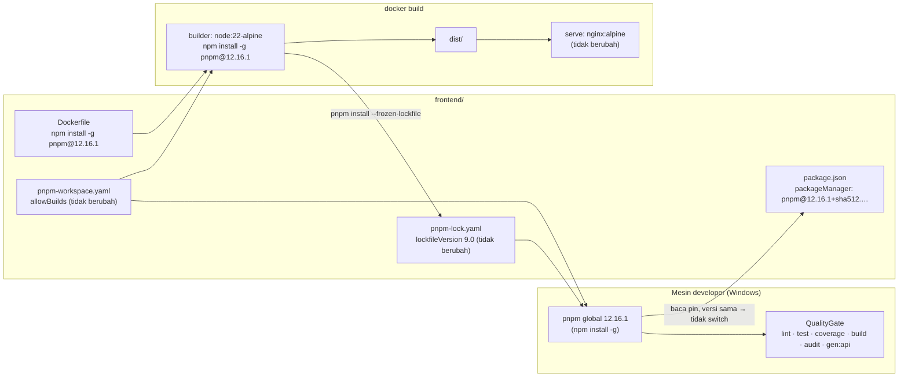

# Design Document

> **Status:** draft 2026-11-03. Requirements disetujui 2026-11-03 (D1-D6 ikut saran Kiro).

## Overview

Upgrade pnpm dari 11.20.0 ke 12.16.1 di CompanyPortal-Vite (CP) dan VendorPortal-Vite (VP). Perubahan hanya di konfigurasi tool dan dokumen. Tidak ada kode aplikasi, dependency aplikasi, atau backend yang berubah.

Ringkasan keputusan:

- **D1:** target pnpm 12.16.1 (`latest` di npm per 2026-11-03). 12.17.0 masih `next-12`, tidak dipakai.
- **D2:** Dockerfile memasang pnpm lewat `npm install -g pnpm@12.16.1`, tanpa corepack.
- **D3:** Lockfile tidak dibuat ulang. Bila install tanpa frozen menghasilkan diff format, diff di-commit di perubahan yang sama. Bila versi resolved berubah, pekerjaan berhenti.
- **D4:** job frontend di CI tidak ditambahkan. Temuannya dicatat di X.3.
- **D5:** dicatat sebagai item cross-cutting X.12 di `development-plan.md`.
- **D6:** developer lain cukup diberi tahu lewat dokumentasi dan changelog.

Pekerjaan dibagi tiga langkah: ambil baseline gate dengan pnpm 11.20.0, ganti pin dan Dockerfile, lalu jalankan ulang gate dan Docker build dengan pnpm 12.16.1 dan bandingkan hasilnya dengan baseline.

## Architecture

pnpm dipakai di dua tempat: mesin developer (Windows, `dev.ps1`, `pnpm dev/test/build`) dan stage `builder` di Dockerfile. CI tidak menjalankan pnpm (D4).



Alur verifikasi:

1. **Baseline (pnpm 11.20.0).** Sebelum file apa pun diubah, jalankan QualityGate di kedua portal dan simpan jumlah test lulus, persentase coverage, dan daftar `nama@versi` dari Lockfile. pnpm global 11.9.0 otomatis pindah ke 11.20.0 karena pin.
2. **Pasang pnpm 12.16.1 global** dengan `npm install -g pnpm@12.16.1`, lalu pastikan `pnpm --version` mencetak 12.16.1 dari folder di luar portal.
3. **Ganti pin dan Dockerfile.**
4. **Verifikasi Lockfile:** `pnpm install --frozen-lockfile`, lalu satu `pnpm install` tanpa frozen untuk melihat apakah ada diff (D3).
5. **QualityGate ulang** dan bandingkan dengan baseline.
6. **Docker build** kedua portal, cek `pnpm --version` di stage builder dan HEALTHCHECK container.
7. **Dokumen.**

## Components and Interfaces

### Tool configuration

#### PackageManagerPin (Req 1)

File: `frontend/CompanyPortal-Vite/package.json` baris 55 dan `frontend/VendorPortal-Vite/package.json` baris 48.

Nilai baru (sama persis di kedua file):

```json
"packageManager": "pnpm@12.16.1+sha512.091d1dee7927575661b25dab3c2ae31cafc1c54d6b71ed6a6600cf0c1cb10434a447eae14015f1b23e2e6bedeed79df94a932e2164d2832280dce3fb32f656d1"
```

Hex diambil dari `dist.integrity` `pnpm@12.16.1` di registry npm (base64 `sha512-CR0d7nknV1Zh…`, diubah ke hex). Saat implementasi, hex dihitung ulang dari registry dan dibandingkan dengan nilai di atas sebelum ditulis. Versi exact, bukan range atau tag (Req 1.4).

#### PortalDockerfile (Req 2)

File: `frontend/CompanyPortal-Vite/Dockerfile` dan `frontend/VendorPortal-Vite/Dockerfile`, baris 3.

```dockerfile
# sebelum
RUN corepack enable && corepack install --global pnpm@11.20.0
# sesudah
RUN npm install -g pnpm@12.16.1
```

Baris lain di stage `builder` tidak berubah: `COPY pnpm-lock.yaml package.json pnpm-workspace.yaml ./` (Req 2.2), `RUN pnpm install --frozen-lockfile` sebagai flag tanpa nilai (Req 2.3), dan perintah build. Stage serve (`nginx:alpine`, user `appuser`, HEALTHCHECK, `security-headers.conf`) tidak disentuh (Req 2.6).

Paket npm `pnpm@12` butuh Node.js 18 atau lebih baru. `node:22-alpine` memenuhinya, dan pnpm 12 punya binary Linux musl x64/arm64. pnpm global dan pin sama-sama 12.16.1, jadi pnpm tidak perlu pindah versi saat build. Dengan begitu jalur shim yang menyebabkan `ENOEXEC` tidak terpakai.

Verifikasi `pnpm --version` di builder (Req 2.5) dilakukan dari luar, tanpa mengubah Dockerfile:

```powershell
docker build --target builder -t cp-builder:pnpm12 frontend/CompanyPortal-Vite
docker run --rm cp-builder:pnpm12 pnpm --version   # harus 12.16.1
```

#### Lockfile dan WorkspaceConfig (Req 3)

Tidak ada perubahan yang direncanakan. `pnpm-workspace.yaml` hanya berisi `allowBuilds`, setting yang dikenal pnpm 12 (Req 3.5). Prosedur cek:

1. Sebelum upgrade, simpan daftar kunci di bagian `packages:` Lockfile (format `nama@versi`) ke file sementara di luar repo (`$env:TEMP`).
2. Sesudah upgrade, `pnpm install --frozen-lockfile` harus lolos dan `git diff --exit-code -- pnpm-lock.yaml` harus bersih (Req 3.1).
3. Jalankan satu `pnpm install` tanpa frozen. Bila Lockfile berubah, bandingkan daftar kunci `packages:` dengan snapshot:
   - daftar sama, yang berubah hanya format/peer variant → commit diff di perubahan yang sama (Req 3.3, D3);
   - ada `nama@versi` yang bertambah, hilang, atau berubah → hentikan pekerjaan, kembalikan Lockfile (`git checkout -- pnpm-lock.yaml`), dan lapor ke user (Req 3.4).
4. Cek build script jalan: `pnpm exec biome --version` dan `pnpm exec esbuild --version` (Req 3.6).

Graph dependency kedua portal tidak diketahui punya siklus. Jadi diff yang paling mungkin adalah tidak ada diff sama sekali.

#### QualityGate (Req 4)

Perintah per portal, dijalankan di folder portal:

| # | Perintah | CP | VP |
| --- | --- | --- | --- |
| 1 | `pnpm install --frozen-lockfile` | ✔ | ✔ |
| 2 | `pnpm lint` | ✔ | ✔ |
| 3 | `pnpm test` | ✔ | ✔ |
| 4 | `pnpm run test:coverage` (threshold CP 84/80/80/85, VP 93/84/90/93) | ✔ | ✔ |
| 5 | `pnpm build` (CP termasuk `scripts/check-bundle.mjs`) | ✔ | ✔ |
| 6 | `pnpm audit --prod` → 0 vulnerability | ✔ | ✔ |
| 7 | `pnpm run gen:api` + `pnpm run gen:api:exq`, lalu `git diff --exit-code -- src/lib/api/` | ✔ | — |

Baseline (pnpm 11.20.0) dan hasil sesudah (pnpm 12.16.1) dicatat dalam tabel yang sama di catatan task: exit code, jumlah test lulus/gagal, empat angka coverage. Hasil sesudah harus exit 0 di setiap perintah, jumlah test lulus sama dengan baseline dengan 0 gagal, dan coverage tidak di bawah threshold (Req 4.1-4.5). Diff kosong di `src/lib/api/` memenuhi Req 4.6.

`pnpm audit` di pnpm 12 memakai endpoint audit yang sama dengan pnpm 11. Bila hasilnya berbeda dari baseline, lihat Error Handling.

### Developer tooling

#### DevSetupHint (Req 5)

File: `frontend/dev.ps1` baris 52.

```powershell
# sebelum
Write-Error "pnpm not found on PATH. Install it first: npm install -g pnpm  (or: corepack enable)"
# sesudah
Write-Error "pnpm not found on PATH. Install it first: npm install -g pnpm@12.16.1"
```

Komentar header `dev.ps1` tidak berubah. Panduan pindah versi untuk mesin developer (Req 5.2, 5.3) ditulis di entri lessons-learned (lihat di bawah), bukan di `dev.ps1`:

1. Cek pnpm global: `pnpm --version` dan `where.exe pnpm`.
2. Bila versinya di bawah 11.10.0 (misalnya 11.9.0 di mesin ini), `pnpm self-update` tidak tersedia. Pasang dengan `npm install -g pnpm@12.16.1`.
3. Bila `where.exe pnpm` menunjukkan lebih dari satu lokasi, hapus salinan pnpm lama yang berbasis JavaScript (misalnya di `%AppData%\npm` atau `%LocalAppData%\pnpm`) supaya tidak menutupi pnpm 12.
4. Gejala `ENOEXEC` atau "Failed to switch pnpm": pnpm lama mencoba menjalankan shim pnpm 12. Perbaikannya adalah memasang pnpm 12 global. Cache pnpm tidak perlu dihapus.

Req 5.4 diverifikasi dengan `./dev.ps1 company` dan `./dev.ps1 vendor` setelah pnpm 12.16.1 terpasang: Vite start dan menampilkan URL lokal tanpa error dari pnpm.

### Documentation

#### Dokumen yang diubah (Req 6)

| File | Perubahan | Req |
| --- | --- | --- |
| `.claude/docs/arsitektur-teknologi.md` baris 74 | `pnpm \| 11.20.0` → `pnpm \| 12.16.1` | 6.1 |
| `.kiro/steering/lessons-learned.md` dan `.claude/lessons-learned.md` | Entri baru "pnpm 11 → 12 upgrade" (isi di bawah), teks sama di kedua file. Tiga entri pnpm lama diberi catatan status | 5.2, 5.3, 6.2, 6.3 |
| `.kiro/steering/development-plan.md` | Baris X.12 di tabel cross-cutting. Baris X.3 ditambah temuan "CI tidak punya job frontend" | 6.4, 6.6 |
| `.claude/development-progress.md` | Entri changelog, termasuk satu baris untuk developer lain | 6.5 |

Isi entri lessons-learned baru:

- Setting `pnpm-workspace.yaml` yang tidak dikenal gagal dengan `ERR_PNPM_UNRECOGNIZED_WORKSPACE_SETTINGS` bila proyek mem-pin versi pnpm. Cek semua kunci sebelum ganti pin.
- Lockfile tetap `lockfileVersion: '9.0'`. Graph siklik bisa memicu satu kali diff peer variant pada install yang me-resolve ulang. Commit diff itu di PR upgrade.
- `--frozen-lockfile false` dan `--resolution-only` ditolak. Pakai `--no-frozen-lockfile` dan `pnpm peers check`.
- `ENOEXEC` / "Failed to switch pnpm": pasang pnpm 12 global, jangan hapus cache. `pnpm self-update` ke 12 butuh pnpm 11.10.0 atau lebih baru.
- Dockerfile: `npm install -g pnpm@<exact>`, tanpa corepack.

Catatan status untuk entri pnpm lama (Req 6.3):

| Entri lama | Catatan |
| --- | --- |
| "pnpm major upgrade + Docker: lockfile version mismatch" | Masih berlaku sebagai pola. Koreksi: pnpm 11 di repo ini tetap menulis `lockfileVersion: '9.0'`, bukan `10.0` |
| Kalimat "corepack … can both fail … Use `npm install -g pnpm@<exact-version>`" | Masih berlaku dan sekarang diterapkan di kedua Dockerfile |
| "pnpm 11 Docker builds: must COPY `pnpm-workspace.yaml`" | Masih berlaku di pnpm 12 (`allowBuilds` tetap dibaca dari `pnpm-workspace.yaml`) |

Tidak diubah: `.opencode/opencode.md` (salinan ringkas untuk tool lain, di luar Req 6), spec `.done` yang menyebut pnpm 11.20.0 (arsip historis), `tech.md` (baris pnpm tidak menyebut versi).

## Data Models

Tidak ada tabel baru, kolom baru, atau migrasi. Tidak ada perubahan skema API atau tipe hasil generate.

Satu-satunya "data" yang dijaga adalah Lockfile: himpunan kunci `nama@versi` di bagian `packages:` harus sama sebelum dan sesudah upgrade (Req 3.2).

## Correctness Properties

### Property 1: Pin exact dan identik

*For any* portal P di {CP, VP}, nilai `packageManager` di `package.json` P sama persis dengan `pnpm@12.16.1+sha512.<H>`, dengan H hasil konversi `dist.integrity` `pnpm@12.16.1` dari registry npm ke hex. Nilai itu tidak berisi range (`^`, `~`, `>=`) atau tag.

**Validates: Requirements 1.1, 1.2, 1.4**

### Property 2: Tidak ada sisa versi lama dan corepack

*For any* file F di {`frontend/*/package.json`, `frontend/*/Dockerfile`, `frontend/dev.ps1`}, F tidak memuat string `11.20.0`, dan tidak ada Dockerfile atau DevSetupHint yang memuat `corepack`.

**Validates: Requirements 1.3, 2.1, 5.1**

### Property 3: Dependency resolved tidak berubah

*For any* kunci `nama@versi` K di bagian `packages:` Lockfile portal P sebelum upgrade, K ada di Lockfile P sesudah upgrade, dan sebaliknya. `pnpm install --frozen-lockfile` dengan pnpm 12.16.1 tidak mengubah Lockfile.

**Validates: Requirements 3.1, 3.2, 3.3, 3.4**

### Property 4: Paritas gate kualitas

*For any* portal P dan perintah C di QualityGate P, C selesai dengan exit 0 di bawah pnpm 12.16.1. Jumlah test lulus sama dengan baseline pnpm 11.20.0 dengan 0 gagal, coverage tidak di bawah threshold P, dan `pnpm audit --prod` melaporkan 0 vulnerability.

**Validates: Requirements 4.1, 4.2, 4.3, 4.4, 4.5**

### Property 5: Tipe API generate tidak berubah

*For any* file di `frontend/CompanyPortal-Vite/src/lib/api/`, menjalankan `gen:api` dan `gen:api:exq` dengan pnpm 12.16.1 menghasilkan isi file yang sama byte per byte dengan versi yang di-commit.

**Validates: Requirements 4.6**

### Property 6: Docker build setara

*For any* portal P, `docker build` P selesai tanpa error, `pnpm --version` di stage builder mencetak `12.16.1`, container hasil build mencapai status healthy, dan baris-baris stage serve di Dockerfile P tidak berubah dibanding sebelum upgrade.

**Validates: Requirements 2.2, 2.3, 2.4, 2.5, 2.6, 2.7, 3.5, 3.6**

### Property 7: Dokumen konsisten

*For any* dokumen yang dicatat di tabel "Dokumen yang diubah", versi pnpm yang disebut adalah 12.16.1. Entri upgrade pnpm 12 di `.kiro/steering/lessons-learned.md` dan `.claude/lessons-learned.md` identik teksnya.

**Validates: Requirements 5.2, 5.3, 6.1, 6.2, 6.3, 6.4, 6.5, 6.6**

## Error Handling

| Kegagalan | Penyebab yang mungkin | Tindakan |
| --- | --- | --- |
| `ERR_PNPM_UNRECOGNIZED_WORKSPACE_SETTINGS` | Ada kunci di `pnpm-workspace.yaml` yang tidak dikenal pnpm 12 | Tidak diharapkan (hanya `allowBuilds`). Bila muncul: catat kuncinya, berhenti, dan lapor. Jangan hapus setting tanpa persetujuan |
| `ERR_PNPM_IGNORED_BUILDS` | `pnpm-workspace.yaml` tidak ikut ter-COPY atau `allowBuilds` tidak terbaca | Cek baris COPY Dockerfile (Req 2.2) |
| `ENOEXEC` / "Failed to switch pnpm" di lokal | pnpm global lama mencoba menjalankan shim pnpm 12 | `npm install -g pnpm@12.16.1`, cek `where.exe pnpm` untuk salinan lama |
| `npm install -g pnpm@12.16.1` gagal di Alpine | Binary platform opsional tidak ter-install | Cek log npm. Bila binary musl tidak terpasang, berhenti dan lapor. Jangan kembali ke corepack tanpa keputusan baru (D2) |
| Hash `packageManager` tidak cocok | Hex salah konversi atau salah salin | Hitung ulang dari `npm view pnpm@12.16.1 dist.integrity` |
| Lockfile berubah dengan versi resolved berbeda | pnpm 12 me-resolve ulang ke versi lain | Kembalikan Lockfile, berhenti, lapor (Req 3.4) |
| Jumlah test atau coverage berbeda dari baseline | pnpm 12 mengubah layout `node_modules` sehingga resolusi modul berubah | Bandingkan daftar test yang gagal. Jangan ubah test atau threshold untuk meloloskan gate. Lapor ke user |
| `pnpm audit --prod` melaporkan vulnerability baru | Advisory baru terbit di antara baseline dan run ulang, bukan karena pnpm | Jalankan ulang audit dengan pnpm 11.20.0 untuk memastikan. Bila sama, catat sebagai temuan terpisah, bukan blocker upgrade |

**Rollback:** revert commit upgrade. pnpm global 12.16.1 akan pindah ke versi pin 11.20.0 secara otomatis. Docker build kembali memakai baris corepack lama dari commit sebelumnya.

## Testing Strategy

Tidak ada kode aplikasi yang berubah, jadi tidak ada unit test atau property test baru. Correctness Properties diverifikasi dengan pemeriksaan sekali jalan saat implementasi, dan hasilnya dicatat di catatan task:

| Property | Cara verifikasi |
| --- | --- |
| 1 | Hitung hex dari registry, bandingkan dengan dua nilai `packageManager` (string equality) |
| 2 | `Select-String` untuk `11.20.0` dan `corepack` di file-file Property 2 → harus kosong |
| 3 | Snapshot kunci `packages:` sebelum/sesudah, `Compare-Object` → kosong. `git diff --exit-code -- pnpm-lock.yaml` setelah install frozen |
| 4 | QualityGate baseline vs sesudah, tabel perbandingan |
| 5 | `git diff --exit-code -- src/lib/api/` setelah `gen:api` + `gen:api:exq` |
| 6 | `docker build` kedua portal, `docker run --rm <builder> pnpm --version`, `docker run -d` lalu `docker inspect --format '{{.State.Health.Status}}'` → `healthy`, `git diff` Dockerfile hanya baris 3 |
| 7 | Review dokumen, `Compare-Object` isi entri di dua file lessons-learned |

Test yang sudah ada (Vitest CP dan VP) dijalankan penuh sebagai bagian Property 4 dan menjadi test regresi. Cek manual: `./dev.ps1 company` dan `./dev.ps1 vendor` di Windows (Req 5.4).

CI GitHub Actions tidak menguji frontend (D4), jadi gate di atas wajib dijalankan lokal dan Docker build wajib dijalankan sebelum commit.

## Files touched

| File | Jenis perubahan |
| --- | --- |
| `frontend/CompanyPortal-Vite/package.json` | 1 baris (`packageManager`) |
| `frontend/VendorPortal-Vite/package.json` | 1 baris (`packageManager`) |
| `frontend/CompanyPortal-Vite/Dockerfile` | 1 baris (install pnpm) |
| `frontend/VendorPortal-Vite/Dockerfile` | 1 baris (install pnpm) |
| `frontend/dev.ps1` | 1 baris (pesan petunjuk) |
| `frontend/*/pnpm-lock.yaml` | Tidak diharapkan berubah. Hanya bila ada diff format sesuai D3 |
| `.claude/docs/arsitektur-teknologi.md` | 1 baris |
| `.kiro/steering/lessons-learned.md`, `.claude/lessons-learned.md` | Entri baru + catatan status entri lama |
| `.kiro/steering/development-plan.md` | Baris X.12 baru + temuan di X.3 |
| `.claude/development-progress.md` | Entri changelog |
