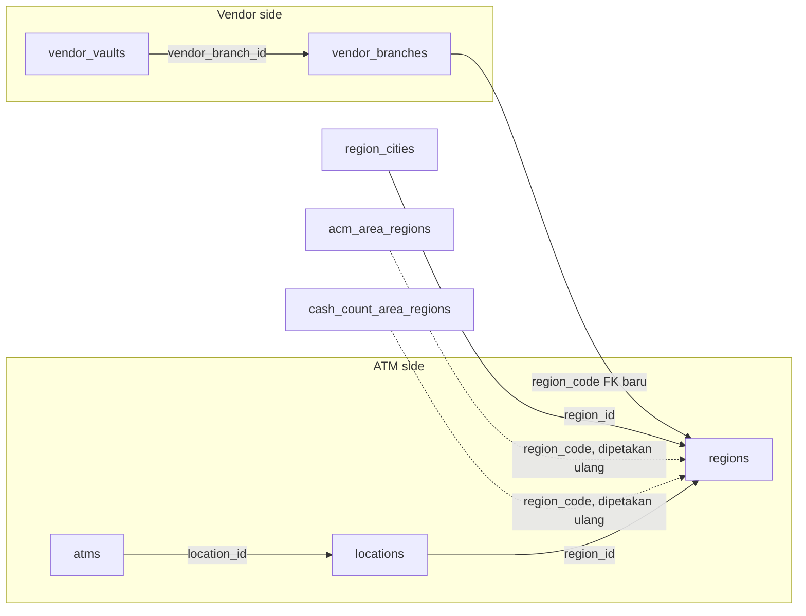

# Design Document — Standarisasi Region

> Status: accepted 2026-11-18 (engineer, "Setuju, lanjut") — termasuk daftar status akhir Vendor Request `completed`, `cancelled`, `failed`.

## Overview

Satu migrasi data (`042_region_standardization.sql`) menjadikan `regions` satu-satunya daftar region untuk ATM dan cabang vendor, sesuai [region-mapping.md](./region-mapping.md) (accepted 2026-11-18):

- 13 baris `regions` di-rename di tempat (kode format cabang, nama ESQ). Tidak ada ATM/lokasi yang berpindah.
- Tabel baru `region_cities` (kota di bawah satu region), diisi 22 kode kota lama.
- `vendor_branches.region_code` diisi ulang dari pemetaan lalu diberi FK ke `regions.code`; kolom teks `vendor_branches.region` di-drop.
- `acm_area_regions`, `cash_count_area_regions`, `cash_count_pics.region_code` dipetakan ulang.

Kode aplikasi mengikuti: halaman Region menampilkan Jumlah ATM + Jumlah Cabang Vendor; disable region juga ditolak bila masih dipakai cabang vendor aktif; submit/apply/CSV cabang vendor hanya menerima region aktif; semua pembaca nama region cabang membaca `regions.region`.

Tidak ada deviasi Golden Rule #3 baru. Region admin tetap memakai deviasi yang sudah ada (Region Management: langsung berlaku + audit dalam tx yang sama). Cabang vendor tetap maker-checker.

## Architecture

Alur migrasi (satu transaksi; file memegang `BEGIN`/`COMMIT` sendiri seperti `040`):

1. **Guard**: hitung Unfinished_Vendor_Request; > 0 → `RAISE EXCEPTION` dengan jumlahnya (Req 5.1).
2. **Peta sementara** (`CREATE TEMP TABLE … ON COMMIT DROP`): `m_region` (id → kode/nama baru), `m_code` (kode cabang lama → kode baru), `m_branch` (override per `branch_code`: 51 cabang tanpa kode, 16 cabang INDTIM Kalimantan, 3 cabang `JKT`), `m_city`.
3. **Guard cakupan**: setiap `vendor_branches.region_code` non-NULL ada di `m_code` atau `m_branch`; setiap cabang aktif ber-kode NULL ada di `m_branch`; setiap kode `acm_area_regions`/`cash_count_*` ada di `m_code`. Gagal → `RAISE EXCEPTION` menyebut nilainya (Req 8.2).
4. **Backup** ke `migration_042_backup` (Req 8.3).
5. Rename `regions` (by id), insert `region_cities`, update `vendor_branches.region_code` (override per cabang dulu, lalu per kode), remap tabel turunan.
6. Tambah FK `vendor_branches_region_code_fk`, drop `vendor_branches.region`.

Runtime setelah migrasi: semua pembaca nama region cabang `LEFT JOIN regions r ON r.code = vb.region_code`; tier vault, Area ACM, dan nomor request memakai kolom yang sama, hanya nilainya yang baru.

## Components and Interfaces

### Backend — migrasi

#### `backend/migrations/042_region_standardization.sql`
- Isi peta = data region-mapping.md A–D sebagai literal `VALUES`, sehingga hasilnya bisa diulang dan diperiksa (Req 8.1).
- Unfinished_Vendor_Request = `vendor_requests.status NOT IN ('completed','cancelled','failed')`. `rejected`/`vendor_rejected` dihitung belum selesai karena masih bisa direvisi. **Engineer konfirmasi daftar status akhir di gate design.**
- `acm_area_regions` punya `UNIQUE (region_code)`: beberapa kode lama → satu kode baru dilebur; bila kode-kode lama itu milik **Area ACM berbeda**, migrasi `RAISE EXCEPTION` (tidak menebak area). Dev: 34 baris, semua "Area ACM Dev" → aman. `cash_count_area_regions` (PK `region_code`) sama. `cash_count_pics.region_code` cukup di-update (0 baris dev).
- `vendor_request_number_seq` tidak disentuh: counter kode lama tidak dipakai lagi, kode baru mulai dari 001.
- Tidak menulis `audit_logs` (perubahan sistem; `audit_logs.actor_id` NOT NULL). Jejak = file migrasi + `schema_migrations` + `migration_042_backup`, sama dengan konvensi S4 import_jobs.
- Header file berisi blok `-- ROLLBACK` seperti `040`, memakai `migration_042_backup`.

#### `backend/scripts/dev/rollback_042_region_standardization.sql`
- Isi = blok ROLLBACK header, dijalankan manual dengan OK user, diakhiri `DELETE FROM schema_migrations WHERE version = '042_region_standardization.sql'`.

### Backend — Region admin (`internal/service/region_admin.go`, handler, queries)

#### Format kode (Req 1.3–1.5)
- `regionCodeRe` dari `^[A-Za-z0-9]+$` (1–20 karakter) menjadi `^[A-Z0-9]{2,10}$` setelah `normalizeRegionCode` — sama dengan `branchRegionCodeRe` (`vendor_branch_admin.go`) dan CHECK `vendor_branches_region_code_chk`, supaya setiap region baru bisa dipakai cabang. Satu pola dipakai bersama; `branchRegionCodeRe` merujuknya.
- Tidak ada CHECK baru di `regions.code`: integration test memakai kode ber-tanda `-` (`ITESTNUM-…`, `IVQP-…`); validasi tetap di service.

#### Hitungan (Req 6)
- `ListRegionsAdmin` / `GetRegionAdminByID`: ganti `COUNT(l.id) AS location_count` (+ `LEFT JOIN locations`, `GROUP BY`) dengan dua subquery:
  - `atm_count` = `SELECT COUNT(*) FROM atms a JOIN locations l ON l.id = a.location_id WHERE l.region_id = r.id AND a.is_active`
  - `vendor_branch_count` = `SELECT COUNT(*) FROM vendor_branches vb WHERE vb.region_code = r.code AND vb.is_active`
- List tetap di replica (`dbRead`), GetByID di primary (dipakai pre-check).
- Handler: field JSON `atm_count`, `vendor_branch_count`; `location_count` dihapus.

#### Disable (Req 7)
- Error baru `ErrRegionHasActiveVendorBranches` ("region still has active vendor branches"); handler 409 `conflict` dengan pesan `"<err>: <jumlah>"`, sama polanya dengan `ErrRegionHasActiveLocations`.
- `setActive(false)` memindahkan kedua pengecekan **ke dalam tx**: `SELECT … FROM regions WHERE id = $1 FOR UPDATE`, lalu hitung lokasi dan cabang aktif lewat query di tx, lalu update + audit (Req 7.3). Sekarang hitungan lokasi dijalankan sebelum `Begin`.

### Backend — Cabang vendor (Req 3, 4)

#### `internal/service/vendor_branch_admin.go`
- Submit create/update: setelah `normalizeBranchRegionCode`, bila kode non-NULL → `FindActiveRegionByCode`; tidak ada → `ValidationError{Field: "region_code", Message: "region tidak dikenal atau nonaktif"}` (422), tidak ada staging.
- Field `Region` dihapus dari payload create/update. JSON `region` dari client lama diabaikan (decoder handler tidak memakai `DisallowUnknownFields` — dicek di task).

#### `internal/service/masterdata_applier_vendor_branch.go`
- Dalam tx apply: `SELECT 1 FROM regions WHERE code = $1 AND is_active FOR SHARE`; tidak ada → applier mengembalikan error baru `ErrVendorBranchRegionInactive`. Jalur yang ada (`MarkApplyFailed`, approve → 409) menangani sisanya. `FOR SHARE` lawan `FOR UPDATE` di disable mencegah race (Property 4).

#### CSV (`masterdata_import_validate.go`, `masterdata_import_confirm.go`, `pkg/csvexport/entities.go`)
- Dry-run: `region_code` non-kosong yang bukan region aktif → error field `region_code` (Req 3.5). `<keep>` tetap diterima.
- Header tidak berubah (`region` tetap ada, juga legacy header); nilai `region` diabaikan saat confirm (Req 4.4).
- Ekspor: `master_data_export.sql` memakai `COALESCE(r.region, '')` lewat `LEFT JOIN regions r ON r.code = b.region_code`.

#### Pembaca nama region (Req 4.2–4.3)
- `vendor_request.sql`: `flm_vendor_region` = `r.region`; filter `LOWER(r.region) = LOWER(@flm_vendor_region)`; `no_region` = `vb.region_code IS NULL`; `ListDistinctVendorBranchRegions` = `SELECT DISTINCT r.region FROM vendor_branches vb JOIN regions r ON r.code = vb.region_code WHERE vb.is_active ORDER BY 1`.
- `vendor_vaults_admin.sql`: `r.region` sebagai kolom `region`.
- Drop kolom membuat `sqlc generate` gagal untuk pembaca yang terlewat, jadi semuanya ketahuan saat build.
- `backend-exq` dan `backend_python`: tidak membaca `vendor_branches.region` (dicek 2026-11-18); tidak berubah.

### Frontend — CompanyPortal

#### `features/admin-regions`
- `types.ts`: `location_count` → `atm_count`, `vendor_branch_count`.
- `RegionsTable.tsx`: kolom "Jumlah ATM" dan "Jumlah Cabang Vendor", rata kanan, `tabular-nums` (Req 6.2–6.3).
- Pesan error 409 cabang vendor aktif ditampilkan apa adanya (sama dengan kasus lokasi).

#### `features/admin-vendors`
- `VendorBranchFormDialog.tsx`, `VendorBranchEditPage.tsx`, `vendorBranchFormSchema.ts`: input teks "Wilayah" dihapus; "Kode Region" menjadi select dari `GET /api/v1/admin/regions?status=active&page_size=100` (label `kode — nama`). Kosong tetap boleh (NULL).
- `BranchesPanel.tsx`, `VaultsPanel.tsx`: tetap membaca field `region` dari API (isinya kini nama region baku).

#### `features/vendor-request`
- Tidak ada perubahan kontrak (`flm_vendor_region`, `regions[]` tetap string); hanya nilainya.

### API contract
- `/admin/regions*` dan `/admin/vendors/{id}/branches*` belum ada di `backend/api/openapi.yaml`; tidak ditambah di fitur ini. `/vendor-requests/forecast*` dan `/vendor-requests/vendors` tidak berubah bentuk, jadi contract test tetap hijau.

## Data Models

### Tabel baru `region_cities` (Req 2)

| Kolom | Tipe | Catatan |
|---|---|---|
| `id` | bigint identity PK | |
| `code` | text NOT NULL UNIQUE | CHECK `^[A-Z0-9]{2,10}$` |
| `name` | text NOT NULL | CHECK `btrim(name) <> ''` |
| `region_id` | bigint NOT NULL | FK → `regions(id)` ON DELETE RESTRICT |
| `is_active` | boolean NOT NULL DEFAULT true | |
| `created_at`, `updated_at` | timestamptz NOT NULL DEFAULT now() | trigger `set_updated_at` |
| `deleted_at` | timestamptz NULL | soft-delete, pola master data |

Index `region_cities_region_idx (region_id)`. Seed 22 baris dari region-mapping.md B: ACEH, AMBON, BALI, BJM, BPN, JAMBI, JEMBER, KDI, KUPANG, LAMPUNG, MADIUN, MDN, MDO, MKS, MTR, PGK, PKU, PKY, PLG, PNK, SMD, TNJ. Tanpa layar/API/CSV (Req 2.4).

### `vendor_branches`
- `region_code`: nilai dari pemetaan; constraint baru `vendor_branches_region_code_fk FOREIGN KEY (region_code) REFERENCES regions(code) ON UPDATE RESTRICT ON DELETE RESTRICT` (Req 3.1). CHECK `vendor_branches_region_code_chk` tetap.
- `region`: **DROP COLUMN** (Req 4.1).

### `regions`
- 13 baris: `code`/`region` diubah per region-mapping.md A. Tidak ada kolom baru.

### Tabel turunan
- `acm_area_regions.region_code`, `cash_count_area_regions.region_code`, `cash_count_pics.region_code`: nilai dipetakan ulang, constraint tidak berubah. FK ke `regions.code` untuk tabel ini **tidak** ditambah (layar Area ACM / cash count masih menerima teks); follow-up terpisah bila diinginkan.

### Tabel sementara `migration_042_backup` (Req 8.3)
- `(entity text, entity_id bigint, payload jsonb, PRIMARY KEY (entity, entity_id))`; entity ∈ `regions`, `vendor_branches` (`region`, `region_code`), `acm_area_regions`, `cash_count_area_regions`, `cash_count_pics`.
- Dibuang oleh migrasi berikutnya setelah rilis dikonfirmasi; dicatat di `docs/data-map.md` sebagai sementara.

## Correctness Properties

### Property 1: ATM tidak berpindah region
*For any* `atms` row, its `locations.region_id` after the Region_Migration equals the value before it.
**Validates: Requirements 1.1**

### Property 2: Cabang vendor hanya merujuk region yang ada
*For any* `vendor_branches` row with non-NULL `region_code`, a `regions` row with that `code` exists, after the migration and after any later insert/update.
**Validates: Requirements 3.1, 3.2**

### Property 3: Submit cabang hanya menerima region aktif
*For any* vendor branch create/update submit whose normalized `region_code` is non-NULL and not the code of an active region, no `master_data_change_requests` row is created and the response is 422 on `region_code`.
**Validates: Requirements 3.3, 3.5**

### Property 4: Tidak ada cabang aktif masuk region nonaktif lewat race
*For any* interleaving of a region disable and a vendor branch apply targeting that region, either the disable is rejected (409) or the apply fails (409); never both succeed.
**Validates: Requirements 3.4, 7.2, 7.3**

### Property 5: Hitungan sesuai definisi
*For any* region, `atm_count` = number of active ATMs whose location has that `region_id`, and `vendor_branch_count` = number of active vendor branches with that `region_code`.
**Validates: Requirements 6.1**

### Property 6: Disable ditolak selama masih dipakai
*For any* region with ≥1 `locations` row or ≥1 active vendor branch, disable returns 409 and writes no audit entry.
**Validates: Requirements 7.1, 7.2**

### Property 7: Migrasi semua-atau-tidak
*For any* database state where a guard fails (unfinished request, uncovered code, Area ACM conflict), after the run the schema and data equal the state before it and `schema_migrations` has no `042` row.
**Validates: Requirements 5.1, 8.1, 8.2**

### Property 8: Satu sumber nama
*For any* vendor branch shown in the Vendor Request recommendation, the vault admin list, or the master-data CSV export, the region name equals `regions.region` of its `region_code` (empty when NULL).
**Validates: Requirements 4.2, 4.3, 4.4**

### Property 9: Riwayat tidak ditulis ulang
*For any* finished Vendor Request, its `request_number`, ticket numbers, and `region_code` snapshot are unchanged by the migration.
**Validates: Requirements 5.4**

## Error Handling

| Kasus | Respon |
|---|---|
| Migrasi: ada Unfinished_Vendor_Request | `RAISE EXCEPTION` dengan jumlahnya; tx rollback; `migrate up` berhenti |
| Migrasi: kode tidak tercakup peta / konflik Area ACM | `RAISE EXCEPTION` menyebut nilainya; rollback |
| Create region, kode tidak cocok format | 422 `code` |
| Disable region, masih ada lokasi | 409 `conflict` (tetap) |
| Disable region, masih ada cabang aktif | 409 `conflict`, pesan `region still has active vendor branches: N` (baru) |
| Submit cabang, region tidak dikenal/nonaktif | 422 `region_code` |
| Apply cabang, region di-disable setelah submit | `ErrVendorBranchRegionInactive` → `MarkApplyFailed` → approve 409; change tidak diterapkan |
| CSV dry-run, region tidak dikenal/nonaktif | error baris, field `region_code` |
| FK dilanggar dari jalur lain (seharusnya tidak terjadi) | error DB 23503 lewat mapper yang ada; tercatat di log |

## Testing Strategy

- **Migrasi (integration, `//go:build integration`, skip tanpa `DATABASE_URL`)**: DB uji dibangun `migrate up`; fixture kecil (region lama, cabang lama, request selesai) → jalankan 042 → cek Property 1, 2, 8, 9. Guard: fixture dengan request belum selesai / kode tak tercakup → migrasi gagal, data utuh (Property 7). CI `go-integration` membangun DB lewat `migrate up`, jadi 042 ikut teruji.
- **Fixture integration test yang ada**: test yang menulis `vendor_branches.region`, atau `region_code` tanpa region yang cocok, harus diubah — insert region dengan kode yang dipakai cabang, tanpa kolom `region`. Diketahui: `vendor_request_number_integration_test.go` (`region_code 'ITEST'`), `forecast_query_integration_test.go`, `vendor_request_cit2_filter_integration_test.go`, `atm_visit_quota_integration_test.go`, `vendor_request_summary_integration_test.go`; daftar lengkap dicari di task.
- **Service unit (table-driven, repo palsu)**: format kode region; disable dua alasan, pengecekan di dalam tx; submit cabang dengan region aktif/nonaktif/tidak ada/NULL; applier region nonaktif.
- **Handler**: JSON `atm_count`/`vendor_branch_count` tanpa `location_count`; 409 cabang aktif; RBAC denial tetap.
- **Repo integration**: hitungan aktif saja (ATM/cabang nonaktif tidak dihitung) — Property 5.
- **Frontend (vitest)**: RegionsTable kolom baru; VendorBranchFormDialog select region tanpa input Wilayah; pesan 409.
- **Gate**: `go test ./...` (backend, pkg), `golangci-lint run --build-tags integration ./...`, `go test ./internal/handler -run OpenAPI`, `pnpm --dir frontend/CompanyPortal-Vite run test|lint|build`. Cek browser manual = outstanding (user).

## Files touched

- `backend/migrations/042_region_standardization.sql` (baru), `backend/scripts/dev/rollback_042_region_standardization.sql` (baru)
- `backend/queries/regions_admin.sql`, `vendor_branches_admin.sql`, `vendor_request.sql`, `vendor_vaults_admin.sql`, `master_data_export.sql` → `sqlc generate` (+ fix `UserLeafe`)
- `backend/internal/service/region_admin.go`, `vendor_branch_admin.go`, `masterdata_applier_vendor_branch.go`, `masterdata_import_validate.go`, `masterdata_import_confirm.go` (+ test)
- `backend/internal/repository/region_admin_repository.go`, repo cabang vendor (+ test)
- `backend/internal/handler/admin_region_handler.go` (+ test)
- Fixture integration test di `backend/internal/service/*_integration_test.go`
- `pkg/csvexport/entities.go` (komentar saja bila perlu)
- `frontend/CompanyPortal-Vite/src/features/admin-regions/*`, `features/admin-vendors/*` (+ test)
- Docs: CLAUDE.md Sec 3 (`region_cities`, FK, drop `vendor_branches.region`, migrasi 042), `.claude/docs/data-map.md`, `.claude/docs/decisions.md`

## Dev rollout (urutan; tiap langkah butuh OK user)

1. Bug fix terpisah: hapus sisa data uji `ITESTNUM` di dev (tidak memblokir migrasi, tapi angka halaman Region jadi bersih).
2. Clear 10 Unfinished_Vendor_Request di dev (Q7); daftar ditunjukkan dulu.
3. `go run ./cmd/migrate status` → `up` (042).
4. Cek: `SELECT code, region FROM regions`, jumlah cabang aktif tanpa kode = 0, FK ada.
