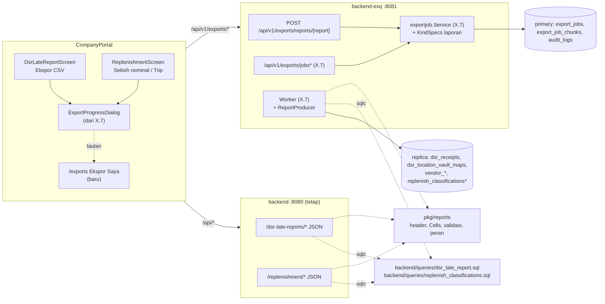

# Design Document: Report Export Migration

## Overview

Spec ini memindahkan empat CSV laporan dari `backend/` ke `backend-exq` dan menjalankannya lewat mekanisme `export_jobs` milik spec `vendor-data-export` (X.7). Tidak ada mekanisme job, worker, janitor, atau penyimpanan baru: spec ini hanya menambah empat Export_Kind, satu paket kontrak laporan di `pkg/`, satu migrasi kecil, dan mengganti tombol ekspor di dua layar laporan.

| Topik | Keputusan | Sumber |
| --- | --- | --- |
| Yang dipindah | Hanya CSV. Layar JSON laporan tetap di `backend/`. | D1, Req 9.1 |
| Cara proses | Asinkron lewat `export_jobs` (pop-up, unduh otomatis sekali, hapus setelah unduh, kedaluwarsa 10 menit). | D2, Req 6.1 |
| SQL | `backend/queries/dsr_late_report.sql` dan `backend/queries/replenish_classifications.sql` di-generate sqlc juga di `backend-exq` (path lintas modul, pola `vendor-data-export`). Tidak ada salinan SQL laporan. | Req 3.4 |
| Format sel + validasi + peran | Paket baru `pkg/reports`: header, `Cells`, validasi parameter, daftar peran viewer, `ParseDsrLateStartDate`. Dipakai `backend/` (layar) dan `backend-exq` (CSV). | Req 1.2, 1.6, 2.2, 3.5, 4.1 |
| BOM | Ditambah (satu-satunya beda dengan file lama). | D3, Req 3.1 |
| Ekspor Saya untuk peran laporan | Halaman baru `/exports` (daftar + unduh manual), tanpa sidebar. | D4, Req 7.5 |
| Audit unduh | Tetap `report_exported` dengan `entity_type` lama; permintaan `export_requested`. | D5, Req 5 |
| Peran | Sama dengan peran melihat laporan hari ini. | D6, Req 4 |
| `DSR_LATE_START_DATE` | Env di `backend-exq`, nilai sama dengan `backend/` dan Python. | D7, Req 1.5, 1.6 |
| Urutan | Setelah X.7 di-deploy. Otorisasi per Kind (`KindSpecs`) sudah masuk design X.7 (D9 = D23 di X.7). | D8, D9 |
| Parameter laporan | Kolom `report_params jsonb` di `export_jobs`. | D10, Req 6.2, 6.3 |

Prinsip: file harus sama dengan export lama dan dengan layar. Dua hal menjamin itu: SQL yang sama (sqlc di dua modul) dan fungsi `Cells` yang sama (`pkg/reports`), lalu dibuktikan oleh golden yang direkam dari kode lama sebelum dipindah.

## Architecture



Alur permintaan, proses, dan unduh identik dengan diagram sequence di design `vendor-data-export`; yang berbeda hanya endpoint permintaan, producer, dan action audit saat unduh.

| Operasi | Pool | Catatan |
| --- | --- | --- |
| Validasi parameter laporan | tanpa DB | `pkg/reports` |
| Insert job + `export_requested` | primary | X.7 |
| Query laporan untuk CSV | replica, `REPEATABLE READ READ ONLY` | Req 6.4; `as_of` = waktu job mulai |
| Unduh + `report_exported` | primary | X.7 |

## Components and Interfaces

### pkg/reports - Req 1.2, 1.3, 1.6, 2.2, 2.3, 3.1, 3.5, 3.6, 4.1

Paket baru, kode murni, hanya stdlib + `pkg/csvexport` (untuk `CSVSafe`, BOM, `Writer`). Isinya dipindah dari `backend/internal/handler/{dsr_late_report,replenishment}_handler.go` dan `backend/internal/service/{dsr_late_report,replenishment_read}.go`.

```go
package reports

const (
    DsrLateDaily                = "dsr_late_daily"
    DsrLateSummary              = "dsr_late_summary"
    ReplenishmentAmountMismatch = "replenishment_amount_mismatch"
    ReplenishmentTrips          = "replenishment_trips"

    ReplenishmentMaxRangeDays = 31
    ReplenishmentExportLimit  = 100000
)

var DsrLateViewerRoles       = []string{"ATM-USER", "ATM-SPV", "BRANCH-ATM-SPV", "ADMIN"}
var ReplenishmentViewerRoles = []string{"ADMIN", "ATM-USER", "ATM-SPV", "BRANCH-ATM-USER", "BRANCH-ATM-SPV"}
var DsrLateStatuses          = map[string]bool{"ok": true, "late": true, "not_sent": true, "pending": true}
var ReplenishmentClasses     = map[string]bool{ /* pending..void, sama dengan sekarang */ }

var WIB = time.FixedZone("WIB", 7*60*60)

func ParseDsrLateStartDate(raw string) (*time.Time, error)          // kosong = nil, salah = error
func ParseDsrLateMonth(raw string) (time.Time, error)               // wajib, YYYY-MM
func ValidateDsrLateMonth(month, now time.Time) error               // tidak setelah bulan berjalan WIB
func ValidateReplenishmentRange(from, to time.Time) error           // wajib, from <= to, <= 31 hari

// Baris netral (dipetakan dari baris sqlc di tiap modul, atau dari view JSON di backend/).
type DsrLateDailyRow struct {
    ReportDate, VendorCode, VendorName, BranchCode, BranchName string
    RegionCode *string; Deadline time.Time; FirstReceivedAt *time.Time
    Status string; LateMinutes int32; ReceiptChecksum string; MatchedLabels []string
}
type DsrLateSummaryRow struct { /* kolom summary */ }
type AmountMismatchRow struct { /* satu klasifikasi + []Amount{Denom, Order, Itm int64; Vendor *int64; Diff int64} + Currency */ }
type TripRow struct { VendorID *int64; VendorName *string; TerminalID string; Trips int64; FirstDate, LastDate *time.Time }

func Header(report string) []string                                    // header lama, urutan sama
func DsrLateDailyCells(r DsrLateDailyRow) []string                      // wibCell, join "; "
func DsrLateSummaryCells(r DsrLateSummaryRow) []string
func AmountMismatchLines(r AmountMismatchRow) [][]string                // satu baris per denom
func TripCells(r TripRow) []string
func FileName(report string, month time.Time, from, to time.Time) string  // nama lama
```

`str`, `int64Cell`, `intCell`, `dateCell`, `wibCell`, `itoa` ikut pindah dan menjadi privat di paket ini. `wibCell` memanggil `t.In(WIB)` sebelum format, sehingga hasilnya sama baik input sudah WIB (layar) maupun UTC (baris sqlc).

### backend/ (perubahan) - Req 4.1, 8, 9.1

| Bagian | Perubahan |
| --- | --- |
| `internal/service/dsr_late_report.go` | Konstanta peran, status, `ParseDsrLateStartDate`, `ParseDsrLateMonth`, validasi bulan memakai `pkg/reports`. `DailyAll`, `RecordExport` dihapus (setelah cutover). |
| `internal/service/replenishment_read.go` | Peran, kelas, rentang, batas memakai `pkg/reports`. `RecordExport` dihapus. `AmountMismatch` dan `Trips` tetap untuk respons JSON. |
| `internal/handler/dsr_late_report_handler.go`, `replenishment_handler.go` | Cabang `format=csv` diganti 400 `validation_error` field `format` dengan pesan "Ekspor CSV dipindah ke menu ekspor (POST /api/v1/exports/reports/...)". `writeCSV` dan helper sel dihapus. Respons JSON tidak berubah. |
| `cmd/api/main.go` | `ParseDsrLateStartDate` dari `pkg/reports`. |
| `api/openapi.yaml` | Hapus parameter `DsrLateFormat` dan respons `text/csv` di `/dsr-late-reports/{daily,summary}`; `pnpm run gen:api` ulang. |

Test `backend/` yang menguji isi CSV lama dipindah menjadi golden (task pertama) dan test "layar = file" (Property 2).

### backend-exq (perubahan di atas X.7) - Req 1, 2, 4, 5, 6

#### sqlc

`backend-exq/sqlc.yaml` `queries` ditambah `../backend/queries/dsr_late_report.sql` dan `../backend/queries/replenish_classifications.sql`. Query lain di file yang sama (layar, warnings, summary dashboard) ikut ter-generate di `backend-exq` tetapi tidak dipakai. CI job `sqlc` X.7 sudah memeriksa kedua modul.

#### KindSpecs laporan (Req 4.1, 4.4, 5.2, 5.3)

```go
KindDsrLateDaily:                {Roles: reports.DsrLateViewerRoles,       DownloadAction: "report_exported", EntityRef: fixed("dsr_late_report")},
KindDsrLateSummary:              {Roles: reports.DsrLateViewerRoles,       DownloadAction: "report_exported", EntityRef: fixed("dsr_late_report")},
KindReplenishmentAmountMismatch: {Roles: reports.ReplenishmentViewerRoles, DownloadAction: "report_exported", EntityRef: fixed("replenishment_report")},
KindReplenishmentTrips:          {Roles: reports.ReplenishmentViewerRoles, DownloadAction: "report_exported", EntityRef: fixed("replenishment_report")},
```

`fixed(t)` mengembalikan `(t, 0)`. Kind master data tetap `ADMIN`/`ADMIN_PARAM` (Req 4.3). Service, janitor, dan handler `/jobs*` X.7 tidak berubah; mereka membaca `KindSpecs`.

Audit `after` untuk laporan (kedua action):

```json
{
  "export_job_id": 88, "export_kind": "dsr_late_daily", "report": "daily",
  "filter": {"month": "2026-10", "vendor_id": 7, "vendor_branch_id": null, "status": "late"},
  "username": "atm.spv", "role": "ATM-SPV",
  "row_count": 412
}
```

`report` memakai nilai lama (`daily`, `summary`, `amount_mismatch`, `trips`) dan `filter` memakai kunci lama ditambah `status` (daily) dan `classification` (amount-mismatch) yang hari ini tidak tercatat (Req 5.4). `row_count` hanya di `report_exported`.

#### Params laporan (Req 1.2, 1.3, 2.2, 2.3, 6.2)

`exportjob.Params` mendapat `Report *ReportParams`:

```go
type ReportParams struct {
    Month          *string `json:"month,omitempty"`          // YYYY-MM (DSR)
    DateFrom       *string `json:"date_from,omitempty"`      // YYYY-MM-DD (replenishment)
    DateTo         *string `json:"date_to,omitempty"`
    VendorID       *int64  `json:"vendor_id,omitempty"`
    VendorBranchID *int64  `json:"vendor_branch_id,omitempty"` // DSR
    RegionCode     *string `json:"region_code,omitempty"`      // replenishment
    Status         *string `json:"status,omitempty"`           // DSR daily
    Classification *string `json:"classification,omitempty"`   // amount-mismatch
}
```

`ParseReportParams(kind, query, now)` memakai validator `pkg/reports`; parameter yang tidak berlaku untuk Kind tersebut (mis. `status` pada summary) diabaikan seperti sekarang. `ParamsHash` memakai JSON kanonis (kunci terurut) dari `ReportParams`, sehingga permintaan identik terdeteksi (dedupe X.7). `entity` di `export_jobs` = nilai `report` lama. `vendor_id`/`vendor_branch_id` kolom job tetap NULL untuk laporan; filter vendor hanya di `report_params`.
#### ReportProducer (Req 1.4, 1.5, 2.4, 2.5, 3.1-3.3, 3.6, 6.4)

Implementasi `exportjob.Producer` X.7, dijalankan worker di dalam tx replica `REPEATABLE READ READ ONLY`. `asOf` = waktu job mulai (dipakai DSR untuk status `pending`). Header dari `reports.Header`, setiap sel lewat `csvexport.Writer` (BOM + `CSVSafe`, D3).

| Kind | Query (SQL bersama) | Paging | Catatan |
| --- | --- | --- | --- |
| `dsr_late_daily` | `ListDsrLateDaily` | `page_limit` 1000 + `page_offset` di dalam snapshot; urutan `report_date, vd.name, branch_code, b.id` sudah deterministik | `DSR_LATE_START_DATE` kosong = header saja tanpa query (Req 1.5) |
| `dsr_late_summary` | `ListDsrLateSummary` | satu query (satu baris per cabang) | sama |
| `replenishment_amount_mismatch` | `ListReplenishClassifications` (`only_diff`, `final_only` = true) + `ListReplenishClassificationAmounts(ids)` | halaman 1000 klasifikasi, total maksimal `ReportExportLimit` 100.000; urutan `report_date, terminal_id, id` | satu baris per denom (`AmountMismatchLines`) |
| `replenishment_trips` | `ReportReplenishTrips` | satu query (≤ satu baris per vendor × terminal dalam 31 hari) | `region_code` diterima dan dicatat di audit tetapi tidak diterapkan, sama dengan sekarang |

Karena semua halaman dibaca dari satu snapshot, paging `OFFSET` menghasilkan baris yang sama dengan query tanpa paging di kode lama. Batas file X.7 (100 MiB / 1.000.000 baris) tetap berlaku; amount-mismatch maksimal 100.000 klasifikasi × denom.

`backend-exq/cmd/api/main.go` membaca `DSR_LATE_START_DATE` lewat `reports.ParseDsrLateStartDate` (salah format = gagal start) dan meneruskannya ke producer DSR (Req 1.6). `.env.example` `backend`, `backend-exq`, dan `backend_python` diberi komentar bahwa nilainya harus sama (D7).

#### ReportExportAPI (Req 1.1, 2.1, 4.1, 4.2)

Ditambahkan ke router `/api/v1/exports` X.7, timeout 30 detik, respons `pkg/response`.

| Method | Path | Query | Guard route | Sukses |
| --- | --- | --- | --- | --- |
| POST | `/reports/dsr-late-daily` | `month`, `vendor_id`, `vendor_branch_id`, `status` | `RequireRoles(reports.DsrLateViewerRoles...)` | 202 / 200 |
| POST | `/reports/dsr-late-summary` | `month`, `vendor_id`, `vendor_branch_id` | sama | 202 / 200 |
| POST | `/reports/replenishment-amount-mismatch` | `date_from`, `date_to`, `vendor_id`, `region_code`, `classification` | `RequireRoles(reports.ReplenishmentViewerRoles...)` | 202 / 200 |
| POST | `/reports/replenishment-trips` | `date_from`, `date_to`, `vendor_id`, `region_code` | sama | 202 / 200 |

Error memakai pemetaan X.7 (400 validasi, 403, 429, 500). `/jobs`, `/jobs/{id}`, `/jobs/{id}/file` X.7 dipakai apa adanya: `RequireAuth` + kepemilikan + `KindSpecs[job.Kind].Roles` dibaca dari DB saat unduh (Req 4.4, 4.5).

#### OpenAPI (Req 8.3, 8.4)

- `backend-exq/api/openapi.yaml`: empat path `/exports/reports/*`, skema `ExportJob.kind` diperluas, `ExportJob.report_params` (object, nullable). Test kontrak X.7 otomatis mencakup route baru.
- `backend/api/openapi.yaml`: hapus `format` + `text/csv` dari `/dsr-late-reports/{daily,summary}`; `schema.d.ts` dan `exq-schema.d.ts` di-generate ulang.

### Frontend CompanyPortal - Req 7, 8.5

| File | Perubahan |
| --- | --- |
| `src/features/exports/api.ts` | `requestReportExport(report, params)` -> `POST /exports/reports/{report}?...` |
| `src/features/exports/hooks.ts` | `useExportFlow().request` menerima varian `{ kind: "report", report, params }` |
| `src/features/exports/status.ts` | label jenis untuk empat Kind laporan ("DSR telat (harian)", "DSR telat (rekap)", "Selisih nominal", "Trip per ATM") |
| `src/features/exports/components/ExportProgressDialog.tsx` | tautan "Lihat Ekspor Saya" menuju `/exports` untuk semua peran |
| `src/features/exports/components/MyExportsPage.tsx` (baru) | halaman Ekspor Saya: `MyExportsTable` X.7 tanpa form; "Minta ekspor lagi" memanggil permintaan dengan parameter job (termasuk `report_params`) |
| `src/routes/exports.tsx` (baru) | lazy route `/exports`, `requireRoles([...DsrLateViewerRoles, ...ReplenishmentViewerRoles])` (ADMIN/ADMIN_PARAM lolos lewat bypass yang ada); tanpa item `NAV_CONFIG` (D4) |
| `src/features/dsr-late-report/api.ts`, `components/DsrLateReportScreen.tsx` | `downloadReport` (fetch mentah) dihapus; tombol "Ekspor CSV" memanggil `useExportFlow` dengan filter layar (status hanya tab detail) + tautan Ekspor Saya |
| `src/features/replenishment/api.ts`, `components/ReplenishmentScreen.tsx` | sama untuk dua tombol; tetap nonaktif selama rentang tidak valid (Req 7.6) |

429 ditampilkan inline (ikon + teks) tanpa membuka dialog, memakai komponen pesan yang sama dengan halaman Export Data X.7 (Req 7.4). Perilaku dialog sepenuhnya dari X.7 (Req 7.3).

## Data Models

### Migrasi `035_export_jobs_reports.sql` - Req 6.2, 6.3

Nomor `035` mengasumsikan `034_export_jobs.sql` (X.7) sudah ada; dicek ulang saat implementasi. Aditif: menambah satu kolom nullable dan mengganti constraint dengan versi yang lebih longgar untuk Kind baru, tetap ketat untuk Kind lama. Baris X.7 yang ada tetap lolos constraint baru.

```sql
BEGIN;

ALTER TABLE public.export_jobs ADD COLUMN report_params jsonb;

ALTER TABLE public.export_jobs DROP CONSTRAINT export_jobs_kind_chk;
ALTER TABLE public.export_jobs ADD CONSTRAINT export_jobs_kind_chk CHECK (kind IN (
    'vendor', 'cabang', 'harga_paket', 'master_data_global',
    'dsr_late_daily', 'dsr_late_summary', 'replenishment_amount_mismatch', 'replenishment_trips'));

-- status_filter hanya untuk Kind master data; report_params hanya untuk Kind laporan.
ALTER TABLE public.export_jobs ALTER COLUMN status_filter DROP NOT NULL;
ALTER TABLE public.export_jobs ADD CONSTRAINT export_jobs_params_kind_chk CHECK (
       (kind IN ('vendor', 'cabang', 'harga_paket', 'master_data_global')
        AND status_filter IS NOT NULL AND report_params IS NULL)
    OR (kind IN ('dsr_late_daily', 'dsr_late_summary', 'replenishment_amount_mismatch', 'replenishment_trips')
        AND status_filter IS NULL AND report_params IS NOT NULL AND jsonb_typeof(report_params) = 'object'));

ALTER TABLE public.export_jobs DROP CONSTRAINT export_jobs_scope_chk;
ALTER TABLE public.export_jobs ADD CONSTRAINT export_jobs_scope_chk CHECK (
       (kind = 'master_data_global' AND vendor_id IS NULL     AND vendor_branch_id IS NULL)
    OR (kind = 'vendor'             AND vendor_id IS NOT NULL AND vendor_branch_id IS NULL)
    OR (kind = 'cabang'             AND vendor_id IS NOT NULL AND vendor_branch_id IS NOT NULL)
    OR (kind = 'harga_paket'        AND vendor_id IS NOT NULL)
    OR (kind IN ('dsr_late_daily', 'dsr_late_summary', 'replenishment_amount_mismatch', 'replenishment_trips')
        AND vendor_id IS NULL AND vendor_branch_id IS NULL));

COMMENT ON COLUMN public.export_jobs.report_params IS
    'Filter laporan (month | date_from,date_to, vendor_id, vendor_branch_id, region_code, status, classification) untuk Kind laporan; NULL untuk Kind master data. Migrasi 035.';

COMMIT;
```

`export_jobs_price_level_kind_chk` X.7 tidak berubah (laporan tidak punya `price_level`). Dicatat di `.claude/CLAUDE.md` Sec 3 dan `data-map.md`.

### CSV laporan

Kolom, urutan, dan nama file sama dengan Legacy_Report_CSV (lihat requirements, "Kondisi kode saat ini"). Satu-satunya beda: file diawali BOM UTF-8 (D3).
## Correctness Properties

*A property is a characteristic or behavior that should hold true across all valid executions of a system: a formal statement about what the system should do. Properties are the bridge between human-readable specifications and machine-verifiable correctness guarantees.*

### Property 1: File sama dengan export lama

*For any* fixture data laporan, `as_of` tetap, dan parameter sah untuk setiap Report_Kind, isi Export_File setelah BOM dibuang sama byte demi byte dengan Legacy_Report_CSV (golden yang direkam dari handler lama sebelum dipindah), dan nama file sama.

**Validates: Requirements 1.4, 2.4, 2.5, 3.1, 3.2, 3.3, 3.6**

### Property 2: Layar sama dengan file

*For any* fixture data dan parameter sah, baris yang dikembalikan endpoint JSON `backend/` (`/dsr-late-reports/daily` semua halaman, `/summary`, `/replenishment/reports/{amount-mismatch,trips}`), setelah dipetakan dengan `pkg/reports` `Cells`, sama dengan baris data Export_File untuk parameter dan `as_of` yang sama.

**Validates: Requirements 3.4, 3.5, 9.1**

### Property 3: Validasi parameter setara

*For any* string acak untuk `month`, `date_from`, `date_to`, `status`, `classification`, `vendor_id`, `vendor_branch_id`, dan jam `now` acak, ReportExportAPI menerima tepat parameter yang diterima endpoint laporan `backend/`; yang ditolak menghasilkan 400 tanpa Export_Job dan tanpa audit.

**Validates: Requirements 1.2, 1.3, 2.2, 2.3**

### Property 4: Matriks peran

*For any* peran dari 14 peran sistem dan *for any* Export_Kind (empat laporan + empat master data), permintaan diterima tepat bila peran ada di `KindSpecs[kind].Roles`; selain itu 403 tanpa job dan audit. Kind master data tetap hanya ADMIN/ADMIN_PARAM.

**Validates: Requirements 4.1, 4.2, 4.3, 9.3**

### Property 5: Cek peran ulang saat unduh

*For any* job laporan `succeeded` dan perubahan peran/status user acak setelah job dibuat, unduhan berhasil tepat bila user masih aktif dan peran saat ini ada di `KindSpecs[job.Kind].Roles`; job milik user lain selalu 404.

**Validates: Requirements 4.4, 4.5**

### Property 6: Bentuk audit laporan

*For any* urutan permintaan dan unduhan laporan yang sah, setiap job baru menghasilkan tepat satu `export_requested` dan setiap unduhan yang dimulai tepat satu `report_exported`; keduanya ber-`entity_type` `dsr_late_report` atau `replenishment_report`, `entity_id = 0`, `after.report` bernilai lama, `after.filter` memuat semua filter yang dikirim (termasuk `status` dan `classification`), plus `export_job_id`, `username`, `role`; dan query viewer `ListAuditLogs` dengan `action = report_exported` mengembalikan baris lama dan baru dalam bentuk yang sama.

**Validates: Requirements 5.1, 5.2, 5.3, 5.4, 5.5**

### Property 7: Gerbang tanggal mulai DSR

*For any* parameter DSR sah, bila `DSR_LATE_START_DATE` kosong maka Export_File hanya BOM + header; *for any* nilai env yang salah format, `backend-exq` gagal start.

**Validates: Requirements 1.5, 1.6**

### Property 8: Parameter tersimpan dan dedupe

*For any* `ReportParams` acak, nilai yang disimpan di `report_params` bisa dibaca ulang menjadi parameter yang sama, dua permintaan dengan parameter sama (urutan query string berbeda) menghasilkan `params_hash` sama dan job yang sama selagi aktif, dan "Minta ekspor lagi" mengirim parameter yang sama.

**Validates: Requirements 6.1, 6.2, 7.5**

### Property 9: Migrasi tidak merusak job lama

*For any* baris `export_jobs` X.7 yang sah sebelum migrasi `035`, baris itu tetap ada dan lolos semua constraint setelah migrasi; baris laporan tanpa `report_params`, atau baris master data dengan `report_params`, ditolak constraint.

**Validates: Requirements 6.3**

### Property 10: Snapshot konsisten

*For any* perubahan data laporan yang terjadi saat Export_Job berjalan (insert/update klasifikasi atau receipt di antara halaman), Export_File sama dengan hasil query tanpa paging pada snapshot awal job: tidak ada baris ganda atau hilang.

**Validates: Requirements 6.4**

### Property 11: Cutover

*For any* parameter, `format=csv` pada empat endpoint laporan `backend/` menghasilkan 400 dengan field `format`, tanpa audit dan tanpa file; tanpa `format` respons JSON tidak berubah.

**Validates: Requirements 8.1, 8.2, 9.1**

### Property 12: Tombol ekspor mengirim filter layar

*For any* state filter layar DSR telat dan Replenishment (acak), tombol ekspor mengirim tepat parameter filter yang aktif (status hanya pada tab detail), tombol nonaktif tepat saat rentang tidak valid, dan 429 tidak membuka dialog.

**Validates: Requirements 7.1, 7.2, 7.4, 7.6**

## Error Handling

| Situasi | Perilaku | Req |
| --- | --- | --- |
| Parameter laporan tidak valid | 400 `bad_request` (field + pesan sama dengan `backend/`), tanpa job/audit | 1.3, 2.3 |
| Peran tidak berhak untuk Kind | 403, tanpa job/audit | 4.2 |
| Peran dicabut sebelum unduh | 403 saat unduh (cek DB) | 4.4 |
| `DSR_LATE_START_DATE` kosong | file header saja | 1.5 |
| `DSR_LATE_START_DATE` salah format | `backend-exq` gagal start | 1.6 |
| `DSR_LATE_START_DATE` beda dengan `backend/` | **tidak terdeteksi otomatis**; layar dan file bisa berbeda. Mitigasi: komentar `.env.example` tiga runtime + cek di daftar deploy (task) | 1.6 |
| Amount-mismatch > 100.000 klasifikasi | dipotong di 100.000 seperti sekarang (perilaku lama, tanpa pesan) | 2.4 |
| Lewat batas file X.7 | job `failed` dengan pesan batas (X.7) | 6.1 |
| Konflik replica / query gagal | job `failed` (X.7), user "Coba lagi" | 6.1 |
| `format=csv` ke `backend/` setelah cutover | 400 field `format`, pesan menunjuk menu ekspor | 8.1 |
| 429 batas job aktif | pesan inline, dialog tidak dibuka | 7.4 |
| `region_code` pada trips | diterima dan dicatat, tidak diterapkan (sama dengan sekarang) | 2.2 |

## Testing Strategy

Mengikuti strategi X.7: fuzz stdlib untuk fungsi murni, generator ber-seed untuk property berbasis DB, `fast-check` di frontend, tanpa library baru (Req 9.4).

| Lapisan | Lokasi | Isi | Property |
| --- | --- | --- | --- |
| Golden (direkam lebih dulu) | `backend/internal/handler/testdata/report_csv/*.csv` | output `writeCSV` lama untuk empat Report_Kind × beberapa filter, fixture DB deterministik + `as_of` tetap | dasar 1 |
| Unit + fuzz | `pkg/reports` | validator (bulan vs `now`, rentang 31 hari, enum), `Cells`/`AmountMismatchLines` terhadap golden, `FileName`, `ParseDsrLateStartDate` | 1 (bagian sel), 3, 7 |
| Integrasi `backend/` | handler laporan (tag `integration`) | layar JSON -> `pkg/reports` cells = golden; `format=csv` = 400; regresi JSON; `dsr_late_cases.json` tetap lulus | 2, 11, Req 9.2 |
| Integrasi `backend-exq` | `exportjob` + ReportProducer | file vs golden (tanpa BOM), matriks peran, cek peran saat unduh, audit + `ListAuditLogs`, `report_params` + dedupe, snapshot saat data berubah, gerbang start date | 1, 4, 5, 6, 7, 8, 10 |
| Migrasi | `backend-exq` integration | job X.7 sebelum/sesudah `035`, constraint menolak kombinasi salah | 9 |
| Kontrak | `backend-exq` + `backend` openapi test, `schema.test.ts`, `exq-schema.test.ts` | path baru ada, `format` hilang dari `backend` | Req 8.3, 8.4 |
| Komponen FE | `features/dsr-late-report`, `features/replenishment`, `features/exports` | tombol -> `useExportFlow` dengan filter layar, nonaktif saat rentang salah, 429, halaman `/exports`, tidak ada `fetch` mentah tersisa | 12, Req 7.3, 7.5, 8.5 |
| Manual (user) | browser Docker | ekspor empat laporan sebagai ATM-SPV dan BRANCH-ATM-USER, Ekspor Saya, Log Audit `report_exported` | Req 4, 5.5, 7 |

## Documented deviation

1. **Isi file berubah satu hal: BOM.** Golden membandingkan isi setelah BOM (D3). Tool hilir yang membaca CSV lama byte demi byte perlu toleran BOM; tidak ditemukan konsumen seperti itu di repo.
2. **SQL laporan di-generate di dua modul.** Sama dengan deviasi 1 di design X.7; berlaku juga untuk file SQL DSR yang CTE-nya disalin Python `dsr_late_notify` (SQL tidak diubah di spec ini).
3. **Konfigurasi ganda `DSR_LATE_START_DATE`** di tiga runtime (D7). Risiko beda nilai diterima dan dimitigasi lewat dokumentasi + daftar cek deploy.
4. **Validasi dan peran laporan pindah ke `pkg/reports`.** `backend/` memakai paket bersama untuk layar, sehingga perubahan peran laporan di masa depan otomatis berlaku untuk ekspor.

## Files touched

| Area | File |
| --- | --- |
| Migrasi | `backend/migrations/035_export_jobs_reports.sql` |
| Paket bersama | `pkg/reports/*.go` + test + `testdata/` |
| backend | `internal/service/{dsr_late_report,replenishment_read}.go`, `internal/handler/{dsr_late_report,replenishment}_handler.go` (+ test, golden), `cmd/api/main.go`, `api/openapi.yaml`, `.env.example` |
| backend-exq | `sqlc.yaml`, `internal/repository/*` (generate), `internal/exportjob/{kinds,report_params,report_producer}.go`, `internal/handler/exports_handler.go` (route laporan), `api/openapi.yaml`, `cmd/api/main.go`, `.env.example` |
| backend_python | `.env.example` (komentar `RETRY_DSR_LATE_START_DATE`) |
| Frontend | `src/features/exports/{api,hooks,status}.ts`, `components/{ExportProgressDialog,MyExportsPage}.tsx`, `src/routes/exports.tsx`, `src/features/dsr-late-report/**`, `src/features/replenishment/**`, `src/lib/api/{schema,exq-schema}.d.ts` |
| Dokumen | `.claude/CLAUDE.md` Sec 3, `data-map.md`, `rbac-role-feature-matrix.md` (route `/api/v1/exports/reports/*`, `/exports`), `development-plan.md` X.8, `development-progress.md` |