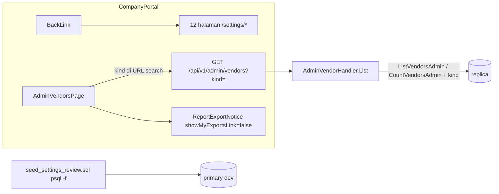

# Design Document

> Status: accepted 2026-11-17 (engineer) — "Terima, lanjut tasks"

## Overview

Empat perubahan kecil dari review menu Pengaturan (requirements.md, accepted 2026-11-17):

1. **BackLink** — satu komponen kecil `BackLink` dipasang di 12 halaman `/settings/*` yang belum punya tautan kembali (Req 1).
2. **Filter Jenis vendor** — parameter `kind` di `GET /api/v1/admin/vendors` (sqlc query + handler) dan dropdown di `AdminVendorsPage` (Req 2).
3. **Hapus "Lihat Ekspor Saya"** di halaman Vendor lewat prop opsional di `ReportExportNotice` (Req 3).
4. **Seed dev** — satu file `backend/scripts/dev/seed_settings_review.sql`: vendor dummy + cabang, lalu PIC (Req 4, 5).

Tidak ada tabel, kolom, migrasi, atau dependency baru. Tidak ada perubahan `backend-exq` (Q9).

## Architecture



Alur filter: dropdown → `kind` disimpan di URL search (`useAdminVendorsUrlState`) → `api.ts` mengirim `kind` → handler memvalidasi → query sqlc menambah `AND (kind IS NULL OR v.kind = kind)` di List dan Count. Repo list sudah membaca dari `dbReadPool` (replica), tidak berubah.

## Components and Interfaces

### Frontend

#### `components/ui/BackLink.tsx` (baru)

```tsx
type BackLinkProps = { to: string; label: string; search?: Record<string, unknown> };
// <Link to={to} search={search} className="…ghost button style…">← {label}</Link>
```

- Satu `<Link>` TanStack bergaya tombol ghost (min 44×44 px, sama dengan `Button`), **bukan** `<Link><Button/></Link>` (pola lama di `VendorHeader` menumpuk elemen interaktif; tidak diubah di fitur ini, Req 1.4).
- Nama aksesibel = teks tampil, mis. "← Kembali ke Pengaturan" (Req 1.5). Panah dibungkus `aria-hidden`.
- Tujuan tetap lewat `to`, bukan `history.back` (Q1, Req 1.3).

#### Penempatan BackLink (inventaris 2026-11-17)

| Route | Komponen halaman | Tujuan (ParentPage) | Aksi |
| --- | --- | --- | --- |
| `/settings/admin/users` | `features/admin-users` `AdminUsersPage` | `/settings` | tambah |
| `/settings/admin/vendors` | `features/admin-vendors` `AdminVendorsPage` | `/settings` | tambah |
| `/settings/admin/atms` | `features/admin-atms` `AdminATMsPage` | `/settings` | tambah |
| `/settings/admin/acm-areas` | `features/admin-acm-areas/AdminAcmAreasPage` | `/settings` | tambah |
| `/settings/admin/holidays` | `features/admin-holidays/AdminHolidaysPage` | `/settings` | tambah |
| `/settings/admin/regions` | `features/admin-regions` | `/settings` | tambah |
| `/settings/admin/master-data-io` | `features/master-data-io` `MasterDataIOPage` | `/settings` | tambah |
| `/settings/roles` | `features/role-management` | `/settings` | tambah |
| `/settings/rbac/users` | `features/rbac-settings` `RbacUsersPage` | `/settings` | tambah |
| `/settings/rbac/delegations` | `features/rbac-settings` `RbacDelegationsPage` | `/settings` | tambah |
| `/settings/rbac/leaves` | `features/rbac-settings` `RbacLeavesPage` | `/settings` | tambah |
| `/settings/rbac/policies` | `features/rbac-settings` `RbacPoliciesPage` | `/settings` | tambah |
| `/settings/admin/vendors/$vendorId` | `VendorHeader` | daftar vendor | sudah ada, tidak diubah |
| `/settings/admin/vendors/$vendorId/branches/$branchId[/edit]` | `VendorBranchDetailPage` / `VendorBranchEditPage` | sudah ada | tidak diubah |
| `/settings/admin/exports` | redirect ke `/exports` | — | tidak berlaku |
| `/settings` | `SettingsHubPage` | — | tanpa BackLink (Req 1.6) |

BackLink dipasang di komponen halaman (bukan file route), di atas judul halaman, supaya component test halaman bisa memeriksanya. Label seragam: "Kembali ke Pengaturan".

#### `AdminVendorsPage` + `useAdminVendorsUrlState`

- `ADMIN_VENDORS_SEARCH_SCHEMA` mendapat `kind: z.enum(["FLM_VENDOR", "INTERNAL"]).optional()`; nilai lain di URL dibuang (`.catch(undefined)`), sama seperti field lain di schema itu.
- Dropdown "Jenis vendor": `Semua` (tanpa `kind`) / `Vendor FLM` / `ROH`. Mengubahnya me-reset `page` ke 1 (Req 2.7), mengikuti cara filter status sekarang.
- `api.ts` list vendor mengirim `kind` bila ada.
- `requestPksExport` **tidak** mengirim `kind` (Q9).

#### `ReportExportNotice`

- Prop baru `showMyExportsLink?: boolean` (default `true`). `AdminVendorsPage` mengirim `false`. Error permintaan ekspor tetap dirender (Req 3.2). Pemakai lain tidak berubah (Req 3.3).
- `ExportProgressDialog` tidak diubah.

### Backend (`backend/`)

#### `queries/vendors_admin.sql`

`ListVendorsAdmin` dan `CountVendorsAdmin` mendapat:

```sql
AND (sqlc.narg('kind')::text IS NULL OR v.kind = sqlc.narg('kind')::text)
```

`sqlc generate` (v1.31.1) → `Kind *string` di `ListVendorsAdminParams` dan `CountVendorsAdminParams`. Hand-fix `UserLeafe` → `UserLeave` setelahnya (CLAUDE.md §2a).

#### `AdminVendorHandler.List`

```go
var kind *string
if v := q.Get("kind"); v != "" {
    if v != "FLM_VENDOR" && v != "INTERNAL" {
        writeError(w, http.StatusBadRequest, "bad_request", "kind tidak valid")
        return
    }
    kind = &v
}
```

Diteruskan ke `listArg.Kind` dan argumen Count (Req 2.1–2.4). Route group, RBAC (`ADMIN`, `ADMIN_PARAM`), dan replica tidak berubah (Req 2.5). Bentuk respons datar tidak berubah.

#### OpenAPI

`/admin/vendors` belum ada di `backend/api/openapi.yaml`, jadi tidak perlu diperbarui (CLAUDE.md §11 hanya mewajibkan untuk modul yang sudah ada di spec).

## Data Models

Tidak ada tabel baru, kolom baru, atau migrasi.

## Seed dev

File: `backend/scripts/dev/seed_settings_review.sql` — header "DEV ONLY — not a migration", cara jalan `psql -v ON_ERROR_STOP=1 "postgres://…@localhost:5432/cms" -f backend/scripts/dev/seed_settings_review.sql`. Satu transaksi (`BEGIN … COMMIT`), tanpa `audit_logs` (data dev, sama seperti `seed_vendor_users.sql`).

### Bagian 1 — vendor dummy (Req 4)

| `code` | `name` | `kind` | `request_prefix` |
| --- | --- | --- | --- |
| `DMY1`…`DMY5` | `Dummy Vendor 1`…`5` | `FLM_VENDOR` | `DMA`…`DME` |
| `DMYROH` | `Dummy ROH` | `INTERNAL` | NULL |

- `INSERT … ON CONFLICT (code) DO NOTHING` (unik `vendors_code_key`) → idempoten, data lama tidak diubah (Req 4.4).
- Kolom lain hanya yang berguna untuk layar: `legal_name`, `contact_email` `<code lower>@vendor.dev.local`. `npwp` NULL (CHECK boleh NULL).
- Cabang: 2 per vendor, `branch_code` `<code>_001` / `<code>_002` (unik `uq_vendor_branches_branch_code`, `ON CONFLICT DO NOTHING`), `branch_name` "Cabang Jakarta" / "Cabang Bandung", `region_code` `JKT` / `BDG`.
- **Catatan Req 4.3**: `region_code` tidak ber-FK ke `regions`; hanya CHECK `^[A-Z0-9]{2,10}$`. Seed memakai literal `JKT`/`BDG`. Engineer cek saat menerima design apakah kode ini sudah dipakai cabang lain di dev; bila tidak, cukup sebagai label (tidak ada pemeriksaan lain di fitur ini yang bergantung padanya).
- Tidak ada vault, ATM, paket, PKS (Req 4.5).

### Bagian 2 — PIC (Req 5)

Dijalankan setelah bagian 1 di file yang sama (Req 5.6).

```sql
-- vendor-wide: 2 per EligibleVendor tanpa SeedPic tingkat vendor
INSERT INTO vendor_pics (vendor_id, vendor_branch_id, name, position, phone, email,
                         is_notification_recipient, is_active, roles, is_director)
SELECT v.id, NULL, v.name || ' PIC ' || n, 'PIC Vendor', '0812000000' || n,
       'pic' || n || '.' || lower(v.code) || '@pic.dev.local',
       false, true, ARRAY['replenish','vault','cashcount'], false
FROM vendors v CROSS JOIN generate_series(1, 2) n
WHERE v.is_active AND v.deleted_at IS NULL AND v.code NOT LIKE 'IT%'
  AND NOT EXISTS (SELECT 1 FROM vendor_pics p
                  WHERE p.vendor_id = v.id AND p.vendor_branch_id IS NULL
                    AND p.email LIKE '%@pic.dev.local');
```

Cabang: sama, `FROM vendor_branches b JOIN vendors v`, `b.is_active`, email `pic<n>.<branch_code lower>@pic.dev.local`, `NOT EXISTS` per `vendor_branch_id` (Req 5.2, 5.4). Hanya `INSERT`, tidak ada `UPDATE`/`DELETE` (Req 5.5). `roles`, `is_notification_recipient`, `is_director`, `is_active` sesuai Req 5.3; tidak melanggar `vendor_pics_director_chk` (bukan direktur).

## Correctness Properties

### Property 1: Filter kind mempersempit, tidak mengubah

*For any* kombinasi `status`, `q`, `pks_status`, dan paging, hasil VendorListAPI dengan `kind = K` sama dengan hasil tanpa `kind` yang disaring ke baris `kind = K`, dan `total` sama dengan jumlah baris itu.

**Validates: Requirements 2.1, 2.2, 2.4**

### Property 2: kind tidak valid ditolak

*For any* string `kind` tidak kosong selain `FLM_VENDOR` dan `INTERNAL`, VendorListAPI mengembalikan 400 `bad_request` dan tidak memanggil service.

**Validates: Requirements 2.3**

### Property 3: BackLink menuju ParentPage

*For any* halaman di tabel Penempatan berstatus "tambah", halaman merender tepat satu tautan bernama "Kembali ke Pengaturan" dengan `href="/settings"`.

**Validates: Requirements 1.1, 1.2, 1.3, 1.5**

### Property 4: Seed idempoten

*For any* jumlah eksekusi ≥ 1 seed script pada DB dev yang sama, jumlah DummyVendor (6), cabang dummy (12), SeedPic per vendor (2), dan SeedPic per cabang aktif (2) tetap sama setelah eksekusi pertama, dan baris non-seed tidak berubah.

**Validates: Requirements 4.1, 4.2, 4.4, 5.1, 5.2, 5.4, 5.5**

## Error Handling

- `kind` tidak valid → 400 `bad_request`, pesan "kind tidak valid" (format `writeError` yang ada).
- URL search `kind` tidak valid di frontend → dibuang oleh schema, halaman memuat "Semua".
- Seed: satu transaksi + `ON_ERROR_STOP`; constraint gagal → seluruh script rollback.

## Testing Strategy

| Requirement / Property | Test |
| --- | --- |
| Req 2.1–2.4, P1, P2 | `admin_vendor_handler_test.go`: table-driven `kind` = `FLM_VENDOR`, `INTERNAL`, kosong, `xyz` (400, service tidak dipanggil), kombinasi dengan `status` + `pks_status`; fake service memeriksa `Kind` di argumen List **dan** Count |
| Req 2.1 (SQL) | integration test (`//go:build integration`, skip tanpa `DATABASE_URL`) bila sudah ada pola untuk `ListVendorsAdmin`; jika tidak, unit test handler + cek manual di DB dev setelah seed (dicatat di Test Results) |
| Req 2.6–2.7 | `AdminVendorsPage` component test: dropdown 3 opsi, pilih ROH → request berisi `kind=INTERNAL` & `page=1`; `useAdminVendorsUrlState.test.ts`: `kind` valid disimpan, tidak valid dibuang |
| Req 3.1–3.3 | `AdminVendorsPage`: tidak ada teks "Lihat Ekspor Saya"; error ekspor tetap tampil. Test `ReportExportNotice`: default menampilkan tautan, `showMyExportsLink={false}` tidak |
| Req 1, P3 | `BackLink.test.tsx` (href, nama aksesibel) + satu test berparameter yang merender tiap halaman "tambah" dan memeriksa P3 |
| Req 4, 5, P4 | Manual oleh engineer di DB dev: jalankan script 2×, query hitung (dicatat di Test Results). Tidak ada harness SQL otomatis untuk `scripts/dev` |
| Req 6.4 | `cd backend && go test ./...`, `golangci-lint run`, `pnpm --dir frontend/CompanyPortal-Vite run test`, `lint`, `build` |
| Req 6.5 | Pemeriksaan browser: **outstanding (user)** |

## Files touched

- `frontend/CompanyPortal-Vite/src/components/ui/BackLink.tsx` (+ test) — baru
- 12 komponen halaman di tabel Penempatan
- `features/admin-vendors/components/AdminVendorsPage.tsx`, `useAdminVendorsUrlState.ts`, `api.ts` (+ test)
- `features/exports/components/ReportExportNotice.tsx` (+ test)
- `backend/queries/vendors_admin.sql`, `backend/internal/db/*` (sqlc generate), `backend/internal/handler/admin_vendor_handler.go` (+ test)
- `backend/scripts/dev/seed_settings_review.sql` — baru
