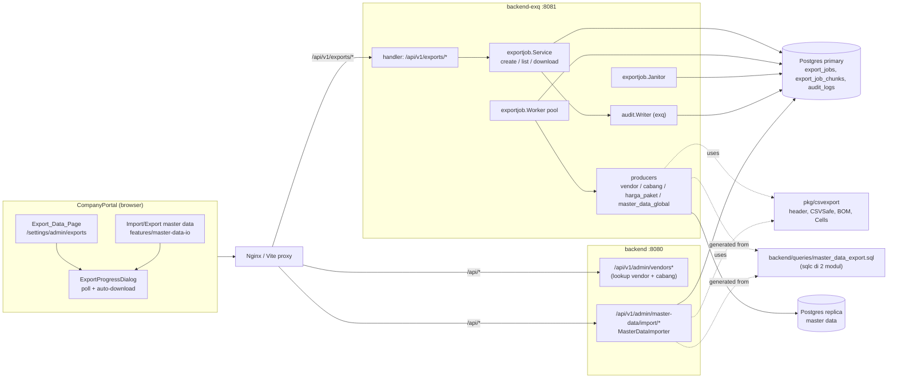
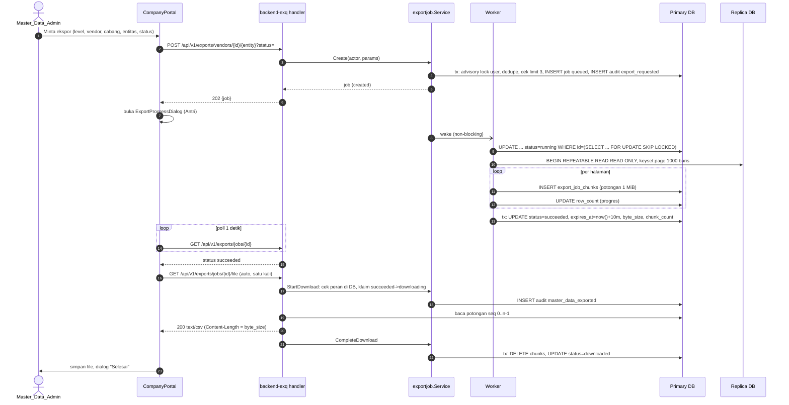
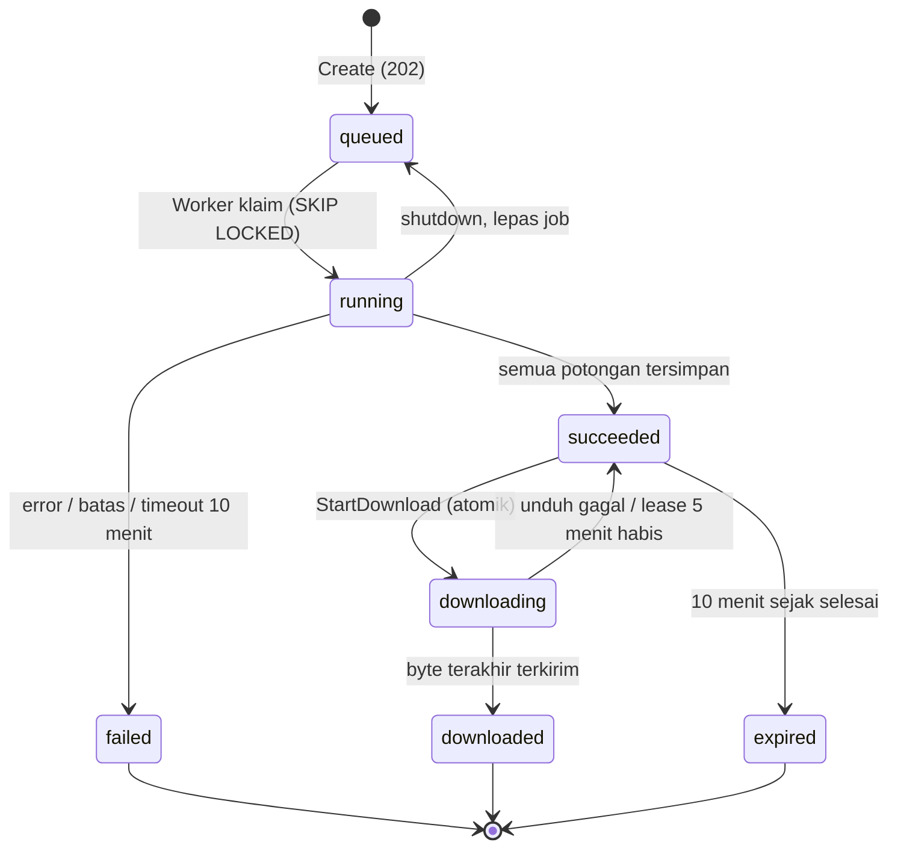

# Design Document: Vendor Data Export

## Overview

Fitur ini membangun scope **Export Data** di `backend-exq`: ekspor master data vendor per entitas pada level vendor dan level cabang, ekspor Harga Paket sebagai menu terpisah, dan pemindahan export master data global yang sudah ada dari `backend/`. Semua ekspor berjalan **asinkron** lewat tabel `export_jobs` (D7), file disimpan sementara di Postgres (D17), diunduh otomatis begitu siap lewat pop-up loading (D18a, D18b), lalu dihapus setelah berhasil diunduh (D18) atau 10 menit setelah dibuat bila tidak diunduh (D18c).

Ringkasan keputusan desain:

| Topik | Keputusan | Sumber |
| --- | --- | --- |
| Runtime | `backend-exq` (:8081). Worker dan janitor berjalan di proses yang sama, bukan binary baru. | D10, D13, Req 11 |
| Kontrak CSV | Paket baru `pkg/csvexport` (header, legacy header, `CSVSafe`, BOM, fungsi sel) + **satu file SQL bersama** `backend/queries/master_data_export.sql` yang di-generate sqlc di dua modul. | D11, Req 5, 13, 14 |
| Antrian | Polling `export_jobs` dengan `FOR UPDATE SKIP LOCKED` + sinyal bangun in-process. Tanpa Redis queue, tanpa library baru. | Req 9.6 |
| Penyimpanan file | `export_job_chunks` (bytea, potongan 1 MiB) di primary. | D17, Req 10.1 |
| Satu kali unduh | Klaim atomik `succeeded -> downloading`, hapus potongan + `downloaded` dalam satu transaksi setelah byte terakhir terkirim. | D18, Req 10.2-10.4 |
| Masa simpan | Janitor tiap 30 detik: kedaluwarsa 10 menit, lease unduh 5 menit, batas proses 10 menit. | D18c, Req 9.9, 10.5-10.7 |
| Audit | `export_requested` (saat buat job, dalam tx yang sama) dan `master_data_exported` (tiap unduhan, sebelum byte pertama). Writer milik `backend-exq`. | D5, D16, Req 8 |
| Kontrak API | `backend-exq/api/openapi.yaml` + test kontrak kin-openapi + tipe TS `exq-schema.d.ts`. | D8, Req 15 |
| Frontend | Fitur baru `features/exports` (halaman, form, daftar Ekspor Saya, `ExportProgressDialog`), dipakai juga oleh `features/master-data-io`. | D12, D22, Req 12, 14.6 |
| Cutover | Endpoint export lama di `backend/` dihapus di rilis yang sama. | D15, Req 14.5 |

Prinsip yang dipegang:

- **Satu sumber format.** Header, aturan sel, dan SQL yang menghasilkan teks sel dipakai bersama export (`backend-exq`) dan importer (`backend/`). Tidak ada salinan yang bisa berbeda (Req 13.1, 14.3, 14.4).
- **DB adalah sumber kebenaran proses** (`how_to_handle_flowprocess.md`): status teknis job, progres, error, dan file ada di DB. Worker dan janitor idempoten dan aman dijalankan di beberapa instance.
- **Read-only terhadap master data.** Data master dibaca dari replica; satu-satunya tulisan adalah `export_jobs`, `export_job_chunks`, dan `audit_logs` di primary (Req 6).
- **Fail closed.** Tanpa audit tidak ada job dan tidak ada byte file (Req 8.1, 8.2).

Koreksi terhadap requirements yang ditemukan saat desain: kolom `add_cr_price`, `add_flm_price`, `extra_amount` sudah dihapus dari `vendor_package_prices` oleh migrasi `012`, dan migrasi `017` memecah identifier menjadi `package` (label) dan `package_code` (kode unik per baris). Requirement 3.5 diperbarui mengikuti skema saat ini (lihat bagian Data Models, "CSV Harga Paket").

## Architecture

### Komponen



### Alur permintaan sampai unduh



### Siklus status Export_Job



Potongan file hanya ada pada status `running` (sebagian), `succeeded`, dan `downloading`. Status terminal (`failed`, `downloaded`, `expired`) tidak punya potongan (Property 10).

### Topologi baca/tulis (Req 6)

| Operasi | Pool | Alasan |
| --- | --- | --- |
| Validasi vendor/cabang saat Create | primary | Validasi alur tulis; vendor yang baru di-approve harus langsung terlihat. |
| Insert/update `export_jobs`, `export_job_chunks`, `audit_logs` | primary | Tulisan. |
| List/status job, baca potongan untuk unduh | primary | Read-after-write (Req 6.3). |
| Cek peran user saat unduh | primary | Pencabutan peran harus langsung berlaku (Req 7.6). |
| Data master untuk isi CSV | replica (fallback primary) | Bacaan berat, satu transaksi `REPEATABLE READ READ ONLY` per file (Req 6.1, 6.2). |

### Batas waktu dan konstanta

| Nama | Nilai | Tempat | Req |
| --- | --- | --- | --- |
| `JobTimeout` | 10 menit | konstanta `exportjob` | 9.9 |
| `DownloadLease` | 5 menit | konstanta | 10.5 |
| `Retention` | 10 menit sejak `finished_at` | konstanta | 10.6 |
| `MaxBytes` / `MaxRows` | 100 MiB / 1.000.000 baris data | konstanta | 10.11 |
| `ChunkSize` | 1 MiB | konstanta | 6.4 |
| `PageSize` | 1000 baris | konstanta (sama dengan export lama) | 6.1 |
| `MaxActivePerUser` | 3 job `queued`/`running` | konstanta | 9.5 |
| `EXPORT_WORKERS` | default 2 | env | 11.7 |
| `EXPORT_POLL_INTERVAL` | default 2s | env | 11.7 |
| `EXPORT_JANITOR_INTERVAL` | default 30s, maksimum 1m (start gagal bila lebih) | env | 10.7 |
| Timeout handler umum | 30s (chi `Timeout`, sama seperti sekarang) | `main.go` | - |
| Timeout route unduh | 5 menit (tidak memakai chi `Timeout(30s)`; write deadline diperpanjang per potongan) | `main.go`, handler | 10.10 |

Konstanta yang menyangkut keputusan PO (D18c, D21) sengaja tidak bisa diubah lewat env, sama dengan pola `pkg/auth` untuk kebijakan password.

## Components and Interfaces

### pkg/csvexport (CSV_Contract) - Req 5, 13, 14

Paket baru, kode murni tanpa akses DB, tanpa dependensi selain stdlib. Isinya dipindah apa adanya dari `backend/internal/service/masterdata_export.go`.

#### Isi paket

```go
package csvexport

// Nama entitas master data global (path {entity}); nilai sama dengan konstanta lama.
const (
    Vendors        = "vendors"
    VendorBranches = "vendor-branches"
    VendorVaults   = "vendor-vaults"
    VendorPICs     = "vendor-pics"
    ATMs           = "atms"
    ATMAssignments = "atm-assignments"
)

const BOM = "\xEF\xBB\xBF"

// Isi sel khusus importer (dipindah dari backend/internal/service).
const (
    KeepCurrentCell        = "<keep>" // nilai keepCurrentCell lama (vendor_branch_admin.go)
    AssignmentSourceBranch = "branch"
    PICRolesNone           = "none"
)

// Entity adalah kontrak satu entitas: header stabil + header lama yang masih
// diterima importer + isian kolom yang hilang di header lama.
type Entity struct {
    Name          string
    Header        []string
    LegacyHeaders [][]string
    LegacyFill    map[string]string
}

func Lookup(name string) (Entity, bool)   // ganti ParseExportEntity + MasterDataExportHeader
func Names() []string                       // urutan stabil, untuk test dan OpenAPI enum

// Baris netral per entitas, satu field per kolom SQL bersama (semua string/bool/int,
// NULL sudah menjadi "" di SQL). Tiap modul memetakan baris sqlc-nya ke tipe ini.
type VendorRow struct { ID int64; Code, Name, LegalName, Npwp, ContactEmail, ContactPhone, HqAddress string; IsActive bool }
type VendorBranchRow struct { /* ... */ }
type VendorVaultRow struct { /* ... */ }
type VendorPICRow struct { /* ...; Roles []string */ }
type ATMRow struct { /* ... */ }
type ATMAssignmentRow struct { /* ... */ }

func VendorCells(r VendorRow) []string         // persis isi closure cells di exportSpecs lama
func VendorBranchCells(r VendorBranchRow) []string
func VendorVaultCells(r VendorVaultRow) []string
func VendorPICCells(r VendorPICRow) []string    // roles via picRolesCell
func ATMCells(r ATMRow) []string
func ATMAssignmentCells(r ATMAssignmentRow) []string

func CSVSafe(s string) string      // dipindah apa adanya
func UnCSVSafe(s string) string    // buang satu apostrof pembuka yang dipasang CSVSafe; dipakai importer

// Writer menulis BOM + header sekali, lalu setiap baris dengan CSVSafe per sel.
type Writer struct { /* encoding/csv.Writer */ }
func NewWriter(w io.Writer, header []string) (*Writer, error)
func (w *Writer) Write(cells []string) error
func (w *Writer) Flush() error
func WriteTemplate(w io.Writer, entity string) error   // BOM + header saja (Req 14.2)
```

Header entitas baru export-only (`dsr-location-maps`, `package-prices`) juga dideklarasikan di paket ini sebagai `Entity` tanpa `LegacyHeaders`, supaya OpenAPI, test snapshot, dan producer membaca dari satu tempat. Entitas ini tidak didaftarkan di `Lookup` importer (`ImportableNames()` terpisah dari `ExportOnlyNames()`), sehingga importer tetap menolak file-nya dengan 404 seperti sekarang.

#### Kenapa SQL juga dibagi

Format sel tidak hanya ditentukan fungsi `Cells`: NULL menjadi `''`, numeric menjadi teks, tanggal menjadi teks, semuanya terjadi di SQL (`COALESCE(...)::text`). Importer (`loadAll`) dan export harus memakai SQL yang sama. Karena itu:

- `backend/queries/master_data_export.sql` dipecah: enam query `Export*Batch` tetap di file ini (sumber bersama); query `ImportPackageKeys`, `ImportVendorPackageLabels`, `ImportLocationIDs` pindah ke `backend/queries/master_data_import.sql` (milik `backend/` saja).
- `backend-exq/sqlc.yaml` memakai daftar path: `queries: ["queries/", "../backend/queries/master_data_export.sql"]`. Ini referensi file oleh tool codegen, sama seperti `schema: "../backend/migrations/"` yang sudah ada; tidak ada import Go lintas modul (Req 11.5).
- CI job `sqlc` dijalankan untuk kedua modul, jadi perubahan SQL bersama yang lupa di-generate di salah satu modul langsung gagal.

#### Parameter cakupan pada SQL bersama (Req 1.3, 2.3, 4.3-4.6)

Empat query mendapat filter opsional `sqlc.narg`. Importer mengirim NULL sehingga perilakunya tidak berubah (Req 13.2).

| Query | Filter tambahan |
| --- | --- |
| `ExportVendorsBatch` | `vendor_id`: `v.id = vendor_id` |
| `ExportVendorBranchesBatch` | `vendor_id`: `b.vendor_id = vendor_id` |
| `ExportVendorVaultsBatch` | `vendor_id`: `v.id = vendor_id`; `branch_id`: `b.id = branch_id` |
| `ExportVendorPicsBatch` | `vendor_id`: `p.vendor_id = vendor_id`; `branch_id`: `p.vendor_branch_id = branch_id` (PIC vendor-wide otomatis tidak ikut, D3) |
| `ExportATMsBatch`, `ExportATMAssignmentsBatch` | tidak berubah (D2) |

Pola filter: `AND (sqlc.narg('vendor_id')::bigint IS NULL OR v.id = sqlc.narg('vendor_id'))`. Urutan `ORDER BY id` dan keyset `id > after_id` tidak berubah (Req 5.8).

### backend/ (perubahan) - Req 13, 14

| Bagian | Perubahan |
| --- | --- |
| `internal/service/masterdata_export.go` | `exportSpecs` diganti adaptor tipis: `page` memanggil repo lalu memetakan baris sqlc ke `csvexport.*Row` dan `csvexport.*Cells`. Header/legacy dari `csvexport.Lookup`. `MasterDataExporter.Write`, `Authorize`, `WriteExportTemplate`, `CSVSafe`, `ParseExportEntity`, `MasterDataExportHeader` dihapus atau menjadi alias tipis ke `pkg/csvexport` sampai pemanggil terakhir diganti. |
| `internal/service/masterdata_import*.go` | Memakai `csvexport.Lookup` untuk header + legacy, `csvexport.UnCSVSafe`, dan adaptor `page` di atas (`loadAll`). Logika dry-run/confirm tidak berubah. |
| `internal/repository/master_data_export_repository.go` | Signature metode batch menerima scope (`nil, nil` dari importer). |
| `internal/handler/admin_master_data_export_handler.go` | Dihapus (Export + Template). |
| `internal/handler/admin_master_data_import_handler.go` | `ParseExportEntity` diganti `csvexport.Lookup` (404 untuk entitas tidak dikenal tetap sama). |
| `cmd/api/main.go` | Mount `/api/v1/admin/master-data/export` dihapus (Req 14.5). Importer tetap di primary. |
| `queries/` | Pecah file seperti di atas; `sqlc generate` + perbaikan `UserLeafe` seperti biasa. |

Test export lama di `backend/` yang menguji perilaku file dipindah menjadi golden fixture bersama (lihat Testing Strategy), bukan dibuang.
### backend-exq: bootstrap - Req 7, 11

`cmd/api/main.go` diubah menjadi:

```go
cfg := config.Load("8081")
dbPool := pgxpool.New(ctx, cfg.DatabaseURL)            // primary
dbReadPool := dbPool                                    // fallback (Req 11.1)
if cfg.DatabaseReplicaURL != "" { dbReadPool = pgxpool.New(ctx, cfg.DatabaseReplicaURL) }
workerCfg := exportjob.LoadWorkerConfig()               // EXPORT_WORKERS, EXPORT_POLL_INTERVAL, EXPORT_JANITOR_INTERVAL; error bila tidak valid

r := chi.NewRouter()
r.Use(custommw.TrustedRealIP(cfg.TrustedProxies))       // pertama (Req 11.2)
r.Use(middleware.RequestID, custommw.RequestLogger(slog.Default()), middleware.Recoverer)
r.Use(custommw.BodyLimit(1<<20, nil))
r.Get("/health", ...)
r.Get("/ready", health.Ready(2*time.Second, map[string]func(context.Context) error{
    "db": dbPool.Ping, "db_replica": dbReadPool.Ping, "redis": ...,
}))

svc := exportjob.NewService(dbPool, auditWriter, wake)
h := handler.NewExportsHandler(svc)
r.Route("/api/v1/exports", func(r chi.Router) {
    r.Use(custommw.RequireAuth(tokenService))                           // peran per grup, lihat di bawah (D23)
    r.With(middleware.Timeout(30*time.Second)).Mount("/", h.Routes())   // semua kecuali unduh
    r.With(middleware.Timeout(exportjob.DownloadLease)).Get("/jobs/{jobID}/file", h.Download)
})
// h.Routes(): grup permintaan master data + template memakai
// RequireRoles(exportjob.KindRoles[KindVendor]...) (= ADMIN, ADMIN_PARAM);
// /jobs dan /jobs/{jobID} hanya RequireAuth (kepemilikan dicek di service).

pool := exportjob.NewWorker(dbPool, dbReadPool, exportjob.DefaultProducers(), workerCfg, wake)
janitor := exportjob.NewJanitor(dbPool, workerCfg.JanitorInterval)
go pool.Run(workerCtx); go janitor.Run(workerCtx)
// shutdown: srv.Shutdown(15s) -> cancel workerCtx -> pool.Wait(grace) (lepas job yang belum selesai)
```

`chi.Timeout(30s)` global yang ada sekarang dipindah ke dalam grup route, supaya route unduh bisa memakai batas 5 menit. `http.Server.WriteTimeout` 30 detik tetap; handler unduh memperpanjang write deadline per potongan lewat `http.ResponseController.SetWriteDeadline` (stdlib Go 1.20+).

Dockerfile (Req 11.4) mengikuti pola `backend/Dockerfile`: `CGO_ENABLED=0`, `adduser -S appuser`, `USER appuser`, `ENV TZ=Asia/Jakarta`, `HEALTHCHECK ... wget --spider http://localhost:8081/health`. `docker-compose.yaml` mendapat `name: CMS-Backend-EXQ` (nama lama `CMS-Backend-CIT`).

### backend-exq/internal/exportjob - Req 1-4, 9, 10

Paket inti. Tidak tahu HTTP; menerima `middleware.AuthContext` lewat `Actor`.

#### Model

```go
type Kind string    // "vendor" | "cabang" | "harga_paket" | "master_data_global"
type Status string  // queued | running | succeeded | failed | downloading | downloaded | expired

type Params struct {
    Kind         Kind
    Entity       string  // "vendor","branches","vaults","pics","dsr-location-maps" | "package-prices" | 6 entitas global
    VendorID     *int64
    BranchID     *int64
    StatusFilter string  // active | disabled | all
    PriceLevel   *string // vendor | branch | atm | all (harga_paket saja)
}

type Actor struct { UserID int64; Username, Role, IP string }

type Job struct {
    ID int64; RequestedBy int64; Params Params
    VendorCode, BranchCode, FileName string
    Status Status; RowCount int64; ByteSize, ChunkCount *int64; ErrorMessage *string
    CreatedAt time.Time; StartedAt, FinishedAt, ExpiresAt, DownloadStartedAt, DownloadedAt, ExpiredAt *time.Time
}
```

Entitas yang sah per Kind (Req 1.2, 2.2, 3, 14.1):

| Kind | Entity | Producer |
| --- | --- | --- |
| `vendor` | `vendor`, `branches`, `vaults`, `pics`, `dsr-location-maps` | SQL bersama dengan `vendor_id`; `dsr-location-maps` query exq |
| `cabang` | `vaults`, `pics`, `dsr-location-maps` | SQL bersama dengan `vendor_id` + `branch_id`; `dsr-location-maps` query exq |
| `harga_paket` | `package-prices` | query exq |
| `master_data_global` | 6 entitas `csvexport` | SQL bersama tanpa scope |

#### Registry per Kind (Req 7, 8, D23)

```go
// KindSpec mengumpulkan semua aturan yang berbeda per Export_Kind di satu tempat.
type KindSpec struct {
    Roles          []string                   // peran yang boleh meminta dan mengunduh
    DownloadAction string                     // action audit saat unduh
    EntityRef      func(Job) (string, int64)  // entity_type, entity_id untuk audit
}

var KindSpecs = map[Kind]KindSpec{
    KindVendor:           {Roles: masterDataAdmin, DownloadAction: "master_data_exported", EntityRef: vendorRef},
    KindCabang:           {Roles: masterDataAdmin, DownloadAction: "master_data_exported", EntityRef: branchRef},
    KindHargaPaket:       {Roles: masterDataAdmin, DownloadAction: "master_data_exported", EntityRef: priceRef},
    KindMasterDataGlobal: {Roles: masterDataAdmin, DownloadAction: "master_data_exported", EntityRef: globalRef},
}
var KindRoles = rolesOf(KindSpecs)   // dipakai guard route dan service
```

Spec `report-export-migration` menambah empat entri ke `KindSpecs` tanpa mengubah service, worker, janitor, atau handler `/jobs*`.

#### Validasi dan nama file (Req 4.1, 4.2, 5.2)

`ParseParams` murni (tanpa DB): status default `active`, nilai di luar enum -> `ErrValidation` (400); entitas tidak sah untuk Kind -> `ErrUnknownEntity` (404); `price_level` default `all`, hanya untuk `harga_paket`. `ParamsHash = sha256(kind|entity|vendor_id|branch_id|status|price_level)` (hex) untuk dedupe.

`FileName(params, vendorCode, branchCode, now)` memakai tanggal WIB (`time.FixedZone("WIB", 7*3600)`, sama dengan handler lama) dan `sanitize(code)` = ganti setiap karakter di luar `[A-Za-z0-9_-]` dengan `_`. Nama entitas di nama file memakai nama entitas apa adanya (`vaults`, `dsr-location-maps`). Master data global memakai `master-data-<entity>-<YYYYMMDD>.csv` (sama dengan nama lama).

#### Service

```go
type Service struct { /* primary queries, audit writer, wake func() */ }

// Create: Req 1.1, 2.1, 2.4, 3.1, 3.2, 7.2, 8.1, 8.7, 9.1, 9.4, 9.5
func (s *Service) Create(ctx context.Context, a Actor, p Params) (job Job, created bool, err error)
// List: job milik a (terbaru dulu, maks 50). Req 7.5, 12.6
func (s *Service) List(ctx context.Context, a Actor, limit int) ([]Job, error)
// Get: 404 bila bukan milik a. Req 7.5
func (s *Service) Get(ctx context.Context, a Actor, id int64) (Job, error)
// StartDownload: cek peran saat ini, klaim atomik, audit. Req 7.6, 8.2, 9.11, 10.2
func (s *Service) StartDownload(ctx context.Context, a Actor, id int64) (Job, error)
// OpenChunks: iterator potongan seq 0..ChunkCount-1 dari primary. Req 10.10
func (s *Service) OpenChunks(ctx context.Context, jobID int64, chunkCount int64) ChunkIterator
// CompleteDownload: tx DELETE chunks + status downloaded. Req 10.3
func (s *Service) CompleteDownload(ctx context.Context, id int64) error
// AbortDownload: downloading -> succeeded. Req 10.4
func (s *Service) AbortDownload(ctx context.Context, id int64) error
```

Langkah `Create`:

1. `a.UserID == 0` -> `ErrUnauthenticated` (401, Req 8.7). Peran tidak ada di `KindRoles[p.Kind]` -> `ErrForbidden` (Req 7.2, 7.3).
2. Resolusi cakupan di primary: vendor ada (termasuk yang nonaktif, Req 1.6) -> `vendor_code`; cabang ada dan `vendor_id` = vendor path -> `branch_code`, selain itu `ErrNotFound` yang sama untuk dua kasus (Req 2.4, 3.2), tanpa audit (Req 8.8).
3. Satu transaksi primary:
   - `SELECT pg_advisory_xact_lock(hashtextextended('export_jobs:' || $user, 0))` menyerialkan permintaan satu user.
   - Job aktif dengan `params_hash` sama -> kembalikan `(job, false)`; tidak ada audit (bukan job baru).
   - Hitung job `queued`/`running` milik user; `>= 3` -> `ErrTooManyActive` (429, Req 9.5).
   - `INSERT export_jobs` (status `queued`, `vendor_code`, `branch_code`, `file_name`).
   - `INSERT audit_logs` action `export_requested` (Req 8.1). Gagal -> rollback, 500.
4. Commit, lalu `wake()` non-blocking (kanal buffer 1).

Langkah `StartDownload`:

1. Peran saat ini dibaca dari `users` + `roles` di primary (user masih aktif dan peran ada di `KindRoles[job.Kind]`), bukan dari klaim JWT. Gagal -> `ErrForbidden` (Req 7.6).
2. `UPDATE export_jobs SET status='downloading', download_started_at=now() WHERE id=$1 AND requested_by=$2 AND status='succeeded' AND expires_at > now() RETURNING *`.
3. Tidak ada baris: baca status milik user. Tidak ada -> `ErrNotFound`; `queued`/`running`/`failed`/`downloading` -> `ErrNotReady` (409); `downloaded`/`expired`, atau `succeeded` yang `expires_at` sudah lewat -> `ErrGone` (410). Tidak ada audit (Req 8.8, 9.11).
4. `INSERT audit_logs` action `KindSpecs[job.Kind].DownloadAction` (`master_data_exported` untuk semua Kind di spec ini) dengan `row_count` (Req 8.2, 8.6). Gagal -> `AbortDownload`, `ErrInternal` (500, tanpa byte).

#### Producer dan ChunkWriter

```go
type Producer interface {
    Header() []string
    // Produce memanggil emit untuk setiap baris data, urut id naik, halaman keyset PageSize,
    // di dalam tx replica yang sudah dibuka worker.
    Produce(ctx context.Context, q *repository.Queries, p Params, asOf time.Time, emit func([]string) error) error
}

func DefaultProducers() map[Kind]map[string]Producer
```

`ChunkWriter` (implements `io.Writer`) menahan buffer hingga `ChunkSize`, lalu `INSERT INTO export_job_chunks(export_job_id, seq, data)` di primary (autocommit per potongan), menghitung total byte, dan mengembalikan `ErrFileTooLarge` bila melewati `MaxBytes`. `Close()` menulis sisa buffer (file header-only tetap satu potongan). Memori per job dibatasi `ChunkSize` + satu halaman baris (Req 6.4).

#### Worker

```go
func (w *Worker) Run(ctx context.Context)        // N goroutine; tiap goroutine: claim -> run, tidur PollInterval atau sampai wake
func (w *Worker) Wait(grace time.Duration)       // dipanggil saat shutdown (Req 9.10)
```

`claim`: `UPDATE export_jobs SET status='running', started_at=now() WHERE id = (SELECT id FROM export_jobs WHERE status='queued' ORDER BY id FOR UPDATE SKIP LOCKED LIMIT 1) RETURNING *` (Req 9.6).

`run(job)`:

1. `jobCtx` = timeout `JobTimeout` (Req 9.9).
2. `BEGIN ISOLATION LEVEL REPEATABLE READ READ ONLY` di replica (Req 6.1, 6.2). `asOf` = tanggal WIB saat mulai (Req 3.4).
3. `csvexport.NewWriter(chunkWriter, producer.Header())`; `emit` menghitung baris, menolak lewat `MaxRows` (`ErrTooManyRows`), dan tiap akhir halaman memperbarui `row_count` di primary (progres untuk dialog, Req 12.8).
4. Sukses: tx primary `UPDATE ... SET status='succeeded', finished_at=now(), expires_at=now()+Retention, row_count, byte_size, chunk_count WHERE id=$1 AND status='running'` (Req 9.7). Nol baris (janitor sudah menggagalkan atau job dilepas) -> hapus potongan.
5. Gagal: `DELETE chunks` + `UPDATE status='failed', finished_at=now(), error_message=<pesan ringkas>` `WHERE status='running'` (Req 9.8, 10.8). Pesan dipetakan dari error: batas ukuran/baris (menyebut batasnya, Req 10.11), timeout ("Melewati batas waktu proses"), konflik replica, lainnya "Gagal membuat file ekspor". Detail error asli hanya ke log.
6. Selalu: rollback tx replica; log `export_job_started|succeeded|failed` dengan id, kind, entity, durasi, baris, error (Req 9.12).
7. Shutdown: `Wait(grace)` memberi job berjalan waktu `grace` (10 detik, di bawah 15 detik `srv.Shutdown`); sisanya dibatalkan lalu dilepas: hapus potongan + `status='queued', started_at=NULL WHERE status='running'` memakai context latar dengan timeout pendek (Req 9.10).

#### Janitor - Req 9.9, 10.5, 10.6, 10.7

Tiap `JanitorInterval` (default 30 detik), urut, semua di primary dan idempoten:

1. `running` dengan `started_at < now() - JobTimeout` -> `failed` ("Melewati batas waktu proses"), potongan dihapus.
2. `downloading` dengan `download_started_at < now() - DownloadLease` -> `succeeded`.
3. `succeeded` dengan `expires_at <= now()` -> `expired` + hapus potongan dalam satu statement (`WITH e AS (UPDATE ... RETURNING id) DELETE FROM export_job_chunks WHERE export_job_id IN (SELECT id FROM e)`). Urutan 2 lalu 3 membuat job yang dipulihkan setelah lewat 10 menit langsung kedaluwarsa di tick yang sama (Req 10.6).
4. Sapu potongan yatim: potongan yang job-nya tidak berstatus `running`/`succeeded`/`downloading`.

### backend-exq/internal/audit (ExqAuditWriter) - Req 8

```go
type Entry struct { ActorID int64; Action, EntityType string; EntityID int64; After map[string]any; IP string }
func (w *Writer) Write(ctx context.Context, q repository.DBTX, e Entry) error   // menerima tx supaya bisa satu tx dengan job
```

Satu query sqlc `InsertAuditLog` (kolom sama dengan `backend/queries/audit.sql`). Tidak ada query update/delete (Req 8.10). `ActorID == 0` ditolak di writer sebagai pengaman kedua (Req 8.4). Isi `after`:

```json
{
  "export_job_id": 123, "export_kind": "cabang", "export_entity": "pics",
  "vendor_id": 7, "vendor_code": "ABA", "branch_id": 31, "branch_code": "MDN",
  "status_filter": "active", "price_level": null,
  "username": "admin.param", "role": "ADMIN_PARAM",
  "row_count": 42
}
```

`row_count` hanya ada di `master_data_exported`. `entity_type`/`entity_id`: `vendor`/id vendor (Kind `vendor`, `harga_paket` tanpa cabang), `vendor_branch`/id cabang (Kind `cabang`, `harga_paket` dengan cabang), `master_data`/0 (global) (Req 8.3, 14.7). IP = `r.RemoteAddr` setelah `TrustedRealIP` (Req 8.5).
### backend-exq/internal/handler: ExportRequestAPI + TemplateAPI - Req 1-5, 7, 9, 14

Semua di bawah `/api/v1/exports` dengan `RequireAuth`. Endpoint permintaan master data dan template ditambah `RequireRoles("ADMIN","ADMIN_PARAM")`; `/jobs*` hanya `RequireAuth`, kepemilikan dan peran per Kind dicek di service (Req 7.1, D23). Respons JSON memakai `pkg/response`.

| Method | Path | Query | Sukses | Req |
| --- | --- | --- | --- | --- |
| POST | `/vendors/{vendorID}/{entity}` | `status` | 202 job baru / 200 job aktif yang sama | 1, 4, 9.1, 9.4 |
| POST | `/vendors/{vendorID}/branches/{branchID}/{entity}` | `status` | 202 / 200 | 2, 4 |
| POST | `/vendors/{vendorID}/package-prices` | `status`, `branch_id`, `price_level` | 202 / 200 | 3 |
| POST | `/master-data/{entity}` | `status` | 202 / 200 | 14.1 |
| GET | `/master-data/{entity}/template` | - | 200 `text/csv` (sinkron, tanpa DB, tanpa audit) | 14.2, 8.11 |
| GET | `/jobs` | `limit` (1-50, default 20) | 200 `{data: [Job]}` milik pemanggil | 7.5, 12.6 |
| GET | `/jobs/{jobID}` | - | 200 `{data: Job}` | 7.5, 12.7 |
| GET | `/jobs/{jobID}/file` | - | 200 `text/csv`, satu kali | 5.1, 5.9, 10 |

Chi memilih segmen statis (`package-prices`, `branches/{branchID}/...`) sebelum `{entity}`, jadi tidak ada bentrok rute. `vendorID`, `branchID`, `jobID` bukan bilangan bulat positif -> 400 `bad_request` (validasi input, Req 4.2).

Skema `Job` di JSON: `id, kind, entity, vendor_id, vendor_code, branch_id, branch_code, status_filter, price_level, file_name, status, row_count, byte_size, error_message, created_at, started_at, finished_at, expires_at, downloaded_at`. Waktu RFC 3339 UTC; frontend menampilkan WIB.

Handler unduh:

1. `StartDownload` (error di sini masih JSON, Req 9.14).
2. Header: `Content-Type: text/csv; charset=utf-8`, `Content-Disposition: attachment; filename="<file_name>"`, `Content-Length: <byte_size>`, `Cache-Control: no-store`, `X-Content-Type-Options: nosniff` (Req 5.1). `Content-Length` membuat browser menandai unduhan terpotong sebagai gagal.
3. Untuk tiap potongan: perpanjang write deadline 60 detik, tulis, flush. Error tulis atau error baca DB -> `AbortDownload` (context latar), log, `panic(http.ErrAbortHandler)` (Req 9.13).
4. Semua byte tertulis -> `CompleteDownload` (Req 10.3). Bila `CompleteDownload` gagal, file sudah terkirim utuh: log error, status tetap `downloading`, lalu janitor memulihkan ke `succeeded` dan akhirnya `expired` (data tetap terhapus maksimal sekitar 15 menit kemudian).

Pemetaan error service ke HTTP:

| Error | HTTP | `error.code` |
| --- | --- | --- |
| `ErrValidation` | 400 | `bad_request` |
| `ErrUnauthenticated` | 401 | `unauthorized` |
| `ErrForbidden` | 403 | `forbidden` |
| `ErrUnknownEntity`, `ErrNotFound` | 404 | `not_found` |
| `ErrNotReady` | 409 | `export_not_ready` (pesan menyebut status) |
| `ErrGone` | 410 | `export_gone` |
| `ErrTooManyActive` | 429 | `too_many_exports` ("Maksimal 3 ekspor berjalan bersamaan. Tunggu salah satu selesai.") |
| lainnya | 500 | `internal_error` |

401/403 dari `pkg/middleware` tetap memakai body datar `{error, message}` yang sudah ada; kontrak OpenAPI mendokumentasikan kedua bentuk (lihat Documented deviation).

### Kontrak OpenAPI backend-exq - Req 15

- `backend-exq/api/openapi.yaml` (OpenAPI 3.0.3, tulis tangan) + `backend-exq/api/embed.go` (`//go:embed openapi.yaml` -> `api.Spec`), mengikuti pola `backend/api`.
- Skema: `ExportJob`, `ExportJobEnvelope`, `ExportJobListEnvelope`, `ErrorEnvelope` (`pkg/response`), `MiddlewareError` (401/403 datar), enum `ExportStatus`, `ExportKind`, `StatusFilter`, `PriceLevel`, enum entitas per path. Respons file: `text/csv: {schema: {type: string, format: binary}}`.
- `backend-exq/internal/handler/openapi_contract_test.go` meniru `backend/internal/handler/openapi_contract_test.go`: spec valid, setiap route terpasang ada di spec dan sebaliknya, setiap respons handler (fake service) lolos validasi kin-openapi `v0.151.0`.
- Frontend: script `gen:api:exq` = `openapi-typescript ../../backend-exq/api/openapi.yaml -o src/lib/api/exq-schema.d.ts`; `src/lib/api/exq-schema.test.ts` meniru `schema.test.ts`.

### Routing CompanyPortal - Req 11.3

- `vite.config.ts`: entri proxy `"/api/v1/exports": { target: "http://localhost:8081" }` sebelum `"/api"` (tanpa rewrite, karena `backend-exq` melayani path penuh).
- `nginx.conf`: `location /api/v1/exports/ { ... proxy_pass $exq_upstream; proxy_buffering off; proxy_read_timeout 300s; }` di atas `location /api/`, dengan header `X-Forwarded-For` yang sama. `TRUSTED_PROXIES` di `.env` `backend-exq` harus berisi alamat Nginx agar IP audit benar.
- `apiConfig.baseURL` tetap `/api/v1`; panggilan exports memakai path `/exports/...` lewat klien `api` yang sama (refresh 401 tetap berlaku).

### Frontend: features/exports - Req 12

```
src/lib/download.ts                     saveBlobResponse(res, fallbackName): dipindah dari master-data-io/api.ts (privat)
src/lib/api/exq-schema.d.ts             hasil gen:api:exq
src/features/exports/
  api.ts                                requestVendorExport, requestBranchExport, requestPackagePriceExport,
                                        requestMasterDataExport, listMyExports, getExportJob,
                                        downloadExportFile, downloadMasterDataTemplate
  types.ts                              alias dari exq-schema.d.ts
  status.ts                             STATUS_META: status -> label, ikon Lucide, tone badge
  autoDownload.ts                       registry per tab: claimAutoDownload(jobId): boolean
  useBeforeUnloadGuard.ts               pasang/lepas listener beforeunload
  hooks.ts                              useMyExports, useExportJob, useRequestExport, useExportFlow
  components/
    ExportDataPage.tsx                  3 bagian: Data Vendor, Harga Paket, Ekspor Saya
    VendorExportForm.tsx                level, vendor, cabang, entitas, status
    PackagePriceExportForm.tsx          vendor, cabang opsional, tingkat harga, status
    MyExportsTable.tsx                  TanStack Table, badge status, unduh manual, minta lagi
    ExportStatusBadge.tsx
    ExportProgressDialog.tsx
  index.ts
src/routes/settings/admin/exports.tsx   lazy route, requireRoles(["ADMIN","ADMIN_PARAM"])
```

Kartu baru "Export Data" di `SettingsHubPage.tsx` (kategori `master`, ikon `Download`, `href: "/settings/admin/exports"`), tanpa item `NAV_CONFIG` (Req 12.1).

#### Form (Req 12.2-12.5, 12.16, 12.18)

- Pilihan vendor memakai `useVendorsList` (search) dan cabang memakai `useVendorBranches(vendorId)` dari `features/admin-vendors` (endpoint `backend/` yang sudah ada). Cabang wajib saat level Cabang; daftar entitas berganti mengikuti level (Vendor: 5 entitas, Cabang: 3).
- Semua input punya `<label>`; tombol primer satu per menu ("Minta ekspor"); 429 ditampilkan sebagai pesan inline ikon + teks dan dialog tidak dibuka.

#### Daftar Ekspor Saya (Req 12.6, 12.7, 12.14, 12.17)

- `useMyExports` memakai `refetchInterval: hasActive ? 3000 : false`, dengan `hasActive` = ada job `queued`/`running`/`downloading`.
- Kolom: nama file, jenis, diminta (WIB), status, baris (`tabular-nums`, rata kanan), batas unduh (sisa menit untuk `succeeded`), diunduh, keterangan error.
- Badge status (ikon + teks, tidak memakai merah brand): Antri (info, `Clock`), Diproses (info, `Loader`), Siap diunduh (success, `CircleCheck`), Sedang diunduh (info, `Download`), Sudah diunduh (neutral, `Check`), Gagal (danger, `CircleAlert`), Kedaluwarsa (warning, `TimerOff`).
- `succeeded`: tombol Unduh manual + teks "Hanya bisa diunduh satu kali, lalu dihapus dari server." `downloaded`/`expired`: tombol "Minta ekspor lagi" yang memanggil permintaan dengan parameter job tersebut.

#### ExportProgressDialog dan useExportFlow (Req 12.8-12.15, 14.6)

`useExportFlow()` mengembalikan `{ request(params), dialogProps }` dan dipakai oleh `ExportDataPage` dan `MasterDataIOPage`.

| Fase lokal | Kondisi | Teks tahap |
| --- | --- | --- |
| `waiting` | job `queued` | "Antri" |
| `waiting` | job `running` | "Membuat file" + "{row_count} baris" bila > 0 |
| `downloading` | job `succeeded` dan unduhan lokal berjalan | "Mengunduh" |
| `done` | unduhan lokal selesai | "Selesai" + nama file + jumlah baris |
| `failed` | job `failed` | pesan `error_message` + aksi "Coba lagi" |
| `download_failed` | unduhan lokal gagal / 409 / 410 | pesan + petunjuk ke Ekspor Saya (bila job masih `succeeded`) |

- Polling `useExportJob(jobId)` dengan `refetchInterval: 1000` selama fase `waiting`.
- Saat job `succeeded`: `if (claimAutoDownload(job.id)) downloadExportFile(job.id)`. `claimAutoDownload` memakai `Set<number>` modul (per tab), sehingga re-render, polling ganda, atau dialog yang dibuka ulang tidak memicu unduhan kedua (Req 12.13).
- `useBeforeUnloadGuard(phase === "waiting" || phase === "downloading")` (Req 12.11).
- Memakai `components/ui/Dialog.tsx` yang sudah ada (role dialog, `aria-modal`, focus trap, Escape, focus kembali ke pemicu, tanpa `backdrop-blur`). Tombol "Tutup" selalu tampil; Escape dan klik overlay sama dengan Tutup. Selama fase `waiting`/`downloading` dialog memuat teks "Jika ditutup, ekspor tetap berjalan dan file bisa diunduh dari Ekspor Saya selama 10 menit setelah siap." (Req 12.12, 12.14).
- Live region `aria-live="polite"` di dalam dialog mengumumkan setiap pergantian tahap; gagal memakai `role="alert"` (Req 12.13, 12.15).
- Indikator memuat: ikon `Loader` berputar lewat `transform` saja, dimatikan pada `prefers-reduced-motion` (diganti teks statis).

#### master-data-io (Req 14.6)

`downloadExport` diganti `useExportFlow().request({kind: "master_data_global", entity, status})`; tombol berganti label "Minta ekspor"; ada tautan "Lihat Ekspor Saya" ke `/settings/admin/exports`. `downloadTemplate` memanggil `/exports/master-data/{entity}/template`. Dry-run/confirm tetap ke `/admin/master-data/import/*` di `backend/`.
## Data Models

### Migrasi `034_export_jobs.sql` - Req 9, 10, 11.8

Nomor `034` dicek bebas pada 2026-10-28 (file terakhir `033_dsr_receipts.sql`; `022` dicadangkan). Aditif, tidak menyentuh data lama, diterapkan dengan `go run ./cmd/migrate up`.

```sql
BEGIN;

CREATE TABLE public.export_jobs (
    id                  bigint GENERATED ALWAYS AS IDENTITY PRIMARY KEY,
    requested_by        bigint      NOT NULL REFERENCES public.users(id),
    kind                text        NOT NULL CONSTRAINT export_jobs_kind_chk
                            CHECK (kind IN ('vendor', 'cabang', 'harga_paket', 'master_data_global')),
    entity              text        NOT NULL,
    vendor_id           bigint      REFERENCES public.vendors(id),
    vendor_code         text,
    vendor_branch_id    bigint      REFERENCES public.vendor_branches(id),
    branch_code         text,
    status_filter       text        NOT NULL CONSTRAINT export_jobs_status_filter_chk
                            CHECK (status_filter IN ('active', 'disabled', 'all')),
    price_level         text        CONSTRAINT export_jobs_price_level_chk
                            CHECK (price_level IN ('vendor', 'branch', 'atm', 'all')),
    params_hash         text        NOT NULL,
    file_name           text        NOT NULL,
    status              text        NOT NULL DEFAULT 'queued' CONSTRAINT export_jobs_status_chk
                            CHECK (status IN ('queued', 'running', 'succeeded', 'failed',
                                              'downloading', 'downloaded', 'expired')),
    row_count           bigint      NOT NULL DEFAULT 0,
    byte_size           bigint,
    chunk_count         integer,
    error_message       text,
    created_at          timestamptz NOT NULL DEFAULT now(),
    started_at          timestamptz,
    finished_at         timestamptz,
    expires_at          timestamptz,
    download_started_at timestamptz,
    downloaded_at       timestamptz,
    expired_at          timestamptz,
    updated_at          timestamptz NOT NULL DEFAULT now(),

    CONSTRAINT export_jobs_scope_chk CHECK (
           (kind = 'master_data_global' AND vendor_id IS NULL     AND vendor_branch_id IS NULL)
        OR (kind = 'vendor'             AND vendor_id IS NOT NULL AND vendor_branch_id IS NULL)
        OR (kind = 'cabang'             AND vendor_id IS NOT NULL AND vendor_branch_id IS NOT NULL)
        OR (kind = 'harga_paket'        AND vendor_id IS NOT NULL)),
    CONSTRAINT export_jobs_price_level_kind_chk CHECK ((kind = 'harga_paket') = (price_level IS NOT NULL)),
    CONSTRAINT export_jobs_ready_chk CHECK (
        status NOT IN ('succeeded', 'downloading', 'downloaded')
        OR (finished_at IS NOT NULL AND expires_at IS NOT NULL AND byte_size IS NOT NULL AND chunk_count IS NOT NULL))
);

-- Dedupe permintaan identik yang masih diproses (Req 9.4), pengaman kedua di bawah advisory lock.
CREATE UNIQUE INDEX export_jobs_active_dedupe_uq
    ON public.export_jobs (requested_by, params_hash) WHERE status IN ('queued', 'running');
-- Antrian worker (Req 9.6).
CREATE INDEX export_jobs_queue_idx ON public.export_jobs (id) WHERE status = 'queued';
-- Daftar Ekspor Saya (Req 12.6).
CREATE INDEX export_jobs_requester_idx ON public.export_jobs (requested_by, created_at DESC, id DESC);
-- Janitor (Req 10.5-10.7).
CREATE INDEX export_jobs_janitor_idx ON public.export_jobs (status)
    WHERE status IN ('running', 'succeeded', 'downloading');

CREATE TRIGGER trg_export_jobs_set_updated_at BEFORE UPDATE ON public.export_jobs
    FOR EACH ROW WHEN (old.* IS DISTINCT FROM new.*) EXECUTE FUNCTION public.set_updated_at();

CREATE TABLE public.export_job_chunks (
    export_job_id bigint  NOT NULL REFERENCES public.export_jobs(id) ON DELETE CASCADE,
    seq           integer NOT NULL CONSTRAINT export_job_chunks_seq_chk CHECK (seq >= 0),
    data          bytea   NOT NULL,
    PRIMARY KEY (export_job_id, seq)
);

COMMENT ON TABLE public.export_jobs IS
    'Permintaan ekspor asinkron (backend-exq). Status teknis queued -> running -> succeeded|failed; succeeded -> downloading -> downloaded|succeeded; succeeded -> expired. Baris disimpan sebagai riwayat, file ada di export_job_chunks. Migrasi 034.';
COMMENT ON TABLE public.export_job_chunks IS
    'Isi file CSV ekspor per potongan (<= 1 MiB). Berisi data pribadi PIC / harga kontrak: dihapus setelah berhasil diunduh, saat gagal, atau 10 menit setelah siap. Migrasi 034.';

COMMIT;
```

Catatan:

- Tidak ada perubahan pada tabel master data atau `audit_logs`.
- `export_jobs` tidak pernah dihapus (riwayat, ukurannya kecil). `export_job_chunks` selalu kosong untuk job terminal.
- Potongan ikut tereplikasi ke replica dan masuk WAL (maks 100 MiB per job, umur maksimum sekitar 10 menit). Diterima untuk volume saat ini; dicatat sebagai risiko di Error Handling.
- Tabel dicatat di `.claude/CLAUDE.md` Sec 3 (grup Core: `export_jobs` sudah kanonis, `export_job_chunks` baru) dan `.claude/docs/data-map.md`.

### Transisi status dan penjaganya - Req 9.2

Setiap transisi adalah satu `UPDATE` bersyarat; nol baris berarti transisi ditolak.

| Dari | Ke | Pelaku | `WHERE` penjaga |
| --- | --- | --- | --- |
| - | `queued` | Service.Create | insert |
| `queued` | `running` | Worker.claim | `status='queued'` + `FOR UPDATE SKIP LOCKED` |
| `running` | `queued` | Worker shutdown | `status='running'` |
| `running` | `succeeded` | Worker.run | `status='running'` |
| `running` | `failed` | Worker.run, Janitor (timeout) | `status='running'` (+ `started_at < now()-10m` untuk janitor) |
| `succeeded` | `downloading` | Service.StartDownload | `status='succeeded' AND expires_at > now() AND requested_by=$actor` |
| `downloading` | `downloaded` | Service.CompleteDownload | `status='downloading'` (satu tx dengan `DELETE` potongan) |
| `downloading` | `succeeded` | Service.AbortDownload, Janitor (lease) | `status='downloading'` (+ `download_started_at < now()-5m` untuk janitor) |
| `succeeded` | `expired` | Janitor | `status='succeeded' AND expires_at <= now()` (satu statement dengan `DELETE` potongan) |

### CSV entitas export-only - Req 3.5, 5.5

`dsr-location-maps` (Level_Vendor: `m.vendor_id = vendor`; Level_Cabang: `vl.vendor_branch_id = branch`; status aktif = `m.deleted_at IS NULL`):

```
id, vendor_code, branch_code, vault_code, dsr_location, is_active
```

`package-prices` (`vpp.vendor_id = vendor`; opsional `vpp.vendor_branch_id = branch`; `price_level` = `atm` bila `atm_id` terisi, `branch` bila `vendor_branch_id` terisi, selain itu `vendor`; status berdasarkan `effective_end_date` terhadap `asOf` WIB):

```
id, vendor_code, price_level, branch_code, terminal_id, package, package_code, machine_group,
price_class, tier_min, tier_max, base_price, currency, sla_note, effective_start_date, effective_end_date
```

Kolom ini mengikuti skema saat ini: `add_cr_price`, `add_flm_price`, `extra_amount` sudah dihapus migrasi `012`; `package` (label, mis. "PAKET 3") dan `package_code` (kode unik per baris) dipisah migrasi `017`. Requirement 3.5 diperbarui sesuai daftar ini. Semua numeric dan tanggal di-cast ke teks di SQL (`base_price::text`, `effective_start_date::text`), NULL menjadi `''` (Req 5.7).

Query dua entitas ini ada di `backend-exq/queries/vendor_export.sql`, keyset `id > after_id ORDER BY id LIMIT page_size` seperti SQL bersama.

### Konfigurasi `backend-exq/.env.example` - Req 11.7

```
DATABASE_REPLICA_URL=            # kosong = baca dari primary
TRUSTED_PROXIES=                 # alamat Nginx CompanyPortal; dipakai untuk IP audit
EXPORT_WORKERS=2                 # goroutine worker paralel per instance (1-8)
EXPORT_POLL_INTERVAL=2s          # jeda polling antrian bila tidak ada sinyal bangun
EXPORT_JANITOR_INTERVAL=30s      # maksimum 1m (Req 10.7)
```

## Correctness Properties

*A property is a characteristic or behavior that should hold true across all valid executions of a system: a formal statement about what the system should do. Properties are the bridge between human-readable specifications and machine-verifiable correctness guarantees.*

### Property 1: Isolasi cakupan

*For any* data master acak (beberapa vendor, cabang, vault, PIC, mapping DSR, harga paket) dan *for any* permintaan Level_Vendor, Level_Cabang, atau Harga Paket, setiap baris di Export_File milik cakupan yang diminta, dan setiap baris dalam cakupan yang lolos Status_Filter (dan tingkat harga) muncul tepat satu kali. Pada Level_Cabang, tidak ada PIC dengan `vendor_branch_id` NULL.

**Validates: Requirements 1.3, 2.3, 3.1, 3.2, 3.3**

### Property 2: Partisi Status_Filter

*For any* cakupan dan data acak, himpunan id baris `active` dan `disabled` saling lepas dan gabungannya sama dengan himpunan id baris `all`; untuk Harga Paket pembagiannya mengikuti `effective_end_date` terhadap tanggal WIB `asOf`. Baris profil vendor (entitas `vendor`) selalu tepat satu apa pun filternya.

**Validates: Requirements 3.4, 4.3, 4.4, 4.5, 4.6**

### Property 3: Export global byte-identik dengan export lama

*For any* data master acak dan *for any* dari 6 entitas global dan Status_Filter, isi Export_File `master_data_global` sama byte demi byte dengan output `MasterDataExporter.Write` lama pada data yang sama (golden yang direkam sebelum pemindahan, dijalankan ulang terhadap fixture DB yang sama).

**Validates: Requirements 13.1, 14.1**

### Property 4: Round trip ke importer

*For any* data master acak, file `vendor`, `branches`, `vaults`, `pics` (Level_Vendor/Level_Cabang) dan file 6 entitas global yang diunggah tanpa diedit ke dry-run importer menghasilkan `errors` kosong dan `creates = updates = 0`, `unchanged = jumlah baris data`.

**Validates: Requirements 5.3, 13.2, 13.3, 14.3, 14.4**

### Property 5: CSVSafe aman dan bisa dibalik

*For any* string `s`, `CSVSafe(s)` tidak diawali `=`, `@`, TAB, CR, atau `+`/`-` yang bukan angka/telepon polos, dan `UnCSVSafe(CSVSafe(s)) == s`. *For any* daftar sel, file yang ditulis `csvexport.Writer` diawali BOM dan bisa dibaca ulang `encoding/csv` menjadi sel yang sama setelah `UnCSVSafe`.

**Validates: Requirements 5.6, 14.3**

### Property 6: Determinisme dan urutan

*For any* data yang tidak berubah, dua Export_Job dengan parameter sama menghasilkan isi file identik, dan id baris di setiap file urut naik.

**Validates: Requirements 5.8**

### Property 7: Isi unduhan sama dengan yang ditulis

*For any* rangkaian baris (termasuk nol baris dan file yang melintasi beberapa batas potongan 1 MiB), byte yang diterima klien saat unduh sama dengan byte yang ditulis `csvexport.Writer` ke `ChunkWriter`, `Content-Length` = `byte_size`, dan setiap potongan tersimpan ≤ 1 MiB.

**Validates: Requirements 5.9, 6.4, 10.1, 10.10**

### Property 8: Uang dan kapasitas sebagai teks persis

*For any* nilai `numeric(20,2)` acak (termasuk 0, nilai sangat besar, dan NULL), sel CSV sama dengan `value::text` Postgres (atau kosong untuk NULL) dan tidak pernah melewati `float64`.

**Validates: Requirements 5.7**

### Property 9: Nama file aman

*For any* `vendor_code`/`branch_code` acak (unicode, spasi, `/`, `"`, `;`), nama file hanya berisi `[A-Za-z0-9_.-]`, berakhiran `.csv`, mengikuti pola Req 5.2 per Kind, dan tanggalnya tanggal WIB permintaan.

**Validates: Requirements 5.2**

### Property 10: Mesin status hanya mengikuti transisi sah

*For any* urutan acak operasi (`Create`, `claim`, `run` sukses/gagal, `StartDownload`, `CompleteDownload`, `AbortDownload`, tick janitor dengan jam yang dimajukan, shutdown), setiap perubahan status Export_Job adalah salah satu transisi di tabel "Transisi status dan penjaganya", dan job berstatus `failed`, `downloaded`, atau `expired` tidak punya baris `export_job_chunks`.

**Validates: Requirements 9.2, 9.8, 10.3, 10.6, 10.8**

### Property 11: Satu kali unduh

*For any* jumlah permintaan unduh bersamaan (2-10) atas satu job `succeeded`, tepat satu mendapat 200 dengan isi lengkap, sisanya 409 atau 410; setelah unduhan sukses job `downloaded` dengan nol potongan, dan unduhan berikutnya 410. *For any* unduhan yang diputus di byte acak, job kembali `succeeded` dengan potongan utuh dan unduhan ulang berhasil.

**Validates: Requirements 10.2, 10.3, 10.4, 10.9, 9.11**

### Property 12: Masa simpan dan pemulihan janitor

*For any* job dengan waktu acak, setelah satu tick janitor: `running` yang mulai > 10 menit lalu menjadi `failed`; `downloading` yang mulai unduh > 5 menit lalu kembali `succeeded`; `succeeded` dengan `expires_at` lewat menjadi `expired` tanpa potongan (termasuk yang baru dipulihkan di tick yang sama); job lain tidak berubah.

**Validates: Requirements 9.9, 10.5, 10.6, 10.7**

### Property 13: Kepemilikan job

*For any* dua user admin berbeda A dan B dan job milik A, B mendapat 404 pada `GET /jobs/{id}` dan `GET /jobs/{id}/file`, `GET /jobs` milik B tidak memuat job A, dan tidak ada audit unduh yang ditulis untuk percobaan B.

**Validates: Requirements 7.5, 8.8**

### Property 14: Batas aktif dan dedupe

*For any* urutan permintaan bersamaan acak oleh satu user (parameter acak dari himpunan kecil), jumlah job `queued`+`running` milik user tidak pernah > 3, permintaan dengan parameter sama selagi job aktif mengembalikan id job yang sama (200), dan permintaan yang ditolak 429 tidak membuat job.

**Validates: Requirements 9.4, 9.5**

### Property 15: Klaim eksklusif

*For any* jumlah job `queued` (1-50) dan jumlah worker (1-8, termasuk dua instance Worker terpisah pada DB yang sama), setiap job diklaim tepat satu kali dan berakhir `succeeded` atau `failed`.

**Validates: Requirements 9.6, 9.7**

### Property 16: Kelengkapan dan isi audit

*For any* urutan permintaan acak (sah dan tidak sah), jumlah baris `export_requested` = jumlah job baru yang dibuat, jumlah baris `master_data_exported` = jumlah `StartDownload` yang berhasil, setiap baris memuat `actor_id` = peminta (≠ 0), `username`, `role`, IP, `export_job_id`, entity_type/entity_id sesuai Kind, dan permintaan yang ditolak (400/401/403/404/409/410/429) serta unduhan template tidak menambah baris audit. Bila insert audit dipaksa gagal, tidak ada job baru dan tidak ada byte file terkirim.

**Validates: Requirements 8.1, 8.2, 8.3, 8.4, 8.5, 8.6, 8.7, 8.8, 8.11, 14.7**

### Property 17: Validasi parameter

*For any* string acak sebagai `status`, `price_level`, `entity`, atau id path, nilai di luar enum/level menghasilkan 400 (status, price_level, id) atau 404 (entity) tanpa job dan tanpa audit; parameter kosong memakai default `active` / `all`.

**Validates: Requirements 1.2, 1.4, 2.2, 4.1, 4.2**

### Property 18: Unduh otomatis paling banyak sekali

*For any* urutan acak pembaruan status job (polling berulang, status `succeeded` diterima berkali-kali, dialog dibuka-tutup, re-render), `ExportProgressDialog` memanggil `downloadExportFile` untuk satu job paling banyak satu kali per tab, dan hanya setelah status `succeeded` pertama kali terlihat.

**Validates: Requirements 12.9, 12.13**

## Error Handling

| Situasi | Perilaku | Req |
| --- | --- | --- |
| `status` / `price_level` / id path tidak valid | 400 `bad_request`, tanpa job, tanpa audit | 4.2, 8.8 |
| Entitas tidak sah untuk Kind | 404 `not_found` | 1.4 |
| Vendor tidak ada; cabang tidak ada atau bukan milik vendor | 404 `not_found` (pesan sama) | 2.4, 3.2 |
| Token tidak ada / tidak valid / di-blacklist | 401 dari `RequireAuth` | 7.4 |
| `AuthContext` tanpa `UserID` | 401, tanpa audit | 8.7 |
| Peran tidak diizinkan untuk Export_Kind yang diminta (route atau service) | 403 | 7.1-7.3 |
| Peran dicabut / user dinonaktifkan sebelum unduh | 403 saat `StartDownload` (dibaca dari DB) | 7.6 |
| Job milik user lain | 404 | 7.5 |
| ≥ 3 job aktif | 429 `too_many_exports` | 9.5 |
| Permintaan identik saat job aktif | 200 dengan job yang ada | 9.4 |
| Audit gagal saat Create | rollback, 500, tanpa job | 8.1 |
| Audit gagal saat StartDownload | `AbortDownload`, 500, tanpa byte | 8.2 |
| Unduh job `queued`/`running`/`failed`/`downloading` | 409 `export_not_ready` | 9.11, 10.2 |
| Unduh job `downloaded`/`expired` atau sudah lewat `expires_at` | 410 `export_gone` | 9.11 |
| Error baca potongan / tulis ke klien di tengah unduhan | `AbortDownload`, log, `http.ErrAbortHandler` | 9.13, 10.4 |
| `CompleteDownload` gagal setelah semua byte terkirim | log error; janitor memulihkan lalu mengedaluwarsakan (file terhapus ≤ ~15 menit) | 10.3, 10.5 |
| Producer error / query replica gagal | job `failed` "Gagal membuat file ekspor", potongan dihapus, detail hanya di log | 9.8 |
| Konflik replica (`canceling statement due to conflict with recovery`) | job `failed` "Data sedang diperbarui, coba lagi"; user memakai "Coba lagi" | 9.8 |
| Lewat 100 MiB / 1.000.000 baris | job `failed` dengan pesan menyebut batas | 10.11 |
| Lewat 10 menit proses | `jobCtx` dibatalkan -> `failed`; job yatim (crash) dibersihkan janitor | 9.9 |
| Shutdown normal | berhenti klaim, tunggu ≤ 10 detik, sisa job dilepas ke `queued` | 9.10 |
| Crash di tengah unduhan | lease 5 menit lalu `succeeded`, lalu `expired` bila lewat 10 menit | 10.5, 10.6 |
| Env worker tidak valid (`EXPORT_JANITOR_INTERVAL > 1m`, workers di luar 1-8) | `backend-exq` gagal start dengan log jelas | 10.7, 11.7 |
| Browser memblokir unduhan otomatis / dialog ditutup | job tetap `succeeded`; tombol Unduh manual di Ekspor Saya sampai 10 menit | 12.12, 12.14 |
| Klien terputus dari polling | dialog menampilkan error jaringan dan mencoba lagi pada interval berikutnya | 12.9 |

Risiko yang diterima (dicatat, tidak ditangani di scope ini):

- Potongan file (data pribadi) ikut tereplikasi ke replica dan WAL/backup point-in-time selama umurnya (≤ ~15 menit). Dilindungi enkripsi at-rest CloudSQL; jejak di backup mengikuti retensi backup.
- "Berhasil diunduh" berarti server selesai menulis semua byte; bila browser gagal menyimpan, user meminta ekspor baru (Req 10.9).

## Testing Strategy

Tanpa library test baru. Property test Go memakai **native fuzzing stdlib** (`testing.F`, dijalankan sebagai seed corpus di `go test` dan sebagai fuzz panjang secara manual) untuk fungsi murni, dan **generator acak ber-seed** (`math/rand/v2`, seed dicetak saat gagal, minimal 100 iterasi) untuk property berbasis DB. `pgregory.net/rapid` tidak ditambahkan ke `pkg/` maupun `backend-exq` (Req 13.4). Frontend memakai `fast-check` yang sudah ada.

| Lapisan | Lokasi | Isi | Property |
| --- | --- | --- | --- |
| Unit + fuzz | `pkg/csvexport` | CSVSafe/UnCSVSafe, Writer + BOM, Cells per entitas, `WriteTemplate`, snapshot header 6 entitas (dibandingkan file golden `testdata/headers.golden` yang direkam dari `exportSpecs` lama sebelum dipindah) | 5, Req 5.4 |
| Unit + fuzz | `backend-exq/internal/exportjob` | `ParseParams`, `ParamsHash`, `FileName`/`sanitize`, pemetaan error -> pesan, `ChunkWriter` dengan sink palsu (batas potongan, batas ukuran) | 7 (bagian sink), 9, 17 |
| Unit | `backend-exq/internal/handler` | tabel kasus HTTP dengan service palsu: status code, header unduh, `ErrAbortHandler` di tengah stream, pemetaan error | 17, Req 5.1, 9.13, 9.14 |
| Kontrak | `backend-exq/internal/handler/openapi_contract_test.go` | spec valid, coverage route dua arah, respons tervalidasi kin-openapi | Req 15.1, 15.2 |
| Integrasi (Postgres nyata, tag `integration`) | `backend-exq/internal/exportjob` | Create/List/Get/StartDownload/Complete/Abort, worker + janitor dengan jam yang bisa diatur, dua Worker pada DB yang sama, injeksi kegagalan audit, data master acak | 1, 2, 6, 7, 8, 10, 11, 12, 13, 14, 15, 16 |
| Integrasi silang modul | `backend/internal/service` (tag `integration`) | golden byte export lama vs `csvexport` + SQL bersama; round trip file ke dry-run importer; regresi import yang sudah ada | 3, 4, Req 13.2 |
| Komponen | `frontend/CompanyPortal-Vite/src/features/exports/__tests__` | form (level -> entitas, cabang wajib), 429 inline, tabel + badge, `ExportProgressDialog` (fase, live region, focus trap via `Dialog`, Tutup, beforeunload), master-data-io memakai flow baru | 18, Req 12.x, 14.6 |
| Property FE | `autoDownload.test.ts`, `ExportProgressDialog.test.tsx` | fast-check urutan status acak | 18 |
| Tipe | `src/lib/api/exq-schema.test.ts` | tipe hasil generate tidak basi | Req 15.3, 15.4 |
| Manual (user) | browser | alur end-to-end di Docker (Nginx -> :8081), unduh otomatis Chrome/Edge, popup izin multi-download, screen reader | Req 11.3, 12.x |

Golden byte untuk Property 3 direkam di task pertama (sebelum kode export lama disentuh) dari fixture DB deterministik, lalu disimpan di `backend/internal/service/testdata/master_data_export/*.csv`. Test di `backend/` membaca golden itu dan membandingkannya dengan output jalur baru (`csvexport` + SQL bersama), sehingga tidak perlu mengimpor `backend-exq`.

CI (`.github/workflows/ci.yml`, Req 11.6, 13.5):

- Matriks `go` sudah mencakup `backend-exq` dan `pkg` (lint, vuln, `go test -race`).
- Job `go-integration` diperluas: setelah `migrate up`, jalankan `go test -tags integration` juga di `backend-exq` (tanpa skip), dan gate coverage `backend-exq/coverage-thresholds.txt` + `pkg` lewat skrip coverage yang sama.
- Job `sqlc` dijalankan untuk `backend` dan `backend-exq` (`git diff --exit-code` pada output masing-masing).
- Frontend: `pnpm run test:coverage` (ambang CP tetap 84/80/80/85).

## Documented deviation

1. **SQL dibagi lewat codegen lintas modul.** `backend-exq/sqlc.yaml` membaca `../backend/queries/master_data_export.sql`. Tidak ada import Go lintas modul (tech.md prinsip 9 tetap terpenuhi), tetapi perubahan file itu memengaruhi dua modul; dijaga job `sqlc` di kedua modul dan Property 3/4.
2. **Bentuk error 401/403.** `pkg/middleware` menulis body datar `{error, message}`, bukan envelope `pkg/response`. Tidak diubah di scope ini supaya `backend/` tidak terdampak; kontrak OpenAPI mendokumentasikan dua bentuk. Error dari handler exports sendiri memakai `pkg/response` (Req 9.14).
3. **Timeout per route.** `chi.Timeout(30s)` dipindah dari global ke grup route; hanya route unduh yang memakai 5 menit dengan write deadline per potongan.
4. **Requirement 3.5 disesuaikan skema.** Kolom harga mengikuti skema setelah migrasi `012` dan `017` (lihat Data Models).
5. **Property test tanpa `rapid`.** Memakai fuzzing stdlib + generator ber-seed agar tidak menambah dependensi (Req 13.4).

## Files touched

| Area | File |
| --- | --- |
| Migrasi | `backend/migrations/034_export_jobs.sql` (baru) |
| Kontrak CSV | `pkg/csvexport/{csvexport,entities,cells,writer}.go` + test + `testdata/` (baru) |
| SQL bersama | `backend/queries/master_data_export.sql` (filter scope), `backend/queries/master_data_import.sql` (baru, pindahan query import) |
| backend | `internal/service/masterdata_export.go`, `masterdata_import*.go`, `internal/repository/master_data_export_repository.go`, `internal/db/*` (generate), `internal/handler/admin_master_data_import_handler.go`, hapus `admin_master_data_export_handler.go` (+ test), `cmd/api/main.go`, `internal/service/testdata/master_data_export/` (golden) |
| backend-exq | `cmd/api/main.go`, `sqlc.yaml`, `queries/{export_jobs,vendor_export,audit,user_role}.sql`, `internal/repository/*` (generate), `internal/exportjob/*`, `internal/audit/*`, `internal/handler/exports_handler.go` (+ contract test), `api/{openapi.yaml,embed.go}`, `Dockerfile`, `docker-compose.yaml`, `.env.example`, `go.mod` (kin-openapi test), `coverage-thresholds.txt`; hapus stub `internal/{cit,dsr,integration,journal,reconciliation}` bila tidak dipakai |
| Frontend | `vite.config.ts`, `nginx.conf`, `package.json` (`gen:api:exq`), `src/lib/download.ts`, `src/lib/api/exq-schema.d.ts` + test, `src/features/exports/**`, `src/routes/settings/admin/exports.tsx`, `src/features/rbac-settings/components/SettingsHubPage.tsx`, `src/features/master-data-io/**` |
| CI | `.github/workflows/ci.yml` |
| Dokumen | `.claude/CLAUDE.md` Sec 3, `.claude/docs/data-map.md`, `.kiro/steering/{tech,structure,development-plan,rbac-role-feature-matrix}.md` (backend-exq kini punya route ber-guard), `.claude/development-progress.md` |