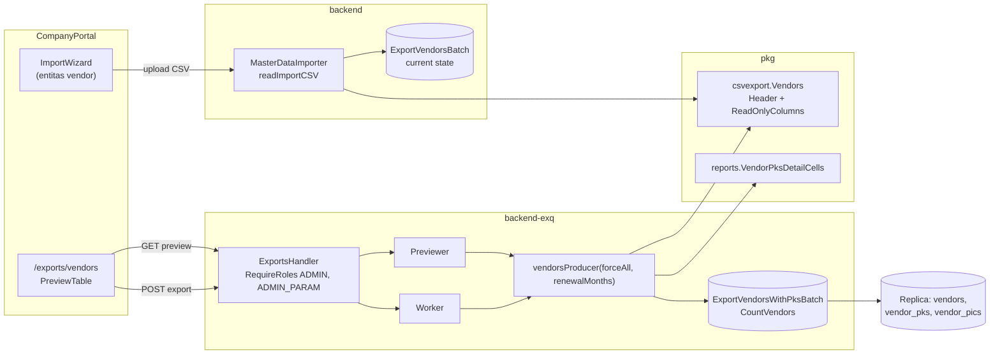

# Design Document

> **Status: disetujui PO 2026-11-06.** Berdasarkan `requirements.md` (disetujui PO 2026-11-06, D1–D8). Keputusan desain DD1–DD7 di `## Design Decisions` ✅ disetujui PO 2026-11-06 (mengikuti saran Kiro). `tasks.md` ditulis 2026-11-06.

## Overview

Ekspor vendor di `backend-exq` (kind `master_data_global`/`vendors` dan `vendor`/`vendor`) mendapat sembilan kolom baca-saja di belakang sembilan kolom vendor yang ada: tiga kolom Direktur Utama dan enam kolom PKS aktif. Pratinjau dan file memakai producer yang sama, jadi keduanya otomatis berisi kolom baru.

Bagian yang berubah:
1. **Kontrak CSV** (`pkg/csvexport`): entitas vendor mendapat daftar `ReadOnlyColumns`. Export_Header = `Header` + `ReadOnlyColumns`. `Header` (Import_Header) tidak berubah.
2. **Sel PKS** (`pkg/reports`): fungsi baru `VendorPksDetailCells` menghasilkan sembilan sel mentah. `VendorPksCells` (report `vendor_pks`) dibangun ulang di atas fungsi ini dengan keluaran yang sama persis, jadi dua ekspor tidak bisa berbeda isi.
3. **Query** (`backend-exq`): query baru `ExportVendorsWithPksBatch`, khusus `backend-exq`. Query bersama `ExportVendorsBatch` tidak disentuh karena dipakai impor di `backend`.
4. **Impor** (`backend`): `readImportCSV` menerima Export_Header dan membuang sel baca-saja sebelum validasi.
5. **Frontend**: badge status PKS di pratinjau, dua kolom angka rata kanan, deskripsi dataset, dan catatan di halaman impor.

Tidak ada tabel, migrasi, endpoint, role, atau audit action baru.

## Architecture



Alur data:
- **Pratinjau:** `Previewer` membuka transaksi `RepeatableRead` read-only di replica, memanggil `CountVendors` lalu `Page` (keyset `id`). `asOf` = waktu permintaan. Tanpa audit.
- **File:** `Worker` membuka transaksi yang sama di replica, `asOf` = waktu job diproses (WIB), lalu `Produce` memanggil `Page` berulang. Sel ditulis lewat `csvexport.Writer` (BOM, header, CSVSafe per sel). Audit `export_requested` dan `master_data_exported` tidak berubah.
- **Impor:** file dengan Export_Header dipotong ke sembilan kolom pertama di `readImportCSV`. Langkah sesudahnya (validasi, diff terhadap `ExportVendorsBatch`, staging, approval) tidak tahu kolom baca-saja pernah ada.

## Components and Interfaces

### pkg

#### `pkg/csvexport` (Req 1.1, 2.1, 2.6, 2.8)

`Entity` mendapat field baru:

```go
type Entity struct {
    Name          string
    Header        []string   // Import_Header: the columns the importer processes
    LegacyHeaders [][]string
    LegacyFill    map[string]string
    // ReadOnlyColumns follow Header in export files only. The importer accepts
    // Header+ReadOnlyColumns and drops these cells before validation (vendor-export-pks).
    ReadOnlyColumns []string
}

// ExportHeader is Header followed by ReadOnlyColumns (a fresh slice).
func (e Entity) ExportHeader() []string
```

- `importable[Vendors].ReadOnlyColumns` = `director_name, director_phone, director_email, pks_name, pks_effective_date, pks_expiry_date, pks_validity_months, pks_remaining_days, pks_status` (D2, D8). Entitas lain tetap `nil` (Req 2.8).
- `clone()` ikut menyalin `ReadOnlyColumns`.
- Konstanta nama kolom diekspor (`VendorReadOnlyColumns`) supaya test di dua modul memakai sumber yang sama.
- Template impor (`backend-exq` `template`) tetap menulis `e.Header`, jadi template tetap Import_Header (Req 2.6). Tidak ada perubahan kode di handler template.

#### `pkg/reports` (Req 1.2, 1.4–1.6, 6.1)

```go
// VendorPksDetailCells is the director + active-PKS part of a vendor row, raw
// (no CSVSafe): director name/phone/email, PKS name, effective date, expiry date,
// validity months, remaining days, status label. Nil = empty cell.
func VendorPksDetailCells(r VendorPksRow) []string

// VendorPksCells (unchanged output) = CSVSafe over [code, name] + VendorPksDetailCells.
func VendorPksCells(r VendorPksRow) []string
```

- Format sama dengan hari ini: tanggal `dateCell` (`YYYY-MM-DD`), angka `int32Cell`, status = `PksStatuses[key]`, kosong bila nil.
- `VendorPksCells` hari ini memakai CSVSafe hanya pada sel teks. CSVSafe tidak mengubah tanggal `YYYY-MM-DD`, bilangan bulat (termasuk negatif, cocok `plainNumberRe`), dan label status, jadi menerapkannya ke semua sel memberi keluaran yang sama. Test report `vendor_pks` yang ada menjaga ini (Property 5).
- Fungsi mentah dipakai producer vendor karena sel pratinjau harus mentah (CSVSafe hanya di writer file).

### backend-exq

#### Query `ExportVendorsWithPksBatch` (Req 1.2–1.7, 4.3)

File baru `backend-exq/queries/vendor_export_pks.sql` (bukan file bersama):

```sql
-- name: ExportVendorsWithPksBatch :many
-- Vendor columns + predicates: COPY of ExportVendorsBatch (backend/queries/master_data_export.sql);
-- keep in sync, Property 2 checks it on a real DB. Director/PKS joins: COPY of ExportVendorPksBatch
-- (vendor_pks_report.sql). Both joins hit partial unique indexes (vendor_pics_director_uq,
-- vendor_pks_active_uq), so they never add rows and CountVendors stays the row count.
SELECT v.id, v.code, v.name,
       COALESCE(v.legal_name, '')::text    AS legal_name,
       COALESCE(v.npwp, '')::text          AS npwp,
       COALESCE(v.contact_email, '')::text AS contact_email,
       COALESCE(v.contact_phone, '')::text AS contact_phone,
       COALESCE(v.hq_address, '')::text    AS hq_address,
       v.is_active,
       d.name  AS director_name,
       d.phone AS director_phone,
       d.email AS director_email,
       ap.pks_name, ap.effective_date, ap.expiry_date,
       COALESCE(vendor_pks_validity_months(ap.effective_date, ap.expiry_date), 0)::int AS validity_months,
       COALESCE(ap.expiry_date - sqlc.arg('today')::date, 0)::int                      AS remaining_days,
       COALESCE(vendor_pks_status(v.kind, ap.expiry_date, ap.terminated_at,
                sqlc.arg('today')::date, sqlc.arg('renewal_months')::int), '')::text   AS pks_status
FROM vendors v
LEFT JOIN vendor_pks ap ON ap.vendor_id = v.id AND ap.replaced_at IS NULL
LEFT JOIN vendor_pics d ON d.vendor_id = v.id AND d.is_director AND d.deleted_at IS NULL
WHERE v.id > sqlc.arg('after_id')::bigint
  AND (sqlc.narg('vendor_id')::bigint IS NULL OR v.id = sqlc.narg('vendor_id')::bigint)
  AND (sqlc.arg('status')::text = 'all'
       OR (sqlc.arg('status')::text = 'active' AND v.deleted_at IS NULL)
       OR (sqlc.arg('status')::text = 'disabled' AND v.deleted_at IS NOT NULL))
ORDER BY v.id
LIMIT sqlc.arg('batch_size')::int;
```

- COALESCE pada hasil fungsi mengikuti pola `ExportVendorPksBatch` (sqlc v1.31.1 menganggap hasilnya NOT NULL; NULL ke `int32` gagal di pgx). `0`/`''` berarti tanpa PKS aktif atau vendor INTERNAL; producer membedakannya lewat `expiry_date.Valid` dan `pks_status != ''`, sama dengan `vendorPksRow`.
- Kolom `d.*` dan `ap.pks_name/effective_date/expiry_date` nullable dari LEFT JOIN; dengan `emit_pointers_for_null_types` sqlc menghasilkan `*string` dan `pgtype.Date`.
- `CountVendors` (`export_preview.sql`) tidak berubah. Komentar file itu diperbarui: twin vendor sekarang `ExportVendorsWithPksBatch`.
- Regenerasi sqlc hanya di `backend-exq` (file tidak dibagi). `backend` tidak perlu regenerasi.

#### `vendorsProducer` (Req 1.1–1.8)

```go
func vendorsProducer(forceAll bool, renewalMonths int) Producer
```

- `header` = `csvexport.Lookup(Vendors).ExportHeader()` lewat helper baru `exportHeaderOf(name)`.
- `fetch` memanggil `ExportVendorsWithPksBatch` dengan `Today: wibDate(reports.TodayWIB(asOf))`, `RenewalMonths: renewalMonths`, scope, status (`forceAll` → `all`), keyset, limit.
- `cells` = `csvexport.VendorCells(VendorRow{9 kolom})` lalu `reports.VendorPksDetailCells(row)`; `row` dibangun oleh helper yang sama dengan `vendorPksRow` (diekstrak jadi `pksDetailRow(...)` supaya aturan `ExpiryDate.Valid` / `PksStatus != ""` satu tempat).
- `count` tetap `CountVendors`.
- `NewProducers` sudah menerima `pksRenewalMonths`; dua entri vendor (`KindVendor["vendor"]`, `KindMasterDataGlobal[Vendors]`) memakai nilai itu.
- `Querier` mengganti `ExportVendorsBatch` dengan `ExportVendorsWithPksBatch`. Fake di `producers_test.go`, `producers_property_test.go`, `producers_report_test.go` disesuaikan.

#### Handler, service, previewer, worker (Req 3.2, 4.1–4.4)

Tidak berubah. Route guard `RequireRoles(KindRoles[kind])`, `allowed()` di service dan previewer, transaksi replica, audit `export_requested` / `master_data_exported`, timeout pratinjau 10 detik, dan `limit` 1–100 tetap. Bentuk respons pratinjau (`columns`, `rows`, `total`, `next_after`, `limit`) sama, jadi `backend-exq/api/openapi.yaml` dan `exq-schema.d.ts` tidak berubah (Req 6.4).

### backend

#### `readImportCSV` (Req 2.1–2.5, 2.8)

```go
func readImportCSV(r io.Reader, header []string, legacy [][]string,
    legacyFill map[string]string, readOnly []string) ([]importRecord, []ImportRowError, error)
```

- Baris pertama dicek berurutan: `header` (Import_Header) → `header+readOnly` (Export_Header, hanya bila `readOnly` tidak kosong) → `legacy`.
- Bila cocok Export_Header: setiap baris data dengan jumlah sel = `len(header)+len(readOnly)` dipotong menjadi `cells[:len(header)]` sebelum masuk `recs`. Baris dengan jumlah sel lain dibiarkan, sehingga pemeriksaan per baris yang ada (`jumlah kolom %d, seharusnya %d`) menolaknya.
- Header yang tidak cocok dengan semuanya ditolak dengan pesan yang ada, yang menyebut Import_Header (Req 2.5).
- Kombinasi legacy header + kolom baca-saja tidak didukung (vendor tidak punya legacy header; YAGNI).
- `exportSpec` mendapat field `readOnly` dari `e.ReadOnlyColumns`; `masterdata_import.go` meneruskannya. Pemanggil lain `readImportCSV` (bila ada di test) memakai `nil`.
- Karena sel baca-saja dibuang sebelum `parseRow`, nilainya tidak divalidasi, tidak masuk snapshot change, tidak muncul di pratinjau dry-run, dan tidak disimpan (Req 2.2, 3.1). `masterdata_import_confirm.go` mengurai ulang file lewat jalur yang sama, jadi konfirmasi juga membuangnya.
- `ExportVendorsBatch` dan `MasterDataExportRepository.Vendors` tidak berubah (Req 2.8).

### Frontend (CompanyPortal)

#### `features/exports` (Req 5.1–5.4)

- `datasets.ts` dataset `vendors`: `numericColumns` = `["id", "pks_validity_months", "pks_remaining_days"]`; `description` = "Daftar vendor beserta kontak, alamat kantor pusat, Direktur Utama, dan PKS aktif." Filter tetap Status saja (D5).
- `PreviewTable.tsx` `buildColumns`: bila `name === "pks_status"` dan sel tidak kosong, render `PksStatusBadge` dengan key hasil `pksStatusFromLabel(v)`; sel kosong dirender kosong; label tak dikenal dirender sebagai teks. Kolom angka sudah rata kanan + `tabular-nums` lewat `meta.align` di `DataTable`.
- `pksStatusFromLabel` (baru, `features/admin-vendors`) adalah kebalikan label di `PKS_BADGES`, supaya label di frontend dan `reports.PksStatuses` dicek oleh satu test.
- `features/admin-vendors/index.ts` mengekspor `PksStatusBadge` dan `pksStatusFromLabel`.

#### `features/master-data-io` `ImportWizard.tsx` (Req 2.7)

Saat `entity === "vendors"`, daftar petunjuk langkah 1 mendapat satu butir: "File ekspor vendor berisi kolom Direktur Utama dan PKS. Kolom itu hanya untuk dibaca dan diabaikan saat impor. Ubah PKS di tab PKS dan direktur di data PIC."

## Data Models

Tidak ada tabel baru, kolom baru, atau migrasi (Req 6.4). Data dibaca dari tabel dan fungsi yang dibuat spec `vendor-pks` (migrasi `022`):

| Sumber | Dipakai untuk | Jaminan satu baris |
| --- | --- | --- |
| `vendor_pics` (`is_director`, `deleted_at IS NULL`) | `director_name/phone/email` | `vendor_pics_director_uq` (partial unique per `vendor_id`) |
| `vendor_pks` (`replaced_at IS NULL`) | `pks_name`, `pks_effective_date`, `pks_expiry_date` | `vendor_pks_active_uq` (partial unique per `vendor_id`) |
| `vendor_pks_validity_months(effective, expiry)` | `pks_validity_months` | fungsi IMMUTABLE |
| `ap.expiry_date - today` | `pks_remaining_days` | today = WIB dari Go |
| `vendor_pks_status(kind, expiry, terminated_at, today, renewal_months)` | `pks_status` (key → label) | NULL untuk INTERNAL |

Kolom CSV baru (urutan tetap, setelah `is_active`):

| Kolom | Isi | Kosong bila |
| --- | --- | --- |
| `director_name` | nama Director_PIC | tanpa direktur |
| `director_phone` | telepon Director_PIC | tanpa direktur atau telepon kosong |
| `director_email` | email Director_PIC | tanpa direktur atau email kosong |
| `pks_name` | nama PKS aktif | tanpa PKS aktif atau INTERNAL |
| `pks_effective_date` | `YYYY-MM-DD` | tanpa PKS aktif atau INTERNAL |
| `pks_expiry_date` | `YYYY-MM-DD` | tanpa PKS aktif atau INTERNAL |
| `pks_validity_months` | bilangan bulat | tanpa PKS aktif atau INTERNAL |
| `pks_remaining_days` | bilangan bulat, negatif bila lewat | tanpa PKS aktif atau INTERNAL |
| `pks_status` | label `reports.PksStatuses` ("Aktif", "Need Renewal", "Expired", "Terminated", "Belum diisi") | INTERNAL |

## Correctness Properties

### Property 1: Sel baca-saja sama dengan report `vendor_pks`

*For any* vendor row from `ExportVendorsWithPksBatch` (any combination of director present/absent, PKS present/absent, kind FLM/INTERNAL, status key), the last nine cells of the vendor producer equal `reports.VendorPksDetailCells` of the same data, and on a real database the vendor producer's last nine cells, after CSVSafe, equal cells 3–11 of the `vendor_pks` report for the same vendor, As_Of_Date, and renewal months.

**Validates: Requirements 1.2, 1.4, 1.5, 1.6, 6.1**

### Property 2: Kolom impor tidak berubah

*For any* database state, status filter, and vendor scope, the first nine cells of every vendor producer row equal `csvexport.VendorCells` of the `ExportVendorsBatch` row with the same `id`, and both queries return the same ids in the same order.

**Validates: Requirements 1.3, 1.7, 2.3, 2.8**

### Property 3: Pratinjau sama dengan file, jumlah sama dengan baris

*For any* vendor set and page size, concatenating the preview pages gives the same header (the Export_Header) and the same rows as the file, every row has `len(Export_Header)` cells, and `CountVendors` equals the number of rows written.

**Validates: Requirements 1.1, 1.7, 1.8, 6.3**

### Property 4: Impor mengabaikan kolom baca-saja

*For any* vendor CSV body valid under the Import_Header and any strings in the nine read-only cells, the dry-run of the Export_Header file (Import_Header columns + those cells) gives the same records, errors, creates, updates, and change previews as the dry-run of the Import_Header file.

**Validates: Requirements 2.1, 2.2, 2.3, 2.4, 3.1**

### Property 5: Header lain tetap ditolak

*For any* vendor CSV header that is neither the Import_Header nor the Export_Header (missing, extra, reordered, or renamed columns, or the read-only columns alone), the importer rejects the file with the existing header-mismatch error naming the Import_Header, and processes no row.

**Validates: Requirements 2.5**

### Property 6: Report `vendor_pks` tidak berubah

*For any* `reports.VendorPksRow`, `VendorPksCells` equals CSVSafe applied to `[code, name]` followed by CSVSafe applied to `VendorPksDetailCells`, and equals the output of the implementation before this change (golden cases in the existing report tests).

**Validates: Requirements 6.1, 6.3**

## Error Handling

| Kondisi | Penanganan |
| --- | --- |
| Hasil fungsi PKS NULL (INTERNAL / tanpa PKS) | COALESCE ke `0`/`''` di SQL; producer mengosongkan sel lewat `ExpiryDate.Valid` dan `PksStatus != ""` (sama dengan report). |
| `VENDOR_PKS_RENEWAL_MONTHS` tidak valid | Perilaku yang ada: `backend-exq` berhenti saat start (`reports.ParseVendorPksRenewalMonths`). |
| Replica gagal / timeout pratinjau | Perilaku yang ada: pratinjau `replicaErr` → 503; job ditandai gagal dan bisa diminta ulang. |
| Role tanpa akses | Perilaku yang ada: 403 dari route guard atau service (Req 4.2). |
| File impor dengan Export_Header tetapi baris berjumlah sel lain | Baris tidak dipotong; pemeriksaan per baris menolaknya dengan `jumlah kolom N, seharusnya 9`. Pesan ini sama dengan perilaku legacy header hari ini. |
| File impor dengan header lain | Pesan yang ada: "kolom header tidak sesuai; diharapkan persis: <Import_Header>". |
| File Export_Header diunggah ke `backend` versi lama | Ditolak sebagai header tidak cocok. Dicegah lewat urutan deploy (`backend` dulu atau bersamaan). |
| Label status tak dikenal di frontend | Ditampilkan sebagai teks biasa, tanpa badge. |

## Testing Strategy

**Unit (Go)**
- `pkg/csvexport`: `ExportHeader` = `Header` + `ReadOnlyColumns`, salinan baru (mutasi tidak bocor); entitas selain vendor tanpa `ReadOnlyColumns`; template vendor tetap Import_Header (Req 2.6, 2.8).
- `pkg/reports`: `VendorPksDetailCells` untuk direktur ada/tidak, PKS ada/tidak, INTERNAL, sisa hari negatif; Property 6 (rapid) + test golden report yang ada.
- `backend-exq` producer: Property 1 bagian unit (rapid, fake querier) dan Property 3 (perluas `propCases` "vendors" dan "vendors-forceAll" ke baris baru). Today = WIB dari `asOf` (batas tengah malam WIB).
- `backend` importer: Property 4 dan Property 5 (rapid, `pgregory.net/rapid` sudah ada di `backend`); test contoh: file Export_Header tanpa edit, file dengan sel baca-saja diedit, baris Export_Header dengan jumlah sel salah.

**Integration (DB nyata, `--build-tags integration`)**
- `backend-exq` `producers_integration_test.go` / `vendor_pks_export_integration_test.go`: seed vendor FLM dengan PKS aktif + PKS lama (replaced) + direktur, FLM tanpa PKS, INTERNAL; Property 1 bagian DB (bandingkan dengan report `vendor_pks`), Property 2 (bandingkan dengan `ExportVendorsBatch`), satu baris per vendor (Req 1.3).
- `backend-exq` handler/preview: role non-admin 403 untuk pratinjau dan ekspor vendor; audit `export_requested` + `master_data_exported` tetap berbentuk sama (Req 4.1–4.4).
- `backend` round-trip: perluas `TestExportRoundTrip_DryRunIsZeroChanges` dan `TestMasterDataImport_RoundTripOnRealDatabase` dengan varian Export_Header (sel baca-saja diisi data PKS nyata dan data acak) → 0 create, 0 update (Req 2.3, 2.4).

**Frontend (Vitest)**
- `PreviewTable`: `pks_status` → badge sesuai label, sel kosong kosong, label tak dikenal teks; dua kolom angka rata kanan (Req 5.1, 5.2).
- `pksStatusFromLabel`: semua label `PKS_BADGES` bolak-balik, dan daftar label sama dengan `reports.PksStatuses` (disalin eksplisit di test).
- `datasets.ts`: deskripsi dan `numericColumns` vendor; filter tetap Status (Req 5.3, 5.4).
- `ImportWizard`: catatan muncul hanya untuk entitas vendor (Req 2.7).

**Gate**
- `go test ./...` di `pkg`, `backend`, `backend-exq` (unit + integration), `golangci-lint`, `sqlc generate` di `backend-exq` tanpa diff lain, `go test ./internal/handler -run OpenAPI` di dua backend, `pnpm run gen:api:exq` tanpa diff, `pnpm run lint`, `pnpm run test:coverage` (ambang CP 84/80/80/85), `pnpm run build` (Req 6.3, 6.4).
- Cek browser manual oleh user (GR#10): pratinjau `/exports/vendors`, unduh file dan buka di Excel, impor file itu kembali (0 perubahan), impor file lama, catatan di halaman impor.

## Design Decisions

| ID | Keputusan | Alternatif | Alasan |
| --- | --- | --- | --- |
| DD1 | Query baru `ExportVendorsWithPksBatch` khusus `backend-exq` | Ubah `ExportVendorsBatch` (file bersama); query kedua `PKS by vendor ids` lalu gabung di Go | `ExportVendorsBatch` dipakai impor `backend` untuk membaca keadaan sekarang; mengubahnya menggeser kontrak impor dan mewajibkan regenerasi di dua modul. Query kedua menambah satu round-trip per halaman dan logika penggabungan. Duplikasi predicate dijaga Property 2 di DB nyata. |
| DD2 | `CountVendors` tidak berubah | Count baru dengan join | Dua LEFT JOIN ke partial unique index tidak menambah atau mengurangi baris. Property 3 memeriksa count = baris. |
| DD3 | `VendorPksDetailCells` mentah di `pkg/reports`, `VendorPksCells` dibangun di atasnya | Salin format di producer vendor; potong `VendorPksCells(r)[2:]` | Satu sumber format menjamin dua ekspor sama. Potongan `VendorPksCells` sudah ber-CSVSafe, sedangkan sel pratinjau harus mentah. |
| DD4 | `csvexport.Entity.ReadOnlyColumns` + `ExportHeader()`; importer memotong sel | Daftarkan Export_Header sebagai legacy header; header ekspor terpisah di `backend-exq` | Mekanisme legacy dirancang untuk kolom yang **kurang**, bukan lebih. Header terpisah di `backend-exq` membuat `backend` tidak tahu kolom mana yang boleh dibuang. Satu kontrak di `pkg/csvexport` dibaca kedua modul. |
| DD5 | Sel status berisi label; frontend memetakan label → badge | Sel berisi key, frontend memberi label | Keputusan D8: file dibaca manusia dan sama dengan report `vendor_pks`. Pemetaan balik di frontend kecil dan dites terhadap daftar label backend. |
| DD6 | Pakai ulang `PksStatusBadge` dari `features/admin-vendors` lewat `index.ts` | Pindahkan ke `components/ui`; badge baru di `features/exports` | Perubahan paling kecil, satu tampilan badge. Bila fitur ketiga butuh badge ini, pindahkan ke `components/ui` saat itu. |
| DD7 | Catatan statis di `ImportWizard` | Info di respons dry-run | Tidak mengubah API impor. Info dry-run butuh field baru di respons dan tipe frontend. |

## Files touched

| File | Perubahan |
| --- | --- |
| `pkg/csvexport/entities.go` (+ test) | `ReadOnlyColumns`, `ExportHeader`, `VendorReadOnlyColumns` |
| `pkg/reports/vendor_pks.go` (+ test) | `VendorPksDetailCells`; `VendorPksCells` memakainya |
| `backend-exq/queries/vendor_export_pks.sql` (baru) | `ExportVendorsWithPksBatch` |
| `backend-exq/queries/export_preview.sql` | komentar twin `CountVendors` |
| `backend-exq/internal/repository/*` | hasil `sqlc generate` |
| `backend-exq/internal/exportjob/producers.go`, `producers_report.go` | `vendorsProducer(forceAll, renewalMonths)`, `exportHeaderOf`, `Querier`, helper `pksDetailRow` |
| `backend-exq/internal/exportjob/*_test.go` | fake querier, property, integration |
| `backend/internal/service/masterdata_import_csv.go`, `masterdata_import.go`, `masterdata_export.go` | parameter `readOnly`, field `exportSpec.readOnly` |
| `backend/internal/service/*_test.go` | Property 4, 5, round-trip Export_Header, golden bila mencetak header |
| `frontend/CompanyPortal-Vite/src/features/exports/datasets.ts`, `components/PreviewTable.tsx` (+ test) | kolom angka, deskripsi, badge status |
| `frontend/CompanyPortal-Vite/src/features/admin-vendors/index.ts`, `components/PksStatusBadge.tsx` (+ test) | ekspor badge, `pksStatusFromLabel` |
| `frontend/CompanyPortal-Vite/src/features/master-data-io/components/ImportWizard.tsx` (+ test) | catatan vendor |
| `.claude/docs/` / `development-plan.md` / `.claude/development-progress.md` | entri X.16 dan status saat selesai |

## Deploy

- Urutan: `backend` (impor menerima Export_Header) sebelum atau bersamaan dengan `backend-exq` (file mulai berisi kolom baru).
- `VENDOR_PKS_RENEWAL_MONTHS` sudah wajib sama di dua backend (spec `vendor-pks`); fitur ini menambah satu pemakai di `backend-exq`.
- Tanpa migrasi; tidak ada langkah DB.
