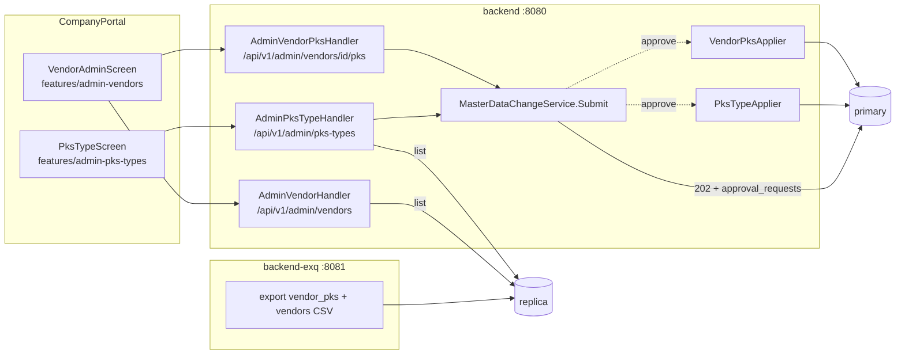

# Design Document

> Status: accepted 2026-11-18 (engineer) — berdasarkan `requirements.md` (accepted 2026-11-18, PO). DD1–DD10 diterima bersama dokumen ini.

## Overview

PKS vendor berubah dari "satu PKS aktif per vendor" menjadi "satu PKS aktif per (vendor, type)". Ada tiga bagian:

1. **Master type PKS baru** (`vendor_pks_types`): entitas master data dengan maker-checker, polanya sama dengan `cash_count_anomaly_category` (`041`). Isi awal `FLM` dan `CIT`. Type tidak bisa dinonaktifkan selama masih dipakai (Req 1).
2. **`vendor_pks` mendapat `pks_type_id` + `wod_number`.** Index satu PKS aktif dan index change pending berpindah dari per vendor ke per (vendor, type). WOD dibuat unik global (Req 2, 3).
3. **Pembaca menyesuaikan**: daftar vendor (list `pks` per type + filter type + status), laporan/ekspor `vendor_pks` (satu baris per PKS), dan CSV vendor (6 kolom PKS dibuang) (Req 4, 6, 7).

Aturan status (`vendor_pks_status()`), masa berlaku, monitoring, terminate, dan Renewal_Threshold **tidak berubah**. Fungsi-fungsinya hanya dipanggil per (vendor, type).

Tidak ada deviasi GR#3. Semua penulisan lewat `MasterDataChangeService.Submit` → `approval_requests` → `Applier` di dalam tx apply, dengan audit di tx yang sama.

## Architecture



Alur data:
- **Tulis**: submit → validasi (role, field, aturan in-use/WOD/pending) → `master_data_change_requests` + `approval_requests` → 202. Approve oleh checker ≠ maker → applier → tabel + `audit_logs` dalam satu tx.
- **Baca**: daftar vendor, daftar type, dan ekspor dari replica. Detail vendor/PKS/type dari primary (read-after-write).

## Components and Interfaces

### Backend — master type PKS (baru)

#### `backend/queries/vendor_pks_types.sql`
`ListPksTypes` (replica; + kolom `in_use` = `EXISTS vendor_pks WHERE pks_type_id = t.id AND replaced_at IS NULL`), `GetPksType`, `GetPksTypeByCode`, `ListActivePksTypes`, `CreatePksType`, `UpdatePksTypeName` (`WHERE is_active`), `DisablePksType`, `EnablePksType`, `LockPksType` (`FOR UPDATE`), `LockPksTypeShare` (`FOR SHARE`), `PksTypeInUse`, `GetPendingPksTypeChange`.

#### `internal/repository/pks_type_repository.go`
Repo read-only (`db` primary + `dbRead` replica), sesuai pola repo master data.

#### `internal/service/pks_type_admin.go` — `PksTypeAdminService`
- `List`, `Get`, `Create(code, name)`, `Update(id, name)`, `Disable(id)`, `Enable(id)` → `Submit` dengan `entity_type = "vendor_pks_type"`.
- Validasi: `code` `^[A-Z0-9]{2,10}$` (A2); `name` 1–100 setelah trim; code duplikat (tabel atau create pending) → `ErrPksTypeConflict` (409); disable saat `in_use` → `ErrPksTypeInUse` (409); change pending lain pada type itu → `ErrMasterDataChangePending` (409, sudah dijaga `master_data_change_requests_pending_uq (entity_type, entity_id)`).
- Role dicek ulang di `Submit` (`ADMIN`/`ADMIN_PARAM`).

#### `internal/service/masterdata_applier_pks_type.go` — `PksTypeApplier`
- `create`: insert; `23505` → `ErrPksTypeConflict`.
- `update`: ubah `name`, guarded `WHERE is_active`; 0 baris → stale.
- `disable`: `LockPksType` (`FOR UPDATE`) → `PksTypeInUse` → bila dipakai `ErrPksTypeInUse` (apply gagal, 409, change tidak diterapkan) → `DisablePksType`.
- `enable`: `EnablePksType`.
- Didaftarkan di `masterDataApplierRegistry` (`cmd/api/main.go`) sebagai `"vendor_pks_type"`.

#### `internal/handler/admin_pks_type_handler.go`
| Method | Path | Hasil |
|---|---|---|
| GET | `/api/v1/admin/pks-types` | `{pks_types:[{id,code,name,is_active,in_use}]}` (replica) |
| GET | `/api/v1/admin/pks-types/{id}` | satu type + `pending` change (primary) |
| POST | `/api/v1/admin/pks-types` | `{code,name}` → 202 |
| PUT | `/api/v1/admin/pks-types/{id}` | `{name}` → 202 |
| POST | `/api/v1/admin/pks-types/{id}/disable` | 202 / 409 `pks_type_in_use` |
| POST | `/api/v1/admin/pks-types/{id}/enable` | 202 |

Dipasang di grup `masterDataAdmin`. Respons JSON datar, sama seperti handler tetangga. Semua endpoint masuk `backend/api/openapi.yaml`.

### Backend — PKS vendor (berubah)

Pemetaan op yang sudah ada tetap: terminate = op `disable`, batalkan terminate = op `enable`, keduanya dengan `entity_id` = id PKS (`master_data_change_requests_op_chk` hanya mengizinkan `create|update|disable|enable`).

#### `backend/queries/vendor_pks.sql`
- Semua `SELECT … FROM vendor_pks` menambah `pks_type_id`, `wod_number`, serta join `vendor_pks_types` untuk `code`/`name` (detail).
- `GetActiveVendorPks(vendor_id, pks_type_id)`: menggantikan versi per vendor.
- `InsertVendorPks`: tambah `pks_type_id`, `wod_number` (disimpan setelah trim).
- `GetPendingVendorPksChanges(vendor_id)`: **many** (satu per type, A1). Menggantikan `GetPendingVendorPksChange :one`.
- `WodNumberTaken(wod)`: `EXISTS` di `vendor_pks` (semua baris) **atau** change `vendor_pks` op `create` yang pending, dengan perbandingan `lower(btrim(...))`.
- `LockVendorForPks` tetap. Ditambah `LockPksTypeShare` di applier create.

#### `internal/service/vendor_pks_admin.go`
- `Create` menerima `PksType` (code) + `WodNumber`. Code di-resolve ke `pks_type_id` aktif (tidak ada / nonaktif → 422 `pks_type`). WOD divalidasi 1–100 setelah trim (422) dan dicek `WodNumberTaken` (409 `wod_number`).
- Payload change sekarang memuat `vendor_id` + `pks_type_id` untuk **semua** op (`create`, `disable`=terminate, `enable`=unterminate). Untuk terminate/unterminate, nilainya diambil dari baris PKS yang dituju. Index pending (DD4) membaca field ini.
- Cek pending: hanya change dengan (vendor, type) yang sama yang memblok (409). Index DB menjadi jaring terakhir (`23505` → `ErrMasterDataChangePending`).
- `Get` mengembalikan `VendorPksDetail{ groups: [{pks_type:{code,name}, active, history[], pending}] }`. Group dibuat untuk tiap type yang pernah punya PKS atau punya change pending, diurutkan berdasarkan `code`.

#### `internal/service/masterdata_applier_vendor_pks.go`
- `create`: `LockVendorForPks` → `LockPksTypeShare` (nonaktif → stale) → `GetActiveVendorPks(vendor, type)` dibandingkan dengan `replaced_pks_id` dari snapshot submit (beda → stale) → mark replaced → insert (`23505` pada index WOD → 409 `ErrVendorPksWodTaken`; pada index aktif → stale) → set `replaced_by`.
- `disable` / `enable` (terminate / unterminate): tidak berubah. Query-nya sudah per `id`, jadi type lain tidak tersentuh.

#### `internal/handler/admin_vendor_pks_handler.go`
Rute tetap sama. Body `POST /` menambah `pks_type`, `wod_number`. Respons `GET /` berubah ke bentuk `groups`. OpenAPI diperbarui, lalu `gen:api`.

### Backend — daftar vendor (berubah)

#### `backend/queries/vendors_admin.sql`
- `ListVendorsAdmin` / `CountVendorsAdmin`: join PKS aktif tunggal **dihapus**. Filter baru: `sqlc.narg('pks_type_id')` + `sqlc.narg('pks_status')`. Kalau keduanya terisi: `LEFT JOIN vendor_pks ap ON ap.vendor_id = v.id AND ap.pks_type_id = @pks_type_id AND ap.replaced_at IS NULL` lalu `vendor_pks_status(v.kind, ap.expiry_date, ap.terminated_at, @today, @renewal) = @pks_status`. Join ini ke index parsial unik, jadi tidak menggandakan baris dan `total` tetap benar.
- Query baru `ListVendorPksSummaries(vendor_ids[], today, renewal)`: `vendors × vendor_pks_types aktif` (`CROSS JOIN`), `LEFT JOIN` PKS aktif per (vendor, type), kembalian `vendor_id, code, name, pks_status, remaining_days`. Hanya untuk `kind = 'FLM_VENDOR'`; vendor INTERNAL tidak menghasilkan baris (Req 4.6). Dijalankan sekali per halaman (dua query, tanpa N+1).

#### `internal/service/vendor_admin.go` + `internal/handler/admin_vendor_handler.go`
- Param `pks_type` (code) + `pks_status`. Keduanya wajib bersama; satu saja, code tidak dikenal/nonaktif, atau status di luar 5 nilai → 400 (A4).
- Item daftar: field PKS tunggal **dibuang** (`pks_name`, `pks_effective_date`, `pks_expiry_date`, `pks_validity_months`, `pks_remaining_days`, `pks_status`). Field baru `pks: [{pks_type, pks_type_name, pks_status, remaining_days|null}]` (A5). Field direktur tetap.
- `/admin/vendors` tetap ditulis tangan (D31 `vendor-pks`), tidak masuk OpenAPI.

### Shared — `pkg/reports` + `pkg/csvexport`

#### `pkg/reports/vendor_pks.go`
- `VendorPksHeader` → 13 kolom (Req 6.3): menambah `Type PKS`, `No. WOD` setelah kolom direktur.
- `VendorPksRow` + `VendorPksCells` menambah `PksTypeCode`, `WodNumber` (lewat `CSVSafe`).
- Params laporan: `pks_type` + `pks_status` (aturan sama dengan Req 4.4); validator bersama dipakai `backend` dan `backend-exq`.

#### `pkg/csvexport/entities.go`
- `VendorReadOnlyColumns` → hanya `director_name, director_phone, director_email`.
- Export_Header vendor yang sebelumnya (dengan 9 kolom baca-saja) ditambahkan ke `LegacyHeaders`. Saat impor, sel baca-sajanya dibuang (pola `vendor-export-pks`).

### backend-exq — ekspor

- `backend/queries/vendor_pks_report.sql` (+ salinan sqlc di `backend-exq`): dua cabang.
  - Default / status ≠ `belum_diisi`: satu baris per `vendor_pks` aktif (join type, vendor, direktur), difilter `q`, `status`, dan opsional (`pks_type`, `pks_status`). Diurutkan `vendor.code, type.code`.
  - `pks_status = belum_diisi`: satu baris per vendor FLM yang tidak punya PKS aktif untuk `pks_type` itu; sel PKS kosong (Req 6.2, A3).
- `backend-exq/queries/vendor_export_pks.sql` (CSV vendor): join PKS dibuang, hanya kolom direktur yang tersisa.

### Frontend — CompanyPortal

#### `features/admin-pks-types/` (baru)
Tabel type (code, nama, badge status, badge "Dipakai"), dialog tambah/ubah nama, aksi nonaktif/aktif. Nonaktif dimatikan bila `in_use`, dengan alasan dalam teks. Hasil 202 ditampilkan sebagai "menunggu persetujuan". Ditaruh di menu Pengaturan di samping master data lain; path final ditentukan di `tasks.md`. Hanya untuk `ADMIN`/`ADMIN_PARAM`.

#### `features/admin-vendors/` (berubah)
- `VendorsTable`: kolom PKS tunggal diganti grup kolom per type aktif (header dari `GET /pks-types` yang aktif), isinya `PksStatusBadge` + Monitoring. `belum_diisi` → badge netral "Tidak ada".
- `VendorFilterBar` + `useAdminVendorsUrlState`: select Type PKS + select Status. Keduanya wajib bersama (status dimatikan selama type kosong).
- `PksPanel`: satu kartu per type (aktif, riwayat, pending), WOD ditampilkan.
- `PksFormDialog`: select type (aktif) + input No. WOD, dengan error 409/422 per field.
- `pksApi.ts`/`types.ts`: tipe dari `schema.d.ts` hasil `gen:api`.

## Data Models

### Migrasi `043_vendor_pks_type.sql`

```sql
BEGIN;
-- Guard (Req 9.2): kolom baru NOT NULL tanpa nilai yang bisa ditebak.
DO $$ BEGIN
  IF EXISTS (SELECT 1 FROM public.vendor_pks) THEN
    RAISE EXCEPTION '043: vendor_pks berisi data; isi pks_type/wod_number dulu (tidak ditebak)';
  END IF;
  IF EXISTS (SELECT 1 FROM public.master_data_change_requests
             WHERE entity_type = 'vendor_pks' AND status = 'pending') THEN
    RAISE EXCEPTION '043: ada change vendor_pks pending tanpa pks_type_id; selesaikan dulu';
  END IF;
END $$;

CREATE TABLE public.vendor_pks_types (
  id         bigint GENERATED ALWAYS AS IDENTITY PRIMARY KEY,
  code       text NOT NULL CONSTRAINT vendor_pks_types_code_chk CHECK (code ~ '^[A-Z0-9]{2,10}$'),
  name       text NOT NULL CONSTRAINT vendor_pks_types_name_chk CHECK (char_length(btrim(name)) BETWEEN 1 AND 100),
  is_active  boolean NOT NULL DEFAULT true,
  created_at timestamptz NOT NULL DEFAULT now(),
  updated_at timestamptz NOT NULL DEFAULT now()
);
CREATE UNIQUE INDEX vendor_pks_types_code_uq ON public.vendor_pks_types (upper(code));
CREATE TRIGGER trg_vendor_pks_types_set_updated_at BEFORE UPDATE ON public.vendor_pks_types
  FOR EACH ROW WHEN ((old.* IS DISTINCT FROM new.*)) EXECUTE FUNCTION public.set_updated_at();
INSERT INTO public.vendor_pks_types (code, name) VALUES ('FLM', 'FLM'), ('CIT', 'CIT');

ALTER TABLE public.vendor_pks
  ADD COLUMN pks_type_id bigint NOT NULL REFERENCES public.vendor_pks_types(id) ON DELETE RESTRICT,
  ADD COLUMN wod_number  text   NOT NULL
    CONSTRAINT vendor_pks_wod_chk CHECK (wod_number = btrim(wod_number) AND char_length(wod_number) BETWEEN 1 AND 100);

DROP INDEX public.vendor_pks_active_uq;
CREATE UNIQUE INDEX vendor_pks_active_uq ON public.vendor_pks (vendor_id, pks_type_id) WHERE replaced_at IS NULL;
CREATE UNIQUE INDEX vendor_pks_wod_uq ON public.vendor_pks (lower(wod_number));
CREATE INDEX vendor_pks_type_active_idx ON public.vendor_pks (pks_type_id) WHERE replaced_at IS NULL; -- cek in-use

DROP INDEX public.master_data_change_requests_vendor_pks_pending_uq;
CREATE UNIQUE INDEX master_data_change_requests_vendor_pks_pending_uq
  ON public.master_data_change_requests (((payload->>'vendor_id')::bigint), ((payload->>'pks_type_id')::bigint))
  WHERE entity_type = 'vendor_pks' AND status = 'pending';
CREATE UNIQUE INDEX master_data_change_requests_vendor_pks_wod_pending_uq
  ON public.master_data_change_requests (lower(btrim(payload->>'wod_number')))
  WHERE entity_type = 'vendor_pks' AND op = 'create' AND status = 'pending';
CREATE UNIQUE INDEX master_data_change_requests_pks_type_code_pending_uq
  ON public.master_data_change_requests (upper(payload->>'code'))
  WHERE entity_type = 'vendor_pks_type' AND op = 'create' AND status = 'pending';
-- + COMMENT ON TABLE/COLUMN (type = master maker-checker, tidak di-hard-delete; wod unik global)
COMMIT;
```

Catatan:
- `master_data_change_requests` (`003`) tidak punya CHECK pada `entity_type`, jadi `vendor_pks_type` cukup didaftarkan di registry applier. `op` tetap `create|update|disable|enable`.
- Guard kedua mencegah change `vendor_pks` pending lama (tanpa `pks_type_id`) lolos ke index baru dengan NULL. Di dev saat ini 0 baris `vendor_pks`; jumlah change pending dicek ulang di task migrasi sebelum `up`.
- Tidak ada perubahan pada `vendors`, `vendor_pks_status()`, `vendor_pks_validity_months()`, atau `export_jobs` (kind `vendor_pks` sudah ada sejak `037`).
- Forward-only, sesuai konvensi proyek. Rollback dev = skrip `backend/scripts/dev/rollback_043_vendor_pks_type.sql` (pola `042`), aman karena data PKS masih kosong.

### Payload change

| entity_type | op | entity_id | payload |
|---|---|---|---|
| `vendor_pks_type` | create | — | `{code, name}` |
| `vendor_pks_type` | update | type id | `{name}` (+ `before`) |
| `vendor_pks_type` | disable / enable | type id | `{}` |
| `vendor_pks` | create | — | `{vendor_id, pks_type_id, pks_name, effective_date, expiry_date, wod_number, replaced_pks_id\|null}` |
| `vendor_pks` | disable (terminate) / enable (unterminate) | PKS id | `{vendor_id, pks_type_id, reason}` |

## Correctness Properties

### Property 1: Satu PKS aktif per (vendor, type)
*For any* urutan approve `create` PKS (termasuk yang konkuren) untuk vendor dan type mana pun, jumlah baris `vendor_pks` dengan `replaced_at IS NULL` per (vendor_id, pks_type_id) selalu ≤ 1.
**Validates: Requirements 2.5, 2.7**

### Property 2: Ganti PKS tidak menyentuh type lain
*For any* vendor dengan PKS aktif di type A dan B, approve `create` / terminate / unterminate untuk type A tidak mengubah baris PKS type B sama sekali (semua kolom sama sebelum dan sesudah).
**Validates: Requirements 2.5, 3.1**

### Property 3: WOD unik global
*For any* dua PKS_Record, atau PKS_Record + change `create` pending, nilai `lower(btrim(wod_number))` keduanya berbeda; submit dengan WOD yang sama (beda huruf besar/kecil atau spasi tepi) ditolak 409, termasuk WOD milik PKS riwayat.
**Validates: Requirements 2.3, 2.4, 2.7**

### Property 4: Type yang dipakai tidak bisa dinonaktifkan
*For any* type yang punya PKS dengan `replaced_at IS NULL` (terminated atau tidak), submit disable ditolak 409, dan approve disable yang lolos submit tetapi tipenya dipakai sebelum apply gagal tanpa perubahan.
**Validates: Requirements 1.5, 1.6**

### Property 5: Type wajib dan aktif
*For any* PKS create dengan type kosong, tidak dikenal, atau nonaktif saat submit → 422; bila type nonaktif saat apply → change stale tanpa baris baru.
**Validates: Requirements 2.2, 2.6**

### Property 6: Filter = status yang tampil
*For any* `pks_type` T dan `pks_status` S, setiap vendor di hasil daftar punya entry `pks` dengan type T dan status S, setiap vendor FLM yang memenuhi `q`/`status` dengan status S untuk T ada di hasil, dan `total` = jumlah vendor tersebut.
**Validates: Requirements 4.3, 4.5**

### Property 7: Entry per type aktif
*For any* vendor FLM, daftar `pks` berisi tepat satu entry per type aktif (urut `code`), berstatus `belum_diisi` bila tidak ada PKS aktif; vendor INTERNAL selalu `pks = []` dan tidak cocok dengan filter apa pun.
**Validates: Requirements 4.1, 4.6**

### Property 8: Pending per (vendor, type)
*For any* vendor, dua change PKS pending untuk type yang sama tidak bisa ada bersamaan (submit kedua 409), sedangkan change pending untuk type berbeda bisa.
**Validates: Requirements 2.8**

### Property 9: Ekspor = satu baris per PKS aktif
*For any* filter, baris ekspor `vendor_pks` (status ≠ `belum_diisi`) berkorespondensi 1:1 dengan PKS aktif yang memenuhi filter; dengan `belum_diisi`, berkorespondensi 1:1 dengan vendor FLM tanpa PKS aktif untuk type itu.
**Validates: Requirements 6.1, 6.2**

### Property 10: CSV vendor bolak-balik
*For any* file vendor dengan header baru, Export_Header lama (9 kolom baca-saja), atau Import_Header, impor menghasilkan change yang sama untuk kolom yang bisa diubah; header lain ditolak.
**Validates: Requirements 7.1, 7.2**

## Error Handling

| Kondisi | HTTP | Kode / field |
|---|---|---|
| Role bukan `ADMIN`/`ADMIN_PARAM` | 403 | dari middleware atau `Submit` |
| `code` / `name` type tidak valid | 422 | `code` / `name` |
| Code type sudah ada / create pending sama | 409 | `pks_type_conflict` |
| Disable type yang dipakai (submit) | 409 | `pks_type_in_use` |
| Disable type yang dipakai (apply) | approve gagal 409, change tidak diterapkan | `pks_type_in_use` |
| Change pending lain pada type / (vendor, type) | 409 | `master_data_change_pending` |
| `pks_type` kosong / tidak dikenal / nonaktif | 422 | `pks_type` |
| `wod_number` kosong / > 100 | 422 | `wod_number` |
| `wod_number` sudah dipakai | 409 | `wod_number` |
| Saat apply: type nonaktif / PKS aktif berubah | change `stale` | — |
| Saat apply: index WOD bentrok | approve gagal 409 | `wod_number` |
| Filter daftar/ekspor: hanya satu dari `pks_type`/`pks_status`, atau nilai tidak dikenal | 400 | `pks_type` / `pks_status` |
| `043` dijalankan dengan `vendor_pks` berisi atau change PKS pending | migrasi gagal, rollback tx | pesan `043: …` |

Respons error mengikuti bentuk tetangga di ATM `backend` (JSON datar dengan pesan per field). `backend-exq` memakai envelope `pkg/response`.

## Testing Strategy

- **Unit (table-driven, mock repo)**: validasi `PksTypeAdminService` (regex code, panjang name, update hanya name, disable in-use), validasi `VendorPksAdminService.Create` (type, WOD trim/panjang/duplikat, pending per type), parse filter daftar dan ekspor (pasangan wajib, 400), `pkg/reports` (header 13 kolom, `CSVSafe` pada WOD dan type), dan `pkg/csvexport` (header baru + legacy).
- **Property (`rapid`, sudah dipakai)**: Property 6, 7 (generator vendor × type × tanggal × status), Property 10 (round-trip CSV).
- **Integration (`//go:build integration`, skip tanpa `DATABASE_URL`)**: migrasi `043` di DB kosong dan kedua guard; Property 1 dengan approve konkuren (dua goroutine); Property 2, 3, 4 (termasuk terminated dan race submit → apply), 5, 8, 9; maker ≠ checker; audit dalam tx (audit gagal = rollback); daftar dari replica.
- **Kontrak**: `go test ./internal/handler -run OpenAPI` untuk `/admin/pks-types*` + `/admin/vendors/{id}/pks*`; `gen:api` + vitest stale-check.
- **Frontend (vitest + RTL)**: tabel type (disable dimatikan bila dipakai), kolom per type + badge "Tidak ada", filter pasangan type/status di URL, `PksFormDialog` (type + WOD, error 409/422 per field), `PksPanel` per type.
- **Regresi**: test `vendor-pks` dan `vendor-export-pks` yang menyentuh PKS tunggal diperbarui sesuai kontrak baru; seluruh suite lain tetap hijau.
- **Manual browser**: outstanding (user), Golden Rule #10.

## Design Decisions

| # | Keputusan | Alasan |
|---|---|---|
| DD1 | Tabel `vendor_pks_types` (id, code, name, is_active), soft-disable lewat `is_active`, tanpa `deleted_at`. | Pola master kecil `041`; type tidak pernah dihapus (Req 1.8). |
| DD2 | `vendor_pks.pks_type_id` FK + `wod_number` disimpan sudah di-trim (CHECK `= btrim`), unik pada `lower(wod_number)`. | Unik case-insensitive (Q4) dijaga DB; trim di service + CHECK menjaga konsistensi. |
| DD3 | `vendor_pks_active_uq` dibuat ulang per `(vendor_id, pks_type_id)`; nama index sama. | Req 2.7; nama sama supaya komentar/test lama tetap merujuk index yang benar. |
| DD4 | Index pending `vendor_pks` per `(vendor_id, pks_type_id)` dari payload; semua op membawa `pks_type_id`. | A1; terminate/unterminate juga harus terkunci per type. |
| DD5 | Index pending unik untuk WOD (create) dan code type (create). | Menutup celah dua submit konkuren dengan nilai sama sebelum ada baris di tabel. |
| DD6 | Applier create PKS: `FOR UPDATE` vendor + `FOR SHARE` type; applier disable type: `FOR UPDATE` type lalu cek in-use. | Disable type dan create PKS untuk type itu saling menunggu, sehingga tidak ada PKS aktif baru pada type yang sudah nonaktif (Property 4, 5). |
| DD7 | Daftar vendor = dua query (halaman vendor + ringkasan PKS per vendor × type aktif), tanpa JSON agregat di SQL. | Paging/`total` tetap sederhana; ringkasan satu query per halaman, tanpa N+1. |
| DD8 | Filter daftar memakai `pks_type_id` hasil resolve code di service. | Code tidak dikenal/nonaktif → 400 sebelum query. |
| DD9 | Ekspor `belum_diisi` = cabang query terpisah (vendor tanpa PKS type itu). | Req 6.2 / A3, tanpa mengubah makna "satu baris per PKS". |
| DD10 | Migrasi `043` berhenti bila `vendor_pks` berisi atau ada change `vendor_pks` pending. | Req 9.2; tidak menebak type/WOD untuk data nyata. |

## Files touched

- `backend/migrations/043_vendor_pks_type.sql` (baru), `backend/scripts/dev/rollback_043_vendor_pks_type.sql` (baru)
- `backend/queries/vendor_pks_types.sql` (baru), `vendor_pks.sql`, `vendors_admin.sql`, `vendor_pks_report.sql` → `sqlc generate` (+ perbaikan `UserLeafe` → `UserLeave`)
- `backend/internal/repository/pks_type_repository.go` (baru), `vendor_pks_admin_repository.go`, `vendor_admin_repository.go`
- `backend/internal/service/pks_type_admin.go`, `masterdata_applier_pks_type.go` (baru), `vendor_pks_admin.go`, `masterdata_applier_vendor_pks.go`, `vendor_admin.go`
- `backend/internal/handler/admin_pks_type_handler.go` (baru), `admin_vendor_pks_handler.go`, `admin_vendor_handler.go`
- `backend/cmd/api/main.go` (registry `vendor_pks_type`, mount `/api/v1/admin/pks-types`)
- `backend/api/openapi.yaml`
- `pkg/reports/vendor_pks.go`, `pkg/csvexport/entities.go`
- `backend-exq/queries/vendor_export_pks.sql`, query laporan PKS + producer/params di `internal/exportjob`
- `frontend/CompanyPortal-Vite/src/features/admin-pks-types/` (baru), `features/admin-vendors/` (tabel, filter, URL state, PKS panel/form, api/types), router + menu Pengaturan, `src/lib/api/schema.d.ts`
- Dokumentasi saat apply: `.claude/CLAUDE.md` Sec 3, `.claude/docs/data-map.md`, `.claude/docs/decisions.md`, `.claude/development-progress.md`
