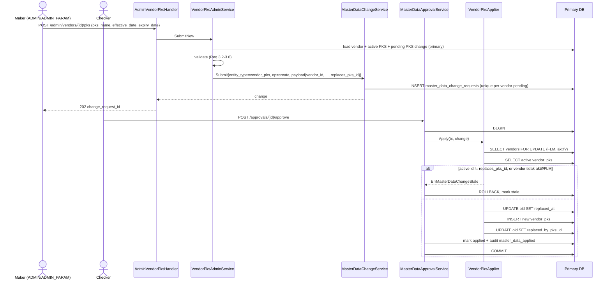

# Design Document

> **Status: draft 2026-11-05; `tasks.md` ditulis atas permintaan user 2026-11-05. Revisi 2026-11-05 (D32): Direktur Utama pindah dari kolom `vendors` ke PIC bertanda `vendor_pics.is_director` (DD9–DD11).** Berdasarkan `requirements.md` (disetujui PO 2026-11-05, D1–D31). Keputusan desain DD1–DD8 di `## Design Decisions` adalah saran Kiro dan perlu dicek PO bersama dokumen ini.

## Overview

Fitur ini menambah dua hal ke master data vendor di `backend/` dan CompanyPortal, tanpa modul baru:

1. **Direktur Utama sebagai PIC**: satu kolom penanda `vendor_pics.is_director` (D32). Direktur dicatat lewat form PIC, maker-checker PIC, dan CSV PIC yang sudah ada. Constraint database memastikan direktur selalu PIC tingkat vendor, tanpa roles, bukan penerima notifikasi, dan paling banyak satu per vendor. Tabel `vendors` tidak berubah (Req 1, 2).
2. **PKS vendor**: tabel baru `vendor_pks` dengan satu PKS aktif per vendor dan riwayat. Tiga aksi lewat maker-checker master data: catat PKS baru (menggantikan PKS aktif), terminate, batalkan terminate (Req 3, 4, 5). Status, masa berlaku, dan sisa hari dihitung saat dibaca oleh dua fungsi SQL, sehingga daftar, filter, detail, dan ekspor memakai satu aturan (Req 6, 7, 8). Ekspor CSV sesuai filter berjalan sebagai report kind baru di `backend-exq` (Req 10).

Pola yang dipakai ulang:
- `MasterDataChangeService.Submit` → `approval_requests` (`document_type = master_data`) → `MasterDataApprovalService.applyOne` → `Applier` per `entity_type`, dengan audit di transaksi apply (`master_data_applied`).
- Guard `masterDataAdmin` (`ADMIN`, `ADMIN_PARAM`) di route + `authorizeMasterDataMaker` di service.
- Legacy header CSV (`pkg/csvexport.Entity.LegacyHeaders` + `KeepCurrentCell`), seperti `vendor_branches`.
- Report kind `backend-exq` (`pkg/reports`, `report_params` jsonb, `export_jobs`), seperti laporan DSR telat (mig `035`).

Tidak ada deviasi Golden Rule #3: semua perubahan lewat maker-checker.

## Architecture

### Komponen dan alur data

```mermaid
flowchart LR
  subgraph CP[CompanyPortal admin-vendors]
    L[AdminVendorsPage<br/>kolom + filter Status PKS + Ekspor CSV]
    D[VendorDetailPage<br/>tab PKS]
    F[VendorPicFormDialog<br/>checkbox Direktur Utama]
  end

  subgraph BE[backend :8080]
    VA[/admin/vendors<br/>AdminVendorHandler/]
    VP[/admin/vendors/vendorID/pks<br/>AdminVendorPksHandler/]
    VAS[VendorAdminService]
    VPS[VendorPksAdminService]
    MDC[MasterDataChangeService]
    MDA[MasterDataApprovalService]
    VC[/admin/vendors/vendorID/pics<br/>AdminVendorPicHandler/]
    VCS[VendorPicAdminService<br/>VendorPicRoleService]
    APL[VendorPicApplier<br/>VendorPksApplier]
  end

  subgraph EXQ[backend-exq :8081]
    EX[/exports/reports/vendor-pks/]
    PR[vendorPksProducer]
  end

  subgraph DB[(PostgreSQL)]
    V[vendors<br/>tidak berubah]
    PC[vendor_pics<br/>+ is_director]
    P[vendor_pks]
    FN[[vendor_pks_status<br/>vendor_pks_validity_months]]
    MD[master_data_change_requests]
    EJ[export_jobs]
  end

  L -->|GET list ?pks_status| VA
  F -->|POST/PUT 202| VC
  D -->|GET / POST 202| VP
  L -->|POST report| EX
  VA --> VAS
  VC --> VCS --> MDC
  VP --> VPS --> MDC
  MDC --> MD
  MDA -->|approve final| APL
  APL -->|tx: write + audit| PC
  APL --> P
  VAS -.list replica.-> V
  VAS -.join.-> P
  VAS -.join direktur.-> PC
  VPS -.detail primary.-> P
  EX --> EJ
  PR -.replica.-> V
  PR -.-> P
  PR -.-> PC
  V -.-> FN
  P -.-> FN
```

### Alur catat PKS baru



Terminate dan batalkan terminate mengikuti alur yang sama dengan `op = disable` / `op = enable`, `entity_id` = id PKS, dan `before` = snapshot baris PKS, sehingga cek stale standar `applyOne` (`CurrentState` + `statesEqual`) berlaku tanpa kode tambahan.

### Alur baca status

Status tidak disimpan. Go menghitung `Today_WIB` (tanggal Asia/Jakarta dari jam server) dan membaca `Renewal_Threshold` dari env, lalu mengirim keduanya sebagai parameter query. SQL memanggil `vendor_pks_status(...)` dan `vendor_pks_validity_months(...)`. Fungsi itu `IMMUTABLE` dan tidak memanggil `now()`, jadi hasilnya hanya bergantung pada argumen dan bisa diuji dengan tanggal tetap.

## Components and Interfaces

### Database

#### Migrasi `022_vendor_pks.sql` (Req 1, 3, 4, 6, 7, 12.1)

Lihat `## Data Models`. Isi: kolom `vendor_pics.is_director` + constraint direktur, tabel `vendor_pks`, dua fungsi SQL, dan partial unique index "satu change PKS pending per vendor" di `master_data_change_requests`. Semua objek yang dirujuk (`vendors` dan `users` dari `001`, `vendor_pics` dan `master_data_change_requests` dari `003`) sudah ada sebelum `022` pada DB baru. Constraint direktur merujuk `vendor_pics.roles` dari `032`, yang pada DB baru berjalan **setelah** `022`; karena itu constraint yang menyentuh `roles` ditaruh di `037` (lihat di bawah), sedangkan `022` hanya menambah kolom `is_director` dan constraint yang tidak bergantung pada `roles`. Pada DB dev, runner menjalankan `022` walaupun `036` sudah diterapkan (runner menerapkan setiap file yang belum ada di `schema_migrations`, termasuk nomor lebih kecil).

#### Migrasi `037_export_jobs_vendor_pks.sql` (Req 10, 12.1)

Mengganti `export_jobs_kind_chk`, `export_jobs_params_kind_chk`, dan `export_jobs_scope_chk` dari `035` dengan versi yang menambah `'vendor_pks'` ke daftar kind laporan. Harus setelah `035` karena tabel dan constraint-nya dibuat di `034`/`035`. Migrasi ini juga menambah `vendor_pics_director_roles_chk` (direktur → `roles` kosong), karena kolom `roles` baru ada sejak `032`. Nama file tetap `037_export_jobs_vendor_pks.sql`; header komentarnya menyebut kedua isi.

### Backend (`backend/`)

#### Queries

`backend/queries/vendors_admin.sql` (Req 1.10, 8):
- `GetVendorAdminByID`, `CreateVendorAdmin`, `UpdateVendorAdmin` **tidak berubah**. `GetVendorAdminByIDRow` adalah bentuk snapshot `before` vendor; membiarkannya tetap berarti change vendor yang pending saat deploy tidak menjadi stale.
- `GetVendorDirectorPic :one` (baru) — `id, name, phone, email` dari `vendor_pics` dengan `vendor_id = $1 AND is_director AND deleted_at IS NULL` (primary, untuk detail vendor).
- `ListVendorsAdmin` dan `CountVendorsAdmin`:
  - `LEFT JOIN vendor_pks ap ON ap.vendor_id = v.id AND ap.replaced_at IS NULL`.
  - `LEFT JOIN vendor_pics dp ON dp.vendor_id = v.id AND dp.is_director AND dp.deleted_at IS NULL` (paling banyak satu baris karena `vendor_pics_director_uq`); kolom `dp.name AS director_name, dp.phone AS director_phone, dp.email AS director_email`.
  - Kolom baru di list: `ap.id AS pks_id, ap.pks_name, ap.effective_date AS pks_effective_date, ap.expiry_date AS pks_expiry_date`, `vendor_pks_validity_months(ap.effective_date, ap.expiry_date)::int AS pks_validity_months`, `(ap.expiry_date - sqlc.arg('today')::date)::int AS pks_remaining_days`, `vendor_pks_status(v.kind, ap.expiry_date, ap.terminated_at, sqlc.arg('today')::date, sqlc.arg('renewal_months')::int)::text AS pks_status`, plus `v.kind`.
  - Filter baru: `AND (sqlc.narg('pks_status')::text IS NULL OR vendor_pks_status(...) = sqlc.narg('pks_status')::text)`. `CountVendorsAdmin` memakai join dan predicate yang sama.
  - Predicate `q` dan `status` tidak berubah (Req 8.5).

`backend/queries/vendor_pks.sql` (baru, Req 3, 4, 5):
- `GetVendorPksVendor :one` — `id, kind, deleted_at` vendor (primary, pre-check submit).
- `LockVendorForPks :one` — `SELECT id, kind, deleted_at FROM vendors WHERE id = $1 FOR UPDATE` (applier).
- `GetActiveVendorPks :one` — PKS aktif satu vendor.
- `GetVendorPksByID :one` — satu baris PKS (bentuk snapshot `before`/`CurrentState`).
- `ListVendorPksByVendor :many` — semua PKS satu vendor + `vendor_pks_validity_months`, urut `replaced_at DESC NULLS FIRST, id DESC` (aktif di atas, lalu riwayat terbaru).
- `GetPendingVendorPksChange :one` — `master_data_change_requests` dengan `entity_type = 'vendor_pks' AND status = 'pending' AND (payload->>'vendor_id')::bigint = $1`, join `users` untuk nama maker.
- `MarkVendorPksReplaced :exec`, `InsertVendorPks :one`, `SetVendorPksReplacedBy :exec`, `TerminateVendorPks :one`, `UnterminateVendorPks :one`. Update terminate/unterminate memakai guard `WHERE id = $1 AND replaced_at IS NULL AND terminated_at IS [NOT] NULL`; nol baris → error domain.

`backend/queries/vendor_pics_admin.sql` (Req 1):
- `ListVendorPicsAdmin`, `GetVendorPicAdminByID`, `CreateVendorPicAdmin`, `UpdateVendorPicAdmin` menambah `is_director` (SELECT/RETURNING; INSERT/UPDATE menerima `sqlc.arg('is_director')`).
- `GetVendorPicRolesForUpdate` mengembalikan `roles, is_director` (dipakai guard di `VendorPicRoleService`).
- `FindOtherActiveDirector :one` (baru) — id Director_PIC aktif lain milik vendor (`vendor_id = $1 AND is_director AND deleted_at IS NULL AND id <> COALESCE(sqlc.narg('exclude_id'), 0)`), untuk pre-check 409.

`backend/queries/master_data_export.sql` (Req 2): `ExportVendorPicsBatch` menambah `is_director`; `ExportVendorsBatch` tidak berubah. File ini dipakai `backend` dan `backend-exq`, jadi sqlc digenerate ulang di kedua modul.

`backend/queries/vendor_pks_report.sql` (baru, dibaca juga oleh `backend-exq/sqlc.yaml`, Req 10):
- `ExportVendorPksBatch :many` — kolom laporan, predicate `q`/`status` disalin persis dari `ListVendorsAdmin`, filter `pks_status`, keyset `(v.name, v.id) > (sqlc.arg('after_name'), sqlc.arg('after_id'))`, `ORDER BY v.name, v.id`, `LIMIT batch_size`.
- `CountVendorPksReport :one` — total dengan filter yang sama.

Setelah edit: `sqlc generate` di `backend/` (v1.31.1, lalu perbaikan `UserLeafe → UserLeave`) dan di `backend-exq/`. Hasil fungsi SQL di-cast eksplisit (`::text`, `::int`) supaya sqlc tidak bergantung pada inferensi tipe fungsi buatan sendiri.

#### Konfigurasi `VENDOR_PKS_RENEWAL_MONTHS` (Req 6.7)

- `pkg/reports.ParseVendorPksRenewalMonths(raw string) (int, error)`: kosong → `9`; selain bilangan bulat 1–24 → error.
- `backend/cmd/api/main.go` dan `backend-exq/cmd/api/main.go` membaca env yang sama saat start dan keluar (`exit 1`) bila tidak valid, seperti `DSR_LATE_START_DATE`. Nilai diteruskan ke `VendorAdminService`, `VendorPksAdminService`, dan producer ekspor.
- `.env.example` kedua backend menambah `VENDOR_PKS_RENEWAL_MONTHS=9` dengan catatan bahwa nilainya harus sama di kedua service.

#### Tanggal hari ini (Req 6.1, D30)

`pkg/reports.TodayWIB(now time.Time) time.Time` mengembalikan tanggal kalender `now.In(reports.WIB)` sebagai `time.Date(y, m, d, 0, 0, 0, 0, time.UTC)`. Service memegang `now func() time.Time` (default `time.Now`) supaya test bisa menyuntik jam.

#### `VendorAdminService` (Req 1.10, 8)

- `List`/`Count` menerima `PksStatus *string` dan menambah `Today`, `RenewalMonths` ke param query. Nilai `pks_status` divalidasi di handler (Req 8.3).
- `Get` tetap memakai `GetVendorAdminByID`; handler detail memanggil `GetVendorDirectorPic` terpisah untuk field `director`.
- Create/update vendor tidak berubah (D32). `VendorApplier` tidak berubah.

#### `VendorPicAdminService` (Req 1.1–1.5, 1.7)

- `VendorPicUpdatePayload` + `IsDirector *bool` (`json:"is_director,omitempty"`). Create: nil = `false`. Update: nil = flag tetap (klien lama dan CSV legacy tidak menghapusnya), `true`/`false` = set.
- `validate` menghitung flag efektif (`req.IsDirector` atau nilai `before` pada update). Bila efektif `true`:
  - `VendorBranchID != nil` → `ValidationError{Field: "vendor_branch_id", Message: "Direktur Utama harus PIC tingkat vendor"}` (422, Req 1.2).
  - `IsNotificationRecipient` → `ValidationError{Field: "is_notification_recipient", Message: "Direktur Utama tidak menerima notifikasi"}` (422, Req 1.3).
  - `Roles` tidak nil dan tidak kosong → `ValidationError{Field: "roles", ...}` (422). Service mengisi `Roles = &[]string{}` supaya applier menyimpan set kosong (Req 1.4; tanpa ini create memakai default `AllPicRoles`).
  - `FindOtherActiveDirector(vendorID, excludeID)` ada → `ErrVendorDirectorExists` (409, Req 1.5).
- `Enable` PIC direktur yang nonaktif: cek `FindOtherActiveDirector` → 409 bila ada (Req 1.5).
- Update dengan `is_director = false` dari direktur: payload `IsDirector = false`, `Roles = nil` (roles tetap kosong sampai diubah lewat `VendorPicRoleService`, Req 1.7).
- **Efek ke change PIC yang sudah pending saat deploy:** `GetVendorPicAdminByIDRow` (snapshot `before` PIC) mendapat key `is_director`, jadi change PIC `update`/`disable`/`enable` yang pending saat migrasi diterapkan akan `stale` saat di-approve (aturan `statesEqual` yang ada). Maker submit ulang. Checklist deploy: hitung change `vendor_pic` pending sebelum migrasi.

#### `VendorPicApplier` (Req 1.4, 1.5, 1.7)

- `create`: `IsDirector` diteruskan ke `CreateVendorPicAdmin`; `roles` = `*p.Roles` (sudah `[]` dari service untuk direktur).
- `update`: `IsDirector` nil → nilai sekarang (dibaca dari baris terkunci); diteruskan ke `UpdateVendorPicAdmin`; bila menjadi direktur, `SetVendorPicRoles(roles = [])` di transaksi yang sama.
- Unique violation `vendor_pics_director_uq` atau check violation constraint direktur saat apply (dua change direktur sama-sama disetujui) → `ErrMasterDataChangeStale` (lewat cabang stale baru di `applyOne`, Req 1.5).

#### `VendorPicRoleService` (Req 1.6)

`SetRoles` membaca `roles, is_director` dari `GetVendorPicRolesForUpdate`; direktur + set tidak kosong → `ErrVendorDirectorNoRoles` (409), tanpa tulis dan tanpa audit. Set kosong untuk direktur diterima (no-op seperti sekarang).

#### `VendorPksAdminService` (baru, `backend/internal/service/vendor_pks_admin.go`, Req 3, 4, 5, 11)

```go
type VendorPksAdminService struct {
    repo          VendorPksAdminRepo
    changes       VendorAdminSubmitter // MasterDataChangeService
    renewalMonths int
    now           func() time.Time
}

func (s *VendorPksAdminService) Get(ctx context.Context, vendorID int64) (*VendorPksDetail, error)
func (s *VendorPksAdminService) SubmitNew(ctx context.Context, makerID, vendorID int64, req SubmitVendorPksRequest, ip string) (db.MasterDataChangeRequest, error)
func (s *VendorPksAdminService) SubmitTerminate(ctx context.Context, makerID, vendorID, pksID int64, reason, ip string) (db.MasterDataChangeRequest, error)
func (s *VendorPksAdminService) SubmitUnterminate(ctx context.Context, makerID, vendorID, pksID int64, reason, ip string) (db.MasterDataChangeRequest, error)
```

Urutan cek `SubmitNew` (semua baca dari primary):
1. Vendor ada, bukan `INTERNAL`, `deleted_at IS NULL` → kalau tidak: `ErrVendorNotFound` (404), `ErrVendorPksInternalVendor` (422, field `vendor`), `ErrVendorPksVendorInactive` (409).
2. Validasi field: `pks_name` trim 1–500; tanggal `YYYY-MM-DD`; `expiry_date >= effective_date` (Req 3.2–3.4).
3. `GetPendingVendorPksChange(vendorID)` ada → `ErrMasterDataChangePending` (409, Req 3.6).
4. `Submit{EntityType: "vendor_pks", Op: "create", Payload: vendorPksCreatePayload{VendorID, PksName, EffectiveDate, ExpiryDate, ReplacesPksID}}`, dengan `ReplacesPksID` = id PKS aktif saat ini atau nil.

`SubmitTerminate`/`SubmitUnterminate`: vendor seperti langkah 1; PKS `pksID` milik vendor (bukan milik vendor → 404); PKS sudah digantikan → `ErrVendorPksNotActive` (409, Req 5.6); sudah/belum terminate → `ErrVendorPksAlreadyTerminated` / `ErrVendorPksNotTerminated` (409, Req 5.2, 5.4); alasan trim 1–500 (Req 5.7); pending → 409; lalu `Submit{EntityType: "vendor_pks", Op: "disable" | "enable", EntityID: &pksID, Before: <GetVendorPksByID row>, Payload: vendorPksReasonPayload{VendorID, Reason}}`.

`Get` mengembalikan PKS aktif (dengan status dan sisa hari), riwayat, dan change pending (Req 4.3–4.5). Role dicek ulang oleh `MasterDataChangeService.Submit` untuk semua aksi tulis (Req 11.1).

#### `VendorPksApplier` (baru, `backend/internal/service/masterdata_applier_vendor_pks.go`, Req 3.7–3.10, 5.3, 5.5)

Didaftarkan sebagai `"vendor_pks"` di `masterDataApplierRegistry` (`cmd/api/main.go`).

- `Apply` `op = create`:
  1. `LockVendorForPks(vendor_id)` (`FOR UPDATE`) — menyerialkan semua apply PKS satu vendor, termasuk saat vendor belum punya PKS aktif.
  2. Vendor bukan FLM aktif → `ErrMasterDataChangeStale`.
  3. `GetActiveVendorPks`; id ≠ `replaces_pks_id` (termasuk nil vs ada) → `ErrMasterDataChangeStale`.
  4. Bila ada PKS aktif: `MarkVendorPksReplaced(old.id, now)`. Lalu `InsertVendorPks(..., created_by = change.MakerID)`. Lalu `SetVendorPksReplacedBy(old.id, new.id)`. Data terminate PKS lama tetap (Req 3.10).
  5. Return `new.ID`, baris baru.
- `Apply` `op = disable`: `TerminateVendorPks(id, maker, reason)`; nol baris → `ErrMasterDataChangeStale`. `op = enable`: `UnterminateVendorPks(id)`; nol baris → stale. `vendors.is_active` tidak disentuh (Req 5.3).
- `CurrentState(id)` → `GetVendorPksByID` (bentuk yang sama dengan `before` dari service).

#### Perubahan kecil di `MasterDataApprovalService.applyOne` (Req 3.8)

Sekarang setiap error dari `applier.Apply` ditandai `MarkApplyFailed` (status tetap `approved`, bisa di-retry). Tambah satu cabang: `errors.Is(applyErr, ErrMasterDataChangeStale)` → `MarkStale` + return `ErrMasterDataChangeStale`, sama dengan hasil cek stale sebelum apply. Applier lain tidak pernah mengembalikan error ini, jadi perilaku mereka tidak berubah (dipatok test regresi, Req 12.2).

#### Handler (Req 3, 4, 5, 8, 11)

`AdminVendorHandler` (ada):
- Body create/update tidak berubah.
- `List`: parse `pks_status` (`aktif | need_renewal | expired | terminated | belum_diisi`; lain → 400 `bad_request`, field `pks_status`).
- `listVendorRowToResponse` + `kind, director, pks`. `director` = null bila tidak ada Director_PIC, selain itu `{name, phone, email}`. `pks` = null bila tidak ada PKS aktif, selain itu `{id, pks_name, effective_date, expiry_date, validity_months, remaining_days}`. `pks_status` berada di level vendor (null untuk vendor internal, `belum_diisi` bila FLM tanpa PKS).
- `Get`: response yang sama + `kind` dan `director` (dari `GetVendorDirectorPic`, primary).

`AdminVendorPicHandler` (ada, Req 1):
- Body create/update + `is_director` (`*bool`; absen pada update = tetap).
- Response list/detail PIC + `is_director`.
- `handleVendorPicError` + `ErrVendorDirectorExists` → 409 `conflict` "Vendor ini sudah punya Direktur Utama aktif".
- Endpoint roles PIC: `ErrVendorDirectorNoRoles` → 409 `conflict` "Direktur Utama tidak memiliki peran PIC".

`AdminVendorPksHandler` (baru, `admin_vendor_pks_handler.go`), di-mount `masterDataAdmin.Mount("/api/v1/admin/vendors/{vendorID}/pks", ...)`:

| Method | Path | Body | Sukses |
| --- | --- | --- | --- |
| GET | `/` | – | 200 `VendorPksDetail` |
| POST | `/` | `{pks_name, effective_date, expiry_date}` | 202 `changeRequestAcceptedResponse` |
| POST | `/{pksID}/terminate` | `{reason}` | 202 |
| POST | `/{pksID}/unterminate` | `{reason}` | 202 |

`VendorPksDetail` (JSON datar, ATM backend):

```json
{
  "vendor_id": 12,
  "kind": "FLM_VENDOR",
  "today": "2026-11-05",
  "renewal_months": 9,
  "pks_status": "need_renewal",
  "active": {
    "id": 31, "pks_name": "Perubahan dan Pernyataan Kembali ...",
    "effective_date": "2026-01-01", "expiry_date": "2027-03-31",
    "validity_months": 15, "remaining_days": 511,
    "created_at": "...", "terminated_at": null, "termination_reason": null
  },
  "history": [
    { "id": 30, "pks_name": "...", "effective_date": "2024-01-01", "expiry_date": "2025-12-31",
      "validity_months": 24, "created_at": "...", "replaced_at": "...", "replaced_by_pks_id": 31,
      "terminated_at": null, "termination_reason": null }
  ],
  "pending": { "change_request_id": 88, "op": "create", "payload": { "...": "..." },
               "maker_id": 5, "maker_name": "...", "created_at": "..." }
}
```

`active` dan `pending` bisa null; `history` bisa kosong. Untuk vendor internal: `pks_status` null, `active` null, `history` kosong.

Pemetaan error PKS (`handleVendorPksError`): lihat `## Error Handling`.

#### OpenAPI (Req 12.3, D31)

`backend/api/openapi.yaml` menambah empat operasi di atas (path relatif `/admin/vendors/{vendorID}/pks...`) dan schema `VendorPksDetail`, `VendorPksRecord`, `VendorPksPending`, `SubmitVendorPksRequest`, `VendorPksReasonRequest`, `ChangeRequestAccepted`. `openapi_contract_test.go` menambah prefix `/admin/vendors/{vendorID}/pks` ke peta `mounted` dan `contractCase` untuk 200/202/403/404/409/422. `/admin/vendors` lama tetap di luar spec.

### Shared (`pkg/`)

#### `pkg/csvexport` (Req 2)

- `VendorPICs.Header` = `id, vendor_code, branch_code, name, position, phone, email, is_notification_recipient, is_active, roles, is_director` (kolom baru di akhir).
- `VendorPICs.LegacyHeaders` = header 10 kolom saat ini (dengan `roles`) + header 9 kolom lama (tanpa `roles`); `LegacyFill` = `{roles: "", is_director: KeepCurrentCell}`.
- `VendorPICRow` + `IsDirector bool`; cell `true`/`false`.
- `Vendors` (header vendor) tidak berubah (Req 2.4).

Import PIC (`masterdata_import_validate.go`, `masterdata_import_confirm.go`):
- `is_director`: `true`/`false`, kosong pada create = `false`; `KeepCurrentCell` → `IsDirector = nil` (update: tetap; create: `false`).
- Baris direktur divalidasi di dry-run dengan aturan `VendorPicAdminService.validate` (Req 1.2, 1.3): `branch_code` harus kosong, `is_notification_recipient` harus `false`, `roles` harus kosong atau `none`. Dua baris direktur aktif untuk vendor yang sama dalam satu file, atau baris direktur saat vendor sudah punya direktur aktif lain → error baris (Req 1.5).
- Payload yang di-stage sama dengan form, jadi `VendorPicApplier` tidak membedakan sumbernya.

#### `pkg/reports` (Req 6.7, 10)

- `VendorPks = "vendor_pks"`, `VendorPksViewerRoles = []string{"ADMIN", "ADMIN_PARAM"}`.
- `PksStatuses = map[string]string{"aktif": "Aktif", "need_renewal": "Need Renewal", "expired": "Expired", "terminated": "Terminated", "belum_diisi": "Belum diisi"}` (label CSV dan validasi filter).
- `VendorPksRenewalMonthsDefault = 9`, `ParseVendorPksRenewalMonths`, `TodayWIB`.
- `VendorPksHeader` + `VendorPksCells(row)`: kolom Req 10.3 (nama, telepon, email Director_PIC dari join `vendor_pics`). Masa berlaku dan monitoring ditulis sebagai bilangan bulat (bulan, hari bertanda; vendor tanpa PKS → sel kosong). Semua teks lewat `csvexport.CSVSafe`.
- `FileName`: `vendor-pks-YYYYMMDD.csv` (tanggal WIB saat file dibuat).

### Export service (`backend-exq/`, Req 10)

- `exportjob/report_params.go`: `KindVendorPks Kind = reports.VendorPks`; `ReportParams` + `Q *string` (trim, maks 100, seperti URL state daftar), `VendorStatus *string` (`active | disabled | all`, default `active`), `PksStatus *string` (kunci `reports.PksStatuses`). `ParseReportParams` cabang `vendor_pks` membaca `q`, `status`, `pks_status`.
- `exportjob/kinds.go`: `KindSpecs[KindVendorPks] = {Roles: reports.VendorPksViewerRoles, DownloadAction: ActionReportExported, EntityRef: fixed("vendor_pks_report")}`.
- `exportjob/producers.go`: `vendorPksProducer(renewalMonths)` — `Produce` memakai `asOf` → `reports.TodayWIB(asOf)` dan `ExportVendorPksBatch` dengan keyset `(name, id)`. Bukan `PreviewProducer`; pratinjau ada di daftar vendor sendiri.
- `handler/exports_handler.go`: `reportRoutes` + `POST /reports/vendor-pks` (guard `RequireRoles(KindRoles[KindVendorPks]...)`).
- `backend-exq/sqlc.yaml`: tambah `../backend/queries/vendor_pks_report.sql`; `Querier` interface menambah dua method baru.
- `backend-exq/api/openapi.yaml`: tambah `POST /exports/reports/vendor-pks` (param `q`, `status`, `pks_status`) dan kind `vendor_pks` di enum job.

### Frontend (`frontend/CompanyPortal-Vite/`, Req 9, 10)

#### Tipe dan API

- `features/admin-vendors/types.ts` (hand-typed): `AdminVendor` + `kind`, `director: {name, phone, email} | null`, `pks_status: PksStatus | null`, `pks: AdminVendorPksSummary | null`; `PksStatus` union; `AdminVendorsListParams.pks_status?`; tipe PIC + `is_director`, payload PIC + `is_director?`. Payload vendor tidak berubah.
- `features/admin-vendors/pksApi.ts` (baru): `getVendorPks`, `submitVendorPks`, `terminateVendorPks`, `unterminateVendorPks` dengan tipe dari `src/lib/api/schema.d.ts` (`pnpm run gen:api`).
- `hooks.ts`: `useVendorPks(vendorId)`, `useSubmitVendorPks`, `useTerminateVendorPks`, `useUnterminateVendorPks`; sukses → invalidasi `adminVendorKeys.all`, `["master-data","pending"]`, dan key PKS vendor.
- `useAdminVendorsUrlState.ts`: `pks_status` opsional (enum lima nilai), tidak masuk URL bila kosong; perubahan mereset `page` ke 1.

#### Komponen

| File | Perubahan | Req |
| --- | --- | --- |
| `components/PksStatusBadge.tsx` (baru) | `Badge` dengan ikon + label: Aktif `success` `CheckCircle2`; Need Renewal `warning` `AlarmClock`; Expired `danger` `XCircle`; Terminated `neutral` `Ban`; Belum diisi `neutral` `CircleDashed`. Vendor internal → teks "-". | 9.1, 9.6 |
| `lib/pks.ts` (baru) | `formatValidity(months)`: "N tahun M bulan" tanpa bagian nol, "< 1 bulan" untuk 0. `formatMonitoring(status, days)`: "N hari", "lewat N hari", atau "-". Angka pakai `tabular-nums`. | 7.2–7.5 |
| `components/VendorFilterBar.tsx` | Select "Status PKS" (Semua + lima label), berlabel untuk screen reader. | 8.2, 9.2, 9.8 |
| `components/VendorsTable.tsx` | Kolom Nama Direktur Utama, Nama PKS, Tanggal Expired PKS, Monitoring PKS, Status PKS (D27). | 9.2 |
| `components/AdminVendorsPage.tsx` | Tombol sekunder "Ekspor CSV" memanggil `requestReportExport("vendor-pks", {q, status, pks_status})` lewat `useExportFlow` (pop-up + unduh otomatis yang sudah ada). | 10.1 |
| `components/VendorPicFormDialog.tsx` + `lib/vendorPicFormSchema.ts` | Checkbox "Direktur Utama" hanya untuk PIC tingkat vendor. Saat dicentang: pilihan cabang dan "Penerima notifikasi" dikunci kosong/tidak, dengan teks bantuan "Direktur Utama hanya untuk pencatatan: tanpa login, tanpa peran PIC, tanpa notifikasi". Zod menolak kombinasi yang dilarang. 409 "sudah punya Direktur Utama" → banner. | 1.1–1.5, 9.3 |
| `components/PicsPanel.tsx` | Badge `info` "Direktur Utama" (ikon `BadgeCheck`) di baris direktur; aksi "Atur peran" disembunyikan untuk direktur. | 1.6, 9.3 |
| `components/PicRolesDialog.tsx` | Tidak dibuka untuk direktur; bila server tetap mengembalikan 409, tampilkan pesan. | 1.6 |
| `components/InfoTab.tsx` | Blok baca-saja "Direktur Utama" (nama, telepon, email) dari `vendor.director`, atau "Belum dicatat" dengan petunjuk ke tab PIC. | 1.10, 9.3 |
| `components/VendorFormDialog.tsx` | Tidak berubah (D32). | 9.3 |
| `components/VendorDetailPage.tsx` | Tab baru "PKS" di `TOP_TABS`, disembunyikan untuk vendor internal. | 9.4, 9.6 |
| `components/PksPanel.tsx` (baru) | Kartu PKS aktif (nama, tanggal efektif, tanggal expired, masa berlaku, monitoring, badge), tabel riwayat, blok change pending (`PendingApprovalBadge` + ringkasan). Tombol "Catat PKS baru", "Terminate PKS", "Batalkan terminate" sesuai state; semuanya nonaktif selama pending atau vendor nonaktif. | 9.4, 9.5 |
| `components/PksFormDialog.tsx` (baru) | Form nama PKS + dua tanggal, zod (`expiry >= effective`), 202 → pesan "menunggu persetujuan", 422 → pesan per field, 409 → banner. | 3, 9.7 |
| `components/PksReasonDialog.tsx` (baru) | Mode terminate / batalkan terminate, field alasan wajib (maks 500). | 5, 9.7 |

Copy UI tanpa em dash; tanggal tampil `DD MMM YYYY` dengan `tabular-nums` (Req 9.8).

#### Approval inbox dan Ekspor Saya

- `features/approvals/lib/changeDiff.ts`: `ENTITY_LABELS.vendor_pks = "PKS vendor"`; label op khusus entitas: `disable` → "Terminate PKS", `enable` → "Batalkan terminate". `diffFields` untuk `vendor_pks` disable/enable menampilkan alasan + nama PKS dari `before`, bukan baris `is_active`.
- `features/exports/status.ts`: `KIND_LABEL.vendor_pks = "PKS vendor"`, `REPORT_KEY_BY_KIND.vendor_pks = "vendor-pks"`; tipe `ExportKind`/`ReportKey` mengikuti `exq-schema.d.ts` (`gen:api:exq`).

### RBAC, audit, dan batas cakupan (Req 2.5, 11, 12.5)

- Route: `masterDataAdmin` (`ADMIN`, `ADMIN_PARAM`) untuk `/admin/vendors`, `/admin/vendors/{vendorID}/pics`, dan `/admin/vendors/{vendorID}/pks`; ekspor: `RequireRoles(reports.VendorPksViewerRoles...)` di `backend-exq`. Service: `MasterDataChangeService.Submit` → `authorizeMasterDataMaker` untuk setiap tulis (Req 11.1, 11.2).
- Audit: `submit` (entity `master_data_change_request`) saat submit, `master_data_applied` (entity `vendor_pks` / `vendor_pic`) di transaksi apply, `reject` saat ditolak, `export_requested` + `report_exported` untuk ekspor. Semua lewat jalur yang sudah ada; tidak ada titik audit baru (Req 11.3).
- Maker ≠ checker dijaga `approval.Orchestrator` lewat `MasterDataApprovalService` yang sudah ada (Req 11.4).
- VendorPortal tidak berubah: tidak ada route, API, atau tipe PKS/direktur di `frontend/VendorPortal-Vite` (Req 11.6).
- Director_PIC tanpa login (Req 1.8): PIC tidak punya relasi ke `users`; fitur ini tidak menambah endpoint, query, atau seed yang membuat `users` dari PIC.
- Notifikasi (Req 1.9, 12.2): query penerima di `backend/queries/notifications.sql` dan `backend_python/dsr_late_notify/queries.py` tidak diubah; mereka mensyaratkan `is_notification_recipient = true`, yang tidak mungkin untuk Director_PIC karena `vendor_pics_director_chk`.
- CSV import master data tidak punya entitas PKS: `vendor_pks` tidak didaftarkan di `pkg/csvexport` importable maupun export-only (Req 2.5).
- Dokumentasi tabel dan migrasi dicatat saat diterapkan (Req 12.5), lihat `## Files touched`.

## Data Models

### `vendors`

Tidak berubah (D32).

### `vendor_pics` (diubah, mig `022` + `037`, Req 1, 2)

| Kolom | Tipe | Catatan |
| --- | --- | --- |
| `is_director` | `boolean NOT NULL DEFAULT false` | Penanda Director_PIC. Baris yang ada menjadi `false`. Nama, telepon, email memakai kolom PIC yang sudah ada (`name`, `phone`, `email`); `position` boleh diisi "Direktur Utama" tapi tidak dipakai untuk logika. |

Constraint dan index:
- `vendor_pics_director_chk` (mig `022`): `NOT is_director OR (vendor_branch_id IS NULL AND is_notification_recipient = false)`.
- `vendor_pics_director_roles_chk` (mig `037`, karena `roles` dibuat `032`): `NOT is_director OR roles = '{}'::text[]`.
- `vendor_pics_director_uq` (mig `022`): `UNIQUE (vendor_id) WHERE is_director AND deleted_at IS NULL` — satu Director_PIC aktif per vendor (Req 1.5, 1.9).

Constraint berlaku juga untuk PIC nonaktif yang masih bertanda direktur, jadi mengaktifkan kembali direktur lama tidak bisa melanggar aturan roles/notifikasi; hanya keunikan yang dicek ulang saat enable (Req 1.5).

### `vendor_pks` (baru, mig `022`, Req 3, 4, 5)

| Kolom | Tipe | Catatan |
| --- | --- | --- |
| `id` | `bigint GENERATED ALWAYS AS IDENTITY PRIMARY KEY` | |
| `vendor_id` | `bigint NOT NULL` | FK `vendors(id)` ON DELETE RESTRICT |
| `pks_name` | `text NOT NULL` | CHECK `char_length(btrim(pks_name)) BETWEEN 1 AND 500` |
| `effective_date` | `date NOT NULL` | |
| `expiry_date` | `date NOT NULL` | CHECK `vendor_pks_dates_chk`: `expiry_date >= effective_date` |
| `created_by` | `bigint NOT NULL` | FK `users(id)`, maker change `create` |
| `replaced_at` | `timestamptz NULL` | NULL = PKS aktif |
| `replaced_by_pks_id` | `bigint NULL` | FK `vendor_pks(id)`; CHECK `replaced_by_pks_id IS NULL OR replaced_at IS NOT NULL` |
| `terminated_at` | `timestamptz NULL` | |
| `terminated_by` | `bigint NULL` | FK `users(id)` |
| `termination_reason` | `text NULL` | |
| `created_at`, `updated_at` | `timestamptz NOT NULL DEFAULT now()` | trigger `set_updated_at` seperti tabel master data lain |

Constraint dan index:
- `vendor_pks_terminate_chk`: `(terminated_at IS NULL AND terminated_by IS NULL AND termination_reason IS NULL) OR (terminated_at IS NOT NULL AND terminated_by IS NOT NULL AND char_length(btrim(termination_reason)) BETWEEN 1 AND 500)`.
- `vendor_pks_active_uq`: `UNIQUE (vendor_id) WHERE replaced_at IS NULL` — satu PKS aktif per vendor (Req 4.1).
- `vendor_pks_vendor_idx` pada `(vendor_id, replaced_at DESC)` untuk riwayat.
- Tidak ada `parent_pks_id` (D3). Tidak ada hard delete; `no_hard_delete_test.go` diperluas ke `vendor_pks` (Req 4.2).

Kolom `pks_name`, `effective_date`, `expiry_date` tidak pernah di-UPDATE oleh query mana pun (Req 4.2); dipatok oleh test yang memindai `backend/queries/vendor_pks.sql`.

Riwayat batalkan terminate hanya ada di `audit_logs` (Req 5.5): baris PKS menyimpan state terkini.

### Fungsi SQL (mig `022`, Req 6, 7)

```sql
-- Label PKS satu vendor. NULL untuk vendor INTERNAL; 'belum_diisi' bila tidak ada PKS aktif (p_expiry NULL).
CREATE FUNCTION public.vendor_pks_status(p_kind text, p_expiry date, p_terminated_at timestamptz,
                                         p_today date, p_renewal_months int)
RETURNS text LANGUAGE sql IMMUTABLE AS $$
  SELECT CASE
    WHEN p_kind = 'INTERNAL' THEN NULL
    WHEN p_expiry IS NULL THEN 'belum_diisi'
    WHEN p_terminated_at IS NOT NULL THEN 'terminated'
    WHEN p_expiry < p_today THEN 'expired'
    WHEN p_expiry < (p_today + make_interval(months => p_renewal_months))::date THEN 'need_renewal'
    ELSE 'aktif'
  END
$$;

-- Bulan kalender penuh dari p_effective sampai p_expiry + 1 hari:
-- n terbesar dengan (p_effective + n bulan, di-clamp ke akhir bulan) <= p_expiry + 1.
CREATE FUNCTION public.vendor_pks_validity_months(p_effective date, p_expiry date)
RETURNS int LANGUAGE plpgsql IMMUTABLE AS $$ ... $$;
```

- Penambahan `date + interval 'N months'` di PostgreSQL meng-clamp ke akhir bulan (`2026-05-31 + 9 bulan = 2027-02-28`), sesuai D20 (Req 6.3).
- `vendor_pks_validity_months` menghitung kandidat dari `age(p_expiry + 1, p_effective)` lalu mengoreksi ±1 dengan cek `p_effective + make_interval(months => n)` terhadap `p_expiry + 1`, karena `age()` dan penambahan interval tidak selalu sepakat di akhir bulan. Hasil NULL bila salah satu argumen NULL.
- Sisa hari tidak butuh fungsi: `p_expiry - p_today` (integer bertanda).

### `master_data_change_requests` (index baru, mig `022`, Req 3.6, D24)

```sql
CREATE UNIQUE INDEX master_data_change_requests_vendor_pks_pending_uq
  ON public.master_data_change_requests (((payload->>'vendor_id')::bigint))
  WHERE entity_type = 'vendor_pks' AND status = 'pending';
```

Semua payload `vendor_pks` membawa `vendor_id`. `MasterDataChangeService.Submit` sudah memetakan unique violation ke `ErrMasterDataChangePending`, jadi dua submit bersamaan untuk vendor yang sama tetap menghasilkan satu pending dan satu 409. Tidak ada baris `vendor_pks` lama, jadi index aman dibuat.

### Payload change `vendor_pks`

| `op` | `entity_id` | `payload` | `before` |
| --- | --- | --- | --- |
| `create` | NULL | `{vendor_id, pks_name, effective_date, expiry_date, replaces_pks_id}` | NULL |
| `disable` (terminate) | id PKS | `{vendor_id, reason}` | baris `GetVendorPksByID` |
| `enable` (batalkan terminate) | id PKS | `{vendor_id, reason}` | baris `GetVendorPksByID` |

### `export_jobs` (mig `037`, Req 10)

Tidak ada kolom baru. `'vendor_pks'` ditambahkan ke daftar kind di `export_jobs_kind_chk`, cabang kind laporan di `export_jobs_params_kind_chk` (`status_filter IS NULL`, `report_params` objek), dan cabang kind laporan di `export_jobs_scope_chk` (tanpa `vendor_id`/`vendor_branch_id`). Baris lama tetap lolos.

## Correctness Properties

### Property 1: Aturan status PKS

*For any* `kind` in {`FLM_VENDOR`, `INTERNAL`}, any optional Active_PKS (`expiry_date`, `terminated_at`), any `today`, and any `renewal_months` in 1–24, `vendor_pks_status` returns exactly the value of the reference model: NULL for INTERNAL, else `belum_diisi` without PKS, else `terminated` if terminated, else `expired` if `expiry < today`, else `need_renewal` if `expiry < addMonthsClamped(today, renewal_months)`, else `aktif`.

**Validates: Requirements 6.1, 6.2, 6.3, 6.4, 6.5, 6.6**

### Property 2: Masa berlaku dalam bulan penuh

*For any* `effective_date ≤ expiry_date`, `vendor_pks_validity_months` returns the largest `n ≥ 0` with `addMonthsClamped(effective_date, n) ≤ expiry_date + 1 day`.

**Validates: Requirements 7.1**

### Property 3: Format masa berlaku dan monitoring

*For any* `months ≥ 0`, `formatValidity(months)` returns "< 1 bulan" for 0, otherwise the years part ("N tahun") when `months / 12 > 0` and the months part ("M bulan") when `months % 12 > 0`, joined by a space; *for any* status and signed `days`, `formatMonitoring` returns "N hari" (N = days ≥ 0) for `aktif`/`need_renewal`, "lewat N hari" (N = −days > 0) for `expired`, and "-" otherwise, never a negative number.

**Validates: Requirements 7.2, 7.3, 7.4, 7.5**

### Property 4: Filter, daftar, dan ekspor memakai status yang sama

*For any* set of vendors and PKS rows, any `today`, `renewal_months`, `q`, `status`, and any `pks_status` value, the filtered list equals the rows of the unfiltered list (same `q`, `status`) whose `pks_status` equals the filter, `total` equals the filtered row count across all pages, and the export of the same filters contains exactly the same vendor ids with the same `pks_status`, `validity_months`, and `remaining_days`.

**Validates: Requirements 6.8, 7.6, 8.1, 8.2, 8.4, 10.2**

### Property 5: Satu PKS aktif dan riwayat tidak berubah

*For any* sequence of approved `create` changes for one vendor, including approvals that run concurrently, the vendor ends with at most one row with `replaced_at IS NULL`, every earlier row has `replaced_at` and `replaced_by_pks_id` set, and no row's `pks_name`, `effective_date`, or `expiry_date` differs from the value it was inserted with.

**Validates: Requirements 3.7, 4.1, 4.2**

### Property 6: Satu change PKS pending per vendor

*For any* interleaving of PKS submits (`create`, terminate, un-terminate) for one vendor, at most one `vendor_pks` change for that vendor is `pending` at any time, and every other submit returns 409 without staging a row.

**Validates: Requirements 3.6**

### Property 7: Change basi tidak pernah diterapkan

*For any* `create` change whose `replaces_pks_id` differs from the vendor's Active_PKS at approval time, or whose vendor is no longer an active Vendor_FLM, and *for any* terminate/un-terminate whose target row changed since submit, approval marks the change `stale` and leaves every `vendor_pks` row and `vendors` row unchanged.

**Validates: Requirements 3.8, 3.9**

### Property 8: Terminate tidak mengubah vendor dan bisa dibatalkan

*For any* Active_PKS, applying terminate then un-terminate returns the row to its pre-terminate values (except `updated_at`), never changes `vendors.is_active` or `vendors.deleted_at`, and leaves one `audit_logs` row per applied step.

**Validates: Requirements 5.3, 5.5, 11.3**

### Property 9: Invarian Direktur Utama

*For any* sequence of PIC creates, updates (with `is_director` absent, `true`, or `false`), disables, enables, roles changes, and PIC CSV imports (current or legacy header) for one vendor, including approvals that run concurrently: every vendor has at most one active Director_PIC; every PIC with `is_director = true` is vendor-wide, has an empty role set, and is not a notification recipient; an update or legacy-header row without `is_director` keeps the stored flag; no `users` row is created; and the notification recipient queries never return a Director_PIC.

**Validates: Requirements 1.2, 1.3, 1.4, 1.5, 1.6, 1.7, 1.8, 1.9, 2.2, 2.3**

### Property 10: Hanya role master data yang bisa memakai PKS

*For any* authenticated role outside {`ADMIN`, `ADMIN_PARAM`} and any VendorPksAPI or PKS export endpoint, the response is 403 and no `master_data_change_requests` or `export_jobs` row is created.

**Validates: Requirements 10.4, 11.1, 11.2**

### Property 11: CSV PIC round-trip dengan penanda direktur

*For any* set of PICs, exporting the PIC CSV with the current header and importing it unchanged stages zero changes, and the exported `is_director` cells equal the stored flags.

**Validates: Requirements 2.1, 2.3**

## Error Handling

### VendorPksAPI dan VendorAdminAPI

| Kondisi | Error Go | HTTP | `error` | Pesan (UI) |
| --- | --- | --- | --- | --- |
| Field body tidak valid (nama PKS, tanggal, alasan; direktur dengan cabang, notifikasi, atau roles) | `*ValidationError{Field}` → `writeValidationError` | 422 | `validation_error` | pesan per field (`details[]`) |
| Vendor sudah punya Director_PIC aktif lain | `ErrVendorDirectorExists` | 409 | `conflict` | "Vendor ini sudah punya Direktur Utama aktif" |
| Ubah roles untuk Director_PIC | `ErrVendorDirectorNoRoles` | 409 | `conflict` | "Direktur Utama tidak memiliki peran PIC" |
| Query `pks_status` tidak dikenal; body bukan JSON | – | 400 | `bad_request` | pesan umum |
| Vendor tidak ada; PKS bukan milik vendor | `ErrVendorNotFound`, `ErrVendorPksNotFound` | 404 | `not_found` | "Vendor tidak ditemukan" / "PKS tidak ditemukan" |
| Vendor internal | `ErrVendorPksInternalVendor` (ValidationError field `vendor`) | 422 | `validation_error` | "Vendor internal tidak memiliki PKS" |
| Vendor nonaktif | `ErrVendorPksVendorInactive` | 409 | `conflict` | "Vendor nonaktif. Aktifkan vendor dulu" |
| Change PKS pending | `ErrMasterDataChangePending` | 409 | `conflict` | "Masih ada perubahan PKS yang menunggu persetujuan" |
| PKS sudah digantikan | `ErrVendorPksNotActive` | 409 | `conflict` | "PKS ini sudah digantikan" |
| Sudah / belum terminate | `ErrVendorPksAlreadyTerminated`, `ErrVendorPksNotTerminated` | 409 | `conflict` | "PKS sudah Terminated" / "PKS tidak dalam status Terminated" |
| Role bukan master data | `ErrMasterDataForbidden` / route guard | 403 | `forbidden` | "Anda tidak berhak mengubah master data" |
| Rantai approval tidak lengkap | `approval.ErrChainIncomplete` | 422 | `approval_chain_incomplete` | pesan yang sudah ada |
| Lainnya | – | 500 | `internal_error` | "Terjadi kesalahan internal" (detail di log, tidak ke klien) |

### Saat approve

| Kondisi | Hasil |
| --- | --- |
| PKS aktif berbeda dari `replaces_pks_id`, vendor nonaktif/bukan FLM, baris target terminate berubah, atau change PIC kedua yang akan membuat direktur aktif kedua | change `stale`, tidak ada tulis; checker melihat status stale di inbox yang sudah ada; maker submit ulang |
| Error DB lain di applier | change tetap `approved` + `error` (`MarkApplyFailed`), bisa di-retry lewat `RetryApply` yang sudah ada |
| Audit gagal ditulis | transaksi apply rollback (pola `applyOne` yang ada) |

### Ekspor

`ParseReportParams` `vendor_pks`: `status`/`pks_status` tidak dikenal atau `q` > 100 karakter → 400 dengan `reports.ValidationError{Field}`. Role → 403 dari route guard. Gagal produce → job `failed` (pola yang ada).

### Deploy

Change `vendor_pic` yang pending saat `022` diterapkan menjadi `stale` saat di-approve, karena snapshot PIC mendapat key `is_director`. Change `vendor` pending tidak terdampak (DD11).

### Startup

`VENDOR_PKS_RENEWAL_MONTHS` tidak valid → proses `backend`/`backend-exq` berhenti dengan log error, sehingga salah konfigurasi tidak diam-diam memakai nilai lain.

## Testing Strategy

### Go `backend/`

- **Unit (mock repo/submitter)** `vendor_pks_admin_test.go`: validasi Req 3.2–3.5, 5.2, 5.4, 5.6, 5.7; urutan cek; payload `replaces_pks_id`; pending → 409; forbidden. `vendor_pic_admin_test.go`: aturan direktur (cabang, notifikasi, roles → 422; direktur lain → 409; `is_director` absen = tetap; roles dipaksa kosong). `vendor_pic_roles_test.go`: direktur + roles tidak kosong → 409.
- **Integration (`//go:build integration`, DB nyata)**:
  - `vendor_pks_sql_integration_test.go`: Property 1 dan 2 dengan `rapid` (tanggal acak 2000–2100, termasuk akhir bulan dan 29 Februari) terhadap model referensi Go `addMonthsClamped` di file test.
  - `masterdata_applier_vendor_pks_integration_test.go`: Property 5 (termasuk dua approve paralel dalam goroutine), Property 7, Property 8, Req 3.10.
  - `vendor_pks_pending_integration_test.go`: Property 6 (submit paralel).
  - `vendor_admin_list_pks_integration_test.go`: Property 4 bagian list (filter vs tanpa filter, paging, total) untuk data acak.
  - Migrasi `022` + `037`: tabel, CHECK, index, fungsi ada; `vendors` tanpa kolom baru; baris `vendor_pics` lama `is_director = false`; insert direktur dengan cabang/notifikasi/roles ditolak; dua direktur aktif satu vendor ditolak.
  - `vendor_pic_director_integration_test.go`: Property 9 dengan `rapid` (urutan acak create/update/disable/enable/roles/CSV, termasuk dua approve paralel yang sama-sama menjadikan direktur → satu applied, satu stale); query notifikasi (`ListVendorNotificationPicEmails`, `ListVendorBranchNotificationPicEmails`) tidak pernah mengembalikan direktur; jumlah baris `users` tidak berubah.
  - Regresi `applyOne`: applier lain yang gagal tetap `MarkApplyFailed` (Req 12.2).
- **Handler** `admin_vendor_pks_handler_test.go`: kode status per error, 202 shape, Property 10 (tabel role). OpenAPI contract test untuk empat operasi baru.
- **CSV**: `masterdata_import_test.go` + `masterdata_export_test.go` untuk header PIC baru, dua legacy header (flag tetap), validasi baris direktur, dua direktur dalam satu file, round-trip (Property 11); header vendor tidak berubah. `no_hard_delete_test.go` mencakup `vendor_pks`.
- **Python**: `backend_python/dsr_late_notify` test integration yang ada tetap hijau; tambah satu kasus: PIC direktur tidak masuk daftar penerima.

### `pkg/`

- `pkg/reports`: `ParseVendorPksRenewalMonths`, `TodayWIB` (batas 17:00 UTC), golden CSV `VendorPksCells` (non-ASCII, sel formula diawali apostrof).
- `pkg/csvexport`: kontrak header PIC + dua legacy header; header vendor tidak berubah.

### `backend-exq/`

- `report_params_test.go`: cabang `vendor_pks`.
- Integration producer: Property 4 bagian ekspor (id + kolom hitung sama dengan model untuk filter yang sama), migrasi `037` (kind baru diterima, kombinasi salah ditolak, baris `034`/`035` lama tetap lolos).
- Property 10 bagian ekspor: role non-master data → 403, tidak ada job.

### Frontend (Vitest + fast-check)

- `lib/pks.test.ts`: Property 3 dengan `fast-check`.
- `PksStatusBadge.test.tsx`: lima label + ikon, vendor internal "-".
- `PksPanel.test.tsx`, `PksFormDialog.test.tsx`, `PksReasonDialog.test.tsx`: tombol per state (aktif, terminated, pending, vendor nonaktif, internal), validasi zod, pesan 202/422/404/409, aksesibilitas label.
- `VendorFilterBar`/`useAdminVendorsUrlState` test: `pks_status` di URL, reset page.
- `VendorsTable`, `InfoTab` test: kolom dan blok direktur. `VendorPicFormDialog`, `PicsPanel`, `PicRolesDialog` test: checkbox direktur mengunci cabang/notifikasi, badge, aksi peran tersembunyi, pesan 409.
- `changeDiff.test.ts`, `exports/api.test.ts`: label `vendor_pks`.
- Gate coverage CP tetap 84/80/80/85.

### Gate akhir

`go test ./...` dan integration di `backend`, `backend-exq`, `pkg`; `golangci-lint`; `sqlc generate` bersih di dua modul; `pnpm run gen:api` + `gen:api:exq` tanpa diff; `pnpm run lint`, `test:coverage`, `build`; `go run ./cmd/migrate status` tanpa MISMATCH. Cek browser manual oleh user.

## Design Decisions

| ID | Keputusan | Alternatif yang tidak diambil | Alasan |
| --- | --- | --- | --- |
| DD1 | Terminate = `op disable`, batalkan terminate = `op enable` pada `entity_type vendor_pks`; label UI khusus entitas | Op baru `terminate`/`unterminate` | Tanpa mengubah CHECK `op`, `validateMasterDataOp`, dan tipe op di frontend; cek stale standar langsung berlaku. Label di inbox approval tetap jelas lewat override per entitas. |
| DD2 | Status, masa berlaku, sisa hari dihitung oleh fungsi SQL `IMMUTABLE` dengan `today` + ambang sebagai argumen | Hitung di Go setelah query | Filter server-side dengan paging (Req 8.4) butuh status di SQL; satu implementasi untuk list, detail, dan ekspor (Property 4). |
| DD3 | Satu pending per vendor lewat partial unique index ekspresi `payload->>'vendor_id'` | Cek di service saja | Cek service saja bisa kalah race pada dua create bersamaan (`entity_id` NULL tidak pernah bentrok di index yang ada). |
| DD4 | Stale untuk `create` dicek di applier (`replaces_pks_id`), dengan cabang `ErrMasterDataChangeStale` baru di `applyOne` | Biarkan sebagai apply-failed | Apply-failed bisa di-retry dan akan gagal lagi; stale memberi tahu maker untuk submit ulang, sesuai Req 3.8. |
| DD5 | Ekspor sebagai report kind `vendor_pks` di `pkg/reports` | Kind master data (`entitiesFor(KindVendor)`) | Kind master data hanya membawa `status_filter` + scope vendor, tanpa `q`/`pks_status`; report kind menyimpan filter bebas di `report_params`. |
| DD6 | Perubahan CHECK `export_jobs` di migrasi `037`, bukan `022` | Semua di `022` | Pada DB baru `022` jalan sebelum `034` yang membuat `export_jobs`. |
| DD7 | `VENDOR_PKS_RENEWAL_MONTHS` env (default 9, 1–24), dibaca kedua backend | Const Go saja; tabel parameter | Bisa diubah tanpa migrasi atau rebuild (D6). Tabel parameter menunggu sheet "Menu Input Parameter" yang masih TBA. |
| DD8 | Tombol ekspor di daftar vendor, tidak ditambahkan ke katalog `/exports` | Item katalog + pratinjau | Daftar vendor sudah berfungsi sebagai pratinjau dengan filter yang sama; report kind tidak mendukung pratinjau. |
| DD9 | Director_PIC = `vendor_pics.is_director` + CHECK + partial unique (D32, opsi A PO) | Kolom di `vendors`; kenali dari teks `position`; nilai `direktur` di `roles` | PO tidak mau kolom baru di `vendors`. `position` teks bebas. `roles` dipakai routing notifikasi dan diubah langsung tanpa maker-checker. Constraint DB menjamin direktur tidak pernah masuk query notifikasi tanpa mengubah query itu. |
| DD10 | Constraint `roles` direktur di `037`, constraint lain di `022` | Semua di `022` | Pada DB baru `022` jalan sebelum `032` yang membuat `vendor_pics.roles`. |
| DD11 | Detail vendor membaca direktur lewat query terpisah; `GetVendorAdminByID` tidak diubah | Tambah kolom direktur ke `GetVendorAdminByID` | Query itu adalah bentuk snapshot `before` vendor; mengubahnya membuat semua change vendor pending saat deploy menjadi stale. |

## Files touched

- **Migrasi:** `backend/migrations/022_vendor_pks.sql`, `backend/migrations/037_export_jobs_vendor_pks.sql`.
- **backend:** `queries/vendors_admin.sql`, `queries/vendor_pks.sql` (baru), `queries/vendor_pks_report.sql` (baru), `queries/master_data_export.sql`, `internal/db/*` (sqlc), `queries/vendor_pics_admin.sql`, `internal/repository/vendor_admin_repository.go`, `internal/repository/vendor_pic_admin_repository.go`, `internal/repository/vendor_pks_admin_repository.go` (baru), `internal/repository/no_hard_delete_test.go`, `internal/service/vendor_admin.go`, `internal/service/vendor_pic_admin.go`, `internal/service/vendor_pic_roles.go`, `internal/service/masterdata_applier_vendor_pic.go`, `internal/service/vendor_pks_admin.go` (baru), `internal/service/masterdata_applier_vendor_pks.go` (baru), `internal/service/masterdata_approval.go` (`applyOne`), `internal/service/masterdata_import*.go`, `internal/service/masterdata_export.go`, `internal/handler/admin_vendor_handler.go`, `internal/handler/admin_vendor_pic_handler.go`, `internal/handler/admin_vendor_pks_handler.go` (baru), `internal/handler/openapi_contract_test.go`, `api/openapi.yaml`, `cmd/api/main.go`, `.env.example`.
- **pkg:** `csvexport/entities.go`, `csvexport/cells.go`, `reports/reports.go` (+ file `vendor_pks.go` baru).
- **backend-exq:** `sqlc.yaml`, `internal/repository/*` (sqlc), `internal/exportjob/{params,report_params,kinds,producers}.go`, `internal/handler/exports_handler.go`, `api/openapi.yaml`, `cmd/api/main.go`, `.env.example`.
- **frontend CompanyPortal:** `src/lib/api/schema.d.ts`, `src/lib/api/exq-schema.d.ts`, `features/admin-vendors/{types,api,pksApi,hooks,useAdminVendorsUrlState}.ts`, `features/admin-vendors/components/{AdminVendorsPage,VendorFilterBar,VendorsTable,InfoTab,VendorDetailPage,VendorPicFormDialog,PicsPanel,PicRolesDialog,PksPanel,PksFormDialog,PksReasonDialog,PksStatusBadge}.tsx`, `features/admin-vendors/lib/{vendorPicFormSchema,pks}.ts`, `features/approvals/lib/changeDiff.ts`, `features/exports/status.ts`.
- **Python:** `backend_python/dsr_late_notify/test_job_integration.py` (kasus direktur tidak menerima notifikasi; query tidak berubah).
- **Docs:** `.claude/CLAUDE.md` Sec 3 (ganti baris "Approved 2026-10-05 ... `vendors.director_*`/`pks_*`" dengan `vendor_pks` + `vendor_pics.is_director`), `.claude/docs/data-map.md`, `.kiro/steering/development-plan.md`, `.claude/development-progress.md`.

## Seed dev

Migrasi tidak mengisi PKS. Untuk cek browser, user mencatat PKS lewat UI (butuh maker dan checker berbeda) atau dari skrip SQL dev terpisah di luar `backend/migrations/` yang tidak ikut deploy.
